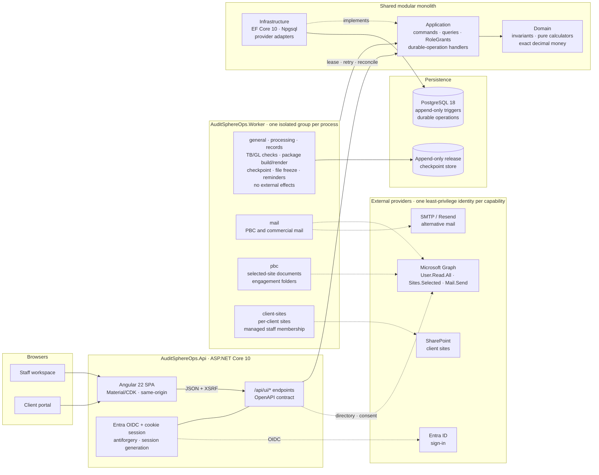

# AuditSphereOps

[](https://dotnet.microsoft.com/)
[](https://www.postgresql.org/)
[](src/AuditSphereOps.Ui/auditsphere-angular-development.md)
[](https://learn.microsoft.com/ef/core/)

**AuditSphereOps** is a professional audit, accounting, and assurance platform — a **.NET 10 modular monolith** (ASP.NET Core API + Angular 22) for CPA firms: engagement lifecycle, practice billing, trial-balance/GL intake, financial-statement production, audit fieldwork and review, controlled package release, records retention, and multi-currency group consolidation.

> **Status:** implementation and focused verification are recorded per slice; whole-product acceptance remains incomplete. [`docs/execution/status.json`](docs/execution/status.json) is the sole authority for test counts, verified SHA, and migration count. Angular is the canonical UI (Blazor host retired, see [removal gate](docs/migration/auditsphere-migration-blazor-removal-readiness.md)); migration acceptance is `NOT_READY`. Live Entra/Graph/release gates are `BLOCKED_EXTERNAL` — never fake-passed. Purview/eSignature providers are out of scope.

## Financial boundaries

Three isolated domains — enforced in Domain, services, and database. Import-first platform, not an operational client ERP (no payroll execution, payment initiation, or external tax filing).

1. **Firm books** (`Practice/FirmLedger`) — billing, WIP time, invoices, receipts, immutable firm ledger.
2. **Client workspace** (`Accounting/`) — TB/GL imports, charts, mappings, adjustments, reconciliations, statements, client FX remeasurement.
3. **Group consolidation** (`Consolidation/`) — approved component packs, eliminations, FX translation. Never mutates component books.

## Architecture



Live groups (`mail`, `pbc`, `client-sites`) compose in Production only when listed in `Worker:ApprovedLiveGroups`. Each one mounts only its own certificate. Core groups never carry external effects.

Reference direction: `Domain → nothing; Application → Domain; Infrastructure → Application, Domain; Api/Worker → all`. Details: [current architecture](docs/architecture/auditsphere-architecture-current-architecture.md) · [code map](docs/architecture/auditsphere-architecture-code-map.md) · [enterprise target (PROPOSED)](docs/architecture/auditsphere-architecture-specification-enterprise-target-proposed.md). Routes: `src/AuditSphereOps.Ui/src/app/app.routes.ts`.

## Record-to-Report modules (20–26)

Native R2R lifecycle under [`docs/task_breakdown`](docs/task_breakdown/auditsphere-r2r-index-task-breakdown.md):

| Module | Scope |
|---|---|
| **20 — Workspace setup** | Client profiles, fiscal calendars, reporting periods, books, versioned charts, dimensions, taxonomy overlays. |
| **21 — TB & GL intake** | Streaming CSV/XLSX intake, deterministic sealing, resumable GL batches, opening/movement completeness. |
| **22 — Adjustments** | Draft journals, revision guards, dual-role decisions, reviewer-gated posting with separation of duties. |
| **23 — Reconciliations & schedules** | Bank/AR-AP proofs, ECL matrix, NRV valuations, specialist schedules (PPE, loans, equity, tax, cash). |
| **24 — Statements & taxonomy** | Chart-to-taxonomy mapping reviews, deterministic statement calculators. |
| **25 — Package assembly** | Versioned packs, durable worker builds, exact-byte formula-free XLSX/PDF artifacts, review decisions. |
| **26 — Consolidation & FX** | Perimeter scope, component pins, intercompany matching/elimination, IAS 21 translation. |

## Stack & layout

.NET 10 / C# 14 · EF Core 10 + Npgsql · PostgreSQL 18.6 (local port `5433`) · Angular 22 + Material/CDK · OpenXML + PDFsharp/MigraDoc · xUnit + Playwright.

```text
src/AuditSphereOps.{Domain,Application,Infrastructure,Api,Ui,Worker}/
tests/AuditSphereOps.{Domain,Api,E2E}.Tests/   docs/ (index · requirements · architecture · task_breakdown · testing · execution)
scripts/db/  global.json  Directory.Packages.props
```

## Quickstart

```bash
dotnet --version            # expect 10.0.300
dotnet tool restore         # pinned dotnet-ef
dotnet restore AuditSphereOps.slnx --locked-mode
npm --prefix src/AuditSphereOps.Ui ci   # Node version per src/AuditSphereOps.Ui/.nvmrc
```

```bash
# macOS (Homebrew) — user-local cluster on :5433, trust auth on loopback
pg_ctl -D /opt/homebrew/var/postgresql@18 -o "-p 5433" start
scripts/db/restore-drill.sh
# Windows — scripts\db\status.ps1 (ensure DBs) · start.ps1 · stop.ps1
```

```bash
./scripts/agent-check --list
./scripts/agent-check <capability> --run   # focused cohort only; full suites run in CI
```

```bash
# Normal development: two terminals; no Angular production bundle needed.
scripts/dev/backend-watch.sh
npm --prefix src/AuditSphereOps.Ui start
# Open http://localhost:4200/ui/app. Reuse an existing backend on :5100.
# Release publication remains a separate CI/operator workflow.
```

Per-test isolation: uniquely named disposable PostgreSQL schemas on `auditsphere_tests`; no InMemory fallback. Full regressions run in `release-verification.yml` on an immutable SHA — never locally after each edit. UI build/run details: `src/AuditSphereOps.Ui/auditsphere-angular-development.md`.

## Invariants

- **Scoped auth everywhere** — `FIRM_WIDE · CLIENT · ENGAGEMENT · GROUP` RoleGrants on every command/query/route; Angular `can*` flags are presentation only.
- **Append-only evidence** — sealed datasets, posted journals, approvals, and releases enforced by Postgres triggers/constraints.
- **Exact money** — `numeric(19,6)` + C# `decimal`; pure deterministic calculators (no EF, clocks, or I/O).
- **Fail closed** — missing rates, unapproved perimeters, or stale evidence block release; humans make all audit opinions.
- **Least-privilege M365** — `Sites.Selected` + per-site grants; no tenant-wide scopes ([permission boundary](docs/architecture/auditsphere-m365-tenant-administration-permissions.md)).
- **Zero-warning Release builds**; `docs/execution/status.json` + current-slice handoff record only observed facts.

## Product roadmap and feature checklist

This is a navigation and implementation roadmap, not a production-readiness certificate. **☑ Completed** means the named bounded slice has recorded implementation/verification evidence; **☐ Partially pending** means implementation exists but integration, current acceptance or an approval remains; **☐ Pending** means the named remaining deliverable is not closed. An unchecked feature is not necessarily absent. Historical checks do not establish current whole-product acceptance.

The [product crosswalk](docs/execution/auditsphere-execution-tracker-practice-management-v22-crosswalk-current.md), [API/Angular parity tracker](docs/execution/auditsphere-execution-tracker-api-angular-parity-current.md), [task board](docs/execution/auditsphere-execution-index-task-board-current.md) and [evidence ledger](docs/execution/status.json) own detailed criteria, dependencies and verification. Requirement IDs in different backlogs are distinct. README does not override their acceptance gates.

### Modules and remaining delivery

| Checklist | Module / capability | Available implementation | Remaining work |
| --- | --- | --- | --- |
| ☐ Partially pending | Practice & commercial | Leads, client profiles/contacts, quotes, pricing, proposals, fee agreements and activation | Complete commercial acceptance, approved layouts/policy and provider delivery evidence. |
| ☐ Partially pending | Workflow & tasks | Seven-phase workspace, eleven derived lifecycle states, expandable task checklists, operational due dates, saved Audit Plan milestones, role-authorized actions, templates with source-bound evidence prerequisites, bounded versioned dependencies, reviewed reminder rules and windows, queues, exact-pinned-template Required/Optional task labels and an NR-12 feature-off matrix; task- and edge-bound overflow reject atomically and Angular pins the 403 unavailable state | Approved/versioned jurisdictional source mapping and legal validation, remaining required-task graph semantics, broader recurrence/automation acceptance, remaining switch-off browser checks, broad role/accessibility acceptance. |
| ☐ Partially pending | Client collaboration | First sign-in, scoped PBC requests/uploads, comments, financial-package review, and portal invoices with separate posted/sent, recorded cash, credit, approved due-date and UTC aging states | Shared write-gate acceptance, exact accepted evidence sets, client-role browser acceptance and invoice-specific provider-delivery evidence. Invoice delivery remains explicitly untracked. |
| ☐ Partially pending | People & time | Staffing, resource grid, recorded leave/training/public-holiday detail, phase/risk-attributed allocations, assigned-task time entry, budgets, rates and utilization | Broader role, responsive/accessibility, resource/time and current-release acceptance. |
| ☐ Partially pending | Firm finance | Protected billing, fee settlements, receipt allocations, expenses, firm ledger, aging, WIP and profitability | Full financial workflow acceptance; firm pricing and end-of-service professional configuration. |
| ☐ Partially pending | Client accounting — modules 20–23 | Setup, charts, periods, TB/GL, mappings, adjustments, reconciliations and specialist schedules | Complete source/review/correction workflows and professionally approved fixtures. |
| ☐ Partially pending | Financial reporting — modules 24–25 | Statements, comparatives, cash/equity schedules, disclosures, package builds and PDF/DOCX/XLSX | Approved indirect classifications, complete source-backed schedules/composition and release acceptance. |
| ☐ Partially pending | Group consolidation — module 26 | Groups/scopes, ownership, component packs, intercompany matching, eliminations and FX | Current authorization/concurrency/browser acceptance and approved methodology. |
| ☐ Partially pending | Audit planning & execution | Programs, materiality/risk, procedures, sampling, confirmations, workpapers and review | Qualified methodology decisions, terminal evidence mapping and complete review journeys. |
| ☐ Partially pending | Completion, release & records | SRM/readiness, human decisions, report artifacts, sealing, signing hooks and archive lineage | Signing/legal policy, authoritative-store/provider acceptance and independent release review. |
| ☐ Partially pending | Administration & security | Initial setup, users/grants, tenant capabilities, search, operations and progress | Whole-application isolation/revocation acceptance and operator readiness. |
| ☐ Partially pending | Microsoft 365 & client sites | Isolated identities/workers, selected-resource verification, per-client site provisioning and managed staff reconciliation | Approved rollout, live tenant positive/negative validation and production acceptance. |
| ☐ Partially pending | Knowledge library | Technical pages and reusable audit-program library | Current authorization, authoring and workflow acceptance. |
| ☐ Partially pending | Platform & durable operations | ASP.NET Core API, Angular, PostgreSQL, retries, idempotency and reconciliation | Current-SHA full CI, recovery/capacity/observability and deployment acceptance. |
| ☐ Pending | Professional acceptance | Human review gates are retained | Named qualified methodology owner and independent reviewer approve applicable policies/fixtures. |
| ☐ Pending | Production acceptance | Acceptance deployment and earlier live evidence are recorded separately | Applicable live identity/provider checks, custody, restore/RPO/RTO and independent sign-off. |

### Completed bounded slices

**☑ applies only to each named slice.** Parent modules remain partial. Focused
checks and historical browser evidence do not replace current-source full CI,
human screen-reader/native zoom review, professional approval or live-provider
acceptance. Exact results and source revisions live in the [evidence ledger](docs/execution/status.json).

| Checklist | Completed slice | Evidence / important limit |
| --- | --- | --- |
| ☑ Completed | Angular host; legacy Blazor host removal | Whole-application migration/parity acceptance remains partial. |
| ☑ Completed | Brand-adjacent expand/compact sidebar; client mobile shell | Both sidebar states browser-checked; synthetic client request covers keyboard opening, focus wrap and Escape at narrow width, with no staff navigation links. Server isolation remains separately verified. |
| ☑ Completed | Journal/evidence/sampling preview keyboard flows | Component/recovery and populated browser checks cover preview focus, delayed-response focus preservation, cancel return, fresh assent and narrow reflow. Evidence recording stays disabled before assent; no human decision was recorded. Unknown/stale and full rendered matrices remain open. |
| ☑ Completed | Consolidation journal draft controls and retained-match scrolling | Add/remove focus recovery and narrow layout checked; arrow scrolling retains table focus and reveals signed amounts and maker/checker context. |
| ☑ Completed | Task prerequisites, source/review context and pinned Required/Optional labels | Labels are informational, derived from exact template revision/step; manual tasks stay unlabeled. Angular covers positive labels; browser checked manual state only. No completion/lifecycle approval gate is implied. |
| ☑ Completed | Atomic workflow graph bounds | Over-limit plans/edges and already-over-limit graphs reject changes atomically. Exact bounds and regression evidence remain in the ledger. |
| ☑ Completed | Net-allocated advance cash gate; expense paging/recovery; monthly P&L date boundaries | Full commercial, receipts, reporting and export acceptance remains open. |
| ☑ Completed | Resource range/capacity and phase/risk allocation | Exact reviewed identity, retry recovery, legacy visibility and aggregate weekly capacity covered; saved leave/training/holiday intervals shown as planning inputs. Broader date-boundary/role acceptance remains open. |
| ☑ Completed | Certification source rules, immutable review and expiry disclosure | Verification is distinct from expiry. PostgreSQL race check proves revocation blocks a waiting higher-level assignment without writing assignment, receipt or grant. Broader concurrency acceptance remains open. |
| ☑ Completed | Purchase-invoice AP preview recovery and supplier purchase/credit flow | Focused local journeys pass; full accounting acceptance remains separate. |
| ☑ Completed | Assigned-task preparer time entry; narrow Time pagination | Domain/API cover assigned acceptance and unassigned denial; authorized managers may route unassigned work. Browser covers wrapping, refresh, pagination and skip-link focus; viewport E2E guard passed. |
| ☑ Completed | Saved Audit Plan milestones and budget-review keyboard flow | Saved dates covered by Angular; browser checked explicit empty milestones. Budget preview/cancel/reopen require fresh assent; both route recovery variants pass, with no browser budget preparation. Statutory source/legal validation remains open. |
| ☑ Completed | Scoped Debug hot reload | [Development loop](src/AuditSphereOps.Ui/auditsphere-angular-development.md#fast-backend-development-loop) reuses the proxy, avoids repeated restore/production bundling and refuses an occupied API port; focused launcher/restart probes pass. |
| ☑ Completed | Entra registration, certificate and exact-role reconciliation; enrollment observer | Offline checks cover exact IDs, signed approval, uncertain creation, certificate overlap and current session. [Operator procedure](docs/operations/auditsphere-entra-registration-automation.md); live consent/custody/runtime gates remain open. |
| ☑ Completed | M365 plan permission boundaries and selected-document-site probe | Capability roles/resources, isolated certificates, redirect origins and incompatible Exchange models checked offline; exact site ownership/write grant and separate DOCUMENTS runtime probe include negative control. Simulations do not prove tenant acceptance. |
| ☑ Completed | Client-site review/local-intent API and worker safeguards | Administrator, stale-authority and persisted-cutoff checks have focused Application/API evidence. Existing worker owns effects/receipts, rechecks authority and preserves uncertain-create fences; queued requests are not provider success. |
| ☑ Completed | Group report review-currentness guard | Returned component-package reviews block new runs and current report claims; final group authorization is rechecked. Focused regressions preserve historical runs and deny raw client artifacts to group-only readers. Broader release acceptance remains open. |
| ☑ Completed | Per-component pinned-source currentness | Server-derived current/stale/unavailable states are separate from approval; focused Domain, Angular and owned browser checks pass. No newest-upload rule, re-pin or component-book write is introduced. Broader group-report/release acceptance remains open. |
| ☑ Completed | Managed-only site membership removal and residual auditing | Unmanaged access is preserved; residual references retained in receipts/audit. Focused provider/PostgreSQL checks pass. |
| ☑ Completed | Autonomous evidence integrity | Supervisor checks hashes/size and refuses missing, changed or symlinked evidence. Existing checkpoints still need attributable revalidation. |
| ☑ Completed | Client-site CLI intent/status integration — offline engineering | Signed approval, current session/CSRF, bounded polling and exact worker receipts have focused offline evidence. The duplicate provider path is removed; current-source CI and live tenant acceptance remain separate. |
| ☐ Partially pending | Development performance/configured startup | Warm compilation is incremental; identity/database readiness, cold-cache/frontend comparisons and session/CSRF acceptance remain open. No overall speedup claimed. |

### Angular quality and accessibility follow-up

| Checklist | Work item | Remaining acceptance |
| --- | --- | --- |
| ☐ Partially pending | Strict typing, bounded feature-state extraction, command lifetime guards, conventions and lean lint integration | Implementation and focused checks are recorded in the [evidence ledger](docs/execution/status.json). The [accessibility checklist](docs/testing/auditsphere-testing-checklist-angular-accessibility-current.md) still requires remaining rendered workflow states, native browser zoom and knowledgeable human screen-reader evidence; current-source full CI remains a separate gate. |

### Available screens

All groups remain **partially pending** for full feature acceptance. Links identify
implemented screens, not proof that every action has an adapter. Shared remaining
gate: owning product/parity criteria and current end-to-end acceptance. Route
aliases are consolidated from the [route registry](src/AuditSphereOps.Ui/src/app/app.routes.ts).

<details>
<summary>Browse implemented screens by module</summary>

| Module | Screens | Additional acceptance notes |
| --- | --- | --- |
| Administration & operations | [Administration](src/AuditSphereOps.Ui/src/app/features/admin/overview.ts) · [Initial administrator setup](src/AuditSphereOps.Ui/src/app/features/admin/bootstrap.ts) · [Microsoft tenant connection](src/AuditSphereOps.Ui/src/app/features/admin/tenant.ts) · [Operations](src/AuditSphereOps.Ui/src/app/features/admin/operations.ts) · [Project task progress](src/AuditSphereOps.Ui/src/app/features/admin/progress.ts) · [Users & Access](src/AuditSphereOps.Ui/src/app/features/admin/access.ts) | Shared gate above. |
| Audit & records | [Audit fieldwork](src/AuditSphereOps.Ui/src/app/features/audit/fieldwork.ts) · [Audit plan](src/AuditSphereOps.Ui/src/app/features/audit/plan.ts) · [Audit program library](src/AuditSphereOps.Ui/src/app/features/audit/library.ts) · [Confirmations](src/AuditSphereOps.Ui/src/app/features/audit/confirmations.ts) · [Engagement completion](src/AuditSphereOps.Ui/src/app/features/audit/completion.ts) · [Finding](src/AuditSphereOps.Ui/src/app/features/audit/records.ts) · [Population](src/AuditSphereOps.Ui/src/app/features/audit/records.ts) · [Records archive](src/AuditSphereOps.Ui/src/app/features/audit/records.ts) · [Release candidate](src/AuditSphereOps.Ui/src/app/features/audit/records.ts) · [Review point](src/AuditSphereOps.Ui/src/app/features/audit/records.ts) · [Workpaper](src/AuditSphereOps.Ui/src/app/features/audit/workpaper.ts) | Shared gate above. |
| Client accounting & reporting | [Accounting](src/AuditSphereOps.Ui/src/app/features/accounting/workspace.ts) · [Accounting evidence](src/AuditSphereOps.Ui/src/app/features/accounting/evidence.ts) · [Accounting mapping](src/AuditSphereOps.Ui/src/app/features/accounting/mapping.ts) · [Accounting period](src/AuditSphereOps.Ui/src/app/features/accounting/period.ts) · [Adjustment journal](src/AuditSphereOps.Ui/src/app/features/accounting/journal.ts) · [Adjustment journals](src/AuditSphereOps.Ui/src/app/features/accounting/records.ts) · [Adjustment plan eligibility](src/AuditSphereOps.Ui/src/app/features/accounting/adjustment-plans.ts) · [Adjustment plan review](src/AuditSphereOps.Ui/src/app/features/accounting/adjustment-plans.ts) · [Analysis evidence](src/AuditSphereOps.Ui/src/app/features/accounting/analysis-review.ts) · [Audit differences](src/AuditSphereOps.Ui/src/app/features/accounting/records.ts) · [Build financial package](src/AuditSphereOps.Ui/src/app/features/engagements/financial-package-build.ts) · [Currency remeasurement](src/AuditSphereOps.Ui/src/app/features/accounting/remeasurement.ts) · [FX rates & policies](src/AuditSphereOps.Ui/src/app/features/accounting/currency-configuration.ts) · [Finalize adjustment plan](src/AuditSphereOps.Ui/src/app/features/accounting/plan-command.ts) · [Financial statement package](src/AuditSphereOps.Ui/src/app/features/accounting/package.ts) · [Financial statements](src/AuditSphereOps.Ui/src/app/features/engagements/statements.ts) · [General ledger](src/AuditSphereOps.Ui/src/app/features/engagements/general-ledger.ts) · [General ledger completeness](src/AuditSphereOps.Ui/src/app/features/accounting/gl-completeness.ts) · [General ledger source acceptance](src/AuditSphereOps.Ui/src/app/features/accounting/source-acceptance.ts) · [General ledger upload](src/AuditSphereOps.Ui/src/app/features/engagements/gl-upload.ts) · [Independent mapping review](src/AuditSphereOps.Ui/src/app/features/accounting/mapping-approval.ts) · [Journal management evidence](src/AuditSphereOps.Ui/src/app/features/accounting/journal-management.ts) · [Mappings](src/AuditSphereOps.Ui/src/app/features/accounting/records.ts) · [Package reviews](src/AuditSphereOps.Ui/src/app/features/accounting/reviews.ts) · [Period restatements](src/AuditSphereOps.Ui/src/app/features/accounting/restatements.ts) · [Period roll-forward](src/AuditSphereOps.Ui/src/app/features/accounting/rollforward.ts) · [Prepare adjustment plan](src/AuditSphereOps.Ui/src/app/features/accounting/plan-command.ts) · [Prepare analytical review](src/AuditSphereOps.Ui/src/app/features/accounting/analytical-preparation.ts) · [Prepare journal](src/AuditSphereOps.Ui/src/app/features/accounting/journal-create.ts) · [Prepare mapping version](src/AuditSphereOps.Ui/src/app/features/accounting/mapping-draft.ts) · [Prepare reconciliation](src/AuditSphereOps.Ui/src/app/features/accounting/reconciliation-create.ts) · [Prepare specialist schedule](src/AuditSphereOps.Ui/src/app/features/accounting/specialist-preparation.ts) · [Prepare valuation](src/AuditSphereOps.Ui/src/app/features/accounting/valuation-preparation.ts) · [Reconciliation evidence](src/AuditSphereOps.Ui/src/app/features/accounting/reconciliation.ts) · [Review accounting evidence](src/AuditSphereOps.Ui/src/app/features/accounting/evidence-actions.ts) · [Source acceptance](src/AuditSphereOps.Ui/src/app/features/accounting/source-acceptance.ts) · [Trial balance intake](src/AuditSphereOps.Ui/src/app/features/engagements/tb-intake.ts) | Shared gate above. |
| Client portal | [Client portal](src/AuditSphereOps.Ui/src/app/features/portal/home.ts) · [Billing and payment receipts](src/AuditSphereOps.Ui/src/app/features/portal/finance.ts) · [Document request](src/AuditSphereOps.Ui/src/app/features/portal/request.ts) · [Journal management response](src/AuditSphereOps.Ui/src/app/features/accounting/journal-management.ts) · [Management review](src/AuditSphereOps.Ui/src/app/features/portal/package.ts) | Invoice lifecycle, net recorded cash, issued credits, approved due date and UTC aging are projected separately; provider delivery is not tracked. Client-role browser and current release acceptance remain open. |
| Firm finance | [End-of-service provision](src/AuditSphereOps.Ui/src/app/features/finance/end-of-service.ts) · [Fee settlements](src/AuditSphereOps.Ui/src/app/features/finance/fee-settlements.ts) · [Firm books](src/AuditSphereOps.Ui/src/app/features/finance/books.ts) · [Firm ledger](src/AuditSphereOps.Ui/src/app/features/finance/ledger.ts) · [Firm receivables ageing](src/AuditSphereOps.Ui/src/app/features/finance/receivables-aging.ts) · [Invoice](src/AuditSphereOps.Ui/src/app/features/finance/invoice.ts) | Shared gate above. |
| Group consolidation | [Advanced consolidation](src/AuditSphereOps.Ui/src/app/features/consolidation/advanced.ts) · [Consolidation scope workspace](src/AuditSphereOps.Ui/src/app/features/consolidation/scope-workspace.ts) · [Group consolidation](src/AuditSphereOps.Ui/src/app/features/consolidation/overview.ts) | Shared gate above. |
| Knowledge library | [Technical library](src/AuditSphereOps.Ui/src/app/features/library/library.ts) | Shared gate above. |
| People & time | [Charge-out rates](src/AuditSphereOps.Ui/src/app/features/practice/rate-cards.ts) · [Resource planning](src/AuditSphereOps.Ui/src/app/features/practice/resources.ts) · [Time & work records](src/AuditSphereOps.Ui/src/app/features/practice/time.ts) | Phase/risk lines, aggregate capacity and exact saved availability entries have focused Domain, Angular and E2E evidence; broad role, responsive/accessibility and release acceptance remain. |
| Practice & commercial | [Acceptance](src/AuditSphereOps.Ui/src/app/features/acceptance/checklist.ts) · [Add client contact](src/AuditSphereOps.Ui/src/app/features/clients/contact-create.ts) · [Client acceptance](src/AuditSphereOps.Ui/src/app/features/acceptance/assessment-route.ts) · [Client profile](src/AuditSphereOps.Ui/src/app/features/clients/client.ts) · [Commercial settings](src/AuditSphereOps.Ui/src/app/features/commercial/settings.ts) · [Convert prospect](src/AuditSphereOps.Ui/src/app/features/commercial/client-conversion.ts) · [Create blocked engagement](src/AuditSphereOps.Ui/src/app/features/clients/engagement-create.ts) · [Engagement](src/AuditSphereOps.Ui/src/app/features/engagements/engagement.ts) with a seven-phase saved-milestone workflow · [Leads](src/AuditSphereOps.Ui/src/app/features/commercial/leads.ts) · [Opportunities](src/AuditSphereOps.Ui/src/app/features/commercial/opportunities.ts) · [PBC requests](src/AuditSphereOps.Ui/src/app/features/engagements/pbc.ts) · [Portfolio](src/AuditSphereOps.Ui/src/app/features/portfolio/portfolio.ts) · [Practice analytics](src/AuditSphereOps.Ui/src/app/features/practice/analytics.ts) · [Proposal](src/AuditSphereOps.Ui/src/app/features/commercial/proposal.ts) · [Review activation](src/AuditSphereOps.Ui/src/app/features/engagements/activation.ts) | Approved/versioned jurisdictional milestone source mapping, role/accessibility and current end-to-end acceptance. |
| Workflow & tasks | [My work](src/AuditSphereOps.Ui/src/app/features/practice/work-queue.ts) · [Reminder rules](src/AuditSphereOps.Ui/src/app/features/practice/reminder-rules.ts) · [Workflow templates](src/AuditSphereOps.Ui/src/app/features/practice/workflow-templates.ts) | Shared gate above. |

</details>

Purview/eSignature provider integrations, payment initiation and payroll execution remain outside approved scope; they are not pending roadmap commitments.

## Docs

Start at [`docs/auditsphere-docs-index.md`](docs/auditsphere-docs-index.md), then [`AGENTS.md`](AGENTS.md).

| Doc | Why |
|---|---|
| [STE requirements](docs/requirements/auditsphere-accounting-module-requirements-current.md) | Commercial/audit-lifecycle contract. |
| [Current architecture](docs/architecture/auditsphere-architecture-current-architecture.md) | Binding monolith structure and guards. |
| [Testing strategy](docs/testing/auditsphere-testing-strategy-definition-of-done-current.md) | Local-vs-CI verification rules. |
| [status.json](docs/execution/status.json) | Machine-readable progress and evidence. |
| [Current slice](docs/execution/auditsphere-execution-current-slice.md) | Active runbook and verified state. |

## Contributing

1. Read the STE requirements, current architecture, and `AGENTS.md` first.
2. One coherent vertical slice at a time; never weaken auth, ledger, or append-only controls.
3. Prove with targeted tests on local PostgreSQL (`0 Warning(s)`); record only observed facts. Never add MediatR, second ERPs, brokers, microservices, or autonomous audit-opinion engines.
