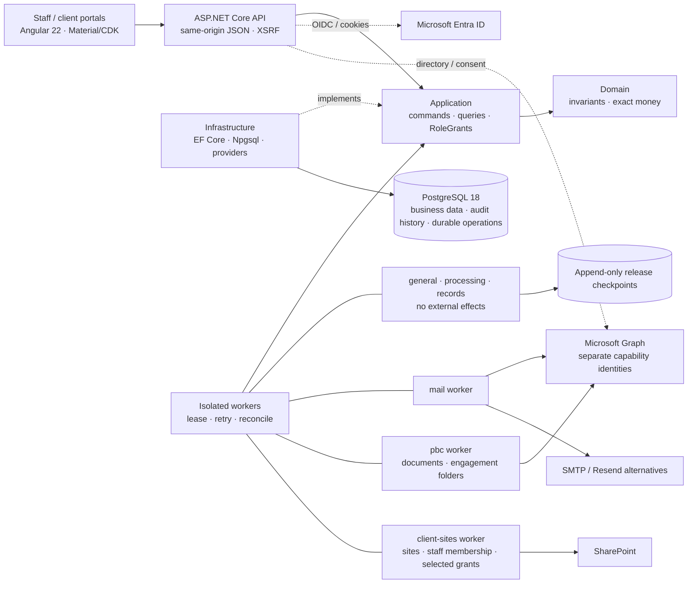

# AuditSphereOps

[](https://dotnet.microsoft.com/)
[](https://www.postgresql.org/)
[](src/AuditSphereOps.Ui/auditsphere-angular-development.md)
[](https://learn.microsoft.com/ef/core/)

**AuditSphereOps** is a .NET 10 / Angular 22 modular monolith for audit and accounting firms: client/engagement management, billing, TB/GL intake, financial statements, fieldwork/review, controlled release, records and multi-currency consolidation. Import-first accounting remains the default; native bookkeeping is separately gated.

> **Status:** implementation and focused verification are recorded per slice; whole-product acceptance remains incomplete. [`docs/execution/status.json`](docs/execution/status.json) is the sole authority for test counts, verified SHA, migration count and current-source CI. An earlier green run does not establish the current HEAD. Angular is the canonical UI (Blazor host retired, see [removal gate](docs/migration/auditsphere-migration-blazor-removal-readiness.md)); the removal gate is `NOT_READY` and migration acceptance remains partial. Live Entra/Graph/release gates are `BLOCKED_EXTERNAL` — never fake-passed. Purview/eSignature providers are out of scope.

## Financial boundaries

Three isolated domains — enforced in Domain, services, and database. Import-first remains the default (`EXTERNAL_SOURCE`) unless an explicit, reviewed cutover is approved. Neither mode is an operational client ERP: no inventory/procurement operations, payroll execution, payment initiation, or external tax filing.

1. **Firm books** (`Practice/FirmLedger`) — billing, WIP time, invoices, receipts, immutable firm ledger.
2. **Client workspace** (`Accounting/`) — TB/GL imports, charts, mappings, adjustments, reconciliations, statements and client FX remeasurement; cut-over clients may also use gated native books (journals, counterparties, invoices/credit notes, opening balances and open-item allocations).
3. **Group consolidation** (`Consolidation/`) — approved component packs, eliminations, FX translation. Never mutates component books or client source data.

**Native bookkeeping is separately gated:** existing clients stay `EXTERNAL_SOURCE`. `NATIVE_BOOKKEEPING` needs reviewer access and unconditional client-level `BOOKKEEPING` acceptance; clients with reporting periods cannot cut over inline. Maker/checker applies to client-owned records. Issuance, delivery and official numbering remain open. See the [code map](docs/architecture/auditsphere-architecture-code-map.md#native-client-operational-bookkeeping).

## Architecture



Live groups (`mail`, `pbc`, `client-sites`) keep one isolated process each and compose in Production only when listed in `Worker:ApprovedLiveGroups`; Acceptance uses the same narrow groups. Each mounts only its own certificate. Core groups never carry external effects.

Reference direction: `Domain → nothing; Application → Domain; Infrastructure → Application, Domain; Api/Worker → all`. Details: [current architecture](docs/architecture/auditsphere-architecture-current-architecture.md) · [code map](docs/architecture/auditsphere-architecture-code-map.md) · [enterprise target (PROPOSED)](docs/architecture/auditsphere-architecture-specification-enterprise-target-proposed.md). Routes: `src/AuditSphereOps.Ui/src/app/app.routes.ts`.

## Record-to-Report modules (20–26)

[Module breakdown](docs/task_breakdown/auditsphere-r2r-index-task-breakdown.md): **20** workspace setup (profiles, calendars, periods, books, charts, dimensions, taxonomy); **21** TB/GL intake (CSV/XLSX, sealed/resumable batches, completeness); **22** adjustments (revision guards, independent decisions/posting); **23** reconciliations and specialist schedules (bank, AR/AP, ECL, NRV, PPE, loans, equity, tax, cash); **24** statements/taxonomy; **25** versioned package assembly, durable builds, formula-free XLSX/PDF and reviews; **26** consolidation and FX. Native bookkeeping is a separately gated client-service mode, not another R2R module.

## Stack & layout

.NET 10 / C# 14 · ASP.NET Core 10 · EF Core 10 + Npgsql 10 · PostgreSQL 18.6 (local port `5433`) · Angular 22 + Material/CDK · Node 26.8.1 (`src/AuditSphereOps.Ui/.nvmrc`) · OpenXML + PDFsharp/MigraDoc · xUnit + Playwright.

```text
src/AuditSphereOps.{Domain,Application,Infrastructure,Api,Worker}/
src/AuditSphereOps.Ui/                         Angular 22 same-origin workspace
tests/AuditSphereOps.{Domain,Api,E2E}.Tests/
contracts/                                    checked-in OpenAPI contract
scripts/{agent-check,contracts,db,dev,m365,ui,verification}/
docs/{architecture,requirements,task_breakdown,testing,execution,operations}/
infra/ · wiki/ · global.json · Directory.Packages.props
```

## Quickstart

```bash
dotnet --version            # expect 10.0.300 from global.json
dotnet tool restore         # pinned dotnet-ef
dotnet restore AuditSphereOps.slnx --locked-mode
nvm use "$(cat src/AuditSphereOps.Ui/.nvmrc)"   # Node 26.8.1; skip if already active
npm --prefix src/AuditSphereOps.Ui ci
```

```bash
# macOS (Homebrew) — user-local cluster on :5433, trust auth on loopback
pg_ctl -D /opt/homebrew/var/postgresql@18 -o "-p 5433" start
createdb -h 127.0.0.1 -p 5433 -U postgres auditsphere       # if absent
createdb -h 127.0.0.1 -p 5433 -U postgres auditsphere_tests # if absent
# Apply pinned migrations to the local development database only.
AUDITSPHERE_MIGRATION_CONNECTION='Host=127.0.0.1;Port=5433;Database=auditsphere;Username=postgres' \
  dotnet ef database update --project src/AuditSphereOps.Infrastructure \
  --startup-project src/AuditSphereOps.Api
# Optional loopback restore rehearsal; drops only its generated restore database.
scripts/db/restore-drill.sh
# Windows — scripts\db\status.ps1 (ensure DBs) · start.ps1 · stop.ps1
```

```bash
./scripts/agent-check --list
./scripts/agent-check <capability> --run   # focused cohort only; full suites run in CI
```

```bash
# Normal development: two terminals; no Angular production bundle needed.
scripts/dev/backend-watch.sh
npm --prefix src/AuditSphereOps.Ui start
# Open http://localhost:4200/ui/app. Reuse an existing backend on :5100.
# Release publication remains a separate CI/operator workflow.
```

```bash
# Run only when the affected contract or EF model changes.
bash scripts/contracts/verify-openapi.sh
dotnet ef migrations has-pending-model-changes --project src/AuditSphereOps.Infrastructure \
  --startup-project src/AuditSphereOps.Api --configuration Release
```

Per-test isolation: uniquely named disposable PostgreSQL schemas on `auditsphere_tests`; no InMemory fallback. Full regressions run in `release-verification.yml` on an immutable SHA — never locally after each edit. UI build/run details: `src/AuditSphereOps.Ui/auditsphere-angular-development.md`.

## Invariants

- **Scoped auth everywhere** — `FIRM_WIDE · CLIENT · ENGAGEMENT · GROUP` RoleGrants on every command/query/route; Angular `can*` flags are presentation only.
- **Append-only evidence** — sealed datasets, posted journals, approvals, and releases enforced by Postgres triggers/constraints.
- **Exact money** — `numeric(19,6)` + C# `decimal`; pure deterministic calculators (no EF, clocks, or I/O).
- **Fail closed** — missing rates, unapproved perimeters, or stale evidence block release; humans make all audit opinions.
- **Book isolation** — native client bookkeeping never posts to the firm ledger or consolidation components; consolidation never mutates component books.
- **Least-privilege M365** — separate capability identities and exact-resource grants; no unscoped Graph roles or Entra administrator roles. SharePoint client-site provisioning uses its own owner-approved isolated boundary ([permission boundary](docs/architecture/auditsphere-m365-tenant-administration-permissions.md), [client-site decision](docs/architecture/auditsphere-client-sharepoint-sites-current.md)).
- **Zero-warning Release builds**; `docs/execution/status.json` + current-slice handoff record only observed facts.

## Product roadmap and feature checklist

**☑ Completed** = bounded slice with recorded evidence; **☐ Partially pending** = implementation exists, acceptance/integration remains; **☐ Pending** = deliverable open. These are implementation statuses, not production certification or current whole-product verification.

The [product crosswalk](docs/execution/auditsphere-execution-tracker-practice-management-v22-crosswalk-current.md), [API/Angular parity tracker](docs/execution/auditsphere-execution-tracker-api-angular-parity-current.md), [task board](docs/execution/auditsphere-execution-index-task-board-current.md) and [evidence ledger](docs/execution/status.json) own detailed criteria, dependencies and verification. Requirement IDs in different backlogs are distinct. README does not override their acceptance gates.

### Modules and remaining delivery

| Checklist | Module / capability | Available implementation | Remaining work |
| --- | --- | --- | --- |
| ☐ Partially pending | Practice & commercial | Leads, client profiles/contacts, quotes, pricing, proposals, fee agreements and activation | Complete commercial acceptance, approved layouts/policy and provider delivery evidence. |
| ☐ Partially pending | Workflow & tasks | Seven phases / eleven derived states; checklists, due dates, saved plan milestones, authorized actions, source-bound prerequisites, versioned dependencies, reminders/windows and queues. Pinned Required/Optional labels, NR-12 feature-off matrix, atomic graph bounds and persistent 403 unavailable state | Approved/versioned jurisdictional source mapping and legal validation, remaining required-task graph semantics, broader recurrence/automation acceptance, remaining switch-off browser checks, broad role/accessibility acceptance. |
| ☐ Partially pending | Client collaboration | First sign-in, scoped PBC requests/uploads, comments, financial-package review, and portal invoices with separate posted/sent, recorded cash, credit, approved due-date and UTC aging states | Shared write-gate acceptance, exact accepted evidence sets, client-role browser acceptance and invoice-specific provider-delivery evidence. Invoice delivery remains explicitly untracked. |
| ☐ Partially pending | People & time | Staffing, resource grid, recorded leave/training/public-holiday detail, phase/risk-attributed allocations, assigned-task time entry, budgets, rates and utilization | Broader role, responsive/accessibility, resource/time and current-release acceptance. |
| ☐ Partially pending | Firm finance | Protected billing, fee settlements, receipt allocations, expenses, firm ledger, aging, WIP and profitability | Full financial workflow acceptance; firm pricing and end-of-service professional configuration. |
| ☐ Partially pending | Client accounting — modules 20–23 | Setup, charts, periods, TB/GL, mappings, adjustments, reconciliations and specialist schedules | Complete source/review/correction workflows and professionally approved fixtures. |
| ☐ Partially pending | Native client bookkeeping (gated) | Explicit source-mode cutover, client journals, counterparties, sales/purchase invoices and credit notes, opening balances and open-item allocations | Complete cutover and full bookkeeping acceptance; tax, delivery and official numbering remain partial. |
| ☐ Partially pending | Financial reporting — modules 24–25 | Statements, comparatives, cash/equity schedules, disclosures, package builds and PDF/DOCX/XLSX | Approved indirect classifications, complete source-backed schedules/composition and release acceptance. |
| ☐ Partially pending | Group consolidation — module 26 | Groups/scopes, ownership, component packs, intercompany matching, eliminations and FX | Current authorization/concurrency/browser acceptance and approved methodology. |
| ☐ Partially pending | Audit planning & execution | Programs, materiality/risk, procedures, sampling, confirmations, workpapers and review | Qualified methodology decisions, terminal evidence mapping and complete review journeys. |
| ☐ Partially pending | Completion, release & records | SRM/readiness, human decisions, report artifacts, sealing, signing hooks and archive lineage | Signing/legal policy, authoritative-store/provider acceptance and independent release review. |
| ☐ Partially pending | Administration & security | Initial setup, users/grants, tenant capabilities, search, operations and progress | Whole-application isolation/revocation acceptance and operator readiness. |
| ☐ Partially pending | Microsoft 365 & client sites | Isolated identities/workers, application-role and selected-site grants, per-client site provisioning, managed staff reconciliation and the authenticated intent/status adapter | Mail RBAC runtime/readback and migration support; approved rollout, live tenant positive/negative validation and production acceptance. |
| ☐ Partially pending | Knowledge library | Technical pages and reusable audit-program library | Current authorization, authoring and workflow acceptance. |
| ☐ Partially pending | Platform & durable operations | ASP.NET Core API, Angular, PostgreSQL, retries, idempotency and reconciliation | Current-SHA full CI, recovery/capacity/observability and deployment acceptance. |
| ☐ Pending | Professional acceptance | Human review gates are retained | Named qualified methodology owner and independent reviewer approve applicable policies/fixtures. |
| ☐ Pending | Production acceptance | Acceptance deployment and earlier live evidence are recorded separately | Applicable live identity/provider checks, custody, restore/RPO/RTO and independent sign-off. |

### Completed bounded slices

Parent modules remain partial. Current-source full CI, human accessibility review, professional approval and live-provider acceptance remain separate gates. Exact evidence is in the [ledger](docs/execution/status.json).

| Checklist | Completed slice | Evidence / important limit |
| --- | --- | --- |
| ☑ Completed | Angular host; legacy Blazor host removal | Whole-application migration/parity acceptance remains partial. |
| ☑ Completed | Brand-adjacent expand/compact sidebar; client mobile shell | Browser: both sidebar states; synthetic client mobile keyboard, focus wrap, Escape and no staff links. Server isolation is separate. |
| ☑ Completed | Journal/evidence/sampling preview keyboard flows | Component/browser: preview and delayed-response focus, cancel return, fresh assent, narrow reflow; recording disabled before assent. No human decision recorded. Unknown/stale and full rendered matrices remain open. |
| ☑ Completed | Consolidation journal draft controls and retained-match scrolling | Add/remove focus recovery and narrow layout checked; arrow scrolling retains table focus and reveals signed amounts and maker/checker context. |
| ☑ Completed | Task prerequisites, source/review context and pinned Required/Optional labels | Informational labels pin template revision/step; manual tasks unlabeled. Angular positive labels; browser manual state only. No lifecycle/completion approval implied. |
| ☑ Completed | Atomic workflow graph bounds | Over-limit plans/edges and already-over-limit graphs reject changes atomically. Exact bounds and regression evidence remain in the ledger. |
| ☑ Completed | Net-allocated advance cash gate; expense paging/recovery; monthly P&L date boundaries | Full commercial, receipts, reporting and export acceptance remains open. |
| ☑ Completed | Resource range/capacity and phase/risk allocation | Reviewed identity, retry recovery, legacy visibility, weekly capacity and saved availability inputs covered; broader date/role acceptance open. |
| ☑ Completed | Certification source rules, immutable review and expiry disclosure | Verification is distinct from expiry. PostgreSQL race check proves revocation blocks a waiting higher-level assignment without writing assignment, receipt or grant. Broader concurrency acceptance remains open. |
| ☑ Completed | Purchase-invoice AP preview recovery and supplier purchase/credit flow | Focused local journeys pass; full accounting acceptance remains separate. |
| ☑ Completed | Assigned-task preparer time entry; narrow Time pagination | Domain/API cover assigned acceptance and unassigned denial; authorized managers may route unassigned work. Browser covers wrapping, refresh, pagination and skip-link focus; viewport E2E guard passed. |
| ☑ Completed | Saved Audit Plan milestones and budget-review keyboard flow | Angular saved dates; browser empty milestones and budget preview/cancel/reopen with fresh assent. Both recovery routes pass; browser budget preparation and statutory/legal acceptance open. |
| ☑ Completed | Scoped Debug hot reload | [Development loop](src/AuditSphereOps.Ui/auditsphere-angular-development.md#fast-backend-development-loop) reuses the proxy, avoids repeated restore/production bundling and refuses an occupied API port; focused launcher/restart probes pass. |
| ☑ Completed | Entra registration, certificate, exact application-role grants and enrollment reconciliation | Offline: exact IDs, signed approval, uncertain creation, certificate overlap, exact roles and current session. [Operator procedure](docs/operations/auditsphere-entra-registration-automation.md); no live tenant action or provider acceptance—live consent/custody/runtime gates remain open. |
| ☑ Completed | Mail provider-readback adapter — offline engineering | Exact operator sessions, additive grants, scope membership, sender/control probes and read counters covered offline. Live output, API capability, RBAC runtime and migration acceptance remain separate. |
| ☑ Completed | M365 plan permission boundaries, selected-site write grants and document-resource probe | Capability roles/resources, isolated certificates, redirect origins, incompatible Exchange models and exact selected-site application grants checked offline; the separate DOCUMENTS probe requires positive namespace reads and a known unrelated-site HTTP 403. Simulations do not prove tenant acceptance. |
| ☑ Completed | Client-site review/local-intent API and worker safeguards | Application/API: admin, stale authority and persisted cutoff. Worker owns effects/receipts, rechecks authority and fences uncertain creation; queued ≠ provider success. |
| ☑ Completed | Group report review-currentness guard | Returned component-package reviews block new runs and current report claims; final group authorization is rechecked. Focused regressions preserve historical runs and deny raw client artifacts to group-only readers. Broader release acceptance remains open. |
| ☑ Completed | Statement content-review identities | Displays persisted revision, snapshot, reviewer and review IDs; rechecks read authority after fetch. Focused component/authorization checks and build pass. Approval rules are unchanged; broader currentness/browser acceptance remains open. |
| ☑ Completed | Immutable correction source lineage | Exact scope/component provenance is retained on new scopes; same-group/period checks, immutable pins and safe downgrade are covered. Owned browser handoff/readback preserves the approved source pack/run. No automatic supersession or approval; broader release acceptance open. |
| ☑ Completed | Per-component pinned-source currentness | Server current/stale/unavailable differs from approval; Domain, Angular and owned browser checks pass. No newest-upload rule, re-pin or book write. Broader release acceptance open. |
| ☑ Completed | Managed-only site membership removal and residual auditing | Unmanaged access is preserved; residual references retained in receipts/audit. Focused provider/PostgreSQL checks pass. |
| ☑ Completed | Autonomous evidence integrity | Supervisor checks hashes/size and refuses missing, changed or symlinked evidence. M365 envelopes reject malformed checks and inconsistent read-only mutation counters. Existing checkpoints still need attributable revalidation. |
| ☑ Completed | Client-site CLI intent/status integration — offline engineering | Signed approval, current session/CSRF, bounded polling and exact worker receipts have focused offline evidence. The duplicate provider path is removed; current-source CI and live tenant acceptance remain separate. |
| ☐ Partially pending | Development performance/configured startup | Warm compilation is incremental; identity/database readiness, cold-cache/frontend comparisons and session/CSRF acceptance remain open. No overall speedup claimed. |

**Angular quality/accessibility remains partial:** strict typing, feature-state extraction, command guards and lint have focused evidence. Remaining rendered states, native zoom and human screen-reader review are tracked in the [accessibility checklist](docs/testing/auditsphere-testing-checklist-angular-accessibility-current.md); current-source full CI is separate.

### Screen navigation

Implemented screens cover administration, audit/records, accounting/reporting, gated native bookkeeping, client portal, firm finance, consolidation, knowledge, people/time, commercial and task workflows. Use the [Angular route registry](src/AuditSphereOps.Ui/src/app/app.routes.ts) for routes and the [code map](docs/architecture/auditsphere-architecture-code-map.md) for owning files. A route is not proof of functional parity; the product/parity trackers and current E2E evidence govern acceptance.

Purview/eSignature providers, payment initiation and payroll execution are outside approved scope, not pending commitments.

## Docs

Start at [`docs/auditsphere-docs-index.md`](docs/auditsphere-docs-index.md), then [`AGENTS.md`](AGENTS.md).

| Doc | Why |
|---|---|
| [STE requirements](docs/requirements/auditsphere-accounting-module-requirements-current.md) | Commercial/audit-lifecycle contract. |
| [Current architecture](docs/architecture/auditsphere-architecture-current-architecture.md) | Binding monolith structure and guards. |
| [Code map](docs/architecture/auditsphere-architecture-code-map.md) | Capability-to-file ownership across Domain, Application, Infrastructure, API, Angular and tests. |
| [Testing strategy](docs/testing/auditsphere-testing-strategy-definition-of-done-current.md) | Local-vs-CI verification rules. |
| [Task board](docs/execution/auditsphere-execution-index-task-board-current.md) | Active work, dependencies and blockers. |
| [status.json](docs/execution/status.json) | Machine-readable progress and evidence. |
| [Current slice](docs/execution/auditsphere-execution-current-slice.md) | Active runbook and verified state. |
| [M365 permissions](docs/architecture/auditsphere-m365-tenant-administration-permissions.md) | Least-privilege identity, consent and resource boundary. |
| [M365 automation](docs/operations/auditsphere-entra-registration-automation.md) | Registration, grants, enrollment, selected-site setup and recovery. |

## Contributing

1. Read the STE requirements, current architecture, and `AGENTS.md` first.
2. One coherent vertical slice at a time; never weaken auth, ledger, or append-only controls.
3. Prove with targeted tests on local PostgreSQL (`0 Warning(s)`); record only observed facts. Never add MediatR, second ERPs, brokers, microservices, or autonomous audit-opinion engines.
