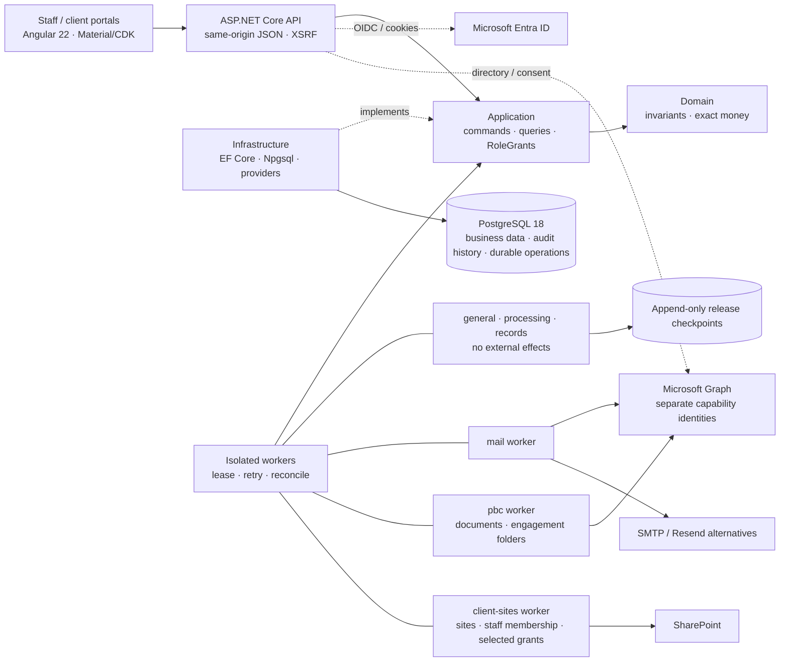

# AuditSphereOps

[](https://dotnet.microsoft.com/)
[](https://www.postgresql.org/)
[](src/AuditSphereOps.Ui/auditsphere-angular-development.md)
[](https://learn.microsoft.com/ef/core/)

**AuditSphereOps** is a .NET 10 / Angular 22 modular monolith for audit and accounting firms: client/engagement management, billing, TB/GL intake, financial statements, fieldwork/review, controlled release, records and multi-currency consolidation. Import-first accounting remains the default; native bookkeeping is separately gated.

> **Status:** whole-product acceptance is incomplete. The [evidence ledger](docs/execution/status.json) owns verified commits, test/migration counts and current-source CI; earlier passes do not verify HEAD. Angular is canonical and the Blazor host is retired, but [migration acceptance](docs/migration/auditsphere-migration-blazor-removal-readiness.md) remains `NOT_READY`. Live Entra/Graph/release acceptance remains `BLOCKED_EXTERNAL`.

## Financial boundaries

Three domains remain isolated in services and persistence:

| Domain | Scope |
| --- | --- |
| Firm books (`Practice/FirmLedger`) | Billing, time/WIP, invoices, receipts and immutable firm ledger. |
| Client accounting (`Accounting/`) | TB/GL, charts, mappings, adjustments, reconciliations, statements and FX; separately gated native journals, counterparties, invoices/credits and opening-item allocations. |
| Consolidation (`Consolidation/`) | Component packs, eliminations and FX translation; never changes client/component books. |

Import-first (`EXTERNAL_SOURCE`) is the default. `NATIVE_BOOKKEEPING` requires reviewer access and unconditional client-level `BOOKKEEPING` acceptance; existing reporting periods prohibit inline cutover. Maker/checker remains mandatory; issuance, delivery and official numbering remain open. See [native bookkeeping](docs/architecture/auditsphere-architecture-code-map.md#native-client-operational-bookkeeping). Inventory/procurement operations, payroll execution, payment initiation, external tax filing and Purview/eSignature providers are outside approved scope.

## Architecture



Live groups (`mail`, `pbc`, `client-sites`) keep one isolated process each and compose in Production only when listed in `Worker:ApprovedLiveGroups`; Acceptance uses the same narrow groups. Each mounts only its own certificate. Core groups never carry external effects.

Reference direction: `Domain → nothing; Application → Domain; Infrastructure → Application, Domain; Api/Worker → all`. Details: [current architecture](docs/architecture/auditsphere-architecture-current-architecture.md) · [code map](docs/architecture/auditsphere-architecture-code-map.md) · [enterprise target (PROPOSED)](docs/architecture/auditsphere-architecture-specification-enterprise-target-proposed.md). Routes: `src/AuditSphereOps.Ui/src/app/app.routes.ts`.

## Record-to-Report modules (20–26)

[Task breakdown](docs/task_breakdown/auditsphere-r2r-index-task-breakdown.md): **20** workspace, charts/dimensions and periods; **21** sealed/resumable TB/GL intake; **22** reviewed adjustments/posting; **23** reconciliations and specialist schedules; **24** statements/taxonomy; **25** versioned packages, durable builds, exports and review; **26** consolidation/FX. Native bookkeeping is a gated service mode, not another R2R module.

## Stack & layout

.NET 10 / C# 14 · ASP.NET Core 10 · EF Core 10 + Npgsql 10 · PostgreSQL 18.6 (local port `5433`) · Angular 22 + Material/CDK · Node 26.8.1 (`src/AuditSphereOps.Ui/.nvmrc`) · OpenXML + PDFsharp/MigraDoc · xUnit + Playwright.

```text
src/AuditSphereOps.{Domain,Application,Infrastructure,Api,Worker}/
src/AuditSphereOps.Ui/                         Angular 22 same-origin workspace
tests/AuditSphereOps.{Domain,Api,E2E}.Tests/
contracts/                                    checked-in OpenAPI contract
scripts/{agent-check,contracts,db,dev,m365,ui,verification}/
docs/{architecture,requirements,task_breakdown,testing,execution,operations}/
infra/ · wiki/ · global.json · Directory.Packages.props
```

## Quickstart

```bash
dotnet --version            # expect 10.0.300 from global.json
dotnet tool restore         # pinned dotnet-ef
dotnet restore AuditSphereOps.slnx --locked-mode
nvm use "$(cat src/AuditSphereOps.Ui/.nvmrc)"   # Node 26.8.1; skip if already active
npm --prefix src/AuditSphereOps.Ui ci
```

```bash
# macOS (Homebrew) — user-local cluster on :5433, trust auth on loopback
pg_ctl -D /opt/homebrew/var/postgresql@18 -o "-p 5433" start
createdb -h 127.0.0.1 -p 5433 -U postgres auditsphere       # if absent
createdb -h 127.0.0.1 -p 5433 -U postgres auditsphere_tests # if absent
# Apply pinned migrations to the local development database only.
AUDITSPHERE_MIGRATION_CONNECTION='Host=127.0.0.1;Port=5433;Database=auditsphere;Username=postgres' \
  dotnet ef database update --project src/AuditSphereOps.Infrastructure \
  --startup-project src/AuditSphereOps.Api
# Optional loopback restore rehearsal; drops only its generated restore database.
scripts/db/restore-drill.sh
# Windows — scripts\db\status.ps1 (ensure DBs) · start.ps1 · stop.ps1
```

```bash
./scripts/agent-check --list
./scripts/agent-check <capability> --run   # focused cohort only; full suites run in CI
```

```bash
# Normal development: two terminals; no Angular production bundle needed.
scripts/dev/backend-watch.sh
npm --prefix src/AuditSphereOps.Ui start
# Open http://localhost:4200/ui/app. Reuse an existing backend on :5100.
# Release publication remains a separate CI/operator workflow.
```

```bash
# Run only when the affected contract or EF model changes.
bash scripts/contracts/verify-openapi.sh
dotnet ef migrations has-pending-model-changes --project src/AuditSphereOps.Infrastructure \
  --startup-project src/AuditSphereOps.Api --configuration Release
```

Per-test isolation: uniquely named disposable PostgreSQL schemas on `auditsphere_tests`; no InMemory fallback. Full regressions run in `release-verification.yml` on an immutable SHA — never locally after each edit. UI build/run details: `src/AuditSphereOps.Ui/auditsphere-angular-development.md`.

## Invariants

- **Server authorization:** current `FIRM_WIDE · CLIENT · ENGAGEMENT · GROUP` grants; UI `can*` flags confer no authority.
- **Immutable evidence:** sealed datasets, postings, approvals and releases retain append-only lineage enforced by PostgreSQL.
- **Accounting integrity:** exact `numeric(19,6)` / C# `decimal`, deterministic calculators and isolated books; no invented rates/balances.
- **Fail closed:** stale/missing evidence or unapproved perimeters block release; authorized humans decide audit opinions.
- **M365 isolation:** per-capability identities, certificates and exact-resource grants; no unscoped Graph/Entra admin roles. Preserve the approved [client-sites exception](docs/architecture/auditsphere-client-sharepoint-sites-current.md).
- **Evidence-led delivery:** zero-warning Release builds; record observed results, not inferred readiness.

## Product roadmap and feature checklist

**☑ Completed** = bounded slice with recorded evidence; **☐ Partially pending** = implementation exists, acceptance/integration remains; **☐ Pending** = deliverable open. These are implementation statuses, not production certification or current whole-product verification.

The [product crosswalk](docs/execution/auditsphere-execution-tracker-practice-management-v22-crosswalk-current.md), [API/Angular parity tracker](docs/execution/auditsphere-execution-tracker-api-angular-parity-current.md), [task board](docs/execution/auditsphere-execution-index-task-board-current.md) and [evidence ledger](docs/execution/status.json) own detailed criteria, dependencies and verification. Requirement IDs in different backlogs are distinct. README does not override their acceptance gates.

### Modules and remaining delivery

| Checklist | Module / capability | Available implementation | Remaining work |
| --- | --- | --- | --- |
| ☐ Partially pending | Practice & commercial | Leads, clients/contacts, pricing, proposals, fees and activation | Commercial acceptance, layouts/policy and provider delivery. |
| ☐ Partially pending | Workflow & tasks | Seven phases / eleven derived states; tasks, milestones, prerequisites, versioned dependencies, reminders and queues; pinned Required/Optional labels, NR-12 off matrix, atomic bounds and persistent 403 state | Jurisdiction/legal mapping, required-task semantics, recurrence/automation, remaining off-state and role/accessibility acceptance. |
| ☐ Partially pending | Client collaboration | Scoped PBC, uploads/comments, package review and invoices; separate posted/sent, cash, credit, approved due-date and UTC aging states | Write-gate/evidence-set acceptance and client browser checks; invoice provider delivery is untracked. |
| ☐ Partially pending | People & time | Staffing/capacity, leave/training/holidays, phase/risk allocation, task time, budgets, rates and utilization | Broader role, responsive/accessibility and current-release acceptance. |
| ☐ Partially pending | Firm finance | Protected billing, settlements, receipts, expenses, ledger, aging, WIP and profitability | End-to-end acceptance; firm pricing and end-of-service professional configuration. |
| ☐ Partially pending | Client accounting — modules 20–23 | Setup, charts/periods, TB/GL, mappings, adjustments, reconciliations and specialist schedules | Source/review/correction workflows and approved fixtures. |
| ☐ Partially pending | Native client bookkeeping (gated) | Cutover, journals, counterparties, sales/purchase invoices/credits, opening balances and allocations | Cutover/full acceptance; tax, delivery and official numbering. |
| ☐ Partially pending | Financial reporting — modules 24–25 | Statements/comparatives, cash/equity, disclosures, packages and PDF/DOCX/XLSX | Indirect classifications, source-backed schedules/composition and release acceptance. |
| ☐ Partially pending | Group consolidation — module 26 | Groups/scopes, ownership, components, intercompany matching, eliminations and FX | Authorization/concurrency/browser acceptance and methodology. |
| ☐ Partially pending | Audit planning & execution | Programs, materiality/risk, procedures, sampling, confirmations, workpapers and review | Methodology, terminal-evidence mapping and complete review journeys. |
| ☐ Partially pending | Completion, release & records | SRM/readiness, human decisions, artifacts, sealing, signing hooks and archive lineage | Secondary-copy provider/shared-site binding, signing/legal policy, custody and independent acceptance. |
| ☐ Partially pending | Administration & security | Setup, users/grants, tenant capabilities, search, operations and progress | Application-wide isolation/revocation acceptance and operator readiness. |
| ☐ Partially pending | Microsoft 365 & client sites | Isolated identities/workers, exact grants, per-client sites, staff reconciliation and authenticated intents/status | Mail RBAC runtime/readback/migration; rollout, live positive/negative probes and acceptance. |
| ☐ Partially pending | Knowledge library | Technical pages and reusable audit programs | Authorization, authoring and workflow acceptance. |
| ☐ Partially pending | Platform & durable operations | API, Angular, PostgreSQL, retries/idempotency and reconciliation | Current-SHA full CI, recovery, capacity, observability and deployment acceptance. |
| ☐ Pending | Professional acceptance | Human review gates are retained | Named qualified methodology owner and independent reviewer approve applicable policies/fixtures. |
| ☐ Pending | Production acceptance | Acceptance deployment and earlier live evidence are recorded separately | Applicable live identity/provider checks, custody, restore/RPO/RTO and independent sign-off. |

### Completed bounded slices

Parent modules remain partial. Current-source full CI, human accessibility review, professional approval and live-provider acceptance remain separate gates. Exact evidence is in the [ledger](docs/execution/status.json).

| Checklist | Completed slices | Verification / remaining limits |
| --- | --- | --- |
| ☑ Completed | Angular host and Blazor retirement; brand-adjacent sidebar toggle; mobile client shell | Sidebar/mobile keyboard, focus wrap and Escape checked; migration/parity and server-isolation acceptance remain separate. |
| ☑ Completed | Journal/evidence/sampling previews; consolidation journal controls and retained-match scrolling | Focus recovery, cancel/reopen, fresh assent, reflow and keyboard scrolling checked; recording off before assent. Unknown/stale matrices and human review remain open. |
| ☑ Completed | Source/review task context, pinned Required/Optional labels and atomic workflow graph bounds | Template revision/step retained; manual tasks unlabeled. Over-limit changes reject atomically. Labels confer no lifecycle/completion approval. |
| ☑ Completed | Net-allocated advance cash gate, expense paging/recovery and monthly P&L date boundaries | Full commercial, receipt, reporting and export acceptance remains open. |
| ☑ Completed | Resource range/capacity, phase/risk allocation and certification evidence | Identity/retry/legacy/availability checks; expiry differs from verification. PG revocation race prevents assignment/receipt/grant writes. Broader role/date/concurrency acceptance open. |
| ☑ Completed | Assigned-task time entry, narrow Time pagination, Audit Plan milestones and budget-review keyboard flow | Assigned allowed/unassigned denied; managers may route work. Saved dates, preview recovery, fresh assent, pagination and skip focus checked; browser budget preparation/legal acceptance open. |
| ☑ Completed | Purchase-invoice preview recovery and supplier purchase/credit flow; accounting mode lock and exact-period navigation | Focused journeys/UI/build checks; known rejection differs from unknown outcome. Accounting currentness summary and full native/browser acceptance open. |
| ☑ Completed | Statement/completion evidence identities, group report review-currentness and per-component pinned-source currentness | Full report/scan/bundle hashes and persisted IDs; read reauthorization, stale/historical distinctions and returned-source guards checked; history retained, group-only raw access denied. No automatic re-pin or book writes; broader reporting/release acceptance open. |
| ☑ Completed | Immutable consolidation correction lineage and unknown-outcome controls | Same-group/period provenance, immutable pins, safe downgrade and owned browser handoff checked. Mutations fenced; refresh is not completion. Exact receipt recovery remains open; no automatic supersession/approval. |
| ☑ Completed | Entra registration/certificates, exact roles, enrollment and mail readback — offline engineering | Signed approvals, exact IDs/session, uncertain creation, certificate overlap, grants/membership, probes, read counts and source-bound snapshots checked. Live consent/custody, API/RBAC runtime and migration acceptance open. |
| ☑ Completed | M365 plan boundaries, selected-site grants, DOCUMENTS probe and readiness inventory — offline engineering | Isolated credentials, redirects, Exchange-model separation and exact grants checked. DOCUMENTS requires namespace reads plus unrelated-site HTTP 403; readiness GETs retain missing-evidence blockers; simulation is not tenant acceptance. |
| ☑ Completed | Client-site local intents/API, CLI status, worker safeguards and managed-only membership reconciliation | Admin/session/CSRF, cutoff, stale authority, bounded polling, uncertain creation and exact receipts checked; duplicate provider path removed. Unmanaged access and residual audit retained. Queued is not provider success; live acceptance separate. |
| ☑ Completed | Scoped Debug hot reload and autonomous evidence integrity | [Development loop](src/AuditSphereOps.Ui/auditsphere-angular-development.md#fast-backend-development-loop) reuses proxy, avoids repeated restore/bundling and refuses occupied ports. Evidence hash/size, symlinks and M365 counters guarded; existing checkpoints need attributable revalidation. |
| ☐ Partially pending | Development performance/configured startup | Warm compilation is incremental; identity/database readiness, cold-cache/frontend comparisons and session/CSRF acceptance remain open. No overall speedup claimed. |

**Angular quality/accessibility remains partial:** strict typing, feature-state extraction, command guards and lint have focused evidence. Remaining rendered states, native zoom and human screen-reader review are tracked in the [accessibility checklist](docs/testing/auditsphere-testing-checklist-angular-accessibility-current.md); current-source full CI is separate.

Screens and owning files: [Angular routes](src/AuditSphereOps.Ui/src/app/app.routes.ts) · [code map](docs/architecture/auditsphere-architecture-code-map.md). Route presence does not establish functional parity.

## Docs

Start at [`docs/auditsphere-docs-index.md`](docs/auditsphere-docs-index.md), then [`AGENTS.md`](AGENTS.md).

| Doc | Why |
|---|---|
| [STE requirements](docs/requirements/auditsphere-accounting-module-requirements-current.md) | Commercial/audit-lifecycle contract. |
| [Current architecture](docs/architecture/auditsphere-architecture-current-architecture.md) | Binding monolith structure and guards. |
| [Code map](docs/architecture/auditsphere-architecture-code-map.md) | Capability-to-file ownership across Domain, Application, Infrastructure, API, Angular and tests. |
| [Testing strategy](docs/testing/auditsphere-testing-strategy-definition-of-done-current.md) | Local-vs-CI verification rules. |
| [Task board](docs/execution/auditsphere-execution-index-task-board-current.md) | Active work, dependencies and blockers. |
| [status.json](docs/execution/status.json) | Machine-readable progress and evidence. |
| [Current slice](docs/execution/auditsphere-execution-current-slice.md) | Active runbook and verified state. |
| [M365 permissions](docs/architecture/auditsphere-m365-tenant-administration-permissions.md) | Least-privilege identity, consent and resource boundary. |
| [M365 automation](docs/operations/auditsphere-entra-registration-automation.md) | Registration, grants, enrollment, selected-site setup and recovery. |

## Contributing

1. Read the STE requirements, current architecture, and `AGENTS.md` first.
2. One coherent vertical slice at a time; never weaken auth, ledger, or append-only controls.
3. Prove with targeted tests on local PostgreSQL (`0 Warning(s)`); record only observed facts. Never add MediatR, second ERPs, brokers, microservices, or autonomous audit-opinion engines.
