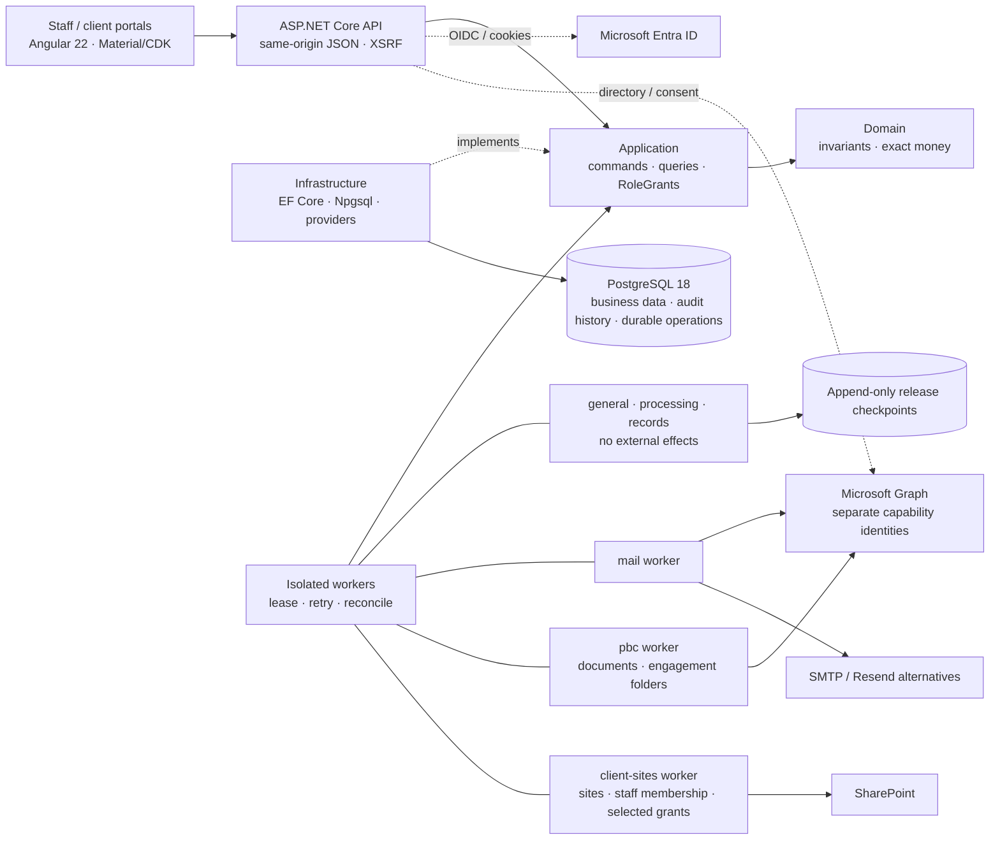

# AuditSphereOps

[](https://dotnet.microsoft.com/)
[](https://www.postgresql.org/)
[](src/AuditSphereOps.Ui/auditsphere-angular-development.md)
[](https://learn.microsoft.com/ef/core/)

**AuditSphereOps** is a .NET 10 / Angular 22 modular monolith for audit and accounting firms: client/engagement management, billing, TB/GL intake, financial statements, fieldwork/review, controlled release, records and multi-currency consolidation. Import-first accounting remains the default; native bookkeeping is separately gated.

> **Status:** whole-product acceptance is incomplete. The [evidence ledger](docs/execution/status.json) owns verified commits, test/migration counts and current-source CI; earlier passes do not verify HEAD. Angular is canonical and the Blazor host is retired, but [migration acceptance](docs/migration/auditsphere-migration-blazor-removal-readiness.md) remains `NOT_READY`. Live Entra/Graph/release acceptance remains `BLOCKED_EXTERNAL`.

## Financial boundaries

| Domain | Owns |
| --- | --- |
| Firm books | Billing, time/WIP, invoices, receipts and immutable firm ledger. |
| Client accounting | TB/GL, charts, mappings, adjustments, reconciliations, statements and FX; gated native bookkeeping. |
| Consolidation | Component packs, eliminations and FX translation; never changes component books. |

`EXTERNAL_SOURCE` is the default. `NATIVE_BOOKKEEPING` requires reviewer access, client-level `BOOKKEEPING` acceptance and controlled cutover; existing periods prohibit inline cutover. Maker/checker remains mandatory. Native issuance, delivery and official numbering remain open. See [bookkeeping boundaries](docs/architecture/auditsphere-architecture-code-map.md#native-client-operational-bookkeeping). Inventory/procurement, payroll execution, payment initiation, external tax filing and Purview/eSignature providers are out of scope.

## Architecture



Live groups (`mail`, `pbc`, `client-sites`) keep one isolated process each and compose in Production only when listed in `Worker:ApprovedLiveGroups`; Acceptance uses the same narrow groups. Each mounts only its own certificate. Core groups never carry external effects.

Reference direction: `Domain → nothing; Application → Domain; Infrastructure → Application, Domain; Api/Worker → all`. Details: [current architecture](docs/architecture/auditsphere-architecture-current-architecture.md) · [code map](docs/architecture/auditsphere-architecture-code-map.md) · [enterprise target (PROPOSED)](docs/architecture/auditsphere-architecture-specification-enterprise-target-proposed.md). Routes: `src/AuditSphereOps.Ui/src/app/app.routes.ts`.

## Stack & layout

.NET 10 / C# 14 · ASP.NET Core · EF Core/Npgsql 10 · PostgreSQL 18.6 · Angular 22 + Material/CDK · Node pinned in `.nvmrc` · OpenXML + PDFsharp/MigraDoc · xUnit + Playwright.

```text
src/AuditSphereOps.{Domain,Application,Infrastructure,Api,Worker}/
src/AuditSphereOps.Ui/                      Angular staff/client workspace
tests/AuditSphereOps.{Domain,Api,E2E}.Tests/
contracts/ · scripts/ · docs/ · infra/ · wiki/
```

[Record-to-Report breakdown](docs/task_breakdown/auditsphere-r2r-index-task-breakdown.md): **20** setup/charts/dimensions/periods; **21** TB/GL intake; **22** adjustments/posting; **23** reconciliations/schedules; **24** statements/taxonomy; **25** packages/exports/review; **26** consolidation/FX. Native bookkeeping is a gated service mode, not another module.

## Quickstart

```bash
dotnet --version            # expect 10.0.300 from global.json
dotnet tool restore         # pinned dotnet-ef
dotnet restore AuditSphereOps.slnx --locked-mode
nvm use "$(cat src/AuditSphereOps.Ui/.nvmrc)"   # Node 26.8.1; skip if already active
npm --prefix src/AuditSphereOps.Ui ci
```

```bash
# macOS (Homebrew) — user-local cluster on :5433, trust auth on loopback
pg_ctl -D /opt/homebrew/var/postgresql@18 -o "-p 5433" start
createdb -h 127.0.0.1 -p 5433 -U postgres auditsphere       # if absent
createdb -h 127.0.0.1 -p 5433 -U postgres auditsphere_tests # if absent
# Apply pinned migrations to the local development database only.
AUDITSPHERE_MIGRATION_CONNECTION='Host=127.0.0.1;Port=5433;Database=auditsphere;Username=postgres' \
  dotnet ef database update --project src/AuditSphereOps.Infrastructure \
  --startup-project src/AuditSphereOps.Api
# Optional loopback restore rehearsal; drops only its generated restore database.
scripts/db/restore-drill.sh
# Windows — scripts\db\status.ps1 (ensure DBs) · start.ps1 · stop.ps1
```

```bash
./scripts/agent-check --list
./scripts/agent-check <capability> --run   # focused cohort only; full suites run in CI
```

```bash
# Normal development: two terminals; no Angular production bundle needed.
scripts/dev/backend-watch.sh
npm --prefix src/AuditSphereOps.Ui start
# Open http://localhost:4200/ui/app. Reuse an existing backend on :5100.
# Release publication remains a separate CI/operator workflow.
```

```bash
# Run only when the affected contract or EF model changes.
bash scripts/contracts/verify-openapi.sh
dotnet ef migrations has-pending-model-changes --project src/AuditSphereOps.Infrastructure \
  --startup-project src/AuditSphereOps.Api --configuration Release
```

Per-test isolation: uniquely named disposable PostgreSQL schemas on `auditsphere_tests`; no InMemory fallback. Full regressions run in `release-verification.yml` on an immutable SHA — never locally after each edit. UI build/run details: `src/AuditSphereOps.Ui/auditsphere-angular-development.md`.

## Engineering safeguards

Server-side current grants (`FIRM_WIDE`, `CLIENT`, `ENGAGEMENT`, `GROUP`), append-only evidence, exact `numeric(19,6)` / `decimal` money, isolated books and fail-closed stale-evidence checks are mandatory. UI flags confer no authority; authorized humans decide opinions and approvals. M365 uses per-capability identities/certificates and exact-resource grants, subject to the approved [client-sites exception](docs/architecture/auditsphere-client-sharepoint-sites-current.md). Record observed evidence; do not infer production readiness.

## Product roadmap and feature checklist

**☑ Completed** means a bounded slice has recorded evidence; **☐ Partially pending** means integration/acceptance remains; **☐ Pending** means an open deliverable. Parent modules remain partial even when individual slices pass.

Detailed criteria and evidence: [product crosswalk](docs/execution/auditsphere-execution-tracker-practice-management-v22-crosswalk-current.md) · [API/Angular parity](docs/execution/auditsphere-execution-tracker-api-angular-parity-current.md) · [task board](docs/execution/auditsphere-execution-index-task-board-current.md) · [ledger](docs/execution/status.json). IDs from separate backlogs are distinct; README does not override acceptance gates.

### Modules and remaining delivery

| Checklist | Module | Implemented / remaining |
| --- | --- | --- |
| ☐ Partially pending | Practice & commercial | Leads, clients/contacts, pricing, proposals, fees, activation. **Open:** acceptance, layouts/policy, provider delivery. |
| ☐ Partially pending | Workflow & tasks | Seven phases / eleven derived states; tasks, milestones, versioned dependencies, reminders, queues, Required/Optional labels, NR-12 off matrix, atomic bounds, persistent 403. **Open:** legal mapping, required-task semantics, recurrence/automation, off-state, role/accessibility acceptance. |
| ☐ Partially pending | Client collaboration | Scoped PBC, uploads/comments, package review, invoices; distinct posted/sent, cash, credit, due-date and UTC aging states. **Open:** write-gate/evidence-set and client browser acceptance; invoice provider delivery untracked. |
| ☐ Partially pending | People & time | Staffing/capacity, leave/training/holidays, phase/risk allocation, task time, budgets, rates, utilization. **Open:** role, responsive/accessibility and release acceptance. |
| ☐ Partially pending | Firm finance | Billing, settlements, receipts, expenses, ledger, aging, WIP, profitability. **Open:** end-to-end acceptance, firm pricing and professional end-of-service configuration. |
| ☐ Partially pending | Client accounting (20–23) | Setup, charts/periods, TB/GL, mappings, adjustments, reconciliations, schedules. **Open:** source/review/correction workflows and approved fixtures. |
| ☐ Partially pending | Native bookkeeping (gated) | Cutover, journals, counterparties, invoices/credits, opening balances/allocations. **Open:** full cutover acceptance, tax, delivery, official numbering. |
| ☐ Partially pending | Financial reporting (24–25) | Statements/comparatives, cash/equity, disclosures, packages, PDF/DOCX/XLSX. **Open:** indirect classifications, source-backed schedules/composition, release acceptance. |
| ☐ Partially pending | Consolidation (26) | Groups/scopes, ownership, components, intercompany matching, eliminations, FX. **Open:** authorization/concurrency/browser acceptance and methodology. |
| ☐ Partially pending | Audit planning & execution | Programs, materiality/risk, procedures, sampling, confirmations, workpapers, review. **Open:** methodology, terminal-evidence mapping, full review journeys. |
| ☐ Partially pending | Completion, release & records | SRM/readiness, human decisions, artifacts, sealing, signing hooks, archive lineage. **Open:** secondary-copy provider/shared-site binding, signing/legal policy, custody, independent acceptance. |
| ☐ Partially pending | Administration & security | Setup, users/grants, tenant capabilities, search, operations, progress. **Open:** application-wide isolation/revocation acceptance and operator readiness. |
| ☐ Partially pending | M365 & client sites | Isolated identities/workers, exact grants, client sites, staff reconciliation, authenticated intents/status. **Open:** mail RBAC runtime/readback/migration, rollout, live positive/negative acceptance. |
| ☐ Partially pending | Knowledge library | Technical pages and reusable programs. **Open:** authorization, authoring, workflow acceptance. |
| ☐ Partially pending | Platform & durable operations | API, Angular, PostgreSQL, retries/idempotency, reconciliation. **Open:** current-SHA full CI, recovery, capacity, observability, deployment acceptance. |
| ☐ Pending | Professional acceptance | Human gates retained; qualified methodology owner and independent reviewer must approve policies/fixtures. |
| ☐ Pending | Production acceptance | Earlier acceptance/live evidence retained separately; live identity/provider, custody, restore/RPO/RTO and independent sign-off remain. |

### Completed bounded slices

Recorded checks below are scoped evidence, not current-source full CI or whole-product acceptance. Exact results and remaining gates live in the [ledger](docs/execution/status.json).

| Checklist | Completed slice | Limits / remaining acceptance |
| --- | --- | --- |
| ☑ Completed | Angular host/Blazor retirement; brand-adjacent sidebar toggle and mobile client shell | Keyboard/focus/Escape checked; migration/parity and server isolation remain open. |
| ☑ Completed | Journal/evidence/sampling previews; consolidation journal controls and retained-match scrolling | Recovery, fresh assent, reflow and keyboard checks; unknown/stale states and human review remain. Recording stays off before assent. |
| ☑ Completed | Source/review task context, pinned Required/Optional labels and atomic graph bounds | Template revision/step retained; manual tasks unlabeled. Labels grant no completion approval. |
| ☑ Completed | Net-allocated advance gate, expense paging/recovery and monthly P&L boundaries | Full commercial, receipt, reporting and export acceptance remains. |
| ☑ Completed | Resource/capacity ranges, phase/risk allocation and certification evidence | Retry/legacy/availability and revocation race checked; broader roles/dates/concurrency remain. Expiry is not verification. |
| ☑ Completed | Assigned-task time, scoped pagination, Audit Plan milestones and budget-review keyboard flow | Assignment denial, dates, preview/fresh assent and skip focus checked; broader browser/legal acceptance remains. |
| ☑ Completed | Purchase/credit flows and preview recovery; accounting-mode lock and exact-period navigation | Known rejection separated from unknown outcome; native/currentness/browser acceptance remains. |
| ☑ Completed | Statement/completion full evidence IDs, release-currentness guards and pinned group/component currentness | Reauthorization, stale/returned sources and retained history checked; group-only raw access denied. No automatic re-pin/book writes; broader release acceptance remains. |
| ☑ Completed | Immutable consolidation correction lineage and unknown-outcome controls | Scoped provenance, immutable pins, safe downgrade and owned browser handoff checked. Refresh is not completion; exact receipt recovery remains. |
| ☑ Completed | Entra registration/certificates, exact roles, enrollment and mail readback — offline | Approval/session/ID, uncertain creation, overlap, grants, probes and source snapshots checked; live consent/custody, API/RBAC and migration acceptance remain. |
| ☑ Completed | M365 plan/deployment boundaries, selected-site grants, DOCUMENTS probe and readiness inventory — offline | Mounts/export, redirects and Exchange-model separation checked. DOCUMENTS needs namespace reads plus unrelated-site HTTP 403; missing runtime evidence stays blocked. |
| ☑ Completed | Client-site intents/API/CLI status, worker guards and managed-only membership reconciliation | Session/CSRF, cutoff, stale authority, polling, uncertainty and exact receipts checked; unmanaged access/residual audit retained. Queued is not live success. |
| ☑ Completed | Debug hot reload, CI dispatch and autonomous evidence integrity | Proxy reuse/port guards, JSON dispatch, full-CI aggregate, hashes/sizes, symlinks and counters checked; prior checkpoints need attributable revalidation. |
| ☐ Partially pending | Development performance/configured startup | Warm compilation is incremental; readiness, cold-cache/frontend comparisons and session/CSRF acceptance remain. No overall speedup claimed. |

**Angular quality/accessibility remains partial:** typing, state extraction, command guards and lint have focused evidence. Rendered states, native zoom and human screen-reader review remain in the [accessibility checklist](docs/testing/auditsphere-testing-checklist-angular-accessibility-current.md). [Routes](src/AuditSphereOps.Ui/src/app/app.routes.ts) and the code map locate screens; route presence does not prove parity.

## Documentation & contributing

Start with the [docs index](docs/auditsphere-docs-index.md) and [AGENTS.md](AGENTS.md).

| Reference | Purpose |
| --- | --- |
| [STE requirements](docs/requirements/auditsphere-accounting-module-requirements-current.md) | Commercial/audit lifecycle contract. |
| [Architecture](docs/architecture/auditsphere-architecture-current-architecture.md) · [code map](docs/architecture/auditsphere-architecture-code-map.md) | Boundaries and capability/file ownership. |
| [Testing strategy](docs/testing/auditsphere-testing-strategy-definition-of-done-current.md) · [Angular development](src/AuditSphereOps.Ui/auditsphere-angular-development.md) | Focused local checks, full CI and development loop. |
| [Task board](docs/execution/auditsphere-execution-index-task-board-current.md) · [current slice](docs/execution/auditsphere-execution-current-slice.md) · [ledger](docs/execution/status.json) | Dependencies, active runbook and observed verification. |
| [M365 permissions](docs/architecture/auditsphere-m365-tenant-administration-permissions.md) · [CLI automation](docs/operations/auditsphere-entra-registration-automation.md) | Identity/consent/resource boundaries, configuration and recovery. |

Implement one coherent vertical slice; preserve authorization, ledger and append-only controls. Use focused local checks and zero-warning Release compilation where applicable; full regressions belong in CI. No second ERP, brokers, microservices, MediatR or autonomous audit opinions.
