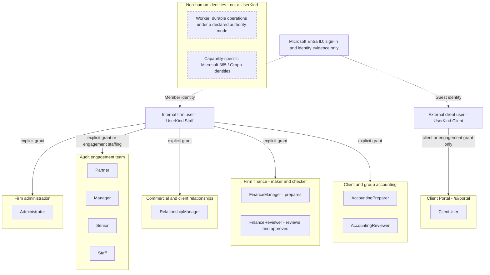
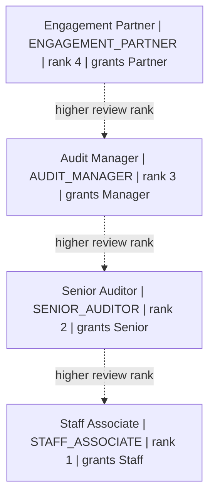
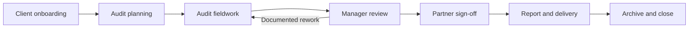
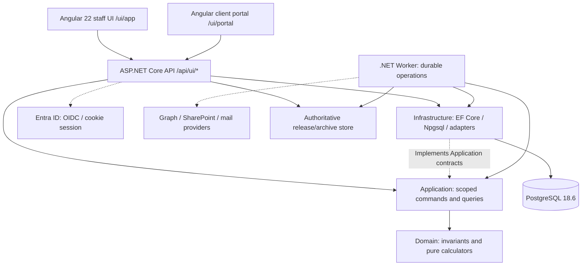

# AuditSphereOps

[](https://dotnet.microsoft.com/)
[](src/AuditSphereOps.Ui/auditsphere-angular-development.md)
[](https://www.postgresql.org/)
[](https://learn.microsoft.com/ef/core/)

**AuditSphereOps** is an audit, accounting, and practice-management platform for accounting firms. It connects client onboarding, engagement management, professional audit work, financial-statement preparation, time and billing, controlled deliverable release, records, and group consolidation within a **.NET modular monolith with an Angular frontend**.

See [User Types, Role Hierarchy & Access Privileges](#user-types-role-hierarchy--access-privileges) below for a summary, and the [detailed roles and privileges reference](docs/architecture/auditsphere-architecture-user-roles-and-privileges-current.md) for guard-level capabilities, grant scopes and approval boundaries.

> **Release status: under active development — not verified as 100% complete or production-ready.** End-to-end acceptance, approved professional policies, live Microsoft 365/SharePoint evidence, operational recovery, and release sign-off remain separate obligations. Do not infer readiness from a route, UI page, focused test, or documentation check. Use the [current execution evidence](docs/execution/status.json), [active handoff](docs/execution/auditsphere-execution-current-slice.md), and [consolidated task board](docs/execution/auditsphere-execution-index-task-board-current.md).
>

## User Types, Role Hierarchy & Access Privileges

AuditSphere uses **explicit, scoped role grants — not a job-title hierarchy or a superuser**. Every protected command and query re-checks, on the server, the current identity, an active grant covering the requested scope, the role list that operation accepts, and its business gates. A person may hold several grants; each is evaluated on its own. Angular navigation and `can*` flags are presentation only.

This section describes **implemented authorization in source code**. It does not claim that every workflow listed below has completed browser, professional or production acceptance (see the release status above).

### User types



Groups show **responsibility areas, not a ranking**; no arrow implies permission inheritance. Signing in, Entra directory membership or an invitation grants **no** AuditSphere role. Disabled users, revoked or expired grants and stale sessions are access states, not further user types. Worker and provider identities execute only their configured operations; they are not interactive administrators or professional approvers.

**Standard role catalogue.** Eleven roles can be assigned through Administration → Users & Access ([`RoleAdministrationService`](src/AuditSphereOps.Application/Security/RoleAdministrationService.cs)): `Administrator`, `Partner`, `Manager`, `Senior`, `Staff`, `RelationshipManager`, `FinanceManager`, `FinanceReviewer`, `AccountingPreparer`, `AccountingReviewer` and `ClientUser`. Internal roles require a staff identity; `ClientUser` requires a client identity and can never be firm-wide. `Staff` and `Client` are the two human `UserKind` values; role names, directory identities and staffing levels are separate concepts.

**Backend-recognized codes (not selectable).** Some Application guards also accept `Reviewer`, `SeniorManager`, `EngagementLeader`, `Auditor`, `Accountant`, `CommercialManager` and `RecordsCustodian`. The standard catalogue cannot assign these additional codes, they are not aliases of a standard role, and a code accepted by one module may be refused by another. See [additional codes](docs/architecture/auditsphere-architecture-user-roles-and-privileges-current.md#additional-codes-recognized-by-selected-backend-guards).

### Engagement staffing hierarchy

Engagement staffing ([`StaffingLevels`](src/AuditSphereOps.Domain/Practice/ResourcePlanning.cs)) uses four levels. Each level maps to one **engagement-scoped** grant for its role (an identical existing grant is reused); revoking the assignment revokes the grant that staffing created and invalidates the user's session.



- **Rank is a review threshold, not inherited permission.** Risk-banded procedures require a minimum preparer, owner and reviewer rank (for example, a red-risk procedure requires Engagement Partner review). The reviewer must still be an authorized, independent person on that engagement.
- **Staffing rules** ([`StaffingService`](src/AuditSphereOps.Application/Practice/StaffingService.cs)): a `Partner`, `Manager` or `Administrator` grant on the engagement is required to staff; nobody staffs themselves or above their own level; an engagement has at most one Engagement Partner; Partner and Manager levels require current, independently reviewed certification evidence; only enabled staff identities can be staffed.
- **Engagement Partner gates:** completion clearance, the opinion decision, signing and bundle assembly accept only the **currently staffed Engagement Partner**. Holding a `Partner` grant without that staffing fails closed.
- Staffing never creates firm-wide or client-wide access and never overrides independence holds, professional-work holds or frozen engagement files.

### Role and privilege matrix

Summaries reflect the role lists accepted by Application guards. "Accepted by" means the role satisfies that operation's role check; the scope, staffing, independence and state gates in the last column still apply.

| User Role | Primary Responsibilities | Permitted Operations | Access Scope | Restrictions / Approval Requirements |
| --- | --- | --- | --- | --- |
| `Administrator` | Firm access governance and application configuration | **Administer:** verify users, grant/replace/revoke roles with preview and reason, copy invitations, view access history, configure the Microsoft 365 connection. **Configure:** workflow templates, reminder rules and pricing rules (shared with Partner). **Also accepted by** staffing, resource planning and many audit and client-accounting preparation/review guards, release approval/release recording and records-archive custody. | User administration and M365 configuration require a **`FIRM_WIDE`** Administrator grant; other operations follow their own scope | No self-elevation or privileged self-change; the last firm administrator cannot be removed without a replacement. **Not accepted** by Partner-only gates (acceptance decisions, engagement activation, Partner-stage package approval, Engagement Partner sign-off) or by firm billing/ledger **commands**. Explicitly registered finance/consolidation reads allow audited, read-only Administrator oversight; action and raw-document permissions remain separate. Grants no Entra role. |
| `Partner` | Professional leadership, acceptance and sign-off | **Approve:** client-acceptance decisions, engagement activation, Partner-stage financial-package approval, audit-programme ownership and applicability. **As staffed Engagement Partner:** completion clearance, opinion decision, signing and bundle assembly. **Review:** procedures, review notes, confirmations, time approval. **Prepare/manage:** planning, staffing, commercial records, client accounting, consolidation, release, records custody. | `CLIENT` or `ENGAGEMENT` grants or staffing; `FIRM_WIDE` where a configuration command requires it; consolidation needs an explicit `GROUP` grant | Engagement Partner actions require current staffing on that engagement. One person cannot approve two stages of the same package version. Decisions are recorded human decisions; holds, frozen files and stale evidence still block. |
| `Manager` | Engagement planning, coordination and review | **Plan/manage:** workflow plans, tasks, staffing (up to Audit Manager), resource planning, risk-owner assignment, finding designation. **Review:** procedures, review notes, confirmations, planning completion, time approval, client-accounting reviews (mapping, adjustments, package accounting stage). **Prepare:** audit deliverables, client-accounting packages, consolidation groups and ownership, commercial records. | `CLIENT` or `ENGAGEMENT` grants or Audit Manager staffing; `GROUP` grant for consolidation | Cannot make Partner-only or Engagement Partner decisions. Review rank thresholds still apply (rank 3). Cannot review their own work where independent review is required. |
| `Senior` | Preparation and coordination of assigned audit work | **Prepare:** fieldwork procedures, confirmations, finding responses, review-point dispositions, PBC/evidence, workflow tasks, time, trial-balance intake. **Review:** procedures and review notes where the risk band allows rank 2. **Read:** engagement, completion and package workspaces. | `CLIENT` or `ENGAGEMENT` grants or Senior Auditor staffing | No time approval, staffing, client-accounting mapping/package review, commercial, finance or administration. Not a Manager or Partner substitute. |
| `Staff` | Preparation of assigned work | **Prepare:** working papers, procedures, assigned tasks, time, PBC/evidence, adjustment journals and plans, statement layouts, package seal preparation, trial-balance intake. **Respond:** review points and review notes. **Read:** portfolio, engagement and progress workspaces. | `CLIENT` or `ENGAGEMENT` grants or Staff Associate staffing | No review, approval, staffing or Partner authority. Mapping drafts and most client-accounting preparation need an accounting-capable role. |
| `RelationshipManager` | Client relationships and commercial pipeline | **Prepare/manage:** leads, CRM and contacts, client conversion, proposals and quotations, fee agreements, commercial documents, engagement drafts. **Read:** onboarding readiness and client search. | Scope required by each commercial command; several commercial queries require `FIRM_WIDE` | No Partner acceptance/risk decision or engagement activation. Pricing rules and commercial-document profiles are Administrator/Partner only. No audit, finance or portal access. |
| `FinanceManager` | Firm billing and ledger preparation | **Prepare/manage:** permitted billing accounts, invoices, credits, receipts/allocations, payment-terms and allocation-reversal requests; firm ledger journals and expenses. **Read:** authorized finance reports and settlements. | Ledger, Firm books and firm-wide reports require `FIRM_WIDE`; invoice/account commands can accept the stored client scope | Independent approvals require a different authorized FinanceReviewer. No client-bookkeeping, professional sign-off or general administration authority. |
| `FinanceReviewer` | Independent firm-finance review and permitted billing work | **Review/approve:** invoices, ledger journals, payment-terms and allocation-reversal requests, expenses and permitted period controls. **Also prepare:** invoices and record/allocate receipts where `BillingService` accepts either finance role. | Firm-wide finance reads/ledger controls and client-scoped billing follow separate guards | An invoice creator cannot approve that invoice; other independent review checks bind the relevant preparer/requester. Holding both finance roles never supplies a second person. Manager-only ledger preparation and payment-terms/reversal submission remain separate. |
| `AccountingPreparer` | Client and group accounting preparation | **Prepare:** permitted mapping drafts, financial statements/packages and consolidation work. **Read:** authorized client-accounting/package and group workspaces. | `CLIENT` / `ENGAGEMENT` where accepted; separate `GROUP` grants for group work; `FIRM_WIDE` for commands requiring it | No independent accounting review or Partner-only approval from this role. Client books, firm finance and group reporting retain separate authorization and ledgers. |
| `AccountingReviewer` | Independent client and group accounting review | **Review:** permitted mapping, accounting-package and consolidation work; selected preparation/read operations also accept this role. | Exact client/engagement or group scope required by each operation | A reviewer must be independent of the relevant preparation and approval stages. No automatic firm-ledger FinanceReviewer or professional Partner authority. |
| `ClientUser` | Client-side collaboration | **Respond:** view assigned PBC requests and shared material, upload evidence, reply. **Delegate:** a request owner who is the client's primary contact may delegate it to another ClientUser of the same client. | `CLIENT` or `ENGAGEMENT` only; never `FIRM_WIDE` | Denied every internal-only operation. Where onboarding applies, the portal opens only after commercial acceptance, Partner risk clearance, activation and advance payment. Request-level upload/reply permissions still apply. |

### Audited oversight and independent task decisions

A current, enabled Staff user with `Administrator@FIRM_WIDE` can use the [registered read-only oversight projections](docs/architecture/auditsphere-architecture-user-roles-and-privileges-current.md#explicit-administrator-read-only-oversight) for firm finance and consolidation without a specialist operational grant. The server retains an immutable disclosure-authorization event before returning an oversight response; audit failure withholds the response. This does not authorize commands, exports, private work or raw-document downloads. Oversight history is limited to the documented administrative boundary; retention and reviewer access policy must follow the current owner decision recorded in execution status.

For conditional workflow tasks, scoped `Staff`, `Senior`, `Manager`, `Partner` and `Administrator` can read permitted applicability evidence. `Manager`, `Partner` and `Administrator` can propose a source-bound exclusion or independently APPROVE, RETURN or REVOKE it. The proposer cannot decide their own proposal. Current accepted PBC evidence, exact task/source pins, professional-work guards and separate required professional N/A decisions still govern progress. Stale evidence restores required work; operational task status and task-completed prerequisites stay unchanged. See [task applicability privileges](docs/architecture/auditsphere-architecture-user-roles-and-privileges-current.md#conditional-task-applicability-privileges).

EQR is an engagement responsibility using the existing assigned EQR Partner, not another selectable user type or standard role. The proposed EQR applicability, eligibility/independence, exact-draft concurrence and legacy-activation policies remain open; a display, role grant or Administrator read does not create a professional decision.

### Authorization scope model

| Scope | Covers | Does not imply |
| --- | --- | --- |
| `FIRM_WIDE` | Eligible records across the actor's own firm for the granted role | Cross-firm access, extra roles or `GROUP` access |
| `CLIENT` | One client and its engagements where the command accepts client-level coverage | Sibling clients or firm-wide-only operations |
| `ENGAGEMENT` | One engagement, resolved through its stored client link | Other engagements of the same client or client-wide access |
| `GROUP` | One consolidation group via a separate `GroupAccessGrant` | Component clients' books, other groups or ordinary client/engagement access |

**Effective access** = current session identity (not disabled, current session epoch) **+** an active, unexpired grant whose scope covers the target **+** a role that the specific operation accepts **+** any staffing requirement **+** that operation's business gates (independence, holds, frozen files, revision fences, current evidence, onboarding). Scope linkage is always read from stored records, never from browser input. See [`AuthorizationDecision`](src/AuditSphereOps.Application/Security/AuthorizationDecision.cs).

Security boundaries:

- **No rank inheritance:** a higher staffing rank or `Partner` grant does not include the permissions of lower roles, and no role inherits another role's lists.
- **Administrator is not a superuser:** it cannot bypass Partner-only gates, finance maker-checker, independence holds, frozen files or provider consent, and cannot elevate itself.
- **Microsoft Global Administrator is not an AuditSphere Administrator:** Entra roles are not mapped to application roles, and AuditSphere roles never grant Entra roles.
- **Client isolation:** client identities and `ClientUser` grants are refused by every internal-only command.
- **Finance separation:** each command has its own role list. Some billing preparation accepts either finance role; independent review still requires a different authorized person. Firm-ledger preparation and payment-terms/allocation-reversal submission retain their FinanceManager-only guards.
- **Human professional decisions:** Partner acceptance, Engagement Partner clearance, opinion and signing require the authorized person's recorded decision and are never generated automatically.
- **Segregation of duties:** where independent review applies, preparers cannot review or approve their own work, and one person cannot approve two stages of the same package version.
- **Fail closed:** cross-firm, sibling-client and unauthorized engagement requests are denied with non-disclosing errors.
- **Current state matters:** role changes and revocations increment the user's session epoch; revoked or expired grants, stale sessions, professional-work holds and frozen engagement files continue to restrict access.

> **Verification boundary:** source descriptions in this README are not acceptance evidence. Current focused checks, exact-source CI, browser acceptance, and external or professional decisions are tracked separately in the [execution status](docs/execution/status.json).

## What AuditSphere covers

The [requirements index](docs/requirements/auditsphere-requirements-index-current.md) classifies approved, proposed, and historical requirement sources. The following table describes **capability foundations present in the repository**, not universal functional acceptance.

| Area | Capability foundations | Boundaries requiring their own evidence or decision |
| --- | --- | --- |
| Commercial, CRM, and onboarding | Leads, client and relationship records, proposals, reviewed quotations, acceptance/continuance, engagement letters, fee agreements, and dual-key gating | Provider delivery, renewal policy, and end-to-end journeys require separate evidence or owner decisions |
| Administration and planning | Scoped users and staffing, capacity, budgets, materiality, risk routing, workflow templates, deadlines and task queues | Assignment/recurrence semantics and professional rules must be validated against approved requirements |
| Audit execution | Controlled programmes, PBC/evidence, source-backed listing capture and independent review through the API/Angular fieldwork workspace; accepted-source identity, per-account tie-outs and paged rows bind to the capture hash; typed catalogs, source-currentness fences, guarded sampling, and append-only cut-off/subsequent-settlement records | Auditor-entered references do not imply validated bank/GL row links; methodology approval, finding linkage, browser acceptance, and exact-source verification remain separately evidenced |
| Financial reporting and records | TB/GL intake, mapping, adjustments, reconciliations, statement/notes preparation, report artifacts, Partner decisions, signing and archive workflows | Policy-backed package semantics, terminal-completion rules, release custody, and production acceptance require their own evidence |
| Practice management | Time, rates, utilization, invoice and payment workflows, receivables, firm expenses and ledger/reporting | Fee/exception policy, connected reporting behavior, and production operations are distinct acceptance concerns |
| Client accounting and consolidation | External-source accounting, separately gated native bookkeeping, group/scopes, component packages, FX, intercompany and eliminations | Service-mode/cutover authorization, accounting-policy evidence, source currentness, and end-to-end acceptance remain separate |
| Microsoft 365 and client collaboration | Entra authentication, capability-specific Graph integrations, SharePoint document operations, client-site intentions, controlled worker operations | Exact-grant/live-provider verification, real-tenant consent, operator custody, and deployment acceptance require external evidence |

The [consolidated requirements index](docs/requirements/auditsphere-requirements-index-current.md) classifies approved, proposed, and historical sources. Feature-level implementation and acceptance boundaries are maintained in the [task board](docs/execution/auditsphere-execution-index-task-board-current.md) and [execution status](docs/execution/status.json); this README intentionally avoids repeating run-specific test counts, CI state, or dated acceptance claims. The [design index](docs/design/auditsphere-design-index-current.md) distinguishes current visual guidance from proposed screen mappings and practice workspaces.

### Audit engagement lifecycle

AuditSphere displays **seven user-facing phases** over **eleven evidence-derived canonical states**:



A task completion or UI action **never sets an audit lifecycle state directly**. Transitions are projected from actual commercial acceptance, risk clearance, recorded advance payment, professional review, Partner decision, report issuance, and file-freeze evidence. Newly activated audit engagements require the applicable **dual-key acceptance** and a linked **fully paid and allocated 50% advance**; a draft invoice or historic paid label does not waive the current cash gate. The workflow preserves independent reviewers and human audit opinions.

### Financial boundaries and service modes

Period close readiness reports missing, unapproved or stale opening evidence. Reopening or reclosing the prior period requires a fresh review of the exact opening evidence against that closing revision; the original approval and each new review remain immutable. The accounting screen retains exact amounts, requires a reason and fresh assent for revalidation, and keeps successor close blocked until the review is current.

| Boundary | Source of truth | Non-negotiable rule |
| --- | --- | --- |
| **Firm ledger** | Practice fees, invoices, cash allocations, expenses, posted firm accounting | Never post client bookkeeping transactions to the firm's books |
| **Client accounting** | Imported client TB/GL, financial reporting inputs, approved adjustments, optionally native client bookkeeping | A proposed audit adjustment is not an automatic client-book posting |
| **Group consolidation** | Exact approved component identities, ownership, FX, intercompany and elimination evidence | Never alter component companies' underlying books |

Client accounting defaults to **`EXTERNAL_SOURCE`**. The `NATIVE_BOOKKEEPING` path is an explicitly authorized, reviewed client-service mode and requires controlled cutover. Its supported pathways are not a commitment to deliver every ERP function. Inventory/procurement execution, payroll execution, payment initiation, external tax filing, autonomous audit opinions, Microsoft Purview and third-party eSignature providers are outside the approved core scope. VAT/tax is separately gated.

## Architecture



| Project | Responsibility |
| --- | --- |
| `src/AuditSphereOps.Domain/` | Domain entities, state rules, immutable financial and audit invariants, pure calculations |
| `src/AuditSphereOps.Application/` | Static capability services, commands, queries, scope authorization, workflow rules and operation contracts |
| `src/AuditSphereOps.Infrastructure/` | EF Core 10, Npgsql, the capability-split `AuditSphereDbContext`, migrations and provider implementations |
| `src/AuditSphereOps.Api/` | ASP.NET Core 11 API, secure session boundary, OpenAPI, Angular asset hosting, protected upload/download transports |
| `src/AuditSphereOps.Ui/` | Angular 22, TypeScript, Material/CDK, standalone staff and client experiences |
| `src/AuditSphereOps.Worker/` | Durable background processing, idempotent retries, reconciliation, isolated external-effect workers |

The **Angular UI is canonical**. The former Blazor/Web rollback host was physically retired; do not recreate it from historical requirements. Retirement itself did **not** establish complete migration or rollback acceptance. The binding references are the [current architecture](docs/architecture/auditsphere-architecture-current-architecture.md), [architecture code map](docs/architecture/auditsphere-architecture-code-map.md), and [ADR register](docs/architecture/adr/auditsphere-architecture-index-adr-register-current.md). The [enterprise target document](docs/architecture/auditsphere-architecture-specification-enterprise-target-proposed.md) is **PROPOSED**, not automatic implementation authority.

### Security and financial integrity

- **Authentication:** server-managed Microsoft OIDC and secure cookie sessions; the Angular browser does not store Graph credentials or bearer access tokens. API session authentication is not a substitute for business authorization.
- **Authorization:** Application-level, current `RoleGrant` scope (`FIRM_WIDE`, `CLIENT`, `ENGAGEMENT`, `GROUP`), session freshness, separation of duties and independent professional/finance approvals. Angular `can*` flags are hints only.
- **Financial correctness:** C# `decimal`, PostgreSQL `numeric(19,6)` by default, explicit module precision and `MidpointRounding.ToEven` where specified. API monetary values are exact decimal strings. No fabricated FX rates, balances or professional conclusions.
- **Evidence and concurrency:** append-only history and SHA-256 identities; approved/sealed/posting corrections use revisions or reversals. Revision fences and persisted receipts guard stale or uncertain commands. Never blindly retry a payment, release, external provider effect or other uncertain write.
- **HTTP boundary:** OpenAPI 3.1 at `contracts/auditsphere-openapi.json`, explicit rate classes, bounded request sizes, safe errors, anti-CSRF protection, security headers and cache policy. See the [HTTP contract authority](docs/architecture/auditsphere-architecture-http-boundary-and-contract-current.md).

## Developer quickstart (macOS)

### 1. Toolchain

Use the **exact versions pinned by this checkout**, not whichever SDK is newest.

| Tool | Repository pin or requirement |
| --- | --- |
| .NET SDK | **11.0.100** (STS), exact match via `global.json` |
| C# | **15** by default for `net11.0`. Nullable references and warnings as errors are enabled centrally. |
| EF Core / Npgsql | EF Core and `dotnet-ef` **10.0.12**, Npgsql EF provider **10.0.0**. Upgrade the EF packages, provider and tool together once the stable provider supports the next major. |
| Node.js | **26.13.0 (LTS)** from `src/AuditSphereOps.Ui/.nvmrc` |
| npm | **11.20.0** declared in Angular `package.json` |
| Angular / Material/CDK | **22.2.1** dependency pins; Angular CLI **22.2.3** |
| PostgreSQL | **18.6** project development/CI baseline; local port **5433** |
| PowerShell (optional for M365) | PowerShell **7.4 or newer**; use pinned modules from `scripts/m365/modules.lock.json` |

On a new checkout, install dependencies **once** or when a lockfile/toolchain changes:

```bash
git clone https://github.com/nirzaf/AuditSphere.git
cd AuditSphere

dotnet --version             # must match global.json

dotnet tool restore
dotnet restore AuditSphereOps.slnx --locked-mode

nvm install "$(cat src/AuditSphereOps.Ui/.nvmrc)"
nvm use "$(cat src/AuditSphereOps.Ui/.nvmrc)"
npm --prefix src/AuditSphereOps.Ui ci
```

### 2. Local PostgreSQL

The application and tests use PostgreSQL—not EF InMemory. The local development database is `auditsphere`; tests use a separate **disposable** `auditsphere_tests` database. Do not point test/migration commands at an existing customer or production database.

For an existing Homebrew PostgreSQL 18 installation, a typical Apple Silicon/macOS setup is:

```bash
export PATH="$(brew --prefix postgresql@18)/bin:$PATH"
PGDATA="$(brew --prefix)/var/postgresql@18"
pg_ctl -D "$PGDATA" -o '-p 5433' start     # only if this cluster is stopped
createdb -h 127.0.0.1 -p 5433 auditsphere       # only if absent
createdb -h 127.0.0.1 -p 5433 auditsphere_tests # only if absent
```

Your existing cluster location, database role and authentication policy may differ. Verify them before running these commands. Supply the development API connection string and approved development identity through **user-secrets/private environment configuration**, never by committing credentials. Local database migrations must be deliberately targeted at the development database; see the [data model and migration contract](docs/architecture/auditsphere-architecture-contract-data-model-current.md).

### 3. Start the app

In separate terminals after configuring the approved local database and authentication settings:

```bash
# Terminal 1 — API in Development mode (localhost:5100)
./scripts/dev/backend-watch.sh

# Terminal 2 — Angular dev server (localhost:4200)
npm --prefix src/AuditSphereOps.Ui start
```

Open **http://localhost:4200/ui/app** for the staff workspace. Client sessions use `/ui/portal`, with separate role/scope checks. The development Angular server proxies backend requests to port `5100`; the script refuses to start another API when that port is already occupied. A new installation **does not have a preapproved default administrator**; follow the initial Microsoft-identity/bootstrap procedure in [Angular development](src/AuditSphereOps.Ui/auditsphere-angular-development.md) and the [tenant runbook](docs/operations/auditsphere-operations-runbook-client-tenant-microsoft365-current.md).

For an **API-hosted** local preview, build Angular assets first, configure the approved private settings, and follow [the alternative preview procedure](src/AuditSphereOps.Ui/auditsphere-angular-development.md). Do not confuse the dev proxy with an authenticated production deployment.

On a macOS sandbox that blocks System V IPC, the native LMDB compiler cache can abort the Angular build before its JavaScript fallback runs. The installed Angular build supports a per-command SQLite cache override; use it in that environment without changing the project cache configuration:

```bash
NG_BUILD_CACHE_STORE=sqlite npm --prefix src/AuditSphereOps.Ui run build
```

## Fast verification and CI/CD

**Development principle:** small, relevant checks after a coherent change; full regression only in CI/CD. Reuse existing focused tests and add the minimum high-signal coverage needed for changed security, accounting, approval or concurrency behavior.

```bash
# Explore focused test packs for changed capabilities
./scripts/agent-check --list
./scripts/agent-check <capability> --run

# Check a specific existing .NET test class (replace with the actual class)
dotnet test tests/AuditSphereOps.Domain.Tests/AuditSphereOps.Domain.Tests.csproj \
  --no-restore -c Release --maxcpucount:1 \
  --filter 'FullyQualifiedName~ChangedBehaviorTests'

# Check one Angular spec (replace with the actual file)
npm --prefix src/AuditSphereOps.Ui run test:ci -- \
  --include 'src/app/features/example/affected.spec.ts'

# Static/diff/contract checks when impacted
git diff --check
bash scripts/contracts/verify-openapi.sh
```

Do not run an unfiltered local test suite after every edit. Use the relevant `src/AuditSphereOps.Ui` file-lint command, focused PostgreSQL/API tests, EF model drift check or Release build **only when affected**. Never reduce testing by removing meaningful authorization, money or immutable-evidence assertions.

| CI workflow | Purpose | What a pass proves |
| --- | --- | --- |
| [`.github/workflows/ci.yml`](.github/workflows/ci.yml) | Fast push/PR gate: Angular lint/build/specs, .NET Release compilation, contracts, database-free guards and docs | Exact tested SHA and latest result are recorded in [execution status](docs/execution/status.json); this gate is not complete .NET or browser regression |
| [`.github/workflows/release-verification.yml`](.github/workflows/release-verification.yml) | Nightly/manual, commit-pinned complete Angular and unfiltered Domain/API/Playwright E2E suites with isolated PostgreSQL | Full automated **test** evidence only after every required job and the aggregate gate succeed on the **same SHA** |
| [`.github/workflows/release.yml`](.github/workflows/release.yml) | Release/evidence-controlled deployment process | Does not remove live-provider, professional or operator acceptance requirements |

Always inspect the [Actions runs](https://github.com/nirzaf/AuditSphere/actions) and `docs/execution/status.json` for the exact **tested commit**. A queued, running, historical or partly successful workflow is not `FULL_CI_PASS`.

**Release and deployment status:** Use the [execution status](docs/execution/status.json) for current exact-SHA CI, image, rehearsal, backup, and acceptance evidence. Past browser checks and code presence do not authorize deployment; preserve the existing mail pause until its separate release conditions are satisfied.

## Microsoft 365, SharePoint, and operator automation

AuditSphere uses **separately credentialed capabilities** for Entra login, directory/admin functions, mail, document transfers and client-site administration. Standard document access uses exact-resource grants; the separately approved privileged `client-sites` worker performs site provisioning and assigned-staff membership reconciliation. Its elevated SharePoint authority must not be shared with the general API, mail or document workers.

Runtime worker profiles include `general`, `processing` and `records` (core work), plus isolated `mail`, `pbc`, `client-sites` and `release-checkpoint` groups. Approved Production live groups require explicit `Worker:ApprovedLiveGroups`, configuration, credential custody and successful readiness checks; the `release-checkpoint` group additionally requires `FeatureActivation:LiveAuditRelease`. **Code supporting a group does not mean it is deployed, consented or live-accepted.** Check the [deployment IaC runbook](infra/auditsphere-deployment-iac-runbook.md) and current execution evidence before making deployment claims.

The `scripts/m365/` directory contains PowerShell planning, application/certificate, permissions, site, mail, readback and verification utilities. Every operation must follow the selected script's contract: `Plan`/`-DryRun`/`-WhatIf` are offline, `ReadOnly` requires the proper approved operator connection, and `Apply` is controlled by approved plan identities and evidence. **No script's mere existence authorizes admin consent, privileged grants or tenant mutation.** Do not commit private keys, tokens, certificates with private material, or customer plans.

Example **offline** prerequisite check using the repository's synthetic fixture:

```bash
pwsh -NoProfile -NonInteractive -File scripts/m365/Test-M365Prerequisites.ps1 \
  -PlanPath scripts/m365/tests/fixtures/plan.synthetic.json \
  -Mode Plan -DryRun -OutputPath /tmp/auditsphere-m365-prerequisites.json
```

See the [tenant automation runbook](docs/operations/auditsphere-operations-runbook-client-tenant-microsoft365-current.md), [configuration reference](docs/operations/auditsphere-operations-reference-microsoft365-configuration-current.md), [M365 permission matrix](docs/architecture/auditsphere-m365-tenant-administration-permissions.md), and [client-site architecture](docs/architecture/auditsphere-client-sharepoint-sites-current.md).

**Archive trust boundary:** the append-only release/archive store is authoritative for issued bytes and SHA-256 manifests. The SharePoint archive library is a **secondary copy**. Local freeze, requested external protection, and verified external read-only/hash readback are distinct states; assigned staff's Full Control on the working site is not equivalent to immutable archive custody. Certificate-backed report signing uses a firm-held certificate when configured/required; legal trust, long-term validation and real-certificate acceptance are separate decisions.

## Production readiness and remaining work

Do not report **100% complete** until the selected service scope satisfies all of the following with dated, exact-commit evidence:

1. **Functional:** authoritative STE v2.2 and applicable approved ADR criteria have connected, authorized UI → API → Application → persistence/worker journeys; the requirement manifest is more than source traced.
2. **Financial/audit:** qualified policies and golden examples are approved; client-book, firm-ledger and group boundaries, maker/checker, signing, terminal procedure dependencies and historical evidence behave correctly.
3. **Security/UI:** client/firm/sibling scope denials, session revocation, direct/deep links, recovery, keyboard access, responsive views and supported assistive technology are accepted. Automated accessibility checks **do not substitute** for any required qualified human review.
4. **External services:** actual Entra consent, capability-specific credentials, selected-site denial probes, SharePoint copy/grant/hash readback, mail/provider paths and operator custody have been observed in the authorized environment.
5. **Operations:** deployment configuration, secrets, migrations, backup/restore, RPO/RTO, observability and release rollback are accepted; **current-candidate** full CI passes.

Current actionable work and observed evidence are in the [task board](docs/execution/auditsphere-execution-index-task-board-current.md), [current execution handoff](docs/execution/auditsphere-execution-current-slice.md), and [status ledger](docs/execution/status.json). The [requirement manifest](docs/spec/completion-requirement-manifest.json) and [policy decision register](docs/spec/completion-policy-decisions.json) remain distinct traceability records. **Source presence, focused verification, workflow acceptance, professional decisions and production readiness must not be conflated.** Reconcile task-board summaries against current source and the autonomous continuation ledger before selecting work.

## Repository documentation and agent workflow

| Start here | Purpose |
| --- | --- |
| [`AGENTS.md`](AGENTS.md) / [`CLAUDE.md`](CLAUDE.md) | Binding engineering protocol, scope, minimal tests, CI and approval boundaries |
| [Documentation index](docs/auditsphere-docs-index.md) | Locate current requirements, architecture, ADRs and operational references |
| [Architecture code map](docs/architecture/auditsphere-architecture-code-map.md) | Find the actual owning Application capability, API endpoint and Angular component |
| [HTTP/OpenAPI contract](docs/architecture/auditsphere-architecture-http-boundary-and-contract-current.md) | Exact transport/security and drift rules |
| [Angular conventions](docs/architecture/auditsphere-angular-conventions-current.md) | Signals, decoders, server `can*` flags, safe drafts, accessible design patterns |
| [Autonomous completion specification](docs/architecture/auditsphere-autonomous-completion-remediation-spec.md) | Dependency-ordered agent work and resume/checkpoint expectations |
| [`scripts/agent/complete.py`](scripts/agent/complete.py) | Bounded, resumable developer supervisor (`init`, `next`, `run`, `resume`, `status`, `verify`); **not** a release authority |
| [Evidence ledger](docs/execution/status.json) | Exact observed tests/CI, blockers and source identities |

Developers and coding agents should follow `AGENTS.md` and approved ADRs, preserve unrelated work, and make the smallest coherent change with targeted verification. A script, green CI, agent decision, or automated review **cannot substitute for human professional approval, real customer consent or authorization to deploy/change production permissions**. Do not introduce another backend framework, ERP, broker, microservice architecture or unapproved dependency to close an ordinary feature gap.
