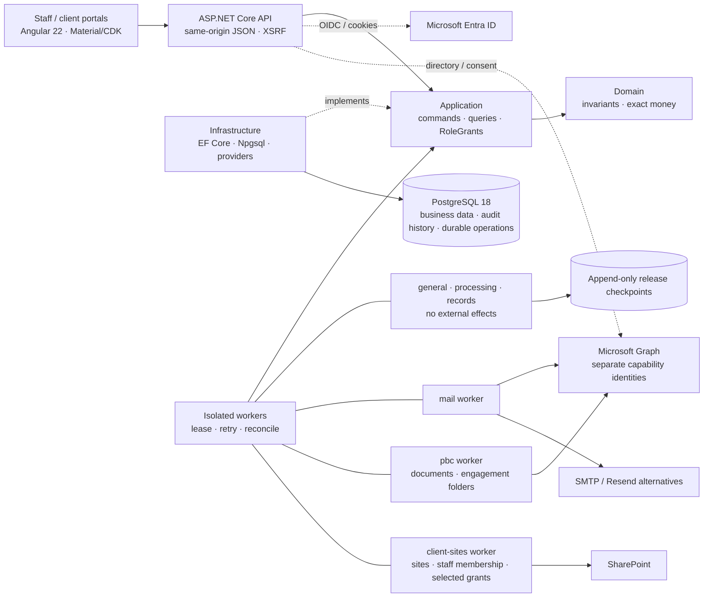

# AuditSphereOps

[](https://dotnet.microsoft.com/)
[](https://www.postgresql.org/)
[](src/AuditSphereOps.Ui/auditsphere-angular-development.md)
[](https://learn.microsoft.com/ef/core/)

**AuditSphereOps** is a .NET 10 / Angular 22 modular monolith for audit and accounting firms, covering client management through billing, accounting, audit, reporting, release, records and consolidation. Import-first accounting is the default; native bookkeeping is gated.

> **Status:** whole-product acceptance is incomplete. The [evidence ledger](docs/execution/status.json) owns verified commits, test/migration counts and current-source CI; earlier passes do not verify HEAD. Angular is canonical and the Blazor host is retired, but [migration acceptance](docs/migration/auditsphere-migration-blazor-removal-readiness.md) remains `NOT_READY`. Live Entra/Graph/release acceptance remains `BLOCKED_EXTERNAL`.

## Financial boundaries

| Domain | Owns |
| --- | --- |
| Firm books | Billing, time/WIP, invoices, receipts and immutable firm ledger. |
| Client accounting | TB/GL, charts, mappings, adjustments, reconciliations, statements and FX; gated native bookkeeping. |
| Consolidation | Component packs, eliminations and FX translation; never changes component books. |

`EXTERNAL_SOURCE` is the default. `NATIVE_BOOKKEEPING` requires reviewer access, client-level `BOOKKEEPING` acceptance and controlled cutover; existing periods prohibit inline cutover. Maker/checker remains mandatory. Native issuance, delivery and official numbering remain open. See [bookkeeping boundaries](docs/architecture/auditsphere-architecture-code-map.md#native-client-operational-bookkeeping). Inventory/procurement, payroll execution, payment initiation, external tax filing and Purview/eSignature providers are out of scope.

## Architecture



Live groups (`mail`, `pbc`, `client-sites`) use separate processes/certificates; Production requires `Worker:ApprovedLiveGroups`. Acceptance preserves the same isolation. Core groups have no external effects.

References: `Domain → nothing; Application → Domain; Infrastructure → Application, Domain; Api/Worker → all`. See the architecture/code map below; the [enterprise target](docs/architecture/auditsphere-architecture-specification-enterprise-target-proposed.md) is PROPOSED.

## Stack & layout

C# 14 · Node pinned in `.nvmrc` · OpenXML + PDFsharp/MigraDoc · xUnit + Playwright; framework versions are shown above.

```text
src/AuditSphereOps.{Domain,Application,Infrastructure,Api,Worker}/
src/AuditSphereOps.Ui/                      Angular staff/client workspace
tests/AuditSphereOps.{Domain,Api,E2E}.Tests/
contracts/ · scripts/ · docs/ · infra/ · wiki/
```

[Record-to-Report breakdown](docs/task_breakdown/auditsphere-r2r-index-task-breakdown.md): **20** setup/charts/dimensions/periods; **21** TB/GL; **22** adjustments/posting; **23** reconciliations/schedules; **24** statements/taxonomy; **25** packages/exports/review; **26** consolidation/FX. Native bookkeeping is a service mode, not another module.

## Quickstart

Use the pinned SDK/Node versions in `global.json` and `src/AuditSphereOps.Ui/.nvmrc`. Restore once per fresh environment or changed lockfile:

```bash
dotnet tool restore
dotnet restore AuditSphereOps.slnx --locked-mode
nvm use "$(cat src/AuditSphereOps.Ui/.nvmrc)"
npm --prefix src/AuditSphereOps.Ui ci
```

Local PostgreSQL uses port **5433**, development database `auditsphere` and isolated test database `auditsphere_tests` (disposable schemas; no InMemory fallback). On macOS/Homebrew:

```bash
pg_ctl -D /opt/homebrew/var/postgresql@18 -o "-p 5433" start
createdb -h 127.0.0.1 -p 5433 -U postgres auditsphere       # if absent
createdb -h 127.0.0.1 -p 5433 -U postgres auditsphere_tests # if absent
# Apply migrations only to the local development database.
AUDITSPHERE_MIGRATION_CONNECTION='Host=127.0.0.1;Port=5433;Database=auditsphere;Username=postgres' \
  dotnet ef database update --project src/AuditSphereOps.Infrastructure \
  --startup-project src/AuditSphereOps.Api
```

Run `scripts/dev/backend-watch.sh` and `npm --prefix src/AuditSphereOps.Ui start` in separate terminals; reuse an existing backend on **:5100**. Open **http://localhost:4200/ui/app**. Windows helpers: `scripts/db/status.ps1`, `start.ps1`, `stop.ps1`. Optional restore rehearsal: `scripts/db/restore-drill.sh` (drops only its generated restore database).

Use `./scripts/agent-check --list` and `./scripts/agent-check <capability> --run` for focused checks. Full regressions run only in `release-verification.yml` against an immutable SHA. After contract/model changes, run `bash scripts/contracts/verify-openapi.sh` or the pinned EF pending-model check. See [Angular development](src/AuditSphereOps.Ui/auditsphere-angular-development.md) and [testing strategy](docs/testing/auditsphere-testing-strategy-definition-of-done-current.md).

## Engineering safeguards

Current server-side grants (`FIRM_WIDE`, `CLIENT`, `ENGAGEMENT`, `GROUP`), append-only evidence, exact `numeric(19,6)` / `decimal` money and stale-evidence denial are mandatory. UI flags confer no authority; humans approve professional work. M365 uses isolated capability identities/certificates and exact grants under the [client-sites exception](docs/architecture/auditsphere-client-sharepoint-sites-current.md).

## Product roadmap and feature checklist

**☑ Completed:** evidenced slice. **☐ Partially pending:** integration/acceptance remains. **☐ Pending:** open deliverable. A completed slice does not complete its parent module. _Checklist reflects the scoped changes below; exact tested source and CI outcomes are recorded in the ledger._

Criteria/evidence: [product crosswalk](docs/execution/auditsphere-execution-tracker-practice-management-v22-crosswalk-current.md) · [API/Angular parity](docs/execution/auditsphere-execution-tracker-api-angular-parity-current.md) · [task board](docs/execution/auditsphere-execution-index-task-board-current.md) · [ledger](docs/execution/status.json). Backlog IDs and acceptance gates remain authoritative.

### Modules and remaining delivery

| Checklist | Module | Implemented → remaining |
| --- | --- | --- |
| ☐ Partially pending | Practice & commercial | Leads, clients/contacts, pricing, proposals, fees, activation → acceptance, layouts/policy, provider delivery. |
| ☐ Partially pending | Workflow & tasks | Seven phases, eleven derived states; tasks, milestones, dependencies, reminders/queues, Required/Optional labels, NR-12 off matrix, atomic bounds, persistent 403 → legal mapping, required-task semantics, recurrence/automation, review-point receipt recovery acceptance, deferred lifecycle observation and off-state/role/accessibility acceptance. |
| ☐ Partially pending | Client collaboration | Scoped PBC, uploads/comments, package review, invoices; posted/sent, cash/credit, due dates, UTC aging → write/evidence gates, client browser acceptance, invoice provider delivery. |
| ☐ Partially pending | People & time | Staffing/capacity, leave/training/holidays, phase/risk allocation, task time, budgets/rates/utilization → role, responsive/accessibility and release acceptance. |
| ☐ Partially pending | Firm finance | Billing, settlements, receipts, expenses, ledger, aging, WIP/profitability → end-to-end acceptance, firm pricing and professional end-of-service configuration. |
| ☐ Partially pending | Client accounting (20–23) | Setup, charts/periods, TB/GL, mappings, adjustments, reconciliations/schedules → source/review/correction flows and approved fixtures. |
| ☐ Partially pending | Native bookkeeping (gated) | Cutover, journals, counterparties, invoices/credits, opening balances/allocations → successor openings, sealed native reporting sources, cutover acceptance, tax, delivery and official numbering. |
| ☐ Partially pending | Financial reporting (24–25) | Statements/comparatives, cash/equity, disclosures, packages, PDF/DOCX/XLSX → indirect classifications, source-backed schedules/composition, release acceptance. |
| ☐ Partially pending | Consolidation (26) | Groups/scopes, ownership, components, intercompany matching, eliminations/FX → authorization, concurrency, browser acceptance and methodology. |
| ☐ Partially pending | Audit planning & execution | Programs, materiality/risk, procedures, sampling, confirmations, workpapers/review → derived confirmation balances, methodology, terminal-evidence mapping and full review journeys. |
| ☐ Partially pending | Completion, release & records | SRM/readiness, human decisions, artifacts/signing hooks, archive lineage, secondary-copy API/CLI → signing/legal policy, custody/recovery, independent acceptance. |
| ☐ Partially pending | Administration & security | Setup, users/grants, tenant capabilities, search, operations/progress, scoped Acceptance/relationship/chart/engagement/invoice/pricing denials → application-wide isolation/revocation and operator readiness. |
| ☐ Partially pending | M365 & client sites | Isolated identities/workers, exact grants, client sites/staff reconciliation, intents/status → operator attestation issuer, broader runtime readiness, RBAC enrollment, rollout/migration and live positive/negative acceptance. |
| ☐ Partially pending | Knowledge library | Technical pages and reusable programs → authorization, authoring, workflow acceptance. |
| ☐ Partially pending | Platform & durable operations | API, Angular, PostgreSQL, retries/idempotency/reconciliation → current-SHA full CI/scan-artifact review, recovery, capacity, observability, deployment acceptance. |
| ☐ Pending | Professional acceptance | Qualified methodology owner and independent reviewer must approve policies/fixtures. |
| ☐ Pending | Production acceptance | Live identity/providers, custody, restore/RPO/RTO and independent sign-off; earlier evidence retained separately. |

### Completed bounded slices

These are recorded, scoped checks—not current-source full CI or whole-product acceptance. The [ledger](docs/execution/status.json) retains exact evidence and unresolved gates.

| Checklist | Completed slice | Remaining limits |
| --- | --- | --- |
| ☑ Completed | Angular host/Blazor retirement; sidebar toggle and mobile shell | Migration/parity and server isolation acceptance. |
| ☑ Completed | Journal/evidence/sampling previews, fieldwork preview focus/loading feedback, serialized review-point receipt recovery, revoked-view E2E handling and consolidation controls/scrolling | Unknown/stale outcomes and human review; recording stays off before assent. |
| ☑ Completed | Pinned task context, Required/Optional labels and atomic graph bounds | Manual tasks stay unlabeled; labels grant no completion approval. |
| ☑ Completed | Proposal dispatch to canonical lifecycle handoff — synthetic browser/API/DB | Client acceptance, provider delivery and full commercial acceptance remain. |
| ☑ Completed | Net-allocated advance gate, scoped fee-settlement browser/API/DB journey, expense paging/recovery and monthly P&L boundaries | Full commercial, receipt, reporting and export acceptance. |
| ☑ Completed | Contact/routing/recipient/hierarchy reads recheck current grants; off-page counts fail closed; routing contacts must belong to the same firm/client | Focused database proof; invalid legacy routing owners block migration pending authorized review; current-source CI and broader UI acceptance remain open. |
| ☑ Completed | Same-firm staffing/resource/cost-rate and expense actor/account/journal/posting parents; capacity, phase/risk allocation and certification evidence | Wider key inventory, roles and date/concurrency acceptance; expiry is not verification. |
| ☑ Completed | Assigned-task time, scoped paging, Audit Plan milestones and budget-review keyboard flow | Broader browser/legal acceptance. |
| ☑ Completed | Purchase/credit preview recovery, accounting-mode lock and exact-period navigation | Native/currentness acceptance; rejection remains distinct from unknown outcome. |
| ☑ Completed | Full statement/completion evidence IDs, release guards and pinned group/component currentness | Broader release acceptance; no group-only raw access, automatic re-pin or component-book writes. |
| ☑ Completed | Immutable profile/dimension history, exact TB/GL scope, current-authority import locks and profile-change reasons — focused API/Angular/PostgreSQL/owned browser | Exact context activation and broader acceptance remain; legacy history is not invented. |
| ☑ Completed | Secondary archive provider, queue/API, expected-plan export and service-to-CLI handoff | Live custody/recovery; historical matches do not prove current custody. |
| ☑ Completed | Consolidation correction lineage/handoff and client unknown-outcome controls | Source-bound handoff checked; broader stale/receipt-recovery browser acceptance remains. |
| ☑ Completed | Entra registration/certificates, signed Legacy mail receipt enrollment/recovery/readback and runtime gate — focused offline/API/Angular | Issuer tooling, browser acceptance, broader readiness, RBAC, live consent/custody and migration acceptance; role-only evidence rejected. |
| ☑ Completed | M365 deployment boundaries, selected-site grants, DOCUMENTS probe and readiness inventory — offline | Runtime evidence; DOCUMENTS requires namespace reads and unrelated-site HTTP 403. |
| ☑ Completed | Financial-package-only balance draft eligibility, shared across manual, automatic and screen status | Focused fee-cycle and no-mutation checks; full current CI, automatic journey and broader commercial acceptance remain. |
| ☑ Completed | Direct confirmation creation and mutations lock publication scope and recheck current authority | Current-authority and post-close alternative refusal checked; broader concurrency, source-balance reconciliation and confirmation acceptance remain. |
| ☑ Completed | Internal-risk API read denial for client identities, including stray internal grants | Focused API/database proof; broader rendered, download/export and client-persona acceptance remain. |
| ☑ Completed | Client reply receipt/navigation recovery | Lost-acknowledgement recovery and owner reauthorization checked; broader portal acceptance remains. Raw reply text is not stored for recovery. |
| ☑ Completed | Client-site intents/API/CLI, worker guards and managed-only membership reconciliation | Live acceptance; queued is not success and unmanaged/residual access remains visible. |
| ☑ Completed | Debug hot reload, Vite security patch, CI, bounded scan capture and evidence guards | Prior checkpoints require revalidation. |
| ☐ Partially pending | Development performance/configured startup | Readiness, cold-cache/frontend comparisons and session/CSRF acceptance; no overall speedup claimed. |

**Four-phase completion specification:** criterion-level reconciliation is in progress in [issue49](https://github.com/nirzaf/AuditSphere/issues/49). Existing delivered code and owner-test evidence are retained; source tracing is separate from functional, professional and production acceptance. All five module sections now have source-line criterion traces in the [requirement manifest](docs/spec/completion-requirement-manifest.json); these locate owners and existing checks, and do not establish functional acceptance. Workflow/invariant source references and lifecycle scenario links are added; inherited finding-level reconciliation and behavioral acceptance remain pending. Archive-countdown anchor semantics remain an explicit [ADR-0018 decision](docs/spec/completion-policy-decisions.json). Merged PR #50 adds focused final-allocation guard checks and an [offline unsigned mail-evidence preparer](docs/operations/auditsphere-entra-registration-automation.md#prepare-unsigned-legacy-evidence-offline); signing, real tenant probes and release acceptance remain pending. Critical workflow criteria have bounded source/test plans and focused local evidence, including missing-approval letter refusal, retained professional decisions/holds after task completion, review, confirmation and archive guards. Full current-source CI, broader rendered workflows and external acceptance remain open.

**Angular quality/accessibility remains partial:** Latest exact-source CI and earlier job results are distinguished in the [ledger](docs/execution/status.json); full current-candidate acceptance remains open. Strict typing, capability splits, owner/recovery guards and lint are implemented. Journal/evidence focus and previews, procedure loading and guarded preview focus, populated sampling previews, fieldwork tabs/validation, budget review/cancel, correction-handoff source preservation and named consolidation pagers/keyboard-scrolling journal lines have scoped automated or built-in browser evidence in the [ledger](docs/execution/status.json). Wider rendered states, native zoom and human screen-reader review stay open in the [accessibility checklist](docs/testing/auditsphere-testing-checklist-angular-accessibility-current.md), which lists existing synthetic handoffs. [Routes](src/AuditSphereOps.Ui/src/app/app.routes.ts) locate screens but do not prove parity.

## Documentation & contributing

Start with the [docs index](docs/auditsphere-docs-index.md) and [AGENTS.md](AGENTS.md).

| Reference | Purpose |
| --- | --- |
| [STE requirements](docs/requirements/auditsphere-accounting-module-requirements-current.md) | Commercial/audit lifecycle contract. |
| [Architecture](docs/architecture/auditsphere-architecture-current-architecture.md) · [code map](docs/architecture/auditsphere-architecture-code-map.md) | Boundaries and capability/file ownership. |
| [Testing strategy](docs/testing/auditsphere-testing-strategy-definition-of-done-current.md) · [Angular development](src/AuditSphereOps.Ui/auditsphere-angular-development.md) | Focused local checks, full CI and development loop. |
| [Task board](docs/execution/auditsphere-execution-index-task-board-current.md) · [current slice](docs/execution/auditsphere-execution-current-slice.md) · [ledger](docs/execution/status.json) | Dependencies, active runbook and observed verification. |
| [M365 permissions](docs/architecture/auditsphere-m365-tenant-administration-permissions.md) · [CLI automation](docs/operations/auditsphere-entra-registration-automation.md) | Identity/consent/resource boundaries, configuration and recovery. |

Implement in the main worktree on `master`; do not create subworktrees. Complete one coherent vertical slice and preserve authorization, ledger and append-only controls. Use focused local checks and zero-warning Release compilation where applicable; full regressions belong in CI. No second ERP, brokers, microservices, MediatR or autonomous audit opinions.
