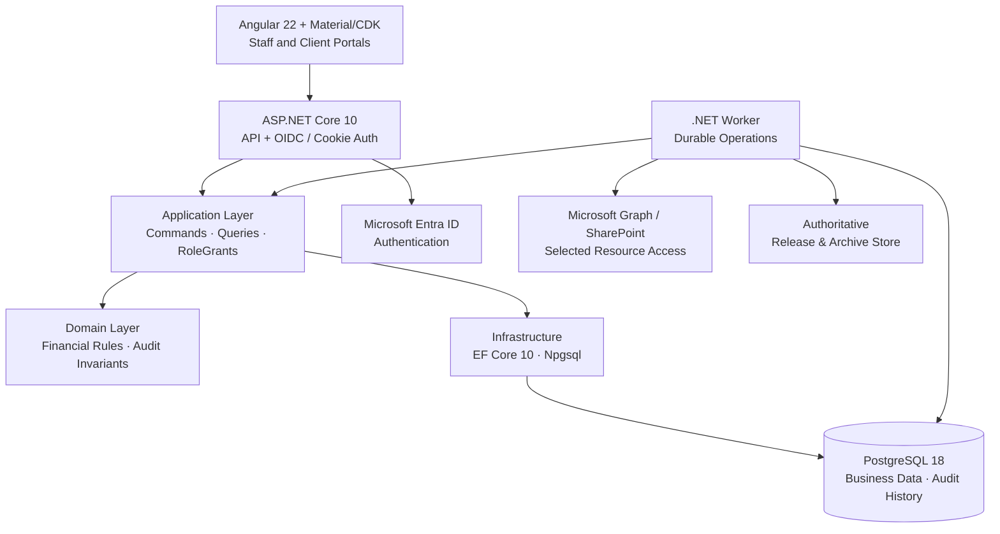

# AuditSphereOps

[](https://dotnet.microsoft.com/)
[](https://www.postgresql.org/)
[](src/AuditSphereOps.Ui/auditsphere-angular-development.md)
[](https://learn.microsoft.com/ef/core/)

**AuditSphereOps** is a professional audit, accounting, and assurance platform — a **.NET 10 modular monolith** (ASP.NET Core API + Angular 22) for CPA firms: engagement lifecycle, practice billing, trial-balance/GL intake, financial-statement production, audit fieldwork and review, controlled package release, records retention, and multi-currency group consolidation.

> **Status:** implemented and verified locally against PostgreSQL 18.6. [`docs/execution/status.json`](docs/execution/status.json) is the sole authority for test counts, verified SHA, and migration count. Angular is the canonical UI (Blazor host retired, see [removal gate](docs/migration/auditsphere-migration-blazor-removal-readiness.md)); migration acceptance is `NOT_READY`. Live Entra/Graph/release gates are `BLOCKED_EXTERNAL` — never fake-passed. Purview/eSignature providers are out of scope.

## Financial boundaries

Three isolated domains — enforced in Domain, services, and database. Import-first platform, not an operational client ERP (no payroll execution, payment initiation, or external tax filing).

1. **Firm books** (`Practice/FirmLedger`) — billing, WIP time, invoices, receipts, immutable firm ledger.
2. **Client workspace** (`Accounting/`) — TB/GL imports, charts, mappings, adjustments, reconciliations, statements, client FX remeasurement.
3. **Group consolidation** (`Consolidation/`) — approved component packs, eliminations, FX translation. Never mutates component books.

## Architecture



Reference direction: `Domain → nothing; Application → Domain; Infrastructure → Application, Domain; Api/Worker → all`. Details: [current architecture](docs/architecture/auditsphere-architecture-current-architecture.md) · [code map](docs/architecture/auditsphere-architecture-code-map.md) · [enterprise target (PROPOSED)](docs/architecture/auditsphere-architecture-specification-enterprise-target-proposed.md). Routes: `src/AuditSphereOps.Ui/src/app/app.routes.ts`.

## Record-to-Report modules (20–26)

Native R2R lifecycle under [`docs/task_breakdown`](docs/task_breakdown/auditsphere-r2r-index-task-breakdown.md):

| Module | Scope |
|---|---|
| **20 — Workspace setup** | Client profiles, fiscal calendars, reporting periods, books, versioned charts, dimensions, taxonomy overlays. |
| **21 — TB & GL intake** | Streaming CSV/XLSX intake, deterministic sealing, resumable GL batches, opening/movement completeness. |
| **22 — Adjustments** | Draft journals, revision guards, dual-role decisions, reviewer-gated posting with separation of duties. |
| **23 — Reconciliations & schedules** | Bank/AR-AP proofs, ECL matrix, NRV valuations, specialist schedules (PPE, loans, equity, tax, cash). |
| **24 — Statements & taxonomy** | Chart-to-taxonomy mapping reviews, deterministic statement calculators. |
| **25 — Package assembly** | Versioned packs, durable worker builds, exact-byte formula-free XLSX/PDF artifacts, review decisions. |
| **26 — Consolidation & FX** | Perimeter scope, component pins, intercompany matching/elimination, IAS 21 translation. |

## Stack & layout

.NET 10 / C# 14 · EF Core 10 + Npgsql · PostgreSQL 18.6 (local port `5433`) · Angular 22 + Material/CDK · OpenXML + PDFsharp/MigraDoc · xUnit + Playwright.

```text
src/AuditSphereOps.{Domain,Application,Infrastructure,Api,Ui,Worker}/
tests/AuditSphereOps.{Domain,Api,E2E}.Tests/   docs/ (index · requirements · architecture · task_breakdown · testing · execution)
scripts/db/  global.json  Directory.Packages.props
```

## Quickstart

```bash
dotnet --version            # expect 10.0.300
dotnet tool restore         # pinned dotnet-ef
dotnet restore AuditSphereOps.slnx --locked-mode
npm --prefix src/AuditSphereOps.Ui ci   # Node version per src/AuditSphereOps.Ui/.nvmrc
```

```bash
# macOS (Homebrew) — user-local cluster on :5433, trust auth on loopback
pg_ctl -D /opt/homebrew/var/postgresql@18 -o "-p 5433" start
scripts/db/restore-drill.sh
# Windows — scripts\db\status.ps1 (ensure DBs) · start.ps1 · stop.ps1
```

```bash
./scripts/agent-check --list
./scripts/agent-check <capability> --run   # focused cohort only; full suites run in CI
```

```bash
# Normal development: two terminals; no Angular production bundle needed.
scripts/dev/backend-watch.sh
npm --prefix src/AuditSphereOps.Ui start
# Open http://localhost:4200/ui/app. Reuse an existing backend on :5100.
# Release publication remains a separate CI/operator workflow.
```

Per-test isolation: uniquely named disposable PostgreSQL schemas on `auditsphere_tests`; no InMemory fallback. Full regressions run in `release-verification.yml` on an immutable SHA — never locally after each edit. UI build/run details: `src/AuditSphereOps.Ui/auditsphere-angular-development.md`.

## Invariants

- **Scoped auth everywhere** — `FIRM_WIDE · CLIENT · ENGAGEMENT · GROUP` RoleGrants on every command/query/route; Angular `can*` flags are presentation only.
- **Append-only evidence** — sealed datasets, posted journals, approvals, and releases enforced by Postgres triggers/constraints.
- **Exact money** — `numeric(19,6)` + C# `decimal`; pure deterministic calculators (no EF, clocks, or I/O).
- **Fail closed** — missing rates, unapproved perimeters, or stale evidence block release; humans make all audit opinions.
- **Least-privilege M365** — `Sites.Selected` + per-site grants; no tenant-wide scopes ([permission boundary](docs/architecture/auditsphere-m365-tenant-administration-permissions.md)).
- **Zero-warning Release builds**; `docs/execution/status.json` + current-slice handoff record only observed facts.

## Product roadmap and feature checklist

This is a navigation and implementation roadmap, not a production-readiness certificate. **☑ Completed** means the named bounded slice has recorded implementation/verification evidence; **☐ Partially pending** means implementation exists but integration, current acceptance or an approval remains; **☐ Pending** means the named remaining deliverable is not closed. An unchecked feature is not necessarily absent. Historical checks do not establish current whole-product acceptance.

The [product crosswalk](docs/execution/auditsphere-execution-tracker-practice-management-v22-crosswalk-current.md), [API/Angular parity tracker](docs/execution/auditsphere-execution-tracker-api-angular-parity-current.md), [task board](docs/execution/auditsphere-execution-index-task-board-current.md) and [evidence ledger](docs/execution/status.json) own detailed criteria, dependencies and verification. Requirement IDs in different backlogs are distinct. README does not override their acceptance gates.

### Modules and remaining delivery

| Checklist | Module / capability | Available implementation | Remaining work |
| --- | --- | --- | --- |
| ☐ Partially pending | Practice & commercial | Leads, client profiles/contacts, quotes, pricing, proposals, fee agreements and activation | Complete commercial acceptance, approved layouts/policy and provider delivery evidence. |
| ☐ Partially pending | Workflow & tasks | Seven-phase workspace, eleven derived lifecycle states, expandable task checklists, operational due dates, saved Audit Plan milestones, role-authorized actions, templates with source-bound evidence prerequisites, bounded versioned dependencies, reviewed reminder rules and windows, queues, exact-pinned-template Required/Optional task labels and an NR-12 feature-off matrix; task- and edge-bound overflow reject atomically and Angular pins the 403 unavailable state | Approved/versioned jurisdictional source mapping and legal validation, remaining required-task graph semantics, broader recurrence/automation acceptance, remaining switch-off browser checks, broad role/accessibility acceptance. |
| ☐ Partially pending | Client collaboration | First sign-in, scoped PBC requests/uploads, comments, financial-package review, and portal invoices with separate posted/sent, recorded cash, credit, approved due-date and UTC aging states | Shared write-gate acceptance, exact accepted evidence sets, client-role browser acceptance and invoice-specific provider-delivery evidence. Invoice delivery remains explicitly untracked. |
| ☐ Partially pending | People & time | Staffing, resource grid, recorded leave/training/public-holiday detail, phase/risk-attributed allocations, assigned-task time entry, budgets, rates and utilization | Broader role, responsive/accessibility, resource/time and current-release acceptance. |
| ☐ Partially pending | Firm finance | Protected billing, fee settlements, receipt allocations, expenses, firm ledger, aging, WIP and profitability | Full financial workflow acceptance; firm pricing and end-of-service professional configuration. |
| ☐ Partially pending | Client accounting — modules 20–23 | Setup, charts, periods, TB/GL, mappings, adjustments, reconciliations and specialist schedules | Complete source/review/correction workflows and professionally approved fixtures. |
| ☐ Partially pending | Financial reporting — modules 24–25 | Statements, comparatives, cash/equity schedules, disclosures, package builds and PDF/DOCX/XLSX | Approved indirect classifications, complete source-backed schedules/composition and release acceptance. |
| ☐ Partially pending | Group consolidation — module 26 | Groups/scopes, ownership, component packs, intercompany matching, eliminations and FX | Current authorization/concurrency/browser acceptance and approved methodology. |
| ☐ Partially pending | Audit planning & execution | Programs, materiality/risk, procedures, sampling, confirmations, workpapers and review | Qualified methodology decisions, terminal evidence mapping and complete review journeys. |
| ☐ Partially pending | Completion, release & records | SRM/readiness, human decisions, report artifacts, sealing, signing hooks and archive lineage | Signing/legal policy, authoritative-store/provider acceptance and independent release review. |
| ☐ Partially pending | Administration & security | Initial setup, users/grants, tenant capabilities, search, operations and progress | Whole-application isolation/revocation acceptance and operator readiness. |
| ☐ Partially pending | Microsoft 365 & client sites | Isolated identities/workers, selected-resource verification and per-client provisioning | Approved rollout, exact-site/staff reconciliation and live production acceptance. |
| ☐ Partially pending | Knowledge library | Technical pages and reusable audit-program library | Current authorization, authoring and workflow acceptance. |
| ☐ Partially pending | Platform & durable operations | ASP.NET Core API, Angular, PostgreSQL, retries, idempotency and reconciliation | Current-SHA full CI, recovery/capacity/observability and deployment acceptance. |
| ☐ Pending | Professional acceptance | Human review gates are retained | Named qualified methodology owner and independent reviewer approve applicable policies/fixtures. |
| ☐ Pending | Production acceptance | Acceptance deployment and earlier live evidence are recorded separately | Applicable live identity/provider checks, custody, restore/RPO/RTO and independent sign-off. |

### Completed bounded slices

These checkmarks apply only to the stated slice; the parent module remains partial where listed above. Evidence is retained in the linked ledger/crosswalk and migration records.

| Checklist | Completed slice | Acceptance limit |
| --- | --- | --- |
| ☑ Completed | Canonical Angular host and removal of the legacy Blazor host | Whole-application migration/parity acceptance remains partial. |
| ☑ Completed | Sidebar expand/compact icon control beside the brand | Both states browser-checked; does not establish every responsive route. |
| ☑ Completed | Client mobile shell navigation on a populated synthetic document request | Keyboard open, focus wrapping and Escape close checked at narrow width; staff links absent from client navigation. This does not establish server isolation or replace human screen-reader/native zoom review. |
| ☑ Completed | Consolidation journal row-removal focus recovery and responsive draft controls | Focused component checks and built-in-browser add/remove, keyboard focus and narrow layout passed; full consolidation acceptance remains open. |
| ☑ Completed | Populated evidence-action preview and cancel keyboard flow | Built-in browser confirmed exact-context preview focus, fresh unchecked assent, disabled recording before assent and cancel returning focus. No human decision was recorded; unknown/stale journeys and human AT review remain separate gates. |
| ☑ Completed | Adjustment-journal preview keyboard focus | Invalid and valid previews receive focus; delayed previews respect later focus and keyboard interaction. Focused component, existing recovery journey and built-in-browser checks passed. Human AT/native zoom and broader rendered state coverage remain open. |
| ☑ Completed | Sampling preview keyboard focus on populated fieldwork | Exact preview receives focus, late responses respect focus moved elsewhere or away and back, and the populated preview reflows at narrow width. Existing sampling calculations and recording controls are preserved; full matrix, human AT and native zoom acceptance remain open. |
| ☑ Completed | Work-queue prerequisite blocking/clearing and source/review context | Broader task graph and operational acceptance remain open. |
| ☑ Completed | Required/Optional template-task designation projected from the exact pinned revision and step; manual tasks remain unlabeled | Informational display only; it does not gate task completion, lifecycle transitions or professional approval. Positive template-label rendering is covered by the focused Angular spec; the browser smoke check covered the manual-task state only. |
| ☑ Completed | Atomic workflow dependency graph bounds | A 501-task plan and an attempt to add edge 4,001 to a 4,000-edge graph are refused atomically; a graph already holding 4,001 edges also refuses changes. Broader workflow acceptance and current-SHA full CI remain pending. |
| ☑ Completed | Advance cash gate based on current net allocations | Complete commercial/receipt acceptance remains open. |
| ☑ Completed | Firm expense paging and exact-record recovery | Broader finance workflow acceptance remains open. |
| ☑ Completed | Monthly P&L date/range boundaries | Complete reporting and export acceptance remains open. |
| ☑ Completed | Resource range validation and capacity remainder calculation | Complete staffing/resource acceptance remains open. |
| ☑ Completed | Phase/risk-attributed resource allocation lines with exact reviewed identity, retry recovery, legacy visibility and aggregate weekly capacity | Broader date-boundary, role and resource acceptance remain open. |
| ☑ Completed | Certification revocation takes precedence over a waiting reviewed higher-level staffing assignment | The focused PostgreSQL race regression proves no assignment, receipt or grant is written; broader resource and release acceptance remain open. |
| ☑ Completed | Exact saved leave, training and public-holiday intervals are visible for each team member in the selected resource-grid range | These are planning inputs only; broader role, responsive/accessibility and resource acceptance remain open. |
| ☑ Completed | Certification disclosure separating verification from expiry | Broader resource and concurrency acceptance remain open. |
| ☑ Completed | Exact-source certification rules, append-only persistence and Application review workspace | UI/API and staffing integration have focused checks; broader concurrency and current release acceptance remain open. |
| ☑ Completed | Purchase-invoice AP-role preview recovery and supplier purchase/credit browser journey | Focused local journeys pass; full accounting acceptance and exact-SHA release verification remain separate gates. |
| ☑ Completed | Preparer time entry is limited to tasks assigned to the actor while authorized managers can still route unassigned work | Focused Domain and API checks cover the unassigned-task denial and assigned-task acceptance; broader time, role and current-release acceptance remain open. |
| ☑ Completed | Saved Audit Plan milestones displayed beside the seven-phase engagement workflow | Focused Angular spec covers saved-plan dates; read-only browser confirmed the explicit empty state. Statutory cutoff legal validation and broad role/responsive acceptance remain open. |
| ☑ Completed | Exact budget preparation review keyboard flow | Populated synthetic approved-rate review receives focus; cancel returns focus and reopening requires fresh assent. Both existing route-variant recovery journeys pass; no budget was prepared from the built-in browser. Full planning and human AT acceptance remain open. |
| ☑ Completed | Keyboard scrolling of retained intercompany matches | The named table region retains focus while arrow keys reveal off-screen review facts at narrow width. Signed amounts and maker/checker explanations are preserved; broader consolidation acceptance remains open. |
| ☑ Completed | Narrow-screen Time pagination controls | Recorded-entry and approval pagination wrap without losing their refresh actions at narrow width. Built-in-browser pagination and skip-link-to-first-field keyboard checks pass at narrow width, alongside the existing six-viewport route E2E guard. Fast CI passed; corrected-source full release verification and human accessibility acceptance remain separate. |
| ☑ Completed | Owned Entra registration and public-certificate reconciliation — offline engineering | [Operator procedure](docs/operations/auditsphere-entra-registration-automation.md) covers exact IDs, signed approvals, uncertain-create reconciliation and key overlap. Synthetic checks pass; live tenant, credential custody and consent/runtime acceptance remain separate. |
| ☑ Completed | Offline Microsoft 365 plan permission boundaries | Exact capability roles/resources, isolated certificates and redirect origins are validated before any connection; incompatible Exchange permission models are refused. Live provisioning and tenant acceptance remain pending. |
| ☑ Completed | Autonomous runner evidence integrity | Supervisor-owned hashes and bounded evidence sizes are checked again before completion; missing, changed or symlinked evidence is refused. Existing checkpoints need attributable evidence revalidation; this does not establish whole-product completion. |

### Angular quality and accessibility follow-up

| Checklist | Work item | Remaining acceptance |
| --- | --- | --- |
| ☐ Partially pending | Strict typing, bounded feature-state extraction, command lifetime guards, conventions and lean lint integration | Implementation and focused checks are recorded in the [evidence ledger](docs/execution/status.json). The [accessibility checklist](docs/testing/auditsphere-testing-checklist-angular-accessibility-current.md) still requires remaining rendered workflow states, native browser zoom and knowledgeable human screen-reader evidence; current-source full CI remains a separate gate. |

### Available screens and feature roadmap

Inventory follows the current [Angular route registry](src/AuditSphereOps.Ui/src/app/app.routes.ts); aliases sharing one component are consolidated. Each feature links to its implementation. All rows remain **Partially pending** at full-feature acceptance level until their owning tracker proves closure. This table does not imply that every sub-action has an API/UI adapter.

| Checklist | Module | Available feature | Remaining acceptance |
| --- | --- | --- | --- |
| ☐ Partially pending | Administration & operations | [Administration](src/AuditSphereOps.Ui/src/app/features/admin/overview.ts) | Owning product/parity criteria and current end-to-end acceptance. |
| ☐ Partially pending | Administration & operations | [Initial administrator setup](src/AuditSphereOps.Ui/src/app/features/admin/bootstrap.ts) | Owning product/parity criteria and current end-to-end acceptance. |
| ☐ Partially pending | Administration & operations | [Microsoft tenant connection](src/AuditSphereOps.Ui/src/app/features/admin/tenant.ts) | Owning product/parity criteria and current end-to-end acceptance. |
| ☐ Partially pending | Administration & operations | [Operations](src/AuditSphereOps.Ui/src/app/features/admin/operations.ts) | Owning product/parity criteria and current end-to-end acceptance. |
| ☐ Partially pending | Administration & operations | [Project task progress](src/AuditSphereOps.Ui/src/app/features/admin/progress.ts) | Owning product/parity criteria and current end-to-end acceptance. |
| ☐ Partially pending | Administration & operations | [Users & Access](src/AuditSphereOps.Ui/src/app/features/admin/access.ts) | Owning product/parity criteria and current end-to-end acceptance. |
| ☐ Partially pending | Audit & records | [Audit fieldwork](src/AuditSphereOps.Ui/src/app/features/audit/fieldwork.ts) | Owning product/parity criteria and current end-to-end acceptance. |
| ☐ Partially pending | Audit & records | [Audit plan](src/AuditSphereOps.Ui/src/app/features/audit/plan.ts) | Owning product/parity criteria and current end-to-end acceptance. |
| ☐ Partially pending | Audit & records | [Audit program library](src/AuditSphereOps.Ui/src/app/features/audit/library.ts) | Owning product/parity criteria and current end-to-end acceptance. |
| ☐ Partially pending | Audit & records | [Confirmations](src/AuditSphereOps.Ui/src/app/features/audit/confirmations.ts) | Owning product/parity criteria and current end-to-end acceptance. |
| ☐ Partially pending | Audit & records | [Engagement completion](src/AuditSphereOps.Ui/src/app/features/audit/completion.ts) | Owning product/parity criteria and current end-to-end acceptance. |
| ☐ Partially pending | Audit & records | [Finding](src/AuditSphereOps.Ui/src/app/features/audit/records.ts) | Owning product/parity criteria and current end-to-end acceptance. |
| ☐ Partially pending | Audit & records | [Population](src/AuditSphereOps.Ui/src/app/features/audit/records.ts) | Owning product/parity criteria and current end-to-end acceptance. |
| ☐ Partially pending | Audit & records | [Records archive](src/AuditSphereOps.Ui/src/app/features/audit/records.ts) | Owning product/parity criteria and current end-to-end acceptance. |
| ☐ Partially pending | Audit & records | [Release candidate](src/AuditSphereOps.Ui/src/app/features/audit/records.ts) | Owning product/parity criteria and current end-to-end acceptance. |
| ☐ Partially pending | Audit & records | [Review point](src/AuditSphereOps.Ui/src/app/features/audit/records.ts) | Owning product/parity criteria and current end-to-end acceptance. |
| ☐ Partially pending | Audit & records | [Workpaper](src/AuditSphereOps.Ui/src/app/features/audit/workpaper.ts) | Owning product/parity criteria and current end-to-end acceptance. |
| ☐ Partially pending | Client accounting & reporting | [Accounting](src/AuditSphereOps.Ui/src/app/features/accounting/workspace.ts) | Owning product/parity criteria and current end-to-end acceptance. |
| ☐ Partially pending | Client accounting & reporting | [Accounting evidence](src/AuditSphereOps.Ui/src/app/features/accounting/evidence.ts) | Owning product/parity criteria and current end-to-end acceptance. |
| ☐ Partially pending | Client accounting & reporting | [Accounting mapping](src/AuditSphereOps.Ui/src/app/features/accounting/mapping.ts) | Owning product/parity criteria and current end-to-end acceptance. |
| ☐ Partially pending | Client accounting & reporting | [Accounting period](src/AuditSphereOps.Ui/src/app/features/accounting/period.ts) | Owning product/parity criteria and current end-to-end acceptance. |
| ☐ Partially pending | Client accounting & reporting | [Adjustment journal](src/AuditSphereOps.Ui/src/app/features/accounting/journal.ts) | Owning product/parity criteria and current end-to-end acceptance. |
| ☐ Partially pending | Client accounting & reporting | [Adjustment journals](src/AuditSphereOps.Ui/src/app/features/accounting/records.ts) | Owning product/parity criteria and current end-to-end acceptance. |
| ☐ Partially pending | Client accounting & reporting | [Adjustment plan eligibility](src/AuditSphereOps.Ui/src/app/features/accounting/adjustment-plans.ts) | Owning product/parity criteria and current end-to-end acceptance. |
| ☐ Partially pending | Client accounting & reporting | [Adjustment plan review](src/AuditSphereOps.Ui/src/app/features/accounting/adjustment-plans.ts) | Owning product/parity criteria and current end-to-end acceptance. |
| ☐ Partially pending | Client accounting & reporting | [Analysis evidence](src/AuditSphereOps.Ui/src/app/features/accounting/analysis-review.ts) | Owning product/parity criteria and current end-to-end acceptance. |
| ☐ Partially pending | Client accounting & reporting | [Audit differences](src/AuditSphereOps.Ui/src/app/features/accounting/records.ts) | Owning product/parity criteria and current end-to-end acceptance. |
| ☐ Partially pending | Client accounting & reporting | [Build financial package](src/AuditSphereOps.Ui/src/app/features/engagements/financial-package-build.ts) | Owning product/parity criteria and current end-to-end acceptance. |
| ☐ Partially pending | Client accounting & reporting | [Currency remeasurement](src/AuditSphereOps.Ui/src/app/features/accounting/remeasurement.ts) | Owning product/parity criteria and current end-to-end acceptance. |
| ☐ Partially pending | Client accounting & reporting | [FX rates & policies](src/AuditSphereOps.Ui/src/app/features/accounting/currency-configuration.ts) | Owning product/parity criteria and current end-to-end acceptance. |
| ☐ Partially pending | Client accounting & reporting | [Finalize adjustment plan](src/AuditSphereOps.Ui/src/app/features/accounting/plan-command.ts) | Owning product/parity criteria and current end-to-end acceptance. |
| ☐ Partially pending | Client accounting & reporting | [Financial statement package](src/AuditSphereOps.Ui/src/app/features/accounting/package.ts) | Owning product/parity criteria and current end-to-end acceptance. |
| ☐ Partially pending | Client accounting & reporting | [Financial statements](src/AuditSphereOps.Ui/src/app/features/engagements/statements.ts) | Owning product/parity criteria and current end-to-end acceptance. |
| ☐ Partially pending | Client accounting & reporting | [General ledger](src/AuditSphereOps.Ui/src/app/features/engagements/general-ledger.ts) | Owning product/parity criteria and current end-to-end acceptance. |
| ☐ Partially pending | Client accounting & reporting | [General ledger completeness](src/AuditSphereOps.Ui/src/app/features/accounting/gl-completeness.ts) | Owning product/parity criteria and current end-to-end acceptance. |
| ☐ Partially pending | Client accounting & reporting | [General ledger source acceptance](src/AuditSphereOps.Ui/src/app/features/accounting/source-acceptance.ts) | Owning product/parity criteria and current end-to-end acceptance. |
| ☐ Partially pending | Client accounting & reporting | [General ledger upload](src/AuditSphereOps.Ui/src/app/features/engagements/gl-upload.ts) | Owning product/parity criteria and current end-to-end acceptance. |
| ☐ Partially pending | Client accounting & reporting | [Independent mapping review](src/AuditSphereOps.Ui/src/app/features/accounting/mapping-approval.ts) | Owning product/parity criteria and current end-to-end acceptance. |
| ☐ Partially pending | Client accounting & reporting | [Journal management evidence](src/AuditSphereOps.Ui/src/app/features/accounting/journal-management.ts) | Owning product/parity criteria and current end-to-end acceptance. |
| ☐ Partially pending | Client accounting & reporting | [Mappings](src/AuditSphereOps.Ui/src/app/features/accounting/records.ts) | Owning product/parity criteria and current end-to-end acceptance. |
| ☐ Partially pending | Client accounting & reporting | [Package reviews](src/AuditSphereOps.Ui/src/app/features/accounting/reviews.ts) | Owning product/parity criteria and current end-to-end acceptance. |
| ☐ Partially pending | Client accounting & reporting | [Period restatements](src/AuditSphereOps.Ui/src/app/features/accounting/restatements.ts) | Owning product/parity criteria and current end-to-end acceptance. |
| ☐ Partially pending | Client accounting & reporting | [Period roll-forward](src/AuditSphereOps.Ui/src/app/features/accounting/rollforward.ts) | Owning product/parity criteria and current end-to-end acceptance. |
| ☐ Partially pending | Client accounting & reporting | [Prepare adjustment plan](src/AuditSphereOps.Ui/src/app/features/accounting/plan-command.ts) | Owning product/parity criteria and current end-to-end acceptance. |
| ☐ Partially pending | Client accounting & reporting | [Prepare analytical review](src/AuditSphereOps.Ui/src/app/features/accounting/analytical-preparation.ts) | Owning product/parity criteria and current end-to-end acceptance. |
| ☐ Partially pending | Client accounting & reporting | [Prepare journal](src/AuditSphereOps.Ui/src/app/features/accounting/journal-create.ts) | Owning product/parity criteria and current end-to-end acceptance. |
| ☐ Partially pending | Client accounting & reporting | [Prepare mapping version](src/AuditSphereOps.Ui/src/app/features/accounting/mapping-draft.ts) | Owning product/parity criteria and current end-to-end acceptance. |
| ☐ Partially pending | Client accounting & reporting | [Prepare reconciliation](src/AuditSphereOps.Ui/src/app/features/accounting/reconciliation-create.ts) | Owning product/parity criteria and current end-to-end acceptance. |
| ☐ Partially pending | Client accounting & reporting | [Prepare specialist schedule](src/AuditSphereOps.Ui/src/app/features/accounting/specialist-preparation.ts) | Owning product/parity criteria and current end-to-end acceptance. |
| ☐ Partially pending | Client accounting & reporting | [Prepare valuation](src/AuditSphereOps.Ui/src/app/features/accounting/valuation-preparation.ts) | Owning product/parity criteria and current end-to-end acceptance. |
| ☐ Partially pending | Client accounting & reporting | [Reconciliation evidence](src/AuditSphereOps.Ui/src/app/features/accounting/reconciliation.ts) | Owning product/parity criteria and current end-to-end acceptance. |
| ☐ Partially pending | Client accounting & reporting | [Review accounting evidence](src/AuditSphereOps.Ui/src/app/features/accounting/evidence-actions.ts) | Owning product/parity criteria and current end-to-end acceptance. |
| ☐ Partially pending | Client accounting & reporting | [Source acceptance](src/AuditSphereOps.Ui/src/app/features/accounting/source-acceptance.ts) | Owning product/parity criteria and current end-to-end acceptance. |
| ☐ Partially pending | Client accounting & reporting | [Trial balance intake](src/AuditSphereOps.Ui/src/app/features/engagements/tb-intake.ts) | Owning product/parity criteria and current end-to-end acceptance. |
| ☐ Partially pending | Client portal | [Client portal](src/AuditSphereOps.Ui/src/app/features/portal/home.ts) | Owning product/parity criteria and current end-to-end acceptance. |
| ☐ Partially pending | Client portal | [Billing and payment receipts](src/AuditSphereOps.Ui/src/app/features/portal/finance.ts) | Invoice lifecycle, net recorded cash, issued credits, approved due date and UTC aging are projected separately; provider delivery is not tracked. Client-role browser and current release acceptance remain open. |
| ☐ Partially pending | Client portal | [Document request](src/AuditSphereOps.Ui/src/app/features/portal/request.ts) | Owning product/parity criteria and current end-to-end acceptance. |
| ☐ Partially pending | Client portal | [Journal management response](src/AuditSphereOps.Ui/src/app/features/accounting/journal-management.ts) | Owning product/parity criteria and current end-to-end acceptance. |
| ☐ Partially pending | Client portal | [Management review](src/AuditSphereOps.Ui/src/app/features/portal/package.ts) | Owning product/parity criteria and current end-to-end acceptance. |
| ☐ Partially pending | Firm finance | [End-of-service provision](src/AuditSphereOps.Ui/src/app/features/finance/end-of-service.ts) | Owning product/parity criteria and current end-to-end acceptance. |
| ☐ Partially pending | Firm finance | [Fee settlements](src/AuditSphereOps.Ui/src/app/features/finance/fee-settlements.ts) | Owning product/parity criteria and current end-to-end acceptance. |
| ☐ Partially pending | Firm finance | [Firm books](src/AuditSphereOps.Ui/src/app/features/finance/books.ts) | Owning product/parity criteria and current end-to-end acceptance. |
| ☐ Partially pending | Firm finance | [Firm ledger](src/AuditSphereOps.Ui/src/app/features/finance/ledger.ts) | Owning product/parity criteria and current end-to-end acceptance. |
| ☐ Partially pending | Firm finance | [Firm receivables ageing](src/AuditSphereOps.Ui/src/app/features/finance/receivables-aging.ts) | Owning product/parity criteria and current end-to-end acceptance. |
| ☐ Partially pending | Firm finance | [Invoice](src/AuditSphereOps.Ui/src/app/features/finance/invoice.ts) | Owning product/parity criteria and current end-to-end acceptance. |
| ☐ Partially pending | Group consolidation | [Advanced consolidation](src/AuditSphereOps.Ui/src/app/features/consolidation/advanced.ts) | Owning product/parity criteria and current end-to-end acceptance. |
| ☐ Partially pending | Group consolidation | [Consolidation scope workspace](src/AuditSphereOps.Ui/src/app/features/consolidation/scope-workspace.ts) | Owning product/parity criteria and current end-to-end acceptance. |
| ☐ Partially pending | Group consolidation | [Group consolidation](src/AuditSphereOps.Ui/src/app/features/consolidation/overview.ts) | Owning product/parity criteria and current end-to-end acceptance. |
| ☐ Partially pending | Knowledge library | [Technical library](src/AuditSphereOps.Ui/src/app/features/library/library.ts) | Owning product/parity criteria and current end-to-end acceptance. |
| ☐ Partially pending | People & time | [Charge-out rates](src/AuditSphereOps.Ui/src/app/features/practice/rate-cards.ts) | Owning product/parity criteria and current end-to-end acceptance. |
| ☐ Partially pending | People & time | [Resource planning](src/AuditSphereOps.Ui/src/app/features/practice/resources.ts) | Phase/risk lines, aggregate capacity and exact saved availability entries have focused Domain, Angular and E2E evidence; broad role, responsive/accessibility and release acceptance remain. |
| ☐ Partially pending | People & time | [Time & work records](src/AuditSphereOps.Ui/src/app/features/practice/time.ts) | Owning product/parity criteria and current end-to-end acceptance. |
| ☐ Partially pending | Practice & commercial | [Acceptance](src/AuditSphereOps.Ui/src/app/features/acceptance/checklist.ts) | Owning product/parity criteria and current end-to-end acceptance. |
| ☐ Partially pending | Practice & commercial | [Add client contact](src/AuditSphereOps.Ui/src/app/features/clients/contact-create.ts) | Owning product/parity criteria and current end-to-end acceptance. |
| ☐ Partially pending | Practice & commercial | [Client acceptance](src/AuditSphereOps.Ui/src/app/features/acceptance/assessment-route.ts) | Owning product/parity criteria and current end-to-end acceptance. |
| ☐ Partially pending | Practice & commercial | [Client profile](src/AuditSphereOps.Ui/src/app/features/clients/client.ts) | Owning product/parity criteria and current end-to-end acceptance. |
| ☐ Partially pending | Practice & commercial | [Commercial settings](src/AuditSphereOps.Ui/src/app/features/commercial/settings.ts) | Owning product/parity criteria and current end-to-end acceptance. |
| ☐ Partially pending | Practice & commercial | [Convert prospect](src/AuditSphereOps.Ui/src/app/features/commercial/client-conversion.ts) | Owning product/parity criteria and current end-to-end acceptance. |
| ☐ Partially pending | Practice & commercial | [Create blocked engagement](src/AuditSphereOps.Ui/src/app/features/clients/engagement-create.ts) | Owning product/parity criteria and current end-to-end acceptance. |
| ☐ Partially pending | Practice & commercial | [Engagement](src/AuditSphereOps.Ui/src/app/features/engagements/engagement.ts) with a seven-phase saved-milestone workflow | Approved/versioned jurisdictional milestone source mapping, role/accessibility and current end-to-end acceptance. |
| ☐ Partially pending | Practice & commercial | [Leads](src/AuditSphereOps.Ui/src/app/features/commercial/leads.ts) | Owning product/parity criteria and current end-to-end acceptance. |
| ☐ Partially pending | Practice & commercial | [Opportunities](src/AuditSphereOps.Ui/src/app/features/commercial/opportunities.ts) | Owning product/parity criteria and current end-to-end acceptance. |
| ☐ Partially pending | Practice & commercial | [PBC requests](src/AuditSphereOps.Ui/src/app/features/engagements/pbc.ts) | Owning product/parity criteria and current end-to-end acceptance. |
| ☐ Partially pending | Practice & commercial | [Portfolio](src/AuditSphereOps.Ui/src/app/features/portfolio/portfolio.ts) | Owning product/parity criteria and current end-to-end acceptance. |
| ☐ Partially pending | Practice & commercial | [Practice analytics](src/AuditSphereOps.Ui/src/app/features/practice/analytics.ts) | Owning product/parity criteria and current end-to-end acceptance. |
| ☐ Partially pending | Practice & commercial | [Proposal](src/AuditSphereOps.Ui/src/app/features/commercial/proposal.ts) | Owning product/parity criteria and current end-to-end acceptance. |
| ☐ Partially pending | Practice & commercial | [Review activation](src/AuditSphereOps.Ui/src/app/features/engagements/activation.ts) | Owning product/parity criteria and current end-to-end acceptance. |
| ☐ Partially pending | Workflow & tasks | [My work](src/AuditSphereOps.Ui/src/app/features/practice/work-queue.ts) | Owning product/parity criteria and current end-to-end acceptance. |
| ☐ Partially pending | Workflow & tasks | [Reminder rules](src/AuditSphereOps.Ui/src/app/features/practice/reminder-rules.ts) | Owning product/parity criteria and current end-to-end acceptance. |
| ☐ Partially pending | Workflow & tasks | [Workflow templates](src/AuditSphereOps.Ui/src/app/features/practice/workflow-templates.ts) | Owning product/parity criteria and current end-to-end acceptance. |

Purview/eSignature provider integrations, payment initiation and payroll execution remain outside approved scope; they are not pending roadmap commitments.

## Docs

Start at [`docs/auditsphere-docs-index.md`](docs/auditsphere-docs-index.md), then [`AGENTS.md`](AGENTS.md).

| Doc | Why |
|---|---|
| [STE requirements](docs/requirements/auditsphere-accounting-module-requirements-current.md) | Commercial/audit-lifecycle contract. |
| [Current architecture](docs/architecture/auditsphere-architecture-current-architecture.md) | Binding monolith structure and guards. |
| [Testing strategy](docs/testing/auditsphere-testing-strategy-definition-of-done-current.md) | Local-vs-CI verification rules. |
| [status.json](docs/execution/status.json) | Machine-readable progress and evidence. |
| [Current slice](docs/execution/auditsphere-execution-current-slice.md) | Active runbook and verified state. |

## Contributing

1. Read the STE requirements, current architecture, and `AGENTS.md` first.
2. One coherent vertical slice at a time; never weaken auth, ledger, or append-only controls.
3. Prove with targeted tests on local PostgreSQL (`0 Warning(s)`); record only observed facts. Never add MediatR, second ERPs, brokers, microservices, or autonomous audit-opinion engines.
