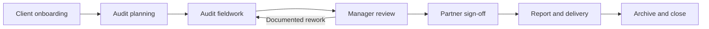
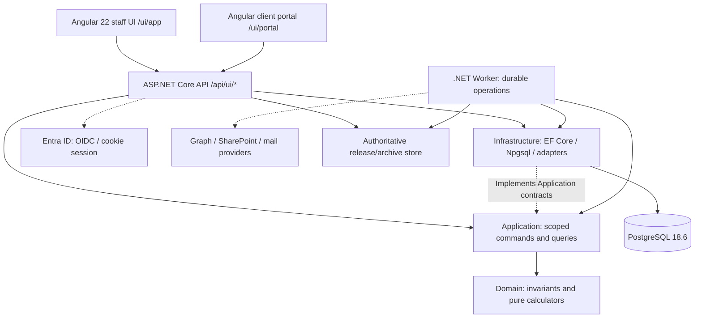

# AuditSphereOps

[](https://dotnet.microsoft.com/)
[](src/AuditSphereOps.Ui/auditsphere-angular-development.md)
[](https://www.postgresql.org/)
[](https://learn.microsoft.com/ef/core/)

**AuditSphereOps** is an audit, accounting, and practice-management platform for accounting firms. It connects client onboarding, engagement management, professional audit work, financial-statement preparation, time and billing, controlled deliverable release, records, and group consolidation within a **.NET modular monolith with an Angular frontend**.

> **Release status: under active development — not verified as 100% complete or production-ready.** Major functionality is implemented, but complete end-to-end acceptance, approved professional policies, live Microsoft 365/SharePoint evidence, operational recovery, and release sign-off remain separate obligations. Do not infer readiness from a route, UI page, green focused test, or documentation checkmark. Use the [current execution evidence](docs/execution/status.json), [active handoff](docs/execution/auditsphere-execution-current-slice.md), and [production-readiness tracker](docs/execution/auditsphere-execution-audit-production-readiness-gap-closure-current.md).
>

## What AuditSphere covers

The [current STE v2.2 functional requirements](docs/requirements/auditsphere-accounting-module-requirements-current.md) define five connected modules. The following table describes **capability foundations present in the repository**, not universal functional acceptance.

| Area | Capability foundations | Still requires completion or acceptance |
| --- | --- | --- |
| Commercial, CRM, and onboarding | Leads, client and relationship records, proposals, reviewed quotations, acceptance/continuance, engagement letters, fee agreements, and dual-key gating | Complete commercial exceptions, provider delivery evidence, renewal policy and role-specific end-to-end journeys |
| Administration and planning | Scoped users and staffing, capacity, budgets, materiality, risk routing, workflow templates, deadlines and task queues | Remaining assignment/recurrence semantics, professional rules and full workflow acceptance |
| Audit execution | Controlled programmes, PBC/evidence, source-backed listing capture and independent review through the API/Angular fieldwork workspace; the reviewer sees accepted-source identity, per-account tie-outs and paged original rows bound to the exact capture hash; typed catalogs, source-currentness fences, guarded sampling, and append-only cut-off/subsequent-settlement records | T058 remains partial: subsequent references are auditor-entered and are not validated bank/GL row links; finding linkage, approved cut-off/MUS methodology, rendered acceptance, exact-source CI and qualified methodology acceptance remain open |
| Financial reporting and records | TB/GL intake, mapping, adjustments, reconciliations, statement/notes preparation, report artifacts, Partner decisions, signing and archive workflows | Complete policy-backed financial packages, terminal-completion policy, release/custody and production acceptance |
| Practice management | Time, rates, utilization, invoice and payment workflows, receivables, firm expenses and ledger/reporting | Broader fee and exception policies, connected reporting checks and production operations |
| Client accounting and consolidation | External-source accounting, separately gated native bookkeeping, group/scopes, component packages, FX, intercompany and eliminations | Full service-mode/cutover verification, accounting-policy fixtures, source-currentness and end-to-end acceptance |
| Microsoft 365 and client collaboration | Entra authentication, capability-specific Graph integrations, SharePoint document operations, client-site intentions, controlled worker operations | Exact-grant/live-provider verification, real-tenant consent, operator custody and deployment acceptance |

A supplemental comprehensive gap guide is used as a cross-check against the approved requirements and existing 31-task plan; actionable findings stay in the existing execution ledger rather than a duplicate backlog, and professional/live-provider gates remain separate.

**T058 verification update:** Focused fieldwork/successor regressions pass after correcting the Sampling-tab keyboard-focus guard and test setup. Exact run IDs, counts and current-source CI state are recorded in the execution status; current-source full verification remains pending.

**Schedule-source review update:** The independent-review preview now includes the exact accepted PBC/TB/period context, source hash, account-level reconciliation, and bounded pages of original listing cells. Review assent stays disabled until the exact preview's retained-row page loads. A PostgreSQL-backed API test creates accepted synthetic PBC/TB sources, confirms preparers receive HTTP 403, and verifies the independent reviewer endpoint returns the exact captured row and bounded-page metadata. Focused Domain, API and Angular results, builds, lint and OpenAPI checks are recorded in [execution status](docs/execution/status.json). The current exact-source full run follows the committed OpenAPI correction; no Playwright or built-in browser reviewer journey, professional approval or full-suite acceptance is claimed.

**Client-portal capability and recovery update:** Focused request checks retain independent upload/reply permissions, the service-matched 250 MiB PBC limit, and current-page count labels. The existing Playwright recovery journey now loses the initial response after the server commits one upload intent and loses a committed chunk acknowledgement; reselecting the exact file resumes that same intent. The focused local result and current exact-source CI status are recorded in [execution status](docs/execution/status.json). WU-034 remains partial: provider receipt, professional acceptance, broader accessibility and whole-portal acceptance remain separate.

**Schema-boundary verification update:** The WU-004 catalog check requires exact composite-FK column mapping, including `firm_id` on both sides. Budget approval and preparation receipts now enforce firm-scoped references to both budgets and engagements; focused cross-firm probes were refused by their expected constraints. Other candidate links still need valid fixture rows, and append-only/upgrade-path coverage remains incomplete, so WU-004 is partial. Evidence and probe boundaries are in [execution status](docs/execution/status.json).

**Finding receipt refresh update:** After lost-response recovery, the verified actor-owned receipt remains visible only while its finding refreshes, and disappears when authorized data is unavailable. See [execution status](docs/execution/status.json) for the current verification state.

**Deployment-binding verification update:** WU-024 now has a synthetic-only render of every profile in the approved Acceptance Compose target. Its selected capability identities, worker roles, declared images, storage roots, and credential isolation passed the offline binding checks (25 pass, 0 fail); the role-specific outbound-host policy remains missing. The 32 focused offline assertions pass. Both read-only result envelopes correctly remain `INCOMPLETE_EVIDENCE`; runtime mounts/readiness, schema compatibility, egress policy, rollback and live acceptance are unverified. See [execution status](docs/execution/status.json).

**Completion-evidence update:** The completion API and screen now expose exact package-review, Partner-clearance/Summary Review Memorandum, opinion, and received-representation identities separately. Opinion display requires a current SRM and its matching clearance; retained package decisions remain distinct from current package readiness, and representation records are not implied to be bound to a package or signed letter. Focused checks and exact-source CI status are recorded in [execution status](docs/execution/status.json). WU-035 remains partial pending full CI, browser acceptance and professional review.

**Connected-journey evidence update:** Focused synthetic Playwright journeys cover lead-create recovery, proposal independent review and client response, client-conversion recovery, approved-rate/FSLI-linked time, and PBC-to-fieldwork review. The PBC staff-inbox case now creates a request through the staff UI, uploads against that same request through the client portal, completes the durable worker transfer, and verifies independent reviewer acceptance against the exact file hash and receipt. This connects the PBC handoff across three application identities without pre-seeding the upload. Other journeys still use separate fixtures; together they do **not** prove one identity through the full commercial-to-archive lifecycle. WU-039 remains partial, including broader planning, reporting, firm-ledger, archive and professional/live acceptance. The combined eight-case `WU-039` filter now passes locally (8 passed, 0 failed, 0 skipped) on the `940ff390` code; exact-source full CI remains running. Details are in [execution status](docs/execution/status.json).

The 2026-10-25 exact-source full run found one Domain assertion comparing a pre-save timestamp with its PostgreSQL projection. The assertion now compares against the persisted timestamp while retaining exact representation ID and signatory checks; the named test passes locally, and corrected-source full CI is pending.

The latest full verification exposed an accounting-profile assent defect, a stale completion-screen test locator, and an unexplained timeout while checking revoked-scope behavior. The assent behavior and locator are corrected and their focused Playwright journeys pass; the timeout remains under observation. Follow-up exact-source verification is running, and the canonical run-by-run evidence is in [execution status](docs/execution/status.json).

**Axelor-inspired UX update:** Remaining workspace changes add exact proposal comparison, equivalent pipeline views, pinned task-plan context, invoice source evidence and read-first financial actions, and keyboard resource inspection. Focused checks, selected built-in browser journeys, connected synthetic source-lineage checks and a previous-UI compatibility rehearsal passed. Exact-candidate full CI and broader human/rendered acceptance remain open. See the [UX tracker](docs/execution/auditsphere-execution-tracker-axelor-practice-ux-current.md) and [execution status](docs/execution/status.json). No full local suite ran.

The [product brief](docs/requirements/auditsphere-requirements-specification-product-brief-current.md) and [practice-management crosswalk](docs/execution/auditsphere-execution-tracker-practice-management-v22-crosswalk-current.md) define scope more precisely. The [API/Angular parity tracker](docs/execution/auditsphere-execution-tracker-api-angular-parity-current.md) distinguishes implemented code from browser/CI acceptance. The [v3 screen-to-code matrix](docs/design/auditsphere-ux-matrix-v3-screen-to-code-proposed.md) is **PROPOSED**, not proof of 19-screen production parity.

### Audit engagement lifecycle

AuditSphere displays **seven user-facing phases** over **eleven evidence-derived canonical states**:



A task completion or UI action **never sets an audit lifecycle state directly**. Transitions are projected from actual commercial acceptance, risk clearance, recorded advance payment, professional review, Partner decision, report issuance, and file-freeze evidence. Newly activated audit engagements require the applicable **dual-key acceptance** and a linked **fully paid and allocated 50% advance**; a draft invoice or historic paid label does not waive the current cash gate. The workflow preserves independent reviewers and human audit opinions.

### Financial boundaries and service modes

| Boundary | Source of truth | Non-negotiable rule |
| --- | --- | --- |
| **Firm ledger** | Practice fees, invoices, cash allocations, expenses, posted firm accounting | Never post client bookkeeping transactions to the firm's books |
| **Client accounting** | Imported client TB/GL, financial reporting inputs, approved adjustments, optionally native client bookkeeping | A proposed audit adjustment is not an automatic client-book posting |
| **Group consolidation** | Exact approved component identities, ownership, FX, intercompany and elimination evidence | Never alter component companies' underlying books |

Client accounting defaults to **`EXTERNAL_SOURCE`**. The `NATIVE_BOOKKEEPING` path is an explicitly authorized, reviewed client-service mode and requires controlled cutover. Its supported pathways are not a commitment to deliver every ERP function. Inventory/procurement execution, payroll execution, payment initiation, external tax filing, autonomous audit opinions, Microsoft Purview and third-party eSignature providers are outside the approved core scope. VAT/tax is separately gated.

## Architecture



| Project | Responsibility |
| --- | --- |
| `src/AuditSphereOps.Domain/` | Domain entities, state rules, immutable financial and audit invariants, pure calculations |
| `src/AuditSphereOps.Application/` | Static capability services, commands, queries, scope authorization, workflow rules and operation contracts |
| `src/AuditSphereOps.Infrastructure/` | EF Core 10, Npgsql, the capability-split `AuditSphereDbContext`, migrations and provider implementations |
| `src/AuditSphereOps.Api/` | ASP.NET Core 10 API, secure session boundary, OpenAPI, Angular asset hosting, protected upload/download transports |
| `src/AuditSphereOps.Ui/` | Angular 22, TypeScript, Material/CDK, standalone staff and client experiences |
| `src/AuditSphereOps.Worker/` | Durable background processing, idempotent retries, reconciliation, isolated external-effect workers |

The **Angular UI is canonical**. The former Blazor/Web rollback host was physically retired; do not recreate it from historical requirements. Retirement itself did **not** establish complete migration or rollback acceptance. The binding references are the [current architecture](docs/architecture/auditsphere-architecture-current-architecture.md), [architecture code map](docs/architecture/auditsphere-architecture-code-map.md), and [ADR register](docs/architecture/adr/auditsphere-architecture-index-adr-register-current.md). The [enterprise target document](docs/architecture/auditsphere-architecture-specification-enterprise-target-proposed.md) is **PROPOSED**, not automatic implementation authority.

### Security and financial integrity

- **Authentication:** server-managed Microsoft OIDC and secure cookie sessions; the Angular browser does not store Graph credentials or bearer access tokens. API session authentication is not a substitute for business authorization.
- **Authorization:** Application-level, current `RoleGrant` scope (`FIRM_WIDE`, `CLIENT`, `ENGAGEMENT`, `GROUP`), session freshness, separation of duties and independent professional/finance approvals. Angular `can*` flags are hints only.
- **Financial correctness:** C# `decimal`, PostgreSQL `numeric(19,6)` by default, explicit module precision and `MidpointRounding.ToEven` where specified. API monetary values are exact decimal strings. No fabricated FX rates, balances or professional conclusions.
- **Evidence and concurrency:** append-only history and SHA-256 identities; approved/sealed/posting corrections use revisions or reversals. Revision fences and persisted receipts guard stale or uncertain commands. Never blindly retry a payment, release, external provider effect or other uncertain write.
- **HTTP boundary:** OpenAPI 3.1 at `contracts/auditsphere-openapi.json`, explicit rate classes, bounded request sizes, safe errors, anti-CSRF protection, security headers and cache policy. See the [HTTP contract authority](docs/architecture/auditsphere-architecture-http-boundary-and-contract-current.md).

## Developer quickstart (macOS)

### 1. Toolchain

Use the **exact versions pinned by this checkout**, not whichever SDK is newest.

| Tool | Repository pin or requirement |
| --- | --- |
| .NET SDK | **10.0.300**, exact match; `global.json` disables roll-forward |
| C# | 14; `Directory.Build.props` enables nullable references and warnings-as-errors |
| EF Core / Npgsql | EF Core **10.0.12**, Npgsql EF provider **10.0.0** (central NuGet versions) |
| Node.js | **26.8.1** from `src/AuditSphereOps.Ui/.nvmrc` |
| npm | **11.19.0** declared in Angular `package.json` |
| Angular / Material/CDK | **22.2.1** dependency pins; Angular CLI **22.2.3** |
| PostgreSQL | **18.6** project development/CI baseline; local port **5433** |
| PowerShell (optional for M365) | PowerShell **7.4 or newer**; use pinned modules from `scripts/m365/modules.lock.json` |

On a new checkout, install dependencies **once** or when a lockfile/toolchain changes:

```bash
git clone https://github.com/nirzaf/AuditSphere.git
cd AuditSphere

dotnet --version             # must match global.json

dotnet tool restore
dotnet restore AuditSphereOps.slnx --locked-mode

nvm install "$(cat src/AuditSphereOps.Ui/.nvmrc)"
nvm use "$(cat src/AuditSphereOps.Ui/.nvmrc)"
npm --prefix src/AuditSphereOps.Ui ci
```

### 2. Local PostgreSQL

The application and tests use PostgreSQL—not EF InMemory. The local development database is `auditsphere`; tests use a separate **disposable** `auditsphere_tests` database. Do not point test/migration commands at an existing customer or production database.

For an existing Homebrew PostgreSQL 18 installation, a typical Apple Silicon/macOS setup is:

```bash
export PATH="$(brew --prefix postgresql@18)/bin:$PATH"
PGDATA="$(brew --prefix)/var/postgresql@18"
pg_ctl -D "$PGDATA" -o '-p 5433' start     # only if this cluster is stopped
createdb -h 127.0.0.1 -p 5433 auditsphere       # only if absent
createdb -h 127.0.0.1 -p 5433 auditsphere_tests # only if absent
```

Your existing cluster location, database role and authentication policy may differ. Verify them before running these commands. Supply the development API connection string and approved development identity through **user-secrets/private environment configuration**, never by committing credentials. Local database migrations must be deliberately targeted at the development database; see the [data model and migration contract](docs/architecture/auditsphere-architecture-contract-data-model-current.md).

### 3. Start the app

In separate terminals after configuring the approved local database and authentication settings:

```bash
# Terminal 1 — API in Development mode (localhost:5100)
./scripts/dev/backend-watch.sh

# Terminal 2 — Angular dev server (localhost:4200)
npm --prefix src/AuditSphereOps.Ui start
```

Open **http://localhost:4200/ui/app** for the staff workspace. Client sessions use `/ui/portal`, with separate role/scope checks. The development Angular server proxies backend requests to port `5100`; the script refuses to start another API when that port is already occupied. A new installation **does not have a preapproved default administrator**; follow the initial Microsoft-identity/bootstrap procedure in [Angular development](src/AuditSphereOps.Ui/auditsphere-angular-development.md) and the [tenant runbook](docs/operations/auditsphere-operations-runbook-client-tenant-microsoft365-current.md).

For an **API-hosted** local preview, build Angular assets first, configure the approved private settings, and follow [the alternative preview procedure](src/AuditSphereOps.Ui/auditsphere-angular-development.md). Do not confuse the dev proxy with an authenticated production deployment.

## Fast verification and CI/CD

**Development principle:** small, relevant checks after a coherent change; full regression only in CI/CD. Reuse existing focused tests and add the minimum high-signal coverage needed for changed security, accounting, approval or concurrency behavior.

```bash
# Explore focused test packs for changed capabilities
./scripts/agent-check --list
./scripts/agent-check <capability> --run

# Check a specific existing .NET test class (replace with the actual class)
dotnet test tests/AuditSphereOps.Domain.Tests/AuditSphereOps.Domain.Tests.csproj \
  --no-restore -c Release --maxcpucount:1 \
  --filter 'FullyQualifiedName~ChangedBehaviorTests'

# Check one Angular spec (replace with the actual file)
npm --prefix src/AuditSphereOps.Ui run test:ci -- \
  --include 'src/app/features/example/affected.spec.ts'

# Static/diff/contract checks when impacted
git diff --check
bash scripts/contracts/verify-openapi.sh
```

Do not run an unfiltered local test suite after every edit. Use the relevant `src/AuditSphereOps.Ui` file-lint command, focused PostgreSQL/API tests, EF model drift check or Release build **only when affected**. Never reduce testing by removing meaningful authorization, money or immutable-evidence assertions.

| CI workflow | Purpose | What a pass proves |
| --- | --- | --- |
| [`.github/workflows/ci.yml`](.github/workflows/ci.yml) | Fast push/PR gate: Angular lint/build/specs, .NET Release compilation, contracts, database-free guards and docs | Those fast checks passed on the tested SHA; **not** complete .NET or browser regression |
| [`.github/workflows/release-verification.yml`](.github/workflows/release-verification.yml) | Nightly/manual, commit-pinned complete Angular and unfiltered Domain/API/Playwright E2E suites with isolated PostgreSQL | Full automated **test** evidence only after every required job and the aggregate gate succeed on the **same SHA** |
| [`.github/workflows/release.yml`](.github/workflows/release.yml) | Release/evidence-controlled deployment process | Does not remove live-provider, professional or operator acceptance requirements |

Always inspect the [Actions runs](https://github.com/nirzaf/AuditSphere/actions) and `docs/execution/status.json` for the exact **tested commit**. A queued, running, historical or partly successful workflow is not `FULL_CI_PASS`.

**Hostinger rollout:** The exact-source API retry found one stale route-catalogue assertion: it listed `/ui` and `/ui/` as separate endpoints. The assertion now models the single root endpoint; existing host coverage still checks both request forms. CI for the correction is pending. The prior browser suite passed, and the restored-copy rehearsal preserved existing rows. Deployment awaits passing current-source CI and release checks; outbound mail stays paused until signed authorization evidence is installed.

## Microsoft 365, SharePoint, and operator automation

AuditSphere uses **separately credentialed capabilities** for Entra login, directory/admin functions, mail, document transfers and client-site administration. Standard document access uses exact-resource grants; the separately approved privileged `client-sites` worker performs site provisioning and assigned-staff membership reconciliation. Its elevated SharePoint authority must not be shared with the general API, mail or document workers.

Runtime worker profiles include `general`, `processing` and `records` (core work), plus isolated `mail`, `pbc` and `client-sites` groups. Approved Production live groups require explicit `Worker:ApprovedLiveGroups`, configuration, credential custody and successful readiness checks. **Code supporting a group does not mean it is deployed, consented or live-accepted.** The checked-in Azure Bicep production topology does not yet configure all the external-effect workers and production credentials; read the [deployment IaC runbook](infra/auditsphere-deployment-iac-runbook.md) before making claims about deployability.

The `scripts/m365/` directory contains PowerShell planning, application/certificate, permissions, site, mail, readback and verification utilities. Every operation must follow the selected script's contract: `Plan`/`-DryRun`/`-WhatIf` are offline, `ReadOnly` requires the proper approved operator connection, and `Apply` is controlled by approved plan identities and evidence. **No script's mere existence authorizes admin consent, privileged grants or tenant mutation.** Do not commit private keys, tokens, certificates with private material, or customer plans.

Example **offline** prerequisite check using the repository's synthetic fixture:

```bash
pwsh -NoProfile -NonInteractive -File scripts/m365/Test-M365Prerequisites.ps1 \
  -PlanPath scripts/m365/tests/fixtures/plan.synthetic.json \
  -Mode Plan -DryRun -OutputPath /tmp/auditsphere-m365-prerequisites.json
```

See the [tenant automation runbook](docs/operations/auditsphere-operations-runbook-client-tenant-microsoft365-current.md), [configuration reference](docs/operations/auditsphere-operations-reference-microsoft365-configuration-current.md), [M365 permission matrix](docs/architecture/auditsphere-m365-tenant-administration-permissions.md), and [client-site architecture](docs/architecture/auditsphere-client-sharepoint-sites-current.md).

**Archive trust boundary:** the append-only release/archive store is authoritative for issued bytes and SHA-256 manifests. The SharePoint archive library is a **secondary copy**. Local freeze, requested external protection, and verified external read-only/hash readback are distinct states; assigned staff's Full Control on the working site is not equivalent to immutable archive custody. Certificate-backed report signing uses a firm-held certificate when configured/required; legal trust, long-term validation and real-certificate acceptance are separate decisions.

## Production readiness and remaining work

Do not report **100% complete** until the selected service scope satisfies all of the following with dated, exact-commit evidence:

1. **Functional:** authoritative STE v2.2 and applicable approved ADR criteria have connected, authorized UI → API → Application → persistence/worker journeys; the requirement manifest is more than source traced.
2. **Financial/audit:** qualified policies and golden examples are approved; client-book, firm-ledger and group boundaries, maker/checker, signing, terminal procedure dependencies and historical evidence behave correctly.
3. **Security/UI:** client/firm/sibling scope denials, session revocation, direct/deep links, recovery, keyboard access, responsive views and supported assistive technology are accepted. Automated accessibility checks **do not substitute** for any required qualified human review.
4. **External services:** actual Entra consent, capability-specific credentials, selected-site denial probes, SharePoint copy/grant/hash readback, mail/provider paths and operator custody have been observed in the authorized environment.
5. **Operations:** deployment configuration, secrets, migrations, backup/restore, RPO/RTO, observability and release rollback are accepted; **current-candidate** full CI passes.

The live list of unresolved work is in the [task board](docs/execution/auditsphere-execution-index-task-board-current.md), [parity tracker](docs/execution/auditsphere-execution-tracker-api-angular-parity-current.md), [requirement manifest](docs/spec/completion-requirement-manifest.json), [policy decision register](docs/spec/completion-policy-decisions.json), and [current execution handoff](docs/execution/auditsphere-execution-current-slice.md). These files track different things: **source presence, focused verification, workflow acceptance, professional decisions and production readiness must not be conflated**. The generated task board contains older code-audit baselines; always reconcile against current source and newer ledger entries before selecting work.

## Repository documentation and agent workflow

| Start here | Purpose |
| --- | --- |
| [`AGENTS.md`](AGENTS.md) / [`CLAUDE.md`](CLAUDE.md) | Binding engineering protocol, scope, minimal tests, CI and approval boundaries |
| [Documentation index](docs/auditsphere-docs-index.md) | Locate current requirements, architecture, ADRs and operational references |
| [Architecture code map](docs/architecture/auditsphere-architecture-code-map.md) | Find the actual owning Application capability, API endpoint and Angular component |
| [HTTP/OpenAPI contract](docs/architecture/auditsphere-architecture-http-boundary-and-contract-current.md) | Exact transport/security and drift rules |
| [Angular conventions](docs/architecture/auditsphere-angular-conventions-current.md) | Signals, decoders, server `can*` flags, safe drafts, accessible design patterns |
| [Autonomous completion specification](docs/architecture/auditsphere-autonomous-completion-remediation-spec.md) | Dependency-ordered agent work and resume/checkpoint expectations |
| [`scripts/agent/complete.py`](scripts/agent/complete.py) | Bounded, resumable developer supervisor (`init`, `next`, `run`, `resume`, `status`, `verify`); **not** a release authority |
| [Evidence ledger](docs/execution/status.json) | Exact observed tests/CI, blockers and source identities |

Developers and coding agents should follow `AGENTS.md` and approved ADRs, preserve unrelated work, and make the smallest coherent change with targeted verification. A script, green CI, agent decision, or automated review **cannot substitute for human professional approval, real customer consent or authorization to deploy/change production permissions**. Do not introduce another backend framework, ERP, broker, microservice architecture or unapproved dependency to close an ordinary feature gap.
