# STE Audit Management Tool

**Functional Requirements & End-to-End System Workflow Specification**

Document Version: 2.2
Target Focus: Business Logic, Functional Requirements, Task Sequences & Module Workflows
Auditing Standards Context: International Standards on Auditing (ISA) & International Financial Reporting Standards (IFRS)
Primary Currency: Qatari Riyal (QAR)
---

> **Source and conversion scope**: Converted from the updated **Audit Management Tool Specification v2.2** in Google Drive. The five original modules, original eleven-stage state table, source requirements and v2.2 enhancements are retained. ASCII illustrations have been translated into executable Mermaid diagrams. Diagram labels summarize the surrounding requirements and should not be treated as additional authorization rules.


**Original source:** [Audit Management Tool Specification — Google Docs](https://docs.google.com/document/d/1Dl_8Lj5NnFUqqhYVraiNnq0HGRktC0eonyMOm-ZN0NA/edit)

### Contents

- [Workflow experience and visual overview](#workflow-experience-addendum--version-22)
- [1. Requirements and operational context](#1-requirement-gathering--operational-context)
- [2. Functional module connectivity](#2-project-modules-connectivity-diagram)
- [3. End-to-end workflows](#3-end-to-end-project-task-flows--sequence-maps)
- [4. Functional requirements](#4-module-by-module-functional-requirements)
- [5. Eleven-state authoritative lifecycle](#5-system-state-machine--lifecycle-transitions)
- [6. Seven-phase user experience requirements](#6-simplified-seven-phase-engagement-workflow--new-requirements)
- [7. Architectural safeguards](#7-architectural-non-regression-requirements--new)

## Workflow Experience Addendum — Version 2.2

The product SHALL present a Karbon-inspired, easy-to-follow seven-phase engagement workflow while preserving all five functional modules and the eleven mandatory backend lifecycle states in Section 5. The display phases are a projection of audited business records; they are NOT a second state machine. Completing a UI task never substitutes for a verified acceptance, finance, audit review, Partner, release or archive command.

Seven visible phases: 1. Client Onboarding; 2. Audit Planning; 3. Audit Fieldwork; 4. Manager Review; 5. Partner Sign-off; 6. Report & Delivery; 7. Archive & Close.

Design principles: show current phase, responsible role, next action, due date, completion progress and exact blockers; expand advanced checks inside a phase; display Waiting for Client, Under Review, Rework Required and Blocked clearly. Keep internal lifecycle codes away from ordinary navigation. The existing detailed requirements remain authoritative.


## Visual overview — seven user-facing phases

The diagram below is a **simplified user-facing projection**, not a new backend state machine. In particular, Dual-Key Acceptance is a subsection of Client Onboarding, and the advance-payment gate remains distinct.

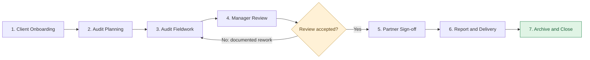

### Two-layer authority model

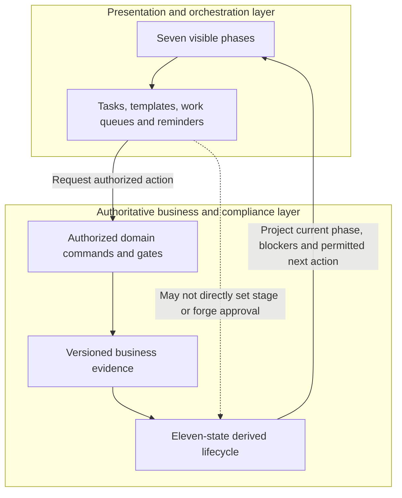

## 1. Requirement Gathering & Operational Context

### 1.1 Business Objectives & Problem Statement

* Elimination of Per-File Licensing Penalties: Existing commercial platforms enforce rigid licensing tiers (e.g., limits of 130 client files) that charge steep incremental fees for additional files. The in-house platform must support an unlimited number of client entities, historical engagements, and working papers with zero subscription penalties.
* Unified Engagement Lifecycle: Centralize commercial sales, administrative governance, compliance clearance, audit fieldwork execution, multi-tier quality reviews, client deliverable generation, and internal firm practice management into a single, cohesive workflow.
* Standardized Auditing Governance: Standardize firm-wide execution in strict alignment with International Standards on Auditing (ISA), including:
  * ISA 210: Agreeing the Terms of Audit Engagements (Engagement Letters).
  * ISA 220 & ISQC 1: Quality Control for an Audit of Financial Statements (Client Acceptance & Continuance).
  * ISA 230: Audit Documentation (60-day assembly and regulatory locking).
  * ISA 320: Materiality in Planning and Performing an Audit.
  * ISA 505: External Confirmations.
  * ISA 570: Going Concern.
  * ISA 700 & 705: Forming an Opinion and Reporting on Financial Statements.

---

### 1.2 User Personas & Responsibility Matrix


| User Role | Persona | Functional Scope & Responsibilities |
| :---- | :---- | :---- |
| PREPARER | Audit Associate / Junior Auditor | • Executes assigned financial statement line item (FSLI) audit test procedures. • Uploads digital working papers and inputs physical binder index codes (X-1, Box 3). • Submits completed testing packages for managerial review. • Logs daily operational hours against assigned engagement tasks. |
| REVIEWER | Audit Senior / Audit Manager | • Verifies substantive testing and recalculated schedules. • Issues inline review notes and initiates the rework loop for incomplete tests. • Determines sampling parameters and calculates engagement materiality. • Prepares the Summary Review Memorandum (SRM) for the partner. • Tracks engagement budgets, team hours, and delivery milestones. |
| APPROVER | Engagement Partner | • Evaluates and signs off on the Dual-Key Acceptance Gate (AML/KYC). • Authorizes commercial proposals and executes Engagement Letters. • Clears high-risk (Red) audit areas and formally signs off on the SRM. • Selects the final Audit Opinion, applies digital signatures and firm seals. • Authorizes final deliverable bundles and enforces regulatory file locks. |
| CLIENT | Client Coordinator / CFO / MD | • Accesses an isolated, tokenized external workspace (PBC Portal). • Views requested audit documentation with real-time review status badges. • Uploads requested financial schedules, trial balances, and voucher evidence. • Receives invoices, receipts, holding letters, and final deliverables. • Access freezes automatically upon engagement sign-off. |

---

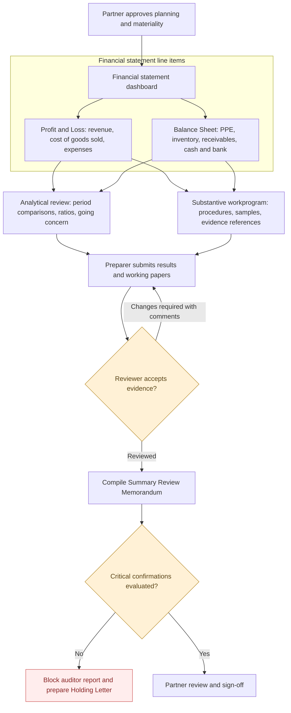


## 2. Project Modules Connectivity Diagram

The five core functional modules communicate across strict data boundaries. An engagement progresses sequentially through gates, ensuring administrative and compliance requirements are met before field testing begins.


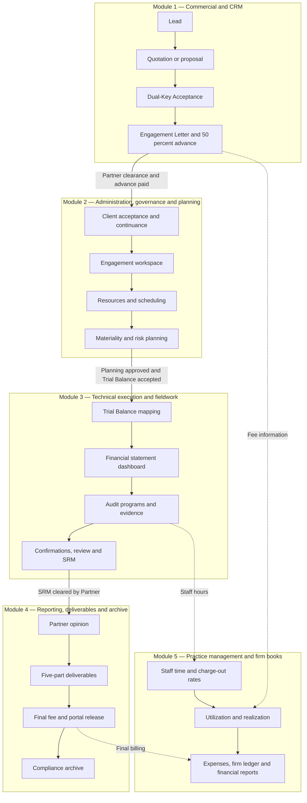


---

## 3. End-to-End Project Task Flows & Sequence Maps

### 3.1 Flow 1: Lead Ingestion to Dual-Key Client Onboarding

The onboarding path enforces an automated state machine. An Engagement Letter cannot be generated until commercial terms are accepted by the client and risk clearance is formally approved by the Engagement Partner.


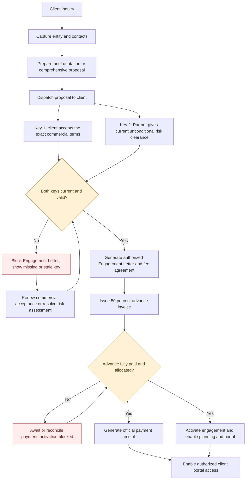


### 3.2 Flow 2: Planning, Resource Scheduling & Materiality Formulation

Once an engagement is onboarded, the system initializes project administration, provisions the document structure, assigns staff, and calculates materiality thresholds from Trial Balance benchmarks.


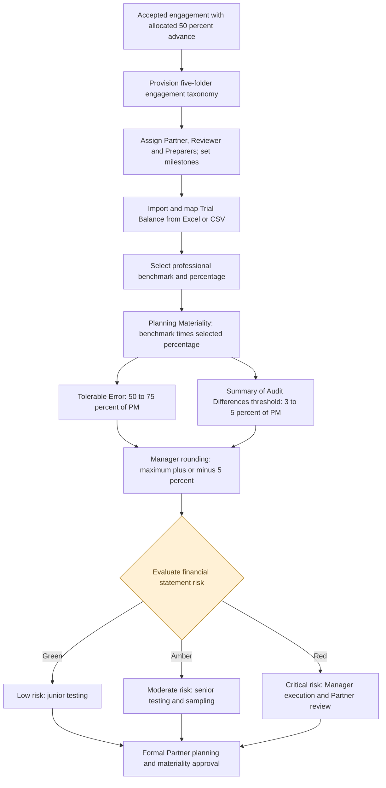


### 3.3 Flow 3: Technical Fieldwork Execution & Multi-Tier Review Matrix

#### Fieldwork execution — submit, review and rework

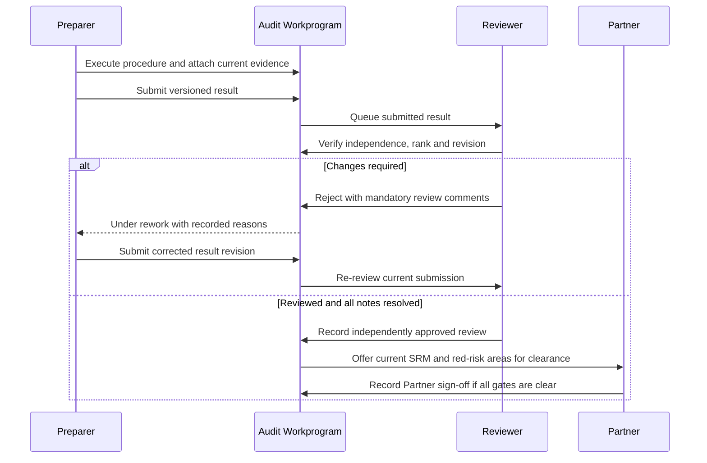


This phase constitutes the operational testing core. Line items on the Financial Statement Dashboard launch dedicated workprograms with row-level concurrency, allowing team members to execute testing in parallel.

### 3.4 Flow 4: Reporting, 5-Part Deliverable Release & Compliance Archive

Following Partner clearance of the SRM and confirmations, the engagement moves to formal closure. The Partner selects the opinion, embeds credentials, and releases the deliverables bundle alongside the final invoice.


```mermaid
flowchart TB
    SRM["Partner clears current SRM and required evidence"] --> CONF{"Critical confirmations returned and evaluated?"}
    CONF -->|"No"| HOLD["Hold auditor report and generate Pending Confirmation Letter"]
    CONF -->|"Yes"| OP{"Select audit opinion"}
    OP -->|"Unmodified"| CLEAN["Unmodified report basis"]
    OP -->|"Qualified, adverse or disclaimer"| BASIS["Require affected FSLI and documented basis"]
    CLEAN --> SIGN["Partner signs report and applies approved firm seal"]
    BASIS --> SIGN
    SIGN --> BUNDLE["Assemble five-part deliverables bundle"]
    BUNDLE --> D1["1. Auditor report and certified financial statements"]
    BUNDLE --> D2["2. Management Letter"]
    BUNDLE --> D3["3. Management Representation Letter"]
    BUNDLE --> D4["4. Management correspondence audit trail"]
    BUNDLE --> D5["5. Final balance fee note"]
    D1 --> RELEASE["Verify release authority; release to client"]
    D2 --> RELEASE
    D3 --> RELEASE
    D4 --> RELEASE
    D5 --> RELEASE
    RELEASE --> PORTAL["Freeze client upload privileges"]
    PORTAL --> TIMER["Countdown: 60 days after Partner report signature"]
    TIMER --> LOCK["Effective local read-only lock or authorized early lock"]
    classDef decision fill:#fff1d6,stroke:#b88b2c,color:#5d4316
    classDef stop fill:#ffeded,stroke:#c55353,color:#842b2b
    class CONF,OP decision
    class HOLD stop
```


### 3.5 Flow 5: Practice Management, Time Realization & Firm Bookkeeping

In parallel with client engagements, the platform captures operational actuals, calculates realization metrics, and maintains the firm's internal practice ledger.

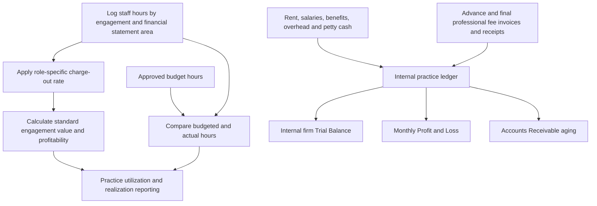


---

## 4. Module-by-Module Functional Requirements

### 4.1 Module 1: Commercial & CRM Pipeline

#### 1. Lead Capture & Client Profiles

* Ingest leads across Phone, WhatsApp, Email, Web Forms, and Referrals.
* Maintain complete organizational trees (Holdings, Subsidiaries, Affiliates).
* Multi-Contact Directory with role-based communication routing:
  * Managing Director / General Manager: Recipient of Proposals, Engagement Letters, and final reports.
  * Chief Financial Officer / Finance Director: Recipient of Commercial Invoices and Receipts.
  * Chief Accountant / Audit Liaison: Recipient of PBC operational document requests.

#### 2. Commercial Proposal Engine

* Brief Quotation (RFQ/RFP): Output a 1–2 page standardized summary showing engagement scope, statutory year, professional fees, payment terms (50/50), and execution timeline.
* Comprehensive Proposal: Auto-compile a multi-page presentation document incorporating:
  * 1. Firm Profile, History, and Commercial Registrations.
  * 2. Assigned Engagement Partner & Audit Team CVs.
  * 3. Industry-specific Credentials and Portfolio Evidence.
  * 4. Audit Methodology Overview (ISA compliance).
  * 5. Fee Schedule & Deliverables Timeline.

#### 3. Dual-Key Onboarding Gatekeeper

* The system shall strictly disallow the generation of an Engagement Letter until two independent authorization keys are marked active in the database:
  * Key 1 (Commercial Approval): Recorded confirmation of client quote acceptance.
  * Key 2 (Risk Clearance): Partner completion and digital sign-off of the Client Acceptance/Continuance Checklist.


#### Enhanced Dual-Key Acceptance — mandatory workflow requirements for version 2.2:

#### Dual-Key Acceptance — approval decision matrix

| Key 1: client commercial acceptance | Key 2: Partner risk clearance | Engagement Letter | Planning activation |
| --- | --- | --- | --- |
| Missing | Missing | Blocked | Blocked |
| Approved | Missing or stale | Blocked | Blocked |
| Missing or stale | Approved | Blocked | Blocked |
| Current and valid | Current and unconditional | Eligible for separately authorized issuance | Blocked until 50% advance is fully paid and allocated |
| Current and valid | Current and unconditional; 50% advance allocated | Eligible for separately authorized issuance | Eligible, subject to other holds and authorization checks |

#### Dual-Key Acceptance — actor sequence

```mermaid
sequenceDiagram
    participant Client
    participant CRM as Commercial Workspace
    participant Partner
    participant Risk as Acceptance Records
    participant Docs as Engagement Documents
    participant Finance
    participant Planning
    Client->>CRM: Accept exact dispatched quotation revision
    CRM->>Risk: Persist commercial response evidence
    Partner->>Risk: Review AML, KYC, independence and continuance
    Partner->>Risk: Record current risk decision
    CRM->>Risk: Recheck both independent approval keys
    alt Both keys current and approved
        Risk-->>Docs: Engagement Letter generation eligible
        Docs->>Finance: Initiate 50 percent advance fee workflow
        Finance->>Finance: Record and allocate payment
        alt Advance fully paid and no outstanding hold
            Finance-->>Planning: Activation may proceed through authorized command
        else Unpaid, partial, stale or held
            Finance-->>Planning: Activation blocked with exact reasons
        end
    else Missing or invalid approval
        Risk-->>CRM: Block document; show missing or stale key
    end
```


- **Key 1 — Client Commercial Acceptance:** Capture the client's acceptance of the exact dispatched quotation revision, scope, legal entity, service route, period, currency, fee and 50/50 payment terms. Record authorized contact, response channel, timestamp and linked acceptance evidence. A changed offer requires a renewed acceptance.

- **Key 2 — Partner Risk Clearance:** Independently require the Engagement Partner's current, unconditional client acceptance/continuance decision against the current due-diligence generation. Require AML/KYC, beneficial ownership, independence, conflicts, management integrity and other relevant risk checks. Conditional, rejected, superseded or stale decisions never clear this key.

- **Gate outcomes:** neither key \=\> blocked, two approvals needed; only Key 1 \=\> awaiting Partner risk clearance; only Key 2 \=\> awaiting client commercial acceptance; both current keys \=\> eligible for Engagement Letter, NOT automatically activated.

- The full 50% advance payment is a separate gate after the two keys: generate the Engagement Letter and advance invoice under their existing authorization rules; activate engagement and portal-enabled planning only after the linked 50% advance is fully paid and allocated. A partially paid or merely invoiced advance is not sufficient.

- **Changes and exceptions:** a declined proposal returns to revision/re-dispatch or closure; a conditional or refused Partner decision returns to risk remediation and fresh unconditional review; open holds, stale commercial revisions and mismatched client/service scopes block protected operations. Never let task completion, workflow rules or staff overrides bypass these guards.

- **Onboarding interface:** provide two independent approval cards, each showing Pending, Awaiting Evidence, Approved, Rejected or Stale as applicable, owner, time, evidence link, revision and authorized next action. Show a separate Engagement Letter readiness row and a third 50% Advance Payment card. Hide sensitive AML/KYC findings from the client portal.

- **Audit history:** preserve the authentic approving actor, decision generation, source evidence, timestamps and reason for rejection; re-evaluate both keys at document generation and activation, and reject stale or concurrently changed inputs.

- **Worked example:** on an accepted QAR 20,000 quotation, Partner acceptance is still mandatory before an Engagement Letter may be issued. Both keys permit letter issuance and the QAR 10,000 advance invoice, but activation waits until the full QAR 10,000 is received and allocated.


#### 4. Engagement Letter Generation (ISA 210)

* Automatically pull standardized templates based on engagement type:
  * External Statutory Audit Template
  * *Internal Audit / Agreed-Upon Procedures (ISRS 4400) Template*
* Require minimal manual field input (Client Legal Name, Period Covered, Agreed Fee, Submission Deadlines).
* Apply Partner digital stamp and signature upon generation.

#### 5. Advance Invoicing, Receipting & Portal Onboarding

* Generate the 50% Advance Invoice alongside the Engagement Letter.
* Record payment receipt with payment reference data (cheque, transfer code).
* Automated Receipt Generation: Instantly compile and dispatch an official payment receipt voucher to the client upon recording payment.
* Automated Client Portal Provisioning:
  * Auto-generate an isolated workspace for the client.
  * Email temporary access credentials to the designated Client Audit Liaison.
  * Enforce mandatory password reset on first login before document submission features are unlocked.
  * Surface real-time status badges on requested items: Pending Upload, Under Review, Approved, Rejected / Re-upload Required.
  * If an item is rejected, the auditor must enter a mandatory rejection reason that surfaces immediately on the client's screen.
  * Temporal Lock: Client document upload privileges automatically freeze when the final audit report is released.

### 4.2 Module 2: Administration, Governance & Planning

#### 1. Dual-Track Acceptance & Continuance Risk Gatekeeper

* Track A: New Client Acceptance Path:
  * Mandatory questionnaires: Ultimate Beneficial Ownership (UBO), Anti-Money Laundering (AML) background check, Know Your Customer (KYC) documentation, assessment of management integrity, financial viability evaluation, independence and conflict of interest checks.
* Track B: Recurring Client Continuance Path:
  * Delta review checklist: Settlement of prior-year professional fees, key management or shareholding changes, substantial new credit facilities or loans, ongoing litigation or legal notices, reported fraud or regulatory investigations.
* Mandatory Partner Sign-Off: Block project transition to operational planning until the Partner executes the digital acceptance gate.

#### 2. Resource Allocation & Scheduling

* Visual capacity calendar tracking team availability, target utilization, and leave schedules.
* Assign explicit roles: Engagement Partner (Approver), Audit Manager/Senior (Reviewer), and Associates (Preparers).
* Configure operational milestones relative to statutory cutoffs (e.g., December 31 year-end → fieldwork commences January Week 1 → draft report by February 15 → final signed report by March 15).

#### 3. Directory Provisioning

* Upon Partner risk acceptance, automatically provision the standard 5-folder engagement directory:
  * 01_Administration & Planning
  * 02_Trial Balance & Schedules
  * 03_Fieldwork & Testing
  * 04_Drafts & Deliverables
  * 05_Final Signed Archive

#### 4. 3-Tier Materiality Calculation Engine

* Dynamic Benchmarking: Link calculation directly to ingested Trial Balance balances:
  * Normalized Profit Before Tax: 5.0% \- 10.0%
  * Total Revenue: 0.5% \- 2.0%
  * Total Assets: 0.5% \- 1.0%
  * Equity / Net Assets: 1.0% \- 2.0%
* Core Output Calculations:
  * **Planning Materiality (PM):** Base × percentage.
  * Tolerable Error (TE) / Performance Materiality: 50% \- 75% of PM.
  * Summary of Audit Differences (SAD) Threshold: 3% \- 5% of PM (trivial error cutoff).
* Rounding Rule: Allow managers to apply practical rounding to computed materiality values within a strict ±5.0% maximum limit prior to Partner approval.
* Visual Color-Coded Risk Stratification:
  * **Green (Low Risk):** Balance below TE; standard automated audit programs; assignable to junior staff.
  * Amber (Moderate Risk): Balance between TE and PM; requires senior substantive testing and sampling.
  * Red (Critical / High Risk): Balance exceeds PM, involves critical accounting estimates, or carries high inherent risk; requires mandatory Manager-level execution and Partner review.

### 4.3 Module 3: Technical Execution & Audit Fieldwork

#### 1. Trial Balance Ingestion & Split Dashboard

* Ingest Trial Balance files via Excel/CSV (exported from QuickBooks, Tally, Zoho, etc.).
* Automated mapping to standardized Financial Statement Line Items (FSLI) with historical memory.
* Split Dashboard Interface:
  * Displays **Profit & Loss (P/L) Statement** on the upper half and **Balance Sheet (B/S)** on the lower half.
  * Displays Current Year Balance, Prior Year Comparative, and Percentage Variance per row.
  * Every line item features two interactive action triggers:
    * \[AR Test\]: Opens the Analytical Review Interface.
    * \[Audit Workprogram\]: Opens substantive audit procedures.
* Row-Level Concurrency: Ensure multiple auditors can simultaneously work on different line items (e.g., Auditor A on Sales, Auditor B on Fixed Assets) without file lockouts or overwrite conflicts.

#### 2. Workprogram Execution & Evidence Cross-Referencing

* Pre-loaded standard procedural checklists per FSLI (Ownership, Valuation, Completeness, Existence, Cut-off).
* Ad-Hoc Step Insertion: Allow field auditors to insert custom, editable procedural rows into active workprograms to address unique engagement risks.
* Sampling Engine: Built-in calculators for Monetary Unit Sampling (MUS), Systematic Random Sampling, and Stratified Attribute Sampling.
* Hybrid Evidence Linking:
  * Digital Evidence: Direct link to electronic spreadsheets, PDFs, and PBC uploads.
  * Physical Evidence Reference: Dedicated text field for physical file index tracking (e.g., File Index: X-1, Box 3, Shelf B).
* Analytical Review & Going Concern: Standard templates for comparative financial analysis and mandatory ISA 570 Going Concern compliance checklists.

#### 3. Three-Tier Review Matrix & Workflow Governance

* Preparer: Executes procedures, cross-references digital/physical evidence, and clicks \[Submit for Review\].
* Reviewer Rejection Loop:
  * Manager reviews completed tests.
  * Can flag individual steps, input mandatory review notes, and click \[Return with Comments\], automatically reverting the status to Under Rework and reassigning the Preparer.
* Summary Review Memorandum (SRM):
  * Auto-compiled upon Manager approval of all workprograms.
  * Summarizes high-level audit variances, adjustments (AJEs), unadjusted differences against SAD/PM, and significant accounting estimates.
* Approver Clearance: Partner conducts targeted reviews of high-risk (Red) areas and the SRM, formally signing off to unlock reporting.

#### 4. Third-Party Confirmations Dashboard

* Centralized tracking grid for Bank, Accounts Receivable, Accounts Payable, Inventory, and Legal confirmations.
* Holding Letter Blocker: If any confirmation marked as Critical remains unreturned, the system blocks the release of the final audit report and auto-generates a "Pending Confirmation / Holding Letter" to client management.

### 4.4 Module 4: Reporting & Final Deliverables

#### 1. Audit Opinion Selection Engine (ISA 700 / 705)

* Dedicated dropdown selector accessible exclusively by the Engagement Partner:
  * 1. Clean / Unqualified Opinion
  * 2. Qualified Opinion
  * 3. Disclaimer of Opinion
  * 4. Adverse Opinion
* Conditional Qualification Builder: Selecting Qualified, Disclaimer, or Adverse dynamically prompts the Partner to select the affected FSLI and input a mandatory textual justification. The system injects this text directly into the "Basis for Qualified/Modified Opinion" paragraph in compliance with ISA 705.
* Digital Credentials: Embeds the Partner's digital signature and official firm seal onto the final certified document.

#### 2. Mandatory 5-Part Commercial Deliverables Bundle

Once the Partner authorizes the file, the system compiles the final package:

* 1. Independent Auditor's Report & Audited Financial Statements: Certified, sealed, and digitally signed PDF.
* 2. Management Letter: Structured internal control observations report (Deficiency → Impact → Auditor Recommendation).
* 3. Letter of Representation (LOR): Formatted representation template populated with engagement figures, ready to be exported for printing on client letterhead, signed by executive management, and re-uploaded.
* 4. Management Correspondences Audit Trail: Summary of all formal audit inquiries, confirmation results, and cleared queries.
* 5. Final Balance Fee Note: Automated trigger generating the invoice for the remaining 50% professional fee balance.

#### 3. Regulatory File Lock (ISA 230)

* Enforce an automated 60-day regulatory file completion countdown timer starting from the date of the Partner's signature.
* Upon timer expiration (or manual Partner command), convert the entire engagement archive to Read-Only status. Deletions, modifications, and overwrites are permanently blocked.
* Maintain an immutable, timestamped audit log of all system actions, reviews, and sign-offs.

### 4.5 Module 5: Practice Analytics & Internal Bookkeeping

#### 1. Real-Time Profitability & Utilization Analytics

* Tiered Charge-Out Rates Engine:
  * Engagement Partner: 1,000 QAR / hour
  * Audit Manager: 750 QAR / hour
  * Audit Supervisor / Senior: 500 QAR / hour
  * Audit Associate / Junior: 200 QAR / hour
* Engagement Profitability Calculation:

Engagement Profitability \= Contracted Audit Fee \- Σ (Staff Hours Logged × Charge-Out Rate)

* Track budget vs. actual hours variance per engagement phase to evaluate realization rates and staff performance.

#### 2. Practice Ledger & Internal Bookkeeping

* Dedicated internal operational accounting ledger to record:
  * Office Rent & Facility Costs
  * Staff Salaries & Benefits
  * Partner Withdrawals
  * Petty Cash Expenses
* Internal Financial Reporting: Generate an internal firm Trial Balance, Monthly Profit & Loss Statement, and Client Accounts Receivable Aging Schedule (tracking 50% Advance and 50% Final Fee payments).

---

## 5. System State Machine & Lifecycle Transitions

### Canonical lifecycle — authoritative state diagram

The diagram represents the **eleven states in the source document's table**. Transitions must follow their underlying business commands and evidentiary gates; the diagram is not itself a permission model.

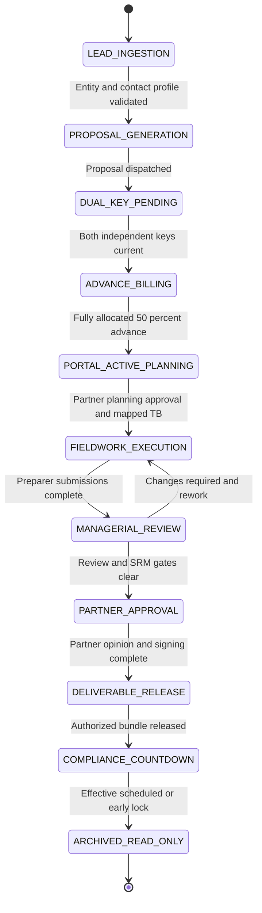

### Relationship between display phases and canonical states

| Display phase | Canonical states represented |
| --- | --- |
| 1. Client Onboarding | `LEAD_INGESTION`, `PROPOSAL_GENERATION`, `DUAL_KEY_PENDING`, `ADVANCE_BILLING` |
| 2. Audit Planning | `PORTAL_ACTIVE_PLANNING` |
| 3. Audit Fieldwork | `FIELDWORK_EXECUTION` |
| 4. Manager Review | `MANAGERIAL_REVIEW` |
| 5. Partner Sign-off | `PARTNER_APPROVAL` |
| 6. Report and Delivery | `DELIVERABLE_RELEASE` |
| 7. Archive and Close | `COMPLIANCE_COUNTDOWN`, `ARCHIVED_READ_ONLY` |


The eleven canonical states in the following table remain authoritative. New Sections 6 and 7 present a simpler seven-phase user-facing workflow but do not replace these gate conditions.

| Current State | Allowed Actions | Gate / Condition to Advance | Next State |
| :---- | :---- | :---- | :---- |
| LEAD_INGESTION | Log inquiry, capture company and contact data | Minimum entity and primary contact data validated | PROPOSAL_GENERATION |
| PROPOSAL_GENERATION | Build Brief Quote or Comprehensive Proposal, dispatch to client | Proposal dispatched via Email / WhatsApp | DUAL_KEY_PENDING |
| DUAL_KEY_PENDING | Complete Client Acceptance Checklist (AML/KYC), record client commercial approval | Dual-Key Clearance: Both Client Acceptance AND Partner AML Approval confirmed | ADVANCE_BILLING |
| ADVANCE_BILLING | Generate Engagement Letter & 50% Advance Invoice | 50% advance payment confirmed and recorded | PORTAL_ACTIVE_PLANNING |
| PORTAL_ACTIVE_PLANNING | Provision Client Portal, schedule team, ingest Trial Balance, calculate materiality | Planning signed off by Partner, TB mapped to FSLIs | FIELDWORK_EXECUTION |
| FIELDWORK_EXECUTION | Execute workprograms, attach digital/physical evidence, log confirmation requests | All assigned FSLI procedures submitted by Preparers | MANAGERIAL_REVIEW |
| MANAGERIAL_REVIEW | Review workpapers, issue review notes/rework, compile SRM | Zero open review notes, SRM compiled, critical confirmations returned | PARTNER_APPROVAL |
| PARTNER_APPROVAL | Partner inspects SRM, reviews Red-risk areas, selects Audit Opinion | Partner applies digital signature and firm seal | DELIVERABLE_RELEASE |
| DELIVERABLE_RELEASE | Generate 5-part deliverables package, issue 50% balance invoice, freeze client portal uploads | Final package generated and delivered to client | COMPLIANCE_COUNTDOWN |
| COMPLIANCE_COUNTDOWN | Review final archive; Partner may trigger early lock | 60 calendar days elapsed since signature date OR manual lock triggered | ARCHIVED_READ_ONLY |
| ARCHIVED_READ_ONLY | Read-only viewing and regulator inspection export | File is permanently locked; modifications strictly disallowed | Terminal State |

## 6. Simplified Seven-Phase Engagement Workflow — New Requirements
### 6.1 Purpose and mapping

This user-interface and task orchestration layer SHALL NOT modify the canonical Section 5 lifecycle state names, stage gates, reviews, or compliance evidence. Map stages as follows:
- Phase 1 Client Onboarding: LEAD_INGESTION, PROPOSAL_GENERATION, DUAL_KEY_PENDING, ADVANCE_BILLING.
- Phase 2 Audit Planning: PORTAL_ACTIVE_PLANNING.
- Phase 3 Audit Fieldwork: FIELDWORK_EXECUTION.
- Phase 4 Manager Review: MANAGERIAL_REVIEW, with procedure-level rework loop back to affected fieldwork.
- Phase 5 Partner Sign-off: PARTNER_APPROVAL.
- Phase 6 Report & Delivery: DELIVERABLE_RELEASE.
- Phase 7 Archive & Close: COMPLIANCE_COUNTDOWN and ARCHIVED_READ_ONLY.
### 6.2 Engagement dashboard

Show a seven-step visual tracker with simple titles, responsible user, relevant milestone/date, task completion, gate readiness, explicit blockers and the next permitted action. Offer expandable phase checklists and contextual links to client, planning, financial statement line item, PBC, review, completion, finance and records workbenches. Distinguish task completion from regulatory clearance. Make the design responsive and keyboard accessible.
### 6.3 Phase detail requirements
- **Client Onboarding:** quotation and client response, separated dual-key approvals, Engagement Letter, 50% invoice/payment and activation eligibility.
- **Audit Planning:** staff and deadlines, workspace provisioning, TB import, approved mapping, materiality PM/TE/SAD, risk routing and Partner planning approval. Updated inputs must invalidate stale approvals.
- **Audit Fieldwork:** FSLI action links, workprograms, evidence, analytical reviews, sampling, preparer assignments and versioned result submission.
- **Manager Review:** independent reviewer authority and risk-based hierarchy; mandatory comments on rejection; preserve history and route affected work back to its preparer; resolve all relevant review notes; compile a current SRM.
- **Partner Sign-off:** review high-risk areas/SRM, select an ISA opinion and rationale when modified, and sign the final report under approved credentials.
- **Report & Delivery:** independently evaluated critical confirmations, controlled audited statement and report delivery, management letter, LOR, correspondence, final fee note and release checkpoints.
- **Archive & Close:** signature-anchored 60-day countdown, authorized early lock and effective local read-only freeze. Show external provider retention/protection independently; an expired timer alone is not archive success.
### 6.4 Reusable practice templates

Permit administrator-approved versioned templates by engagement type and industry, with editable task groups, owners, due-date offsets, dependencies, effort estimates, client requests and ad-hoc tasks. Pin a template revision to each engagement; changes to templates do not silently rewrite existing work. These templates cannot remove mandatory domain gates. Provide My Tasks, Team Work, Waiting for Client, Under Review, Rework, Overdue and Completed list filters plus Kanban/calendar views.
### 6.5 Recurring audit engagements

Support creating the next annual engagement with reusable templates, prior-year client details and historical mapping suggestions. Require fresh commercial consent, current Partner continuance risk approval, current TB/materiality, professional audit review and reporting decisions. Never carry prior-year acceptance or opinion sign-offs forward as valid authorization.
### 6.6 Safe workflow automation

#### Safe task orchestration boundary

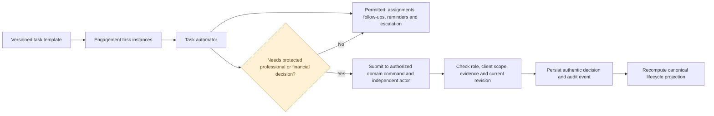


Automators MAY assign tasks, create follow-up checklists, set reminders and due dates, escalate overdue PBC requests and notify permitted users after genuine domain events. They SHALL NOT synthesize approvals, record payment, clear risk, approve materiality, sign an opinion, post invoices, issue release or freeze files. Every automation must reauthorize, use idempotency keys, pin current versions, log its changes and fail safely on stale inputs. Task graphs must reject dependency cycles.
### 6.7 User role, security and progress rules

Preparer sees assigned fieldwork/rework; Reviewer sees submissions and review notes; Partner sees acceptance, high-risk areas, opinion and release; Client sees only authorized commercial and PBC status. Calculate phase readiness from server-side records, not mutable task flags. Track task percentage separately from mandatory gate satisfaction, avoid leaking AML/KYC evidence to client users and show readable blocker reasons.
### 6.8 Acceptance criteria

Acceptance criteria to verify:
1. All 11 canonical states map to exactly one of seven phases.
2. Absent/one-key approvals block Engagement Letter issuance.
3. Both keys allow the letter but do not bypass the full 50% advance.
4. Changed offer or risk basis invalidates the affected approval.
5. Rejection/conditional clearance and open holds cannot be overwritten through tasks.
6. Independent reviewer and mandatory rework comments remain enforced.
7. Open review notes and stale materiality block subsequent professional decisions.
8. Critical confirmation cases block report release.
9. Frozen archival state requires an effective committed lock and does not imply external immutability.
10. Recurring templates never copy professional sign-offs as current.
11. Scoped actors cannot access unrelated clients.
12. Automation retries cannot duplicate or forge domain events.

## 7. Architectural Non-Regression Requirements — New
All domain commands and evidence records remain the sole authority for progression. The existing 11-stage derived lifecycle and five function modules remain unchanged. The seven-phase user experience is a deterministic presentation mapping. Task templates, personal work queues, recurring-engagement creation, deadline automation and dashboard analytics are separate supporting capabilities. All permissions, professional judgments, signed document integrity, 50/50 commercial terms and archive protections must continue to be enforced by authoritative services. Review external Microsoft identity/SharePoint/records protections separately before labelling them production compliant.
