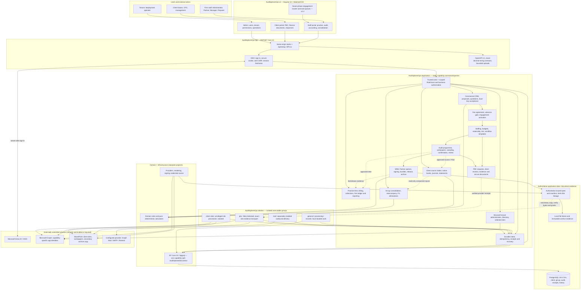
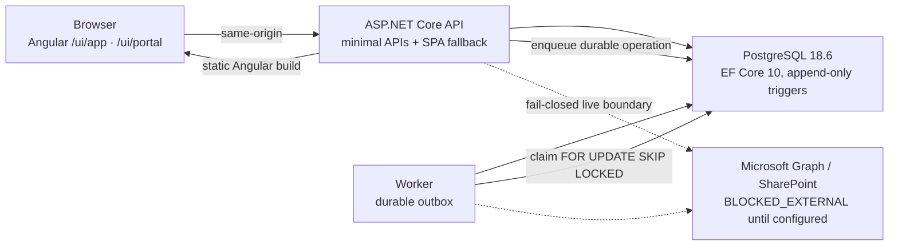
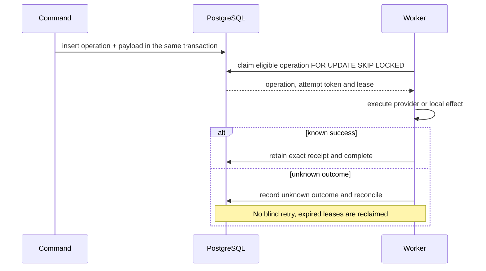
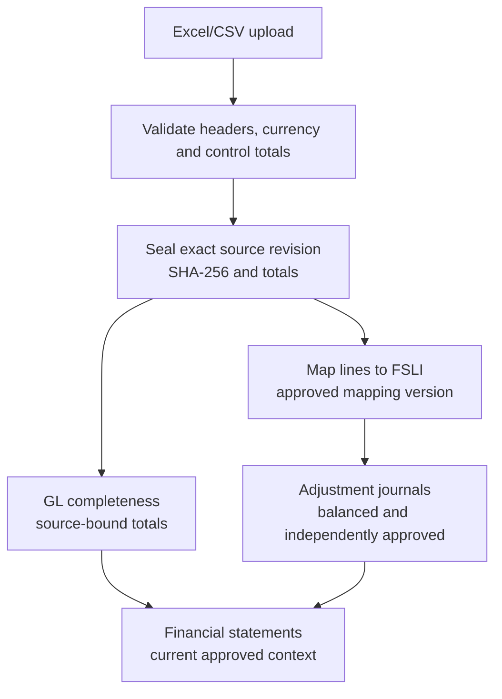
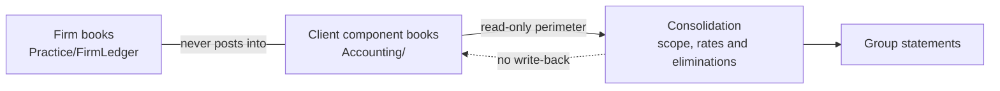

# AuditSphereOps — Current Architecture Authority

**Status: CURRENT.** This document and [`AGENTS.md`](../../AGENTS.md) are the architectural
implementation authority for this repository. Requirement sources preserved under
`docs/task_breakdown/source/` are `HISTORICAL_SOURCE` and never override this
document. Verified project state (test counts, verified SHA, migration count, external blockers)
is recorded only in [`docs/execution/status.json`](../execution/status.json).

## Document authority vocabulary

Every architecture-sensitive document carries one status:

| Status | Meaning |
| --- | --- |
| `CURRENT` | The implemented architecture and its binding rules. Authoritative. |
| `APPROVED` | A human decision that binds future work (for example an accepted methodology). |
| `PROPOSED` | Not implemented; requires a reviewed change before being cited as available. |
| `HISTORICAL_SOURCE` | Preserved original requirements or blueprint text. Not implementation authority. |
| `SUPERSEDED` | Replaced by a later decision; kept for lineage only. |

When preserved source text disagrees with this document (for example "add MediatR facades"),
this document wins and the source text remains a historical requirement record.

## The architecture

```text
           Angular UI
               │
               ▼
        ASP.NET Core API
               │
               ├──────────── Worker
               ▼               │
          Application ◀────────┘
     capability services / queries / pure calculators
               │
       Domain + Infrastructure
                      │
                 PostgreSQL
```



- **One modular monolith**, with `Domain`, `Application`, `Infrastructure`, `Api`
  and `Worker`. `AuditSphereOps.Api` is the HTTP host and serves
  `AuditSphereOps.Ui` (Angular) as the canonical presentation. The owner authorized
  physical retirement of the Blazor rollback host on 2026-10-17; its removal was
  merged to `master` as `e7ebe27c`. No Blazor project or `.razor` files remain in
  the current tree. This physical removal does not establish source-action parity
  or operational rollback acceptance. No microservices, no message broker, no
  second ERP. [ADR-0002](adr/auditsphere-architecture-adr-0002-angular-canonical-ui-blazor-rollback-approved.md)
  records the canonical Angular decision, retirement authorization and the unverified
  parity/rollback conditions.
- **Microsoft tenant administration** follows the
  [capability permission decision](auditsphere-m365-tenant-administration-permissions.md):
  each Microsoft capability (directory read, optional user creation, guest
  invitation, managed-group membership, outbound mail) has its own app identity
  with exactly one Graph role, is disabled by default and is usable only after a
  nonce-bound consent flow and a recorded `VERIFIED` capability check. Microsoft
  mutations use the `m365_external_operations` lifecycle (idempotency key,
  UNKNOWN reconciliation, separate local binding transaction) and append-only
  `m365_administration_events`. Document effects retain exact-site
  `Sites.Selected` access; PBC documents are written only into a provisioned, capability-verified
  engagement repository by the isolated Acceptance `pbc` worker group (LIVE / LIVE_PROVIDER
  operations), with exact-version SHA-256 read-back receipts. AuditSphere roles never assign Entra administrator roles,
  and Microsoft group membership never grants AuditSphere access.
- **Commands and queries are static capability services** returning `CommandResult` /
  `CommandResult<T>`. There is no MediatR/Wolverine handler layer; neither package is pinned.
  This is a recorded variation from R2R-ADR-02 (see
  `docs/task_breakdown/reference/auditsphere-r2r-reference-baseline-architecture-and-adrs.md` §2.3.1).
- **One `AuditSphereDbContext`**, physically split into capability partial files
  (`AuditSphereDbContext.<Module>.cs`), with `OnModelCreating` calling `Configure<Module>(b)`
  methods. No DbContext-per-module.
- **Pure calculators** (`LineTranslationCalculator`, `ConsolidationCalculator`,
  `CurrencyTranslationCalculator`, `TrialBalanceCalculator`, advanced-consolidation
  calculators) contain no EF Core, network, clock or random-ID dependencies.
- **Durable work** (GL completeness, package build/render) runs through the local durable
  operation infrastructure with revision fencing and idempotent retries.
- **Audit programme execution** is one reusable procedure workspace over the adopted
  programme: exact command receipts (`audit_procedure_command_receipts`), a
  server-resolved evidence snapshot inside the immutable result, and one shared
  current-evidence evaluator for programme, area, fieldwork and completion views. Direct
  result/review writes fail closed. Links to planning, confirmations, ledger, statements,
  journals, differences and completion are navigation only; opening a tool never completes
  a procedure.
- **Legacy UI component library: MudBlazor 9.10.0, retired with the Web project.**
  The owner-authorized removal was merged to `master` as `e7ebe27c`; the host is
  absent from the current tree. It is excluded from API composition and the
  API-only test project graph. The removal does not establish parity or rollback
  acceptance; the historical parity and operational gaps remain unverified.
  Intentional native HTML exceptions (browser-draft boundaries, raw-value and file-input
  contracts, `<tfoot>`/`colspan` tables) are recorded in
  the retired MudBlazor conventions document (Git history only; current guidance is `docs/architecture/auditsphere-angular-conventions-current.md`).

## Runtime and execution flows

The diagrams below are explanatory. The .NET projects, the API host, the Angular build and the
PostgreSQL schema remain the executable truth.

### Runtime containers and boundaries



### Durable outbox lifecycle



### Trial-balance and general-ledger intake



### Consolidation perimeter



## Angular presentation migration

The owner-requested [Angular migration](auditsphere-angular-migration-current.md) uses `AuditSphereOps.Api` as the ASP.NET Core HTTP backend and `AuditSphereOps.Ui` as the Angular frontend; [ADR-0002](adr/auditsphere-architecture-adr-0002-angular-canonical-ui-blazor-rollback-approved.md) is the decision record. API owns the authorized contracts, authentication/consent and protected file transports. On 2026-10-17 the owner authorized physical retirement of the Blazor rollback/reference host despite the readiness gate; the removal was merged to `master` as `e7ebe27c`, so no Web project or `.razor` source remains in the current tree. The removed source remains available at commit `c3905e07` as historical evidence only. Operators use the API host with Angular. Domain, Application, Infrastructure, Worker, database and Microsoft permission boundaries remain separate. Source-action parity, operational rollback, production canary, assistive-technology, locale, and live Microsoft acceptance remain unverified or open; physical retirement does not resolve those gates.

Native journal management evidence composes the existing local treatment command in Application.
Client and staff routes derive signed-in versus offline evidence from current identity, preserve
exact draft revision and scoped epoch/period/source guards, and commit immutable evidence with
idempotent receipts. Client disposition grants no technical posting or external-book authority.
The migration detail and code map describe separate reflection/application gates.

## Physical organization rules

1. **Large classes are split into capability-focused partial files** without changing public
   APIs: `ConsolidationService.<Capability>.cs`, `ClientAccountingService.<Capability>.cs`,
   `AccountingAnalysisService.<Capability>.cs`, `AuditFieldworkService.<Capability>.cs`,
   `FinancialStatementService.<Capability>.cs`, `AuditSphereDbContext.<Module>.cs`, and
   `ClientAccountingTests.<Capability>.cs`. Keep new operations in the matching capability file.
2. **File names are business-semantic.** Do not introduce generic names (`Class1.cs`,
   `UnitTest1.cs`, `R2RPass*Tests.cs`); a file name should tell an agent where to look.
3. **One fact, one authority.** Volatile project state (test counts, verified SHA, migration
   count, external blockers, verification dates) lives in `docs/execution/status.json` only.
   Do not copy exact volatile numbers into README or narrative docs.
4. **API and Angular own the presentation boundary.** `AuditSphereOps.Api` composes the
   authenticated HTTP contracts, session/consent boundaries and protected file transports;
   `AuditSphereOps.Ui` owns the Angular routes and presentation and calls the same-origin API.
   Keep authorization and business mutations in Application services, never in browser-only
   state. Do not add a server-side Razor presentation host; ADR-0002 records the canonical
   Angular decision and the later physical retirement of the Blazor host.
5. **Authorization is scope-checked and records are append-only.** Every command, query and
   queue enforces explicit `RoleGrant` scope; sealed datasets, approved mappings, applied
   journals, issued packages and review decisions change only through new revisions. History
   must never gain an update path.

## What this architecture explicitly is not

Not introduced, and not to be introduced: MediatR, Wolverine, MassTransit, Kafka/RabbitMQ,
microservices, a repository pattern wrapping every EF operation, AutoMapper, generic
UnitOfWork abstractions, event sourcing, or a `Features/` vertical-slice rewrite. None of
these solve the navigability problem the physical splits solve.

## Where to look first

Use [`auditsphere-architecture-code-map.md`](auditsphere-architecture-code-map.md) to find the
Domain/Application/Infrastructure/API/Angular/tests files for a business capability before
searching the whole repository. The removed Web/Razor paths in that map are historical references
only, not current owners or evidence of Angular parity.

## Dedicated client SharePoint sites

The owner-approved [client-site decision](auditsphere-client-sharepoint-sites-current.md) adds an isolated Acceptance `client-sites` worker for supported SharePoint site creation, exact document-worker grants and reconciliation of assigned staff into a site group with Full Control. Its privileged certificate was never mounted in the retired Web host and is not mounted in the `pbc` worker. A persisted new-client rollout boundary preserves existing repositories and blocks shared-site fallback for newer clients. Local RoleGrant scopes remain unchanged. Staff have site-wide sharing/deletion authority; external immutable archive protection remains a separately verified requirement.

### STE commercial and completion evidence

Engagement-letter generation is separate from quotation generation and requires recorded client commercial acceptance plus current unconditional Partner risk approval for the same service. The letter records the exact acceptance, quotation, signature and firm-seal identities. New signed management representations bind their PDF bytes to the exact acknowledged generated letter and require human Partner verification. Five-part bundles reference the current signed report, actual reviewed financial-package release and PDF artifact, management letter, verified signed representation and posted final balance invoice. Scoped downloads reuse local session and RoleGrant authorization; application roles never confer Microsoft authority.

The optional general-worker automatic fee policy creates drafts under captured FinanceManager/Administrator authority only. It is disabled by default; finance review, posting and mail dispatch remain separate. Newly converted-client portal access is withheld until commercial keys, activation and advance payment are current. Existing clients without commercial conversion records retain their original onboarding contract. Client write transactions use the final-release client guard. Signature/seal PNGs are visual credentials, not certificate-backed digital signatures; SharePoint archive retention still requires independently verified external controls.

### Authorized client bookkeeping extension

AuditSphere remains an import-first preparation, audit, and consolidation workspace. For a specifically authorized client accounting service, it may also support native client-owned double-entry bookkeeping, client sales and purchase invoices and credit notes, GL/TB, and financial statements. VAT/tax and ancillary modules are optional, independently gated capabilities; they do not block the core bookkeeping path. This extension does not authorize inventory, procurement operations, payroll execution, payment initiation, external tax filing, or changes to the firm's ledger or group-consolidation boundaries.

Client operational books must remain separate from `Practice` firm billing and from audit/reporting adjustments. Existing clients retain external-source behavior unless an explicit approved cutover changes it. Native bookkeeping must use the existing client identity, scope-checked RoleGrants, acceptance and review controls, accounting package pipeline, and one modular monolith; it must not create a second ERP, weaken source-reflection controls, or imply that a local simulation is production acceptance. Client isolation, balanced postings, maker/checker review, and immutable history are mandatory whether optional modules are enabled or not. The detailed acceptance baseline is the owner-provided proposed epic, with VAT/tax and other ancillary modules designated optional by the product owner; feature availability is established only by implemented and verified vertical slices.
