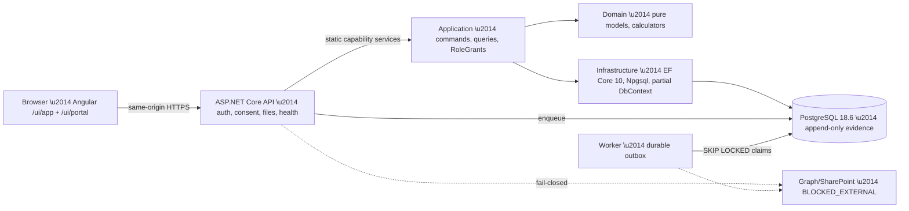

# AuditSphere — Enterprise Target Architecture Specification

**Status: PROPOSED.** Repository-grounded target: retain and harden the implemented .NET 10 + Angular 22 + PostgreSQL 18 modular monolith. This document proposes no framework rewrite and changes no `CURRENT`/`APPROVED` authority. Binding architecture remains [current architecture](auditsphere-architecture-current-architecture.md); binding rules remain [AGENTS.md](../../AGENTS.md); verified state remains [status.json](../execution/status.json). Sections marked *(adopt)* become enforceable only through an approved ADR and a verified slice.

## 1. Retain decision

One modular monolith — `Domain → Application → Infrastructure → Api/Worker`, Angular canonical presentation, PostgreSQL transactional authority — per [ADR-0001](adr/auditsphere-architecture-adr-0001-modular-monolith-static-capability-services-approved.md) and [ADR-0002](adr/auditsphere-architecture-adr-0002-angular-canonical-ui-blazor-rollback-approved.md). Forbidden without separately approved scope: MediatR/Wolverine/MassTransit, brokers, microservices, Kubernetes, second ERP, generic repositories/UnitOfWork, AutoMapper, event sourcing (`AGENTS.md` \u00a76).

## 2. Five priorities and where they live

| # | Priority | Retain *(implemented)* | Strengthen *(adopt)* |
|---|---|---|---|
| 1 | Identity and authorization | Server-side OIDC, HttpOnly cookies, XSRF, session-epoch binding \u2014 `src/AuditSphereOps.Api/HttpBoundary`, `src/AuditSphereOps.Api/ApiHost.Authentication.cs`; per-command `RoleGrant` scope (`FIRM_WIDE \u00b7 CLIENT \u00b7 ENGAGEMENT \u00b7 GROUP`) in `src/AuditSphereOps.Application/Security`; Angular `can*` presentation only ([Angular conventions](auditsphere-angular-conventions-current.md)). | Whole-application re-authorization coverage; revocation fencing per route; full parity verification before any acceptance claim. |
| 2 | Financial correctness | Three isolated books (firm ledger, client workspace, consolidation) \u2014 [current architecture](auditsphere-architecture-current-architecture.md); money policy + ToEven rounding ([ADR-0014](adr/auditsphere-architecture-adr-0014-monetary-scale-and-rounding-approved.md), [data model](auditsphere-architecture-contract-data-model-current.md)); pure calculators with no EF/clock/I-O; revision fences; consolidation never mutates component books. | Golden fixtures and bound checks for FX/translation policies under methodology-owner review (T003/T007/T013 order). |
| 3 | Documents and Graph | Per-capability app identities, `Sites.Selected` exact grants, nonce-bound consent, `m365_external_operations` lifecycle ([M365 permissions](auditsphere-m365-tenant-administration-permissions.md)); isolated `pbc`/`client-sites` workers; SHA-256 evidence; authoritative release/archive store ([ADR-0009](adr/auditsphere-architecture-adr-0009-archive-authority-release-store-approved.md)). Purview/eSignature providers out of scope ([ADR-0005](adr/auditsphere-architecture-adr-0005-visual-credentials-no-esignature-purview-approved.md)). | Live SharePoint/Graph and release-checkpoint gates stay `BLOCKED_EXTERNAL` until live infra + independent review; never simulate. |
| 4 | Agent development speed | Static capability services + partial files; code map first ([code map](auditsphere-architecture-code-map.md)); focused cohorts via `scripts/agent-check`; OpenAPI drift via `scripts/contracts/verify-openapi.sh` against `contracts/auditsphere-openapi.json`; [HTTP boundary](auditsphere-architecture-http-boundary-and-contract-current.md) owns rate limits and error shape. | Keep slices single-capability; extend existing specs before adding files. |
| 5 | Production reliability | Enforced bounds ([NFR policy](auditsphere-architecture-policy-non-functional-requirements-current.md)); durable outbox (`SKIP LOCKED`, 60 s lease, 20 s renewal, 5 attempts, quarantine); restore drill (`scripts/db/restore-drill.sh`). RPO/RTO, capacity, observability collector, Key Vault remain open owner gates (P7/P8). | Commit-pinned full release verification (`release-verification.yml`) required for release claims; fast `ci.yml` alone never proves full regression. |
## 3. Module boundaries (enforce in code, not prose)

- **Presentation:** `src/AuditSphereOps.Ui` calls same-origin `/api/ui/*` only; decodes at the edge; never owns auth or business state.
- **HTTP:** `src/AuditSphereOps.Api/HttpBoundary` answers only authenticated-session; business scope stays in Application.
- **Application:** static capability partials (`<Service>.<Capability>.cs`); every command/query enforces `RoleGrant` plus freshness and professional-work holds.
- **Domain:** pure types, invariants, deterministic calculators \u2014 no EF, network, clocks, random IDs.
- **Infrastructure:** capability-split `AuditSphereDbContext`, migrations, triggers/constraints for append-only history; never bypassed.
- **Worker:** general, processing, records groups; idempotent retries; `RESULT_UNCERTAIN` quarantine for human review.

## 4. Security posture

Server-side BFF (cookie session, no browser bearer tokens), strict CSP/security headers, `{ code, message, correlationId }` errors, per-identity rate classes, bounded request sizes, user-secrets in development and P8-gated production custody. RLS is a separately evaluated defense-in-depth option \u2014 Application authorization stays mandatory regardless.

## 5. Data integrity

Balanced postings; exact money; sealed datasets via triggers; approved-mapping lineage; revision/generation fences; receipt-keyed idempotency; fail closed on missing rates, stale sources, unapproved perimeters. Human practitioners make all professional conclusions and sign-offs \u2014 never autonomous agents.

## 6. Deployment and acceptance

Single monolith plus workers on one PostgreSQL; `infra/` holds compiled-not-deployed configuration. Deployment, production data/permission changes, and destructive migrations need explicit owner authorization. Acceptance order: focused local cohort, `ci.yml` fast gate, commit-pinned `release-verification.yml` (Domain, API, Playwright/PostgreSQL, Angular), live-gate evidence on a real tenant, independent review (P9). Never claim `FULL_CI_PASS` from `ci.yml` alone.

## 7. Adoption plan

1. Finish whole-application authorization and Angular parity verification (partial per `status.json`).
2. Land T003 methodology ownership, then T007/T013 before T014; keep STE-GAP-004/007 blocked on live evidence.
3. Require current-SHA release verification for any release claim.
4. Validate issued document/archive controls against ADR-0009 with exact hashes and reconciled grants.
5. Close worker/recovery acceptance (P7) and observability/secrets custody (P8) with owner evidence.
6. Real-tenant acceptance (P10) last, on a customer-authorized tenant.
