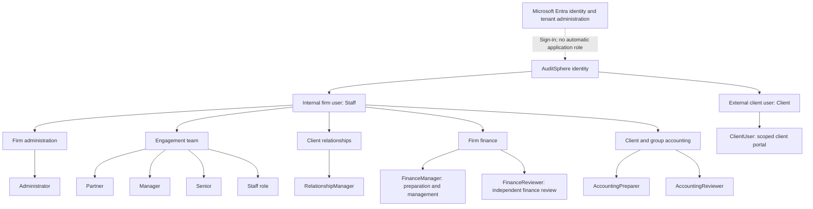
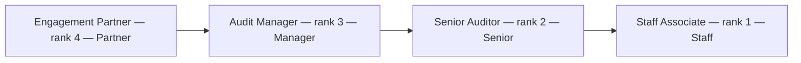

# User types, role hierarchy and privileges

**Status:** CURRENT

**Purpose:** Explain the user identities, role codes, staffing hierarchy and access boundaries implemented in AuditSphere. This is a description of existing authorization, not permission to grant access or a claim that every workflow has completed acceptance.

AuditSphere has **explicit role grants, not a universal superuser hierarchy**. A user may hold several roles, each with its own scope. A higher job title, Microsoft tenant role or visible navigation item does not automatically grant another role's privileges. The server checks the current identity, role, scope and business prerequisites for each operation.

## User types

| Type | Representation | Access |
| --- | --- | --- |
| Internal firm user | `AppUser.UserKind = Staff` | Internal workspaces permitted by current application roles and scope. An identity without suitable grants has no automatic staff privileges. |
| External client user | `AppUser.UserKind = Client`, with `ClientUser` access | The client portal for explicitly assigned clients or engagements. This identity cannot enter internal-only operations or receive firm-wide client access. |
| Microsoft directory identity | Member or guest identity, identified by tenant and immutable object/subject ID | Supplies authentication and identity evidence. Directory membership, an invitation or successful sign-in alone grants no AuditSphere role. |
| Worker or integration identity | Durable worker authority or a capability-specific provider identity | Executes only its configured operations and verified provider capability. It is not another human `UserKind`, an interactive administrator or a professional approver. |

Disabled users, revoked grants, expired access and stale sessions are access states, not additional user types. Revocation and session-epoch checks prevent an old session from retaining earlier access.

The staff workspace's **My profile** page lets the signed-in person view their account and update supported optional personal details. Full name and email remain identity-provider values; editing a position or contact detail does not change roles, staffing or access. The [profile service](../../src/AuditSphereOps.Application/Security/UserProfileService.cs) acts only on the current user and accepts no target-user identifier.

## Application role chart

The branches group responsibilities. **Arrows do not mean permission inheritance.**

These are the roles accepted by the standard Users & Access assignment catalogue. Internal roles require a staff identity; `ClientUser` requires a client identity. See [RoleAdministrationService](../../src/AuditSphereOps.Application/Security/RoleAdministrationService.cs) and the reviewed assignment workflow in [RoleAssignmentService](../../src/AuditSphereOps.Application/Security/RoleAssignmentService.cs).

## Privileges of the standard roles

The table gives implemented capability families. Individual commands can require a narrower role, firm-wide scope, staffing, current evidence or a different authorized reviewer.

| Application role | Principal privileges | Important boundaries |
| --- | --- | --- |
| `Administrator` | Manage firm users, application roles and scope; access administration and access history; configure approved Microsoft 365 integration; operate the administrative capabilities that explicitly accept this role. Several planning, audit and accounting workspaces also accept it. | Firm administration requires a firm-wide grant. It is not a substitute for `Partner`, `FinanceManager` or `FinanceReviewer`; it cannot override independent review, professional eligibility, holds, frozen files or provider consent. |
| `Partner` | Lead the engagement's professional approval work: acceptance/risk decisions, applicable planning and materiality approvals, audit review, opinion/report and financial-package approval where the relevant command permits. | Requires the correct scope, engagement staffing/eligibility and current evidence. Professional decisions remain human decisions. A Partner cannot independently approve their own preparation simply by holding another role. |
| `Manager` | Manage engagement planning, task assignment, staffing/budgets where authorized, fieldwork and review points; prepare accounting packages and perform permitted reviews. | Does not replace a required Partner decision, finance role or independent second person. Firm-wide configuration and scoped engagement work have different checks. |
| `Senior` | Prepare and coordinate assigned audit work, working papers, PBC/evidence, operational tasks and time; use the planning/intake/read capabilities that explicitly accept Senior. | Not a generic Manager or Partner. Package approval, firm administration, billing and other restricted actions require their own roles. |
| `Staff` | Prepare assigned working papers, tasks, time and PBC/evidence; respond to review points; read scoped client, engagement and progress workspaces; use permitted intake functions. | Access stays within current assignments. It does not include independent review, Partner decisions, firm finance or user administration. Some accounting preparation commands require a separate accounting-capable role. |
| `RelationshipManager` | Manage authorized leads, client relationships/contacts, commercial pipeline, proposals and fee-agreement context; read permitted onboarding/acceptance status. | Commercial preparation is not professional risk approval, finance posting or client-portal access. Some commercial configuration and operations require firm-wide scope. |
| `FinanceManager` | Prepare/manage firm billing, invoices, credits, receipts/allocations and ledger operations where permitted; access finance reports and fee settlements. | Firm ledger/books/list capabilities require current firm-wide finance authority. Finance review, exact monetary controls and independent approval remain separate; this role does not grant client-bookkeeping or audit sign-off authority. |
| `FinanceReviewer` | Read firm finance and independently review/approve permitted invoices, postings, reversals and finance period controls. | Cannot approve their own preparation where the workflow requires another person. Holding both finance roles does not satisfy that requirement. It does not grant general firm administration or Partner authority. |
| `AccountingPreparer` | Client accounting intake, mapping drafts, financial-statement preparation and selected consolidation preparation. | [Financial statements](../../src/AuditSphereOps.Application/Accounting/FinancialStatements/FinancialStatementService.Authorization.cs) and [consolidation authorization](../../src/AuditSphereOps.Application/Accounting/Consolidation/ConsolidationService.Authorization.cs). Does not grant firm-ledger finance review. |
| `AccountingReviewer` | Permitted independent client-accounting, mapping, package and consolidation reviews; selected preparation/read capabilities. | [Mapping approval](../../src/AuditSphereOps.Application/Accounting/MappingApprovalWorkspace.cs), [package review](../../src/AuditSphereOps.Application/Accounting/FinancialPackageReviewService.cs) and [consolidation authorization](../../src/AuditSphereOps.Application/Accounting/Consolidation/ConsolidationService.Authorization.cs). Independent-person and Partner-only gates remain. |
| `ClientUser` | View assigned client-portal requests and released/shared material; upload permitted evidence, answer PBC requests and use explicitly authorized request delegation. | Client or engagement scope only. Onboarding, owner/delegate, upload/reply permissions and release restrictions still apply. No internal ledger, audit preparation, firm-wide administration or automatic access to another client. |

Representative enforced boundaries are visible in [fieldwork authorization](../../src/AuditSphereOps.Application/Audit/Fieldwork/AuditFieldworkService.Authorization.cs), [practice time](../../src/AuditSphereOps.Application/Practice/PracticeTimeService.cs), [fee agreements](../../src/AuditSphereOps.Application/Practice/FeeAgreementService.cs), [firm finance](../../src/AuditSphereOps.Application/Practice/FirmFinanceQuery.cs), [billing](../../src/AuditSphereOps.Application/Practice/BillingService.cs), [financial statements](../../src/AuditSphereOps.Application/Accounting/FinancialStatements/FinancialStatementService.Authorization.cs) and the [client portal](../../src/AuditSphereOps.Application/Documents/ClientPortalService.cs).

## Engagement staffing and review hierarchy

Staffing has an explicit rank and maps to an engagement authorization role:

The stored staffing codes are `ENGAGEMENT_PARTNER`, `AUDIT_MANAGER`, `SENIOR_AUDITOR` and `STAFF_ASSOCIATE`. Staffing is engagement-specific; it does not create a firm-wide grant. The rank is used by review workflows that require a higher-level reviewer, alongside the independent-person and current-eligibility checks. Labels such as Engagement Partner, Audit Manager and Senior Auditor in the lifecycle are staffing responsibilities, not extra selectable role codes. See [StaffingLevels](../../src/AuditSphereOps.Domain/Practice/ResourcePlanning.cs).

The business personas **Preparer, Reviewer, Approver and Client** describe a person's function on a particular item. They are not a blanket role hierarchy: one person can prepare one item and review another, but cannot independently review their own item. The governing requirements are [M2-02 roles and independent review](../requirements/auditsphere-accounting-module-requirements-current.md#M2-02).

## Additional codes recognized by selected backend guards

Existing command/query guards also recognize the following codes. **They are not offered by the standard role-assignment catalogue above and are not aliases that automatically inherit a standard role.** Their presence in a guard does not authorize assigning them through the current UI or expanding an existing grant. A code accepted by one module may be refused by another.

| Code | Implemented capability examples | Boundary/source |
| --- | --- | --- |
| `Reviewer` | Selected audit reviews; portfolio and financial-package reads. | [Fieldwork authorization](../../src/AuditSphereOps.Application/Audit/Fieldwork/AuditFieldworkService.Authorization.cs) and [financial statements](../../src/AuditSphereOps.Application/Accounting/FinancialStatements/FinancialStatementService.Authorization.cs). Not `FinanceReviewer` or Partner, and not a progress-reading role. |
| `SeniorManager` | Selected audit planning, completion, findings and lifecycle reads. | [Fieldwork authorization](../../src/AuditSphereOps.Application/Audit/Fieldwork/AuditFieldworkService.Authorization.cs) and [audit completion](../../src/AuditSphereOps.Application/Audit/AuditCompletionService.cs). Does not replace a Partner-only approval. |
| `EngagementLeader` | Selected assessment, planning, audit-record and finding capabilities. | [Assessment commands](../../src/AuditSphereOps.Application/Acceptance/AssessmentCommandWorkspace.cs) and [audit records](../../src/AuditSphereOps.Application/Audit/AuditRecordQueries.cs). Limited to explicitly accepting guards. |
| `Auditor` | Selected assessment, fieldwork preparation, audit records and PBC work. | [Fieldwork authorization](../../src/AuditSphereOps.Application/Audit/Fieldwork/AuditFieldworkService.Authorization.cs) and [PBC service](../../src/AuditSphereOps.Application/Documents/PbcService.cs). No implicit review/Partner authority. |
| `Accountant` | PBC/inbox work and corresponding scoped search. | [PBC service](../../src/AuditSphereOps.Application/Documents/PbcService.cs) and [global search](../../src/AuditSphereOps.Application/Search/GlobalSearchQuery.cs). The name alone does not grant accounting preparation or finance authority. |
| `CommercialManager` | Selected client workspace/search and lifecycle reads; also a displayed commercial responsibility. | [Workspace query](../../src/AuditSphereOps.Application/Practice/WorkspaceQuery.cs) and [lifecycle query](../../src/AuditSphereOps.Application/Acceptance/EngagementLifecycleQuery.cs). Not an automatic `RelationshipManager` grant or permission to approve every commercial action. |
| `RecordsCustodian` | Protected archive and archive-copy operations and permitted audit-record reads. | [Records archive](../../src/AuditSphereOps.Application/Records/RecordsArchiveService.cs) and [archive copy](../../src/AuditSphereOps.Application/Records/ArchiveCopyService.cs). Custody does not create a professional release decision or waive retained evidence. |

## Scope determines where a role works

| Scope | Coverage | What it does not imply |
| --- | --- | --- |
| `FIRM_WIDE` | Eligible records throughout the actor's firm, for commands accepting the granted role. Required for firm user administration and several firm finance/configuration operations. | No cross-firm access, automatic additional roles, group grant or business-gate override. |
| `CLIENT` | The named client and its engagements where the command accepts client-level coverage. | No sibling client or firm-wide-only operation. |
| `ENGAGEMENT` | One engagement and its stored client linkage. | No other engagement of the same client and no automatic client-wide access. |
| `GROUP` | One consolidation group through a separate `GroupAccessGrant`, subject to the command's required group role. | No automatic component-client books, other group or ordinary client/engagement access. |

The reviewed group-assignment path accepts `Partner`, `Manager`, `Staff`, `FinanceManager`, `FinanceReviewer`, `AccountingPreparer` and `AccountingReviewer` for staff identities. That assignment catalogue is distinct from each consolidation command's allowed role list. Group grants do not currently support expiry through this path; they require explicit revocation. See [RoleAssignmentService](../../src/AuditSphereOps.Application/Security/RoleAssignmentService.cs) and [AuthorizationDecision](../../src/AuditSphereOps.Application/Security/AuthorizationDecision.cs).

## Microsoft Global Administrator versus AuditSphere Administrator

- **Microsoft Entra Global Administrator** is a Microsoft tenant role. It is not a selectable AuditSphere application role and is not mapped automatically to local application privileges.
- **AuditSphere Administrator** is an explicit local role grant. It manages the firm's application access and configuration; it is not an unrestricted bypass of professional or financial controls.
- Finance actions can require separate `FinanceManager` and `FinanceReviewer` grants. A required professional Partner decision additionally depends on the applicable scope, staffing, independence and evidence.
- Microsoft 365 service identities have separately verified, capability-specific provider permissions. A user's local role does not supply tenant consent, selected-site access, a mail-sender authorization or permission to enable an external worker.

For provider boundaries, use the [Microsoft 365 tenant permissions guide](auditsphere-m365-tenant-administration-permissions.md).

## Explicit Administrator read-only oversight

An enabled Staff identity with current, unexpired `Administrator@FIRM_WIDE` application access may use the explicitly audited ledger, Firm books expense metadata, firm invoice discovery/detail/balance, accounting-group overview and legal-entity membership projections without a specialist operational grant. Client/engagement-scoped Administrator grants and Entra administrator status do not qualify. The server checks the session and grant again before returning these projections.

The ledger, Firm books and group membership views show **Read-only — Administrator oversight** when using that fallback. Ledger mutation flags and expense preparation/submission/review still require their existing finance roles. Expense-list oversight excludes source-document bytes. Group membership changes still require explicit group authority, and nonmanaging readers receive no eligible-client choices. Raw supporting-document downloads retain their separate finance authorization. Existing firm-wide Administrator group-creation authority remains unchanged; oversight does not create a group grant. The overview refuses an over-limit group cohort explicitly rather than returning a silently truncated list.

Audited consolidation scope, ownership, normalized report, component-pack history and advanced-method metadata reads also support oversight without a group grant. Their operational flags still use the original group authorizer. Oversight receives no preparation choices or source submission manifest, no editable advanced inputs, and no action-only scope-creation or intercompany-match options. Execution and independent review remain separately authorized. Current authority is checked again before returning the reads, including after the detailed workspace snapshot.

Invoice discovery and detail show the same read-only indication. Receipt, allocation correction, credit, terms, approval, posting and sending flags retain their original finance authorization; the API action flag no longer assumes every readable invoice is operational. Invoice search applies the same current oversight authority before selecting same-firm candidates and again before returning results; ordinary scoped finance search is preserved. Detail histories refuse unsupported line/allocation cohorts explicitly rather than silently returning partial balances.

Participating GET requests retain one append-only access event before disclosing an oversight response. Internal checks share that request's event; a separate audit context prevents saving unrelated business edits. Failure to retain evidence returns the shared `ApiError` unavailable response without the protected projection; its diagnostic identity matches `X-Correlation-Id`. Ordinary specialist access does not require an oversight event. A server-issued `X-AuditSphere-Oversight-Request-Id` identifies retained evidence after a successful oversight check.

**Administration → Oversight access** shows this firm's bounded, cursor-paged history to current firm-wide Staff Administrators. History reads do not recursively create access events. Each event contains actor, exact session epoch, request/event identities, operation, resource scope and UTC time. `DISCLOSURE_AUTHORIZED` means permission to disclose was retained; it is not proof of delivery, client acknowledgement or professional review. Search phrases, document contents and credentials are excluded. The database refuses event update, deletion and truncation; no history editing, export or automatic retention expiry is provided. An approved retention policy and independent-reviewer access policy remain required for production acceptance (D-OV-04).

This is a staged rollout. Other finance reports and navigation require their own source audit and verification; this policy does not silently enable every query. Existing Administrator command allowlists remain unchanged pending their separate policy census. Private work, client-portal authority, confidential raw documents, professional approvals and provider consent are not inherited. Retirement of historical role codes remains a separate decision.

The later Role Authorization and EQR specification is a useful source for operation inventories and access evidence, but its older nine-role catalogue does not replace the eleven supported roles above. Its professional EQR changes remain unactivated: service applicability and decision authority, reviewer eligibility/independence, the exact draft evidence and change boundary, and treatment of legacy/open engagements require recorded policy (D-EQR-01 through D-EQR-04). The existing `EqrCase.EqrPartnerUserId`, staffed Partner signing controls and release prerequisites remain authoritative; an EQR display or administrative read cannot supply concurrence or final approval.

## Managing access

Use **Administration → Users & Access** to inspect a user's immutable identity, local roles, scopes, expiry and history. Authorized changes use the existing preview, reason, scope-expansion confirmation and retained receipt/history workflow. Privileged self-changes require another authorized administrator; last-administrator and independence protections remain enforced.

Last-administrator safety counts only same-firm, enabled Staff identities with an unrevoked, unexpired `Administrator@FIRM_WIDE` grant. Direct revocation and reviewed replacement recheck this under the firm row lock. A named replacement must itself qualify. A planned Administrator expiry requires another administrator whose access continues beyond that expiry; the preview states this prerequisite. The expiry worker still expires genuine grants and invalidates sessions. Maintain a second viable administrator before changing access. Initial-installation bootstrap is not a general recovery bypass; recovery after loss of every administrator remains a separate, unverified operator procedure.

Grant only the explicit roles and scopes needed for the person's work. Several roles may coexist, but none removes current-state checks, immutable accounting records, required independent reviewers, professional holds, frozen-file controls or release prerequisites. The UI's `can*` flags describe server-projected permissions; changing the UI never grants authority.

The implementation sources are [user/grant records](../../src/AuditSphereOps.Domain/Security/Users.cs), [current authorization](../../src/AuditSphereOps.Application/Security/AuthorizationDecision.cs), [reviewed role assignment](../../src/AuditSphereOps.Application/Security/RoleAssignmentService.cs), [grant expiry](../../src/AuditSphereOps.Application/Security/RoleGrantExpiry.cs) and the [trusted session resolver](../../src/AuditSphereOps.Api/Authentication/TrustedActorResolver.cs).
