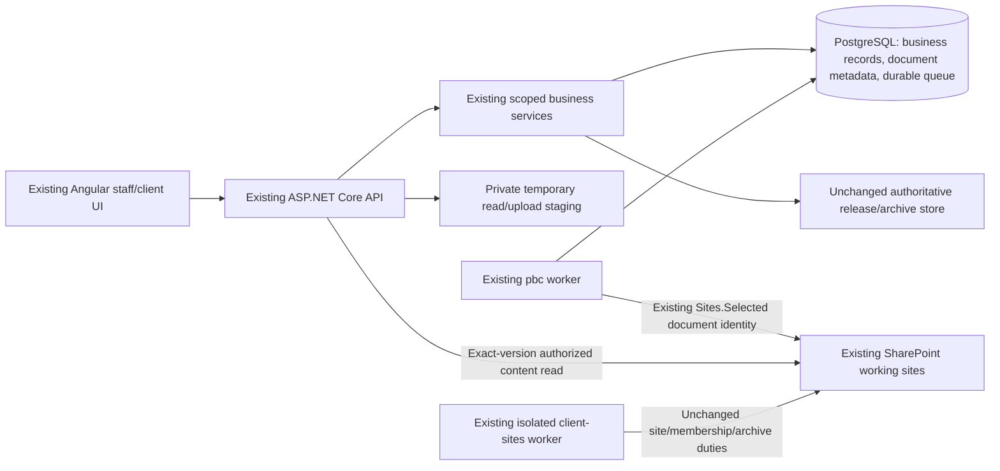

# AuditSphere — SharePoint-Primary Working Storage
## Strict functional-parity implementation specification (revised)

| Control | Detail |
|---|---|
| **Status** | **PROPOSED — storage-only, functional-parity revision. No implementation or deployment authorized by this document** |
| **Date** | 25 October 2026 |
| **Repository** | [`nirzaf/AuditSphere`](https://github.com/nirzaf/AuditSphere) |
| **Inspected source baseline** | `master` at `afc52301d9ccf9349af30c6c69cd9d28b6fadb36`; recheck the implementation checkout before edits |
| **Technology** | Retain existing .NET 10 / ASP.NET Core / Angular / EF Core / PostgreSQL / isolated .NET Worker |
| **Primary goal** | Store **working-document bytes** in existing SharePoint and **document metadata** in PostgreSQL, allowing safe reclamation of no-longer-needed VPS staging files |
| **Hard requirement** | **No business-function, UI-flow, SharePoint provisioning, access/permission, identity, folder-structure, approval, archive, API-route or integration-policy changes** |
| **Evidence level** | Targeted code and requirements inspection. No tests, real-tenant operations, disk cleanup or deployment performed for this revision |

> **This document replaces the behavioral changes suggested in the earlier `AuditSphere_SharePoint_Primary_Storage_Implementation_Spec.md`.** In particular, **do not introduce `MANUAL_VERIFIED` site mode, administrator-managed site creation, manual staff-membership handover, retirement of the `client-sites` worker, altered tenant permissions, or a new site-onboarding UI.** Those ideas are unnecessary for the storage objective and conflict with the requested functional parity.

> **Important limitation:** Changing the *source of downloaded bytes* from local staging to SharePoint is an internal integration change. Once a local copy is deleted, that document's retrieval depends on SharePoint availability. Thus **literal equivalence during a SharePoint outage cannot be promised alongside permanent local-copy removal**. Cleanup must remain off by default; enable it only after explicit acceptance of this operational trade-off or retain local copies for files requiring offline retrieval.

## 1. Executive decision: what remains exactly the same

**The following behavior is contractually unchanged.** Regressions in these areas block release even if disk usage decreases.

| Existing capability | Preserve without modification |
|---|---|
| Microsoft Entra authentication | Existing server-side OIDC sign-in, tenant/object identity binding, cookies and session revocation. No password or token model change. |
| Dedicated client sites | **Automatically create one site per eligible new client**, preserving the approved creation worker, client identity marker and persisted rollout cutoff. |
| Assigned staff access | **Automatically reconcile site-group membership and site-wide Full Control** for eligible assigned staff, as already approved. Keep Microsoft rights distinct from application `RoleGrant` rights. |
| Existing SharePoint grant model | Keep isolated privileged `client-sites` worker, certificate separation, document worker's `Sites.Selected` selected-site grants, exact resource checks, and negative-control verification. |
| Existing workspace taxonomy | Keep the current approved client and engagement folder-template versions and established naming; never replace them with example labels. |
| Microsoft mail/directory/invitations/groups | Keep all already-supported capabilities, activation decisions and workers unchanged. No credential consolidation or unapproved permission reduction. |
| PBC client/staff workflows | Keep the same request, acknowledgement, client upload, trusted staff completion, independent review, acceptance, clarification, resubmission and release-fence behavior. |
| PBC upload transport | Keep the existing upload routes, resume/replay, 250 MiB limit, 8 MiB application chunks, 10 MiB Graph transfer fragments, deterministic remote filename and conflict/reconciliation semantics. |
| Existing user-facing API/UI | Preserve route names, request/response contract and user flow unless a *backward-compatible, strictly necessary* addition is separately reviewed. No new mandatory steps or administration panels. |
| Other accounting and audit features | Preserve TB/GL, schedule capture, fieldwork, reporting, billing, consolidation, planning, permissions, money policies and approval gates. |
| Final signed reports and archive | Preserve **ADR-0009**: independent authoritative release/archive bytes and manifests; SharePoint archive is a separately verified secondary copy. Preserve signing, release, freeze and archive worker responsibilities. |
| Deployment/runtime safety | Retain current worker group, outbox, idempotency, credential isolation, process permissions, external-effect gates and CI/release policy. |

**No replacement of the SharePoint integration.** This is a narrowly scoped implementation change to where already-uploaded working files are *read from*, how their verified references are recorded, and when temporary local bytes may be reclaimed.

## 2. Why any code change is necessary

The existing implementation already uses SharePoint for verified PBC transfers:

- [`GraphPbcProviderSink.cs`](https://github.com/nirzaf/AuditSphere/blob/afc52301d9ccf9349af30c6c69cd9d28b6fadb36/src/AuditSphereOps.Infrastructure/Providers/GraphPbcProviderSink.cs) supports transfer, probing, exact-version SHA-256 and byte-count readback.
- [`GraphSelectedSiteDrive.cs`](https://github.com/nirzaf/AuditSphere/blob/afc52301d9ccf9349af30c6c69cd9d28b6fadb36/src/AuditSphereOps.Infrastructure/Providers/GraphSelectedSiteDrive.cs) implements selected-site folder/upload and content/version operations.
- [`PbcDocumentTransferHandler.cs`](https://github.com/nirzaf/AuditSphere/blob/afc52301d9ccf9349af30c6c69cd9d28b6fadb36/src/AuditSphereOps.Application/Documents/PbcDocumentTransferHandler.cs) publishes `RECEIVED` only after verified provider registration.

**The blocking storage gap:** [`PbcService.PrepareDownloadAsync`](https://github.com/nirzaf/AuditSphere/blob/afc52301d9ccf9349af30c6c69cd9d28b6fadb36/src/AuditSphereOps.Application/Documents/PbcService.cs) and [`ApiHost.DocumentEndpoints.cs`](https://github.com/nirzaf/AuditSphere/blob/afc52301d9ccf9349af30c6c69cd9d28b6fadb36/src/AuditSphereOps.Api/ApiHost.DocumentEndpoints.cs) still use retained `PbcUploadChunk.StagedPath` files for staff PBC downloads. [`AuditScheduleIntakeSources.cs`](https://github.com/nirzaf/AuditSphere/blob/afc52301d9ccf9349af30c6c69cd9d28b6fadb36/src/AuditSphereOps.Application/Audit/AuditScheduleIntakeSources.cs) and the staged schedule reader also use these bytes for accepted-source processing and currentness checks.

Therefore **immediately deleting staging files is unsafe**; it would break existing features. The new read path must be proved first. This is a repository-observed gap, not a claim that production behavior has been tested.

## 3. Allowed change envelope and forbidden changes

### 3.1 Allowed internal changes

1. Associate already-verified PBC provider receipts with existing scoped `DocumentReference` and `DocumentSnapshot` records, with additive schema/constraints **only if required**.
2. Add one small, authorized, exact-version remote-content read path using the **existing** selected-site token/Graph transport; no new storage provider or general-purpose document platform.
3. Make the **existing PBC download endpoint** select a verified remote source when eligible while returning the same filename, MIME type, bytes, authorization decision and successful response shape.
4. Make accepted PBC audit schedule/currentness consumers read verified remote bytes without changing their approved calculations, accepted hashes, source IDs, workpapers or reviewer outcomes.
5. Record independent technical cleanup eligibility and reclaim **only approved temporary staging files** after all active and historical consumers for those files have been converted and verified.
6. Add the minimum targeted regressions, migration inventory, operational measurements and compatible configuration to safely enable these internals.

### 3.2 Forbidden as part of this assignment

- **Do not edit site-provisioning, client-site cutoff, staff membership reconciliation, SharePoint Full Control policy, folder taxonomy or existing site-creation semantics.**
- **Do not remove or disable the isolated privileged site/archive worker**, nor change its credentials, external permissions or archive-copy responsibilities.
- Do not consolidate app registrations, switch sign-in to local passwords, change Entra guest policies, expose Graph bearer/access tokens in Angular, or change active mail/directory/invitation features.
- Do not introduce administrator-managed site onboarding, a new Microsoft 365 configuration experience, `ClientSites:ManagementMode`, a different provider permission model, or directory synchronization redesign.
- Do not replace current Graph upload transport, change its remote filename pattern, change retry semantics, or alter PBC state, numeric/byte limits or client upload steps.
- Do not change professional gate rules, accepted-source digests, immutable decision receipts, file-freeze controls, the signed archive or release manifests.
- Do not delete production/local files, apply migrations, change tenant grants, deploy, merge, or change protected history without the applicable **explicit owner authorization**.
- Do not introduce R2, S3, a second database, new broker, microservices, generic repositories or unrelated dependencies.

**Conflict rule:** If an optimization cannot be delivered without violating this envelope, report `BLOCKED_DECISION`, explain the exact trade-off and **do not silently implement a behavior change**.

## 4. Architecture stays unchanged



SharePoint remains the remote working-document repository. PostgreSQL continues to contain business data and existing audit/financial records as well as version/link metadata—not a newly duplicated binary store. Upload ingress, reporting and imports may still need temporary local bytes. **VPS space cannot be described as zero**; also include retained authoritative archive/checkpoint bytes where hosted.

The only additional Graph traffic is for retrieval/re-verification of pinned working-document versions; **existing Graph upload, site creation, permissions and sync integration behavior stays unchanged**.

## 5. Document classification and required source inventory

Before enabling cleanup, enumerate each relevant file family, actual bytes owner, writing code, every read consumer, active/accepted/issued status, retention requirements and storage location. Do not infer that all files are on SharePoint solely because PBC uploads are.

| Document class | Proposed disposition |
|---|---|
| PBC source uploads | **First pilot.** SharePoint bytes + PostgreSQL exact-version references after verified transfer; local chunks temporary only after remote-read migration and custody acceptance. |
| Working papers, ordinary supporting files and imported raw source attachments | **Inventory and migrate only where current business behavior can be preserved**. Every writer and reader must be traced; separate follow-up slice per family. |
| TB/GL normalized rows, balances, journals, audit-schedule manifest, mapping and review evidence | Remain in PostgreSQL; these are application/business records, not disposable binary blobs. |
| Unissued generated artifacts | Preserve their existing retention and regeneration behavior until each family is individually verified. |
| Issued financial statements, signed reports, management representations where release evidence, five-part bundles, authoritative archive and checkpoint store | **Excluded from working-storage cleanup**. Keep the current owner, bytes, hashes and archive controls. |
| Credentials and signing certificates | Existing protected custody unchanged. |

The change does **not** automatically move every database byte column, change financial history or declare that the entire VPS will shrink. Produce measured before/after values by file class before claiming storage reduction.

## 6. Exact metadata linkage: reuse existing entities

Existing [`Documents.cs`](https://github.com/nirzaf/AuditSphere/blob/afc52301d9ccf9349af30c6c69cd9d28b6fadb36/src/AuditSphereOps.Domain/Documents/Documents.cs) and [`AuditSphereDbContext.Documents.cs`](https://github.com/nirzaf/AuditSphere/blob/afc52301d9ccf9349af30c6c69cd9d28b6fadb36/src/AuditSphereOps.Infrastructure/Persistence/AuditSphereDbContext.Documents.cs) define `RepositoryBinding`, `DocumentReference`, `DocumentSnapshot`, their scope-aware foreign keys and version/hash checks. Use these authorities.

If a PBC-to-snapshot association does not exist, add the **smallest append-only one-to-one mapping**, linking the PBC intent/operation to `DocumentReference`/`DocumentSnapshot` under the exact firm/client/engagement scope. At publication or verified backfill:

- Confirm the same trusted upload intent, operation and exact verified SharePoint `DriveId`, `ItemId`, `VersionId`, SHA-256 and byte count.
- Preserve existing `PbcUploadIntent`, `PbcAcceptanceReceipt`, receipt hashes, upload/request revisions and `RECEIVED` semantics. Technical registration is **not** a new audit decision.
- Enforce scoped unique/idempotent mapping. A replay returns the same association; conflicting content/version refuses publication.
- Do not recompute historical source digests using a different JSON shape, clock precision or serialization.
- Do not invent a historical remote version based on a filename or current SharePoint item.
- Preserve existing append-only protections. **Do not update/delete `PbcUploadChunk` history or clear `StagedPath` columns simply to indicate cleanup**. Use a separate cleanup receipt/disposition for physical-file reclamation.

Schema should be additive. Avoid changing table/column shape until inspection proves the existing records are insufficient. Any added migration must preserve composite scope keys, check constraints, immutable-history triggers and source-reference integrity.

## 7. Existing upload behavior is immutable

Use the current sequence unchanged:

1. Client/staff follows the same existing role- and state-gated upload request flow.
2. Existing API checks capability, origin, firm/client/engagement and upload window and stages a bounded chunk.
3. Existing `PbcService` checks sequential index, offset, size, capability/replay and SHA-256.
4. Existing trusted completion verifies all chunks and places a durable transfer operation in PostgreSQL.
5. Existing isolated PBC worker uploads under the current deterministic name and reconciles unknown Graph outcomes.
6. Only the current provider-verified `RECEIVED` publication is extended with **technical metadata mapping** (within its transaction if compatible).
7. Local cleanup is **later and independent**; successful upload does not imply immediate deletion.

Preserve existing **250 MiB PBC file**, **8 MiB application chunk**, **10 MiB Graph fragment** bounds. Do not introduce new admission limits or change public retry/resume contracts as part of this storage refactor. A conservative physical-disk capacity check may reject transfers when staging would otherwise fail, but requires deployment validation and must not reduce the agreed ordinary supported workload.

## 8. Download and read behavior: same API, new internal source

### 8.1 Keep existing endpoint and audience

**Do not change** `GET /api/pbc/uploads/{uploadId}/download`, the existing staff-only PBC authorization, user-facing filename, MIME type or successful content bytes. Existing released-document endpoints and client-portal permissions stay as they are.

The existing `PbcRepositoryBindingResolver` is **an upload-target resolver**. It requires upload-ready PBC request states. Do not reuse its upload-state guard for historical reads; accepted or closed documents must remain readable by the same actors who can read them today.

### 8.2 Add internal read resolver

A narrowly scoped resolver obtains the authorized upload/source and immutable `DocumentSnapshot` from trusted PostgreSQL state. It checks current actor/session/`RoleGrant`, firm/client/engagement, retained site/drive/binding and exact source/receipt/version. Client-supplied `ItemId`, SharePoint URL or download URL **never authorizes** a read. A moved client site cannot silently redirect an older accepted snapshot.

### 8.3 Verified content protocol

1. Resolve the exact SharePoint item and **pinned version**, not simply its latest content.
2. Fetch with the existing `GraphSelectedSiteDrive`/`GraphPreauthenticatedTransport` trust boundary and selected-site credential; do not send a bearer token to a preauthenticated download URL.
3. If historical, use exact-version content; if current, preserve before/after version/content-tag consistency checks to prevent races.
4. Hash the entire bounded remote stream and verify the stored SHA-256 and byte count **before releasing response bytes to the user or publishing downstream results**. A private bounded spool may be needed: streaming unverified content directly to the response cannot be recalled after a mismatch.
5. Recheck authorization and relevant source/binding freshness after remote I/O and immediately before the protected response/publication. Dispose scratch even after cancellation; retain a lease while a permitted read is in flight.
6. Return the existing success shape. On unavailable/missing/tampered versions, fail using existing safe error conventions; never silently use the latest version or a different client path.

**Compatibility:** For still-retained, pre-cutover staging-based records, keep the current verified local read path. For migrated remote-backed records, prefer the exact SharePoint version. A local fallback is permissible **only** if it matches the same signed-off source hash and is still part of the explicitly recorded storage disposition—not as an uncontrolled bypass for a failed provider read.

**Availability caveat:** After deleting the last local copy, SharePoint downtime may make downloads temporarily unavailable even if they previously worked using staging. If identical offline availability is mandatory, **do not enable cleanup for that document class**. This is a decision, not something a test or feature flag can hide.

## 9. Existing audit-source consumers must continue unchanged

The existing [`AuditScheduleIntakeSources.ResolveAsync`](https://github.com/nirzaf/AuditSphere/blob/afc52301d9ccf9349af30c6c69cd9d28b6fadb36/src/AuditSphereOps.Application/Audit/AuditScheduleIntakeSources.cs) uses PBC download content to build exact CSV population, source manifests and account tie-outs. Retained-source currentness also calls `PbcService.VerifyAcceptedStagedContentForAuthorizedScopeAsync`.

**Required change:** Extract/extend only the content-read dependency so a pinned accepted PBC source can be read and verified from its registered SharePoint version. Preserve:

- Original source IDs, accepted PBC receipt, source digest, file hash, byte count and acceptance version.
- Existing mapped TB period/entity/currency checks, parsing/profile bounds, selected accounts, normalized rows, output manifest and exact totals.
- Existing pre-read and post-read scope/freshness rechecks, independent reviewer restrictions and protected publication transactions.
- The original `IAuditScheduleSourceContentReader` abstraction where adequate; use a compatible source descriptor, not a new entire audit-scheduling pipeline.
- Existing local-only reader for pre-cutover/test records. **Do not require a staged path after remote-only migration.**

Avoid network I/O inside long-lived database write transactions. Resolve and stream with read fences, then revalidate currentness within the existing protected commit boundary. A remote-only accepted listing must produce **byte-for-byte identical normalized outputs and audit evidence**, or fail safely.

## 10. Safe local temporary storage cleanup

Cleanup is an **optional operational optimization**, not an audit workflow event. Keep it **disabled by default**, behind an explicitly reviewed configuration plus per-record eligibility.

A file may be eligible only if **all** apply:

- It belongs to an allowlisted temporary staging root, and its exact source/upload identity is known.
- Its PBC transfer has a verified, current, exact-version SharePoint registration and immutable hash/size match.
- All known download/import/source-currentness consumers can use the remote source (or do not need this file); the user-visible action was demonstrated without the staged bytes.
- No unfinished, uncertain or leased transfer/read/cleanup operation can still need the staged file.
- No open resumption, preservation, legal/professional hold, source-recovery or required archive-custody dependency needs this physical copy.
- The accepted document-family retention and SharePoint recovery policy permits relying on that exact remote version.
- A narrowly scoped cleanup manifest and current live provider verification have passed, with a separate authorized production-cleanup decision.

Implementation requirements:

- Reuse existing durable-operation and lease controls when feasible; record cleanup in append-only technical receipts. Do not mutate immutable PBC upload-history rows just to erase local paths.
- Produce dry-run output with scoped IDs, full expected hash/size, item identity, path class, reason and effect. Protect absolute local paths in operator-only output.
- Guard against symlinks/path escapes, double-delete, concurrent readers, returned uploads and race with job recovery. Recheck immediately before physical deletion.
- Delete only the staged file; **never call SharePoint delete** or delete any released/archive/checkpoint byte store.
- Keep a failed cleanup visible and retryable without changing business state. An expired or orphaned partial upload needs a separately verified cleanup policy.
- Do not impose silent upload-size changes to make disk accounting easier.

Expected VPS disk after eventual cleanup still includes application, PostgreSQL/WAL, logs, temporary concurrent uploads/reads/rendering, and any independent authoritative release/archive/checkpoint bytes and backups hosted on the VPS. This specification claims no measured savings percentage.

## 11. Do not change external SharePoint synchronization behavior

**Do not add a new always-on Graph delta worker or Microsoft permissions in this storage-only slice.** It is not necessary to retrieve a stored version by known IDs, and it introduces ongoing load and potentially user-visible staleness conditions beyond the request.

Reuse the existing exact-version checks on access, existing provider capability probes, and existing site/membership reconciliation as already implemented. If a real consumer later needs a broader metadata-only change feed, obtain a separately scoped, behavior-reviewed requirement; it is **not required for this storage optimization**.

External SharePoint edits, moves or deletes must never make old approval receipts point to different bytes. A missing pinned version must fail closed and enter existing support/recovery mechanisms without changing the saved approval history.

## 12. Migration, release gating and rollback

**Stage 0 — Pin source and baseline behavior.** Read `AGENTS.md`, current approved ADRs and exact present code, inspect existing tests and status. Build a before/after parity matrix covering site creation, staff Full Control reconciliation, SharePoint folder creation, Entra sign-in, PBC upload/download, schedule intake, signed archive and client portal.

**Stage 1 — Additive metadata and read implementation, cleanup OFF.** Backfill only previously verified remote identities. Deploy compatibility that can still serve existing local-staged records. No site/admin/permissions changes.

**Stage 2 — Verify same behavior on a synthetic client.** Execute normal upload → verified receipt → staff download → accepted source capture/review and access-denial tests. Compare hashes, response bytes, receipts, totals, timestamps, authorization and folder/site identities with the baseline. Test the actual runtime worker composition.

**Stage 3 — Enable remote-read selection for a bounded pilot, cleanup OFF.** Keep original staged files while verifying exact historical reads, adverse cases, SharePoint outages and rollback to local read selection. No user-visible flow should change.

**Stage 4 — Decide cleanup separately.** If operational availability and source custody permit removal, obtain the applicable owner approval and enable bounded cleanup for an explicitly enumerated pilot cohort. Test **remote-only** downloads, audit processing and restart/recovery *after* a test copy has been removed. Do not delete customer files as part of a test by default.

**Stage 5 — Expand per existing family.** A further file class is eligible only after its real writer and **all** readers have been inventoried and equivalence demonstrated. Keep issued archives separate and unchanged. No blanket rename of the system's storage role or indiscriminate movement of database binaries.

**Rollback rules:** Before cleanup, restore the old read selection using verified retained local bytes. After cleanup, a binary that assumes `PbcDownload.ChunkPaths` always exist is **not** a valid rollback target. Retain a compatible remote-reader build or use an explicitly tested rehydration procedure that recreates the *same exact verified bytes* in protected staging. No historical receipt or approved source revision is rewritten. Coordinate database and authoritative archive/checkpoint restore independently of SharePoint file recovery.

**No external action authorized:** Production migration, SharePoint permission changes, deletion, actual rollout or irreversible operations still require the existing explicit owner approval process. This document is not permission to do them.

## 13. Minimal code-impact map

The implementing agent must inspect its **current checkout**, reuse equivalent functionality if already present, and make the smallest coherent change. File entries are **affected candidates**, not an order to modify every file.

| File/owner | Minimal permitted change |
|---|---|
| `src/AuditSphereOps.Infrastructure/Providers/GraphPbcProviderSink.cs` | Keep upload/probe/verify behavior; reuse exact trusted provider identity for technical mapping. Only touch if a narrow read adapter requires it. |
| `src/AuditSphereOps.Infrastructure/Providers/GraphSelectedSiteDrive.cs` | Add/reuse exact-version **read** into a bounded verified stream/spool. Leave upload, folder operations and permissions unchanged. |
| `src/AuditSphereOps.Application/Documents/PbcDocumentTransferHandler.cs` | Append/reuse normalized snapshot linkage at verified `RECEIVED` publication without altering business state/receipt. |
| `src/AuditSphereOps.Application/Documents/PbcService.cs` | Keep commands/limits/states; separate read eligibility/content identity from local chunk-path assumptions. |
| `src/AuditSphereOps.Infrastructure/Providers/PbcRepositoryBindingResolver.cs` | **Leave upload resolver intact**; add a separate narrow historical-read resolver if required. |
| `src/AuditSphereOps.Api/ApiHost.DocumentEndpoints.cs` | Keep endpoint, authorization and success contract; switch verified internal byte source where eligible. |
| `src/AuditSphereOps.Application/Audit/AuditScheduleIntakeSources.cs` | Use verified remote-backed source bytes and currentness where eligible without changing audit calculations or source manifests. |
| `src/AuditSphereOps.Infrastructure/Providers/PbcStagedScheduleContentReader.cs` | Keep legacy local behavior; add compatible remote reader in a focused file only if necessary. |
| `src/AuditSphereOps.Api/ApiHost.Providers.cs` | Register remote read service using existing selected-site infrastructure. Leave site/identity/mailing composition unchanged. |
| `src/AuditSphereOps.Worker/Program.cs` | Register minimal cleanup capability in an approved existing group, only after tests. Leave isolated privileged site/mail/PBC worker responsibilities unchanged. |
| `src/AuditSphereOps.Domain/Documents/Documents.cs` and `AuditSphereDbContext.Documents.cs` | Reuse references and snapshots; add scoped mapping/cleanup receipt only if necessary. Additive EF migration. |
| `src/AuditSphereOps.Domain/Documents/Pbc.cs` and `AuditSphereDbContext.Pbc.cs` | Preserve PBC immutability and states. Avoid schema edits if association can be modeled beside existing rows. |
| `contracts/auditsphere-openapi.json` | Update **only** if a reviewed and necessary backward-compatible API shape changes; ideally unchanged. |

**Explicit non-targets:** `Application/Documents/ClientSharePointSites.cs`, `ClientSiteOperatorIntents.cs`, `Application/Documents/PbcRepositoryProvisioning.cs`, `Domain/Microsoft365/ClientSharePointSite.cs`, `Infrastructure/Providers/SharePointClientSiteProvider.cs`, all existing client-site administration endpoints/screens, Entra OIDC identity behavior, mail/directory worker providers, ADR-0006, ADR-0009, and the release/archive signing/custody implementation. Do not modify these files simply to implement working-storage cleanup.

## 14. Agent-ready implementation stories

All stories are **proposed and unimplemented**. The next agent must first confirm which steps are still missing on the current source. Preserve exact business behavior and complete each change with the minimum relevant tests.

| Story | Scope | Exit criterion |
|---|---|---|
| **SP-00** | Audit current storage consumers, retained custody and current behavior at the implementation SHA. | Existing site/permissions/API/business-contract baseline documented; every staging-dependent reader listed. |
| **SP-01** | Add explicit *no-functional-change* regression assertions for auto site creation, membership, folder policy and PBC flows. | Existing integration behavior passes before modification; prohibited source areas unchanged. |
| **SP-02** | Register exact PBC verified transfer results as normalized existing document references/snapshots. | Atomic scoped/idempotent mapping; existing PBC states, accepted receipts and source digests unchanged. |
| **SP-03** | Implement read-only exact-version content access for existing PBC download endpoint. | Same permitted bytes/headers/audience with local or remote source; no unverified bytes released. |
| **SP-04** | Migrate accepted PBC schedule/currentness reader away from mandatory local file paths. | Same source hashes, normalized rows, tie-outs, reviewer decisions and stale-source behavior with remote-only bytes. |
| **SP-05** | Add optional safe cleanup with receipts, allowlist, leases and dry-run. | No deletion until remote retrieval, custody, concurrency and rollback gates pass; cleanup disabled by default. |
| **SP-06** | Backfill mapping for previously verified SharePoint files without changing historical approvals. | Exact remote version read-back; no guessed provider identities, duplicate copies or historical revision edits. |
| **SP-07** | Pilot remote reads and separately authorize eligible cleanup/recovery. | Normal/negative/restart paths pass with original files retained, then with explicitly approved synthetic pilot cleanup. |
| **SP-08** | Repeat only for inventoried non-PBC working-file families. | No binary family is silently dropped; unrelated financial/issued archive data remains unchanged. |
| **SP-09** | Complete exact-source CI, live controlled provider validation, workload and restore evidence. | Proven functional parity, recorded operational dependency decision and recoverable release candidate. |

No story includes manual site onboarding, site-worker retirement, staff-management redesign, new Graph delta synchronization or a Microsoft permission migration.

## 15. Acceptance criteria — functional parity is a release gate

These 40 criteria are **required observations**, not passed test results. Existing focused tests should be reused and extended, not duplicated unnecessarily. Attach the exact source SHA and observed evidence for each applicable criterion.

| ID | Observable requirement |
|---|---|
| FP-01 | New-client automated SharePoint site creation remains available with the same verified client ownership policy. |
| FP-02 | Existing dedicated-site rollout cutoff still prevents shared-site fallback for covered clients. |
| FP-03 | Staff full-control group reconciliation and stale staff removal behave exactly as before. |
| FP-04 | No additional runtime Graph application permission, app registration or privilege is required by the storage slice. |
| FP-05 | Existing site/folder templates and remote naming remain unchanged. |
| FP-06 | Existing Entra staff and client sign-in/session behavior remains unchanged. |
| FP-07 | Existing Microsoft mail/directory/invitation functionality and live worker permissions remain unchanged. |
| FP-08 | Existing secondary SharePoint archive copies and authoritative release-store separation remain unchanged. |
| FP-09 | Existing client PBC request/acknowledgement/upload sequence and current permissions still work. |
| FP-10 | Existing PBC upload size (250 MiB), application chunk size (8 MiB) and Graph fragment (10 MiB) are unchanged. |
| FP-11 | Existing chunk replay/resume rejects changed input and recovers same exact-file attempts. |
| FP-12 | Existing worker retains idempotent deterministic filename, unknown-outcome reconciliation and conflict-fail semantics. |
| FP-13 | Provider `RECEIVED` remains unpublished until exact remote bytes/hash/size are verified. |
| FP-14 | New metadata registration replays without duplicate accepted mappings or revisions. |
| FP-15 | Same-scope source/snapshot constraints refuse cross-client, engagement or firm linkage. |
| FP-16 | Existing `PbcAcceptanceReceipt`, uploaded source hash, source digest, reviewer and timestamps are unchanged by registration. |
| FP-17 | Existing PBC download URL, HTTP success shape and content disposition remain backward-compatible. |
| FP-18 | Authorized staff receive the same bytes and filename before and after enabling remote reads. |
| FP-19 | Existing non-staff/cross-engagement access is still denied even when remote bytes exist. |
| FP-20 | Pinned historical SharePoint version is fetched; a newer version is never substituted. |
| FP-21 | Racing remote edit cannot misattribute current bytes to the retained version. |
| FP-22 | Wrong SHA-256 or size releases no partial successful download body. |
| FP-23 | Current session/grant is rechecked before protected remote byte release. |
| FP-24 | Existing legacy staged-only files stay readable while not migrated; no premature cleanup. |
| FP-25 | Remote-only accepted PBC schedule uses the same source IDs, rows, amounts and manifest hashes. |
| FP-26 | Independent schedule review detail/currentness checks continue to work without local chunks. |
| FP-27 | A changed TB, source hash or approval still invalidates the affected schedule exactly as before. |
| FP-28 | No remote provider write or long-running Graph call is introduced under a protected audit write transaction. |
| FP-29 | Unchanged accepted evidence is not marked stale merely because eligible staging bytes were removed. |
| FP-30 | Cleanup remains disabled by default after deployment. |
| FP-31 | Cleanup never deletes incomplete/uncertain PBC uploads or bytes held by an active transfer/read lease. |
| FP-32 | Cleanup never touches authoritative release/archive/checkpoint bytes or remote SharePoint files. |
| FP-33 | Dry-run cleanup is idempotent, bounded and records exact scoped technical receipts. |
| FP-34 | Path traversal, symlink and cross-firm deletion attempts cannot escape allowlisted staging. |
| FP-35 | A cleaned synthetic pilot file remains downloadable and auditable from its exact SharePoint version. |
| FP-36 | Missing/deleted remote version fails safely without substituting current file or rewriting approval history. |
| FP-37 | Existing normal UI routes, PBC reviewer/client journey and unchanged OpenAPI contracts remain compatible. |
| FP-38 | Existing financial, planning, report-signing and audit archive invariants pass relevant regressions. |
| FP-39 | Cutover and rollback are rehearsed with compatible binaries and a recorded rehydration plan after cleanup. |
| FP-40 | Exact-source CI, negative authorization, real selected-site observation and storage/custody/availability acceptance are recorded separately. |

**Use the repository's current test policy:** targeted local `PbcSelectedSiteProviderTests`, `PbcSelectedSiteWorkerTests`, `ClientSharePointSitesTests`, `AuditScheduleIntakeSourcesTests`, `ScheduleSourceIntakeApiTests`, client/portal API tests and relevant PBC browser specs as affected; full suites through exact-SHA CI/CD. Do not run live tenant tests without authorization. Test names are source references and may need checking against the implementing checkout. No tests were run while preparing this revision.

## 16. Open operational decisions (not functionality redesign)

| Decision | Why required | Safe default |
|---|---|---|
| SharePoint working-version recovery and retention | Verified hash/ID does not guarantee the original bytes remain recoverable forever under Microsoft site administrators. | Do not remove the only required retained copy. |
| SharePoint outage parity | Without local copies, remote-read-only evidence is unavailable when Microsoft Graph/SharePoint is down. | Keep cleanup OFF for classes that require offline availability; retain safe local fallback while verified staged copies exist. |
| VPS temporary budget and recovery | Streaming/import/render tasks and remaining archive/checkpoint bytes still require storage. | Measure and monitor first; do not silently reduce upload limits. |
| Pilot cleanup authorization | Cleanup is an irreversible physical deletion even though SharePoint holds a version. | Explicit operator dry-run, approval, narrow cohort, independent restore/read verification. |
| Supported binary rollback path | Old binaries dependent on `ChunkPaths` break after deletion. | Retain rollback-capable remote-read build or prove exact rehydration before cleanup. |

No new decision is needed to reverse ADR-0006, because **ADR-0006 is not being changed**. Likewise ADR-0009, Entra authentication and firm/client financial authority remain in force. If a storage-specific ADR is required by the project's governance, record it as a narrow supplement that does not supersede those decisions.

## 17. Codex/AI-agent execution brief

```text
Project: nirzaf/AuditSphere (existing .NET 10 + Angular + PostgreSQL).
Assignment: SharePoint-primary WORKING DOCUMENT STORAGE, STRICT FUNCTIONAL PARITY.
Read current AGENTS.md, approved ADR-0006/ADR-0009 and the code map before edits.
Re-check actual checkout against inspected baseline afc52301d9ccf9349af30c6c69cd9d28b6fadb36.

NON-NEGOTIABLE: DO NOT change any existing SharePoint integration behavior:
- Keep automatic per-client site provisioning and rollout cutoff.
- Keep automatic assigned-staff site-wide Full Control and membership reconciliation.
- Keep current workspace folders/naming and Sites.Selected permission model.
- Keep existing client/staff Entra sign-in, mail, invitations, Graph isolation.
- Keep PBC client upload/response/review flows, URLs, file limits, auth and states.
- Keep immutable signed deliverables and independent authoritative archive.
- Do not add manual site-management modes, admin-site UX or delta sync workers.

ONLY permitted scope: register existing verified PBC provider receipts as scoped
snapshot metadata; read exact verified SharePoint versions behind EXISTING
staff download/source-consumer boundaries; permit separately gated cleanup
of unneeded LOCAL TEMPORARY staging after every consumer is migrated.

Before editing: inventory all paths that still require staged bytes; record
existing behavior and focused baseline tests. Fix no unrelated defects.
Preserve current uploaded source IDs, source SHA-256/byte count, immutable
acceptance receipt, PBC revision and report/audit calculations.
Do NOT feed browser-supplied Graph URLs into backend content reads.
Do NOT send unverified bytes to HTTP response; hash before publish.
Do NOT use upload-state resolver unchanged for accepted/closed source reads.
Do NOT delete any staging bytes until remote-only readers, legal custody,
active leases, rollback and explicit production cleanup approval are proven.

If no-such-change is technically impossible, mark BLOCKED_DECISION with
precise trade-off instead of altering SharePoint administration or features.
Explain that deleting local copies changes outage availability; keep cleanup
OFF until that choice is approved. Never claim literal outage parity.

Implement smallest coherent story, reuse existing tests, run relevant local
cohorts, defer full suites to current CI policy; never weaken security or
accounting checks. Do not merge/deploy/delete/change Microsoft grants without
explicit owner authorization. Report minimal diff and exact verification.
```

## 18. Source and verification notes

Primary current-code anchors inspected or confirmed during the preceding targeted audit:

- [`AGENTS.md`](https://github.com/nirzaf/AuditSphere/blob/afc52301d9ccf9349af30c6c69cd9d28b6fadb36/AGENTS.md) — required change limits, exact-source tests, approvals.
- [`ADR-0006`](https://github.com/nirzaf/AuditSphere/blob/afc52301d9ccf9349af30c6c69cd9d28b6fadb36/docs/architecture/adr/auditsphere-architecture-adr-0006-client-sharepoint-site-staff-full-control-approved.md) — **preserved** automated client-site creation and assigned staff Full Control.
- [`ADR-0009`](https://github.com/nirzaf/AuditSphere/blob/afc52301d9ccf9349af30c6c69cd9d28b6fadb36/docs/architecture/adr/auditsphere-architecture-adr-0009-archive-authority-release-store-approved.md) — **preserved** independently controlled issued/archive evidence and secondary SharePoint copy.
- [`PbcRepositoryBindingResolver.cs`](https://github.com/nirzaf/AuditSphere/blob/afc52301d9ccf9349af30c6c69cd9d28b6fadb36/src/AuditSphereOps.Infrastructure/Providers/PbcRepositoryBindingResolver.cs) — trusted write target, not generic historical read authority.
- [`PbcService.cs`](https://github.com/nirzaf/AuditSphere/blob/afc52301d9ccf9349af30c6c69cd9d28b6fadb36/src/AuditSphereOps.Application/Documents/PbcService.cs) — currently staged-path-dependent PBC download and audit-source currentness.
- [`ApiHost.DocumentEndpoints.cs`](https://github.com/nirzaf/AuditSphere/blob/afc52301d9ccf9349af30c6c69cd9d28b6fadb36/src/AuditSphereOps.Api/ApiHost.DocumentEndpoints.cs) — current public upload/download contract.
- [`AuditScheduleIntakeSources.cs`](https://github.com/nirzaf/AuditSphere/blob/afc52301d9ccf9349af30c6c69cd9d28b6fadb36/src/AuditSphereOps.Application/Audit/AuditScheduleIntakeSources.cs) — source currentness, tie-outs, accepted-source hash.
- [`Document metadata entities`](https://github.com/nirzaf/AuditSphere/blob/afc52301d9ccf9349af30c6c69cd9d28b6fadb36/src/AuditSphereOps.Domain/Documents/Documents.cs) — already-present references, snapshots, receipts.
- [Microsoft Graph selected permissions](https://learn.microsoft.com/en-us/graph/permissions-selected-overview) — current selected-site capability should be **retained**, not broadened.
- [Microsoft Graph driveItem content](https://learn.microsoft.com/en-us/graph/api/driveitem-get-content?view=graph-rest-1.0) and [historical version content](https://learn.microsoft.com/en-us/graph/api/driveitemversion-get-contents?view=graph-rest-1.0) — pin exact bytes and do not substitute the current version.

This is a revised **specification**, not an implementation report. It was written against a pinned inspected source, not a fresh full-repository audit, and it does not assert any real tenant or runtime tests passed. No repository edits, tenant changes, deployments or file deletions were performed.
