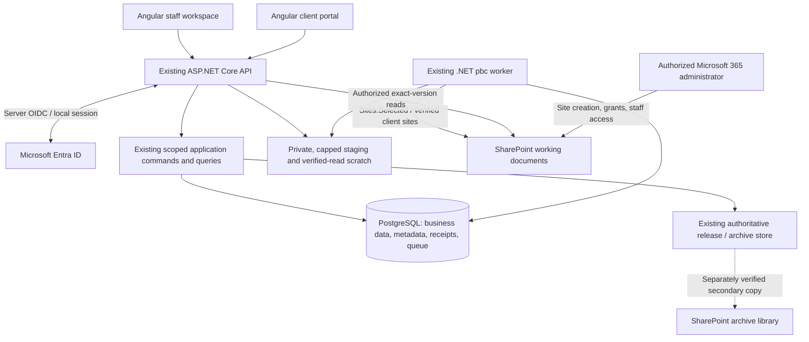

# AuditSphere — SharePoint-Primary Working Documents
## Implementation specification for the existing .NET application

> **SUPERSEDED (2026-10-25).** The owner replaced this specification with the [functional-parity revision](auditsphere-sharepoint-primary-storage-functional-parity-spec-proposed.md). Its manual site-management mode, administrator-managed onboarding, staff-membership handover, client-sites worker retirement and delta-synchronization proposals must not be implemented. Retained for lineage only.

| Document control | Value |
|---|---|
| Status | **SUPERSEDED** by the functional-parity revision; originally PROPOSED |
| Prepared | 25 October 2026 |
| Repository | `nirzaf/AuditSphere` |
| Reviewed branch / immutable commit | `master` / `afc52301d9ccf9349af30c6c69cd9d28b6fadb36` |
| Target stack | Existing ASP.NET Core / C# / Angular / EF Core / PostgreSQL / .NET Worker |
| Change type | Incremental storage and Microsoft 365 onboarding simplification; no framework migration |
| Primary objective | Use SharePoint for working-document bytes, keep document metadata in PostgreSQL, and bound—not eliminate—temporary VPS storage |
| Review evidence | Targeted source and test-body inspection; no application tests, tenant operations, migration, or deployment executed |

> **Decision:** This approach is feasible in the existing AuditSphere application. Reuse its selected-site Graph adapter, durable operations, scoped document entities and Entra session boundary. Add verified manual client-site onboarding, remove permanent staging dependencies from document consumers, and enable safe cleanup only after remote reads and evidence retention are proven. Do not rebuild these capabilities in Laravel or introduce R2.

> **Critical distinction:** SharePoint becomes the primary **working-document** store. This does not make ordinary SharePoint working sites the authoritative store for issued audit reports or archived evidence. Preserve ADR-0009 and explicitly resolve the secondary-archive operational handover before retiring its privileged worker.

## Contents

1. [Outcome and acceptance boundary](#s01)
2. [Verified current state and important gaps](#s02)
3. [Scope, non-goals and retained rules](#s03)
4. [Architecture decision and deployment modes](#s04)
5. [Target runtime and permission boundaries](#s05)
6. [Document classes and storage ownership](#s06)
7. [Administrator-provisioned site onboarding](#s07)
8. [Upload, verification and registration](#s08)
9. [Metadata model and schema changes](#s09)
10. [Downloads and downstream source readers](#s10)
11. [External-change detection](#s11)
12. [Temporary storage, quotas and cleanup](#s12)
13. [API, Angular and authorization requirements](#s13)
14. [Failure handling and operational visibility](#s14)
15. [Migration, rollout and rollback](#s15)
16. [Configuration and affected code](#s16)
17. [Agent-ready implementation stories](#s17)
18. [Acceptance matrix and verification](#s18)
19. [Operator handover and unresolved decisions](#s19)
20. [Implementation-agent brief](#s20)
21. [Source register](#s21)

<a id="s01"></a>
## 1. Outcome and acceptance boundary

The target is an incremental change to the application that already exists, not a new document-management product.

For an activated SharePoint-primary working-document family:

- Every published document revision resolves to a verified SharePoint site, drive, item and version, with the application's SHA-256 and byte count.
- PostgreSQL retains ownership, purpose, source lineage, workflow decisions, document references, verification receipts and operational state. It does not become a new binary-file store.
- Application downloads and downstream processing continue to work after eligible local staging files have been removed.
- Uploads, downloads, imports and rendering use bounded temporary storage, with concurrency limits and recovery. They do not create an indefinite VPS mirror.
- An authorized Microsoft 365 administrator creates the client site and manages direct SharePoint staff access. AuditSphere verifies and binds that site rather than creating it with a tenant-wide runtime credential.
- Existing Entra sign-in, local `RoleGrant` authorization, engagement activation, independent reviews, issued artifacts and financial boundaries remain intact.

**Completion is measured by behavior, not by enabling a configuration flag.** Demonstrate upload → exact-version registration → authorized review/use → safe local cleanup → successful remote-only download and source processing on the same release candidate. A separate scenario must prove denial for a different client or engagement.

The first vertical slice is PBC, because its transfer adapter and local-read dependency were inspected directly. The complete rollout also requires the document-family inventory in section 6: no claim that *all* working files are off the VPS until every applicable consumer has a verified disposition.

<a id="s02"></a>
## 2. Verified current state and important gaps

The following findings are source observations at the reviewed commit. “Present” means code was inspected, not that a live Microsoft tenant or current application release was successfully tested.

| Area | Observed current behavior | Implementation consequence | Evidence |
|---|---|---|---|
| Architecture | Existing .NET modular monolith, Angular UI, PostgreSQL and durable .NET workers. | Retain the stack and established capability boundaries. | [R01](#r01) |
| SharePoint transfer | `GraphPbcProviderSink` uploads, probes uncertain outcomes and verifies an exact stored version against SHA-256 and byte count. | Extend/reuse it; do not create a competing Graph upload implementation. | [R03](#r03) |
| Graph transport | `GraphSelectedSiteDrive` already creates folders, performs capability probes and transfers staged content through upload sessions. | Reuse its selected-site credential and restricted preauthenticated transport. | [R04](#r04) |
| Binding validation | `PbcRepositoryBindingResolver` requires exact scope, verified capability, approved workspace/connection and applicable dedicated-client-site evidence. | Manual onboarding must satisfy those invariants through a real verification path. | [R05](#r05) |
| Transfer publication | `PbcDocumentTransferHandler` verifies local bytes, uses durable operations and publishes `RECEIVED` only after provider verification. | Keep the transaction and recovery behavior; add normalized reference linkage atomically. | [R06](#r06) |
| PBC downloads | `ApiHost.DocumentEndpoints.cs` downloads by opening local chunk paths returned by `PrepareDownloadAsync`. | SharePoint transfer alone does **not** currently remove the local-file dependency. | [R07](#r07), [R17](#r17) |
| Audit-source readers | `AuditScheduleIntakeSources` uses the PBC download descriptor and verifies accepted staged bytes; API composition injects `PbcStagedScheduleContentReader`. | Migrate these consumers before deleting staging files. | [R08](#r08), [R11](#r11), [R19](#r19) |
| Metadata entities | `RepositoryBinding`, `DocumentReference`, `DocumentSnapshot`, `SourceReceipt`, `EvidenceLink`, `IntegrationCapability` and `SyncCursor` already exist. | Reuse them rather than adding a parallel document schema. | [R09](#r09), [R12](#r12) |
| Accepted-source identity | `PbcAcceptanceReceipt` pins exact upload revision, provider identity, byte hash and reviewer decision. | Storage migration/cleanup must not mutate that receipt or invalidate it through incidental upload revision changes. | [R16](#r16), [R17](#r17) |
| Site automation | Existing site discovery/handler creates or reconciles client sites and assigned staff access. | Add an explicit manual-management mode, with an amendment to the automation decision. | [R10](#r10), [R18](#r18), [R20](#r20) |
| API credential boundary | The API already composes selected-site credentials and probes; transfer execution remains a worker responsibility. | Add authorized remote content reads without enabling unrestricted API external effects. | [R11](#r11) |
| Worker environments | Current code evaluates capability profiles and can allow individually approved Production live groups. | Do not copy older “Acceptance only” assumptions or bypass current profile guards. | [R13](#r13) |
| Provider tests | Inspected tests cover exact-version reads, duplicate upload conflicts and racing external edits using a fake Graph drive and PostgreSQL fixtures. | Preserve those tests and extend them for remote-only consumption and cleanup. | [R14](#r14) |
| Archive | ADR-0009 keeps issued bytes in an authoritative release/archive store and uses a secondary SharePoint archive copy. The client-sites capability also serves that copy. | Do not disable the worker before accounting for archive copy and grant-verification responsibilities. | [R15](#r15) |

### 2.1 Not established by this review

This review did not execute the application, verify real grants, enumerate a live document corpus, inspect every binary-bearing table, or run an end-to-end storage migration. A manual site-binding flow and a complete live delta reconciliation loop were not established in the inspected paths. Before implementing either, check for a current equivalent at the implementation commit and extend it if present.

The source already demonstrates enough foundation to support this design. It does **not** establish that a single setting can safely remove local staging, that every document family is already SharePoint-backed, or that the deployment needs only two Microsoft identities.

<a id="s03"></a>
## 3. Scope, non-goals and retained rules

### 3.1 Included

Implement verified manual site onboarding; SharePoint-primary byte retrieval for enrolled working files; normalized provider registration; conversion of staging-dependent consumers; bounded temporary storage; metadata-only external-change observation; migration and safe cleanup; and the necessary API, UI, schema, tests and runbook updates.

Preserve the one-client-site arrangement for clients covered by the existing dedicated-site rollout. Retain historical bindings for earlier clients until explicitly migrated. Continue creating approved engagement folders inside the bound site through existing selected-site capabilities; manual **site** creation does not require manual creation of every working folder.

### 3.2 Excluded

No Laravel/Livewire migration, new frontend, Redis, broker, microservice, storage subscription, generic filesystem framework, Microsoft Graph SDK replacement, new product module, automatic migration of all tenant files, browser Graph tokens, OneDrive desktop-sync dependency, webhook subsystem, Purview integration, external eSignature service or malware-scanning subsystem.

Do not change firm accounting, client bookkeeping, consolidation, fee/payment gates, audit methodology, document signing policy or professional acceptance rules. Do not globally remove mail, directory, guest-invitation or group capabilities: disable unused capabilities only after the specific deployment's consumers and onboarding path have been checked.

### 3.3 Non-negotiable controls

Current firm/client/engagement/group scope and session freshness remain server-owned. A technical administrator cannot become an Engagement Partner. File transfer success is not reviewer acceptance. A SharePoint link does not grant application authorization. Direct SharePoint rights remain a separate external authority.

Keep append-only history, exact version lineage, idempotency, deterministic reconciliation, scoped foreign keys, human sign-offs, final-release upload fences and existing file-freeze rules. Working-file cleanup must never delete authoritative released bytes, alter an accepted financial source, or rewrite an earlier review receipt. [R01](#r01), [R15](#r15), [R16](#r16)

<a id="s04"></a>
## 4. Architecture decision and deployment modes

### 4.1 Proposed decision record

Add a new ADR using the next available repository number; do not overwrite ADR-0006 or assume its number. Its decision should state:

> Permit administrator-managed client sites as an alternative to automated site creation and staff membership synchronization. Preserve dedicated-site requirements, verified binding, application authorization and the existing authoritative archive boundary. Allow working documents to be read from pinned SharePoint versions and permit eligible temporary-file cleanup only after migration and custody gates pass.

Use two explicit policy values, proposed here as `AUTOMATED` and `MANUAL_VERIFIED`. These are new design names, not existing configuration keys or persisted values.

| Concern | Existing automated mode | Proposed manual-verified mode |
|---|---|---|
| Site creation | Isolated client-sites capability | Microsoft 365 administrator outside the application |
| Document app grant | Existing approved provisioning workflow | Administrator grants the runtime document app access to the exact site |
| Staff direct access | Existing membership reconciliation | Administrator-owned joiner/mover/leaver procedure |
| Local binding | Existing verified provisioning receipt | Explicit reviewed registration plus observed runtime-access verification |
| Folder creation | Approved template within verified site | Same existing selected-site folder capability |
| Working-file operations | Selected-site document capability | Same selected-site document capability |
| Secondary archive | Existing separately gated path | Keep existing path until the explicit operator handover below is accepted |

Existing installations retain their previous effective behavior after an additive upgrade. A new or migrated manual-mode deployment requires an explicit policy selection and recorded administrator responsibility. Do not infer the mode from a missing certificate.

### 4.2 Preserve rollout semantics

`ClientSites:Enabled=false` is **not** equivalent to verified manual onboarding. The existing resolver uses persisted cutoff and client-site records. Do not erase or backdate that cutoff, silently redirect a covered client to the shared firm site, or mark a nonexistent site ready. [R05](#r05)

For a mode change, inventory queued, running and uncertain site operations. Stop new automated discovery for the affected policy only after existing effects have been reconciled or explicitly dispositioned. A timeout during site creation cannot be treated as evidence that no site exists.

### 4.3 Secondary archive handover

The current client-sites capability is not solely a site-creation worker: ADR-0009 also gives it secondary archive-copy duties. Choose one recorded transition outcome before removing its credential:

1. Keep the existing isolated capability for its still-required archive work while automated site creation is disabled; report the remaining privileged dependency honestly.
2. Transfer secondary archive copying and permission administration to the authorized Microsoft 365 operator, with a reviewed procedure and verifiable copy/grant evidence.

The second outcome is the intended simplified end state. Operator attestation must be labelled as attestation. It cannot set the existing provider state to `OBSERVED` unless exact content hashes and actual expected-grant evidence have been verified through an accepted process. A `Sites.Selected` document token must not be assumed able to inspect or administer every permission needed for this proof. Preserve `BLOCKED_EXTERNAL` when evidence is unavailable. [R15](#r15)

Do not retire the privileged runtime and simultaneously claim its former responsibilities still happen automatically. This handover does not change the authoritative release/archive store.

<a id="s05"></a>
## 5. Target runtime and permission boundaries



### 5.1 Identity design

Keep the current web sign-in registration and selected-site document registration separate. The document identity uses application `Sites.Selected` and an explicit `write` grant for each enrolled client site. Microsoft requires consent, the selected-resource grant and a suitable token; consent by itself grants no site access. [M01](#m01)

An administrator performs grant administration outside the normal runtime. Do not put `Sites.FullControl.All`, directory administration or a provisioner certificate into the document capability to make onboarding convenient. Keep production and nonproduction registrations, credentials and sites isolated.

Two registrations cover the **sign-in and document** responsibilities; other retained capabilities may still need their existing separate identities. Do not promise a two-registration whole-system deployment until mail, directory/onboarding, archive and any other enabled integrations have been reconciled.

### 5.2 Process boundaries

Reuse the current certificate-backed selected-site token source, HTTP clients and `GraphPreauthenticatedTransport`. The API already has this selected-site capability for existing probes/workspace operations; do not introduce another service simply to proxy reads. [R11](#r11)

Add a narrowly scoped content-read implementation to the API and required processing composition. Provider mutations and durable transfer claims stay in their approved worker group. Keep the API's `ExternalEffects:Enabled` safety behavior unchanged; do not turn it on to enable document downloads. Any new composition must pass the current worker profile and release-safety checks. [R11](#r11), [R13](#r13)

Never expose Graph access tokens, upload-session URLs, temporary download URLs, certificate paths or physical staging paths in browser DTOs, telemetry or application logs. Only use preauthenticated URLs obtained through the trusted Graph operation and the existing restricted transport. Microsoft download URLs do not require a bearer header; never forward the Graph token to them. [M03](#m03), [M04](#m04)

<a id="s06"></a>
## 6. Document classes and storage ownership

### 6.1 Mandatory inventory

Before data migration, produce a bounded inventory per document family with: source table/entity, current binary location, writer, every reader, source/approval/hash dependencies, current provider identity, retention/custody class, projected volume, and migration disposition.

Inspect code and representative authorized metadata; do not copy live financial contents into reports. Do not infer storage from a class name or README. Inventory local paths, `byte[]`/binary columns, encoded content, generated files, exports, worker stores and archive/checkpoint locations. Distinguish normalized business JSON from a file encoded into JSON.

| Family | Target or retained ownership | Gate |
|---|---|---|
| PBC uploads and ordinary working evidence | SharePoint bytes; PostgreSQL scoped references and receipts | First mandatory vertical slice |
| Raw TB/GL import files and source schedules | SharePoint source bytes where classified as working evidence; parsed accounting rows remain in PostgreSQL | Inventory every reader and accepted-source dependency before conversion |
| Workpapers and staff attachments | SharePoint working bytes and exact revision references | Maintain preparer/reviewer history and scoped links |
| Unissued generated working outputs | SharePoint when retention is required, or temporary generation if explicitly disposable | Do not misclassify an issued commercial or professional artifact as disposable |
| Accepted-source manifests, parsed rows, journal data and review decisions | Remain application records in PostgreSQL | These are business/evidence records, not an unwanted binary mirror |
| Issued reports, signed representations where retained as release evidence, final bundles, manifests and checkpoints | Existing authoritative release/archive contract | Not migrated to mutable working sites under this change |
| Certificates, private keys and credentials | Existing approved secret custody | Never SharePoint document metadata or browser content |
| Temporary upload chunks, read spools and render scratch | Capped private VPS paths | Eligible cleanup only; never the permanent source of truth after cutover |

Retain every discovered family in the inventory, including “not applicable” or “excluded by custody” with its reason. PBC completion alone cannot be labelled whole-application storage completion.

### 6.2 Evidence retention is separate from reference immutability

An immutable database hash proves what bytes were expected; it does not keep those bytes available. An ordinary SharePoint version may become unavailable through user action or administrative policy. Before removing the only local working copy, record the accepted version-retention, recovery and backup responsibilities for that family.

If an item is required in the authoritative audit-file archive, copy or retain it through the existing approved archive process before its temporary-copy disposition permits deletion. Until the applicable custody rule is resolved, retain the protected copy and report its storage cost. Do not describe working-site Full Control, a folder name or the presence of a version ID as immutable retention. [R15](#r15)

<a id="s07"></a>
## 7. Administrator-provisioned site onboarding

### 7.1 One-time firm configuration

The operator confirms the firm tenant, public application URL, existing Entra sign-in registration, selected-site document registration, certificate custody, approved SharePoint host, negative-control site and current Microsoft connection revision. The tenant administrator consents and applies the appropriate per-site document-app grants outside AuditSphere.

Reuse existing consent/capability evidence where compatible. Do not forge a directory-reader check or set a verification row to `VERIFIED` merely because a token was obtained. A minimal manual deployment may omit unused directory-management functions only after the application's actual local identity-binding/onboarding procedure has a supported alternative.

### 7.2 Per-client sequence

**SP-BIND-01 — Prepare.** The Microsoft 365 administrator creates or explicitly adopts the dedicated site, establishes the approved client ownership marker, selects the document library and root, enables the firm's accepted version policy, grants the document application the approved site role, and assigns staff access. Record the operator, tenant, client, site/drive/root identifiers and change evidence. This is not a request for AuditSphere to create a site.

**SP-BIND-02 — Review.** A current authorized AuditSphere administrator opens the existing Microsoft 365/client-site area and selects the exact client. The screen accepts the proposed identifiers and reason, resolves existing policy and displays a review summary. Paths and display URLs are informational; identifiers and verified ownership determine the target.

**SP-BIND-03 — Verify.** Reuse or extend the selected-resource verification services to establish:

- The allowed tenant and host, exact site identity and expected client ownership marker.
- The drive belongs to that site, and the root is a folder in that drive.
- No other client binding has conflicting ownership of this dedicated site.
- The runtime document credential is the configured selected-site identity; unrelated-site access is denied using the controlled negative target.
- A disposable, explicitly authorized probe in the approved root can be created, read back with the expected hash and deleted, with cleanup outcome recorded.
- The proposed connection, site policy and relevant template revisions remain current.

Keep requested, observed and activated facts distinct. A failed probe, missing grant, wrong site, stale connection, unexpected ownership marker or incomplete cleanup is not success. Never solve a failed probe by silently increasing permissions.

**SP-BIND-04 — Activate.** Commit the reviewed binding, manual-management provenance and verification receipt in a short transaction. Recheck current administrator authority, expected revisions, policy mode and conflict constraints. Use an idempotency key bound to the full reviewed payload. A replay returns the original receipt; different data under the same key conflicts.

Reuse compatible `ClientSharePointSite`, `ClientWorkspace`, `RepositoryBinding` and `IntegrationCapability` records. Preserve business acceptance and workspace-template prerequisites. A verified site must not itself activate the engagement, satisfy a paid advance or grant a client portal permission.

**SP-BIND-05 — Provision engagement folders.** Reuse `PbcRepositoryProvisioningService` and published folder templates under the enrolled site. Do not hard-code a replacement taxonomy from this document: inspected tests use `03_PBC_Data_Intake`, while historical narratives use other folder labels. The adopted template version is authoritative. [R14](#r14)

### 7.3 Binding changes and staff changes

An existing populated binding cannot be silently edited to point to another site, drive, root or client. Require a reviewed migration/rebinding operation; retain earlier identities for historical snapshots and unresolved operations.

Record direct SharePoint membership management as administrator-owned in manual mode. Do not fabricate `LastMembershipSyncAt`, verified membership lists or automated creation-operation IDs. Staff assignment changes must produce an explicit operator task/notice through existing administration/workflow mechanisms, including revocation follow-up. Application access can be revoked independently; the UI must not state that direct Microsoft access has been removed without evidence.

<a id="s08"></a>
## 8. Upload, verification and registration

### 8.1 Preserve the existing transport and business states

Retain the current PBC upload-intent, capability, sequential chunk and trusted staff-completion flow. Current limits are **250 MiB per PBC upload** and **8 MiB per application chunk**. The Graph uploader repacks into **10 MiB provider fragments**; these are different boundaries and need not match. [R04](#r04), [R17](#r17)

The existing `STAGED` and `RECEIVED` meanings remain unchanged. Do not add a parallel business lifecycle or mark an upload received when only its local file or upload session exists.

### 8.2 Required sequence

1. Resolve current actor and request scope; validate capability, upload window, expected state and declared size. Reserve temporary capacity **before** consuming a new request body. Reuse final locked authorization checks after body transfer; preflight is not a replacement for them.
2. Stream into private staging with bounded buffers. Preserve chunk receipt/hash validation, safe server-generated paths and replay behavior. A rejected or superseded chunk leaves no untracked retained file.
3. Trusted completion verifies every staged chunk, final size, digest and existing content checks, then commits the durable transfer intent with business changes. Provider I/O occurs outside the committing transaction.
4. The existing worker rechecks operation ownership and scope, transfers using the deterministic intent-bound filename, and obtains an exact-version read-back receipt. Preserve conflict-fail behavior and unknown-outcome reconciliation.
5. Publish the provider result and normalized document reference/snapshot association atomically, then make the verified file available to the appropriate existing workflow.
6. Schedule cleanup eligibility only after all required readers and custody conditions support that file's remote identity. Cleanup is not part of provider success and must be recoverable independently.

Microsoft upload sessions accept sequential fragments and have alignment rules; reuse the implementation already accounting for them. Persisting resumable provider-session state is not a prerequisite for the first release: the inspected upload method holds that URL in memory, so do not claim restart-resume across worker crashes already exists. Preserve safe whole-operation reconciliation and introduce persistent session checkpoints only if measured transfer behavior justifies them. [R04](#r04), [M02](#m02)

### 8.3 Unknown outcomes and authorization changes

After a timeout, probe the deterministic existing target and compare exact content before another create. Never switch to automatic rename, overwrite, or upload to a different folder merely to make a retry succeed. Distinguish no observable result from a provider outage that prevented observation.

If authority or binding changes while an operation runs, stop unstarted unauthorized effects and refuse stale publication. Keep evidence of any remote effect that already happened. A manual site switch cannot redirect an in-flight upload to another client or permit a duplicate without reconciliation. Use existing lease/fencing and durable-operation primitives. [R06](#r06), [R10](#r10)

<a id="s09"></a>
## 9. Metadata model and schema changes

### 9.1 Reuse the existing domain

Use `DocumentReference` for scoped provider location and purpose, and `DocumentSnapshot` for the immutable item/version/hash/size identity. Retain `RepositoryBinding`, `IntegrationCapability`, `SourceReceipt`, `EvidenceLink` and current operational records. Preserve their composite scope foreign keys. [R09](#r09), [R12](#r12)

Add only missing linkage and operational metadata. The names below are **proposed**, not claims about existing entities.

| Proposed addition or amendment | Minimum contract | Integrity rule |
|---|---|---|
| Site-management provenance | Management mode, operator responsibility, reviewed registration receipt and verification basis on/alongside existing client-site records | Existing rows are classified from actual provenance; never invent a manual operator or remote creation receipt |
| PBC document registration | Firm/client/engagement, upload intent, transfer operation, document reference/snapshot, binding digest, registration time and verified provider identity | One accepted registration for an upload's exact provider outcome; composite same-scope references; append-only |
| Working-file storage disposition | Existing source identity, registered snapshot, remote-read activation, custody/hold disposition, cleanup eligibility and cleanup result | Separate from PBC business state and approval revision; every transition auditable |
| Temporary reservation/lease | Firm, source/operation, purpose, reserved bytes, owner/token, expiry and actual usage | Shared physical-volume limit; idempotent reservation; safe concurrent release/recovery |
| Current remote observation | Referenced item, observed version/tags/location, observation time and availability/change condition | Cannot replace an immutable snapshot or reviewer decision |

Reuse existing durable operation/event/receipt records for transitions where they provide the necessary scope, ownership and idempotency. Do not add a second job queue, a universal blob entity or a parallel document-state engine.

### 9.2 Registration rules

For new transfers, publication must bind the provider identity to the correct saved target, then create or reuse the corresponding `DocumentReference` and `DocumentSnapshot` with exact hash and size. Snapshot capture is a technical observation; it is not a human approval.

For an existing verified transfer, append the registration association using its retained operation result and a new exact-version verification. Do not overwrite `ProviderIdentity`, `PbcAcceptanceReceipt.SourceDigest`, acceptance times or any historical operation result. A historical upload revision pinned by an acceptance receipt must not be incremented merely because a storage mapping or cleanup event was added. [R16](#r16), [R17](#r17)

Treat provider receipt strings as server-produced evidence that must be validated, not as browser-submitted addresses. Reuse the current parser/format until a versioned contract is needed. If the parser cannot establish an exact supported provider identity, classify the item for remediation; do not infer its version from the current filename.

### 9.3 Schema and transaction requirements

Use additive EF Core migrations. Keep original IDs, FKs, append-only protections, check constraints and audited revisions. Put associated DB guards in the same migration. Do not edit applied migrations, temporarily disable all history triggers or rewrite historical receipt JSON to make a backfill pass.

Enforce uniqueness for accepted registration and active reservations, same-scope source/snapshot linkage, nonnegative bounded sizes, valid hash encoding and explicit state values. Prevent dual storage-authority publication for the same source revision. The existing `DocumentSnapshot` uniqueness by firm/document/version must remain compatible with backfill replay. [R12](#r12)

The first release may reject relocating a populated client site rather than implementing a new generic relocation feature. New site identity adoption and existing-byte migration are different operations. Any future rebind must retain historical mappings and cannot replace a document's historical provider identity.

Store timestamps in the project's existing UTC convention, preserving its database precision. Never recompute an old source digest with a different serialization or timestamp format.

<a id="s10"></a>
## 10. Downloads and downstream source readers

### 10.1 Separate transfer eligibility from read eligibility

Do not call the existing upload resolver unchanged for long-lived reads: it currently restricts the request to `PARTIALLY_RECEIVED` or `RECEIVED`. Legitimate accepted, closed and archived evidence would otherwise become unreadable. [R05](#r05)

Add a small read-resolution path that reuses common scope/connection checks but evaluates the **existing permitted read workflow**, not upload eligibility. It resolves an immutable snapshot from the source record and the relevant retained binding. Read permission does not imply write permission or the right to reactivate an upload.

The existing PBC download command is staff-authorized. Preserve that audience unless a separately approved portal requirement adds a client download surface; do not widen it as a storage refactor. Client-facing issued-document endpoints retain their current, different authority. [R07](#r07), [R17](#r17)

### 10.2 Exact-version content algorithm

The content service accepts a server-resolved scoped snapshot, expected hash/length and a bounded purpose. It does not accept an arbitrary URL or untrusted drive/item supplied by the browser.

1. Authorize the current actor and resolve the permitted snapshot, binding and connection.
2. Reserve temporary read capacity and fetch the exact version through the existing restricted Graph transport.
3. If the requested version is historical, use the version-content endpoint. For the current version, preserve the existing before/after version-and-content-tag checks and historical fallback when an edit races the read. Microsoft does not support retrieving the current version through the version-content endpoint. [R03](#r03), [M04](#m04)
4. Hash and count the complete retrieved bytes against the snapshot. Graph's `sha256Hash` is not supported; do not substitute a provider checksum or metadata comparison for the application hash. [M05](#m05)
5. Recheck current local authority, binding eligibility and source dependencies after provider I/O and before returning content or committing a dependent action.
6. Release content only when verification passes. Remove disposable read scratch when its consumer releases the lease; recover abandoned scratch safely after a crash.

**Recommended implementation:** stream the remote response into a capped private temporary spool, verify it, then stream that verified file to the caller. This adds temporary I/O but prevents sending incorrect bytes before the final digest is known. It is not a permanent local copy. Do not read an entire 250 MiB file into a `byte[]`, and do not fetch twice while assuming the second response equals the first.

A bounded small-source parser may still use its existing justified in-memory limit after verification. Keep the current CSV input/resource bounds rather than increasing them to the general upload limit.

### 10.3 HTTP behavior

Keep the existing PBC download route where practical. Preserve safe filename handling, attachment content disposition, `no-store`, `nosniff`, cancellation and no existence oracle. Do not reveal a physical path or raw provider response. Do not expose a preauthenticated URL as the permanent document link.

For an unavailable provider, return a recoverable safe error and retain the registered source identity. Never silently substitute a newer version, a similarly named file, or an unverified local file. A legacy-local read is permitted only for an explicitly recorded pre-cutover disposition, with the existing byte verification—not as an automatic fallback after SharePoint-primary cutover.

For long downloads, apply the established session/revocation policy and bounded operation time. Do not promise that already transmitted bytes can be recalled or that remote revocation is instantaneous.

### 10.4 Audit schedule and other processors

Replace the hard local-path dependence in the download descriptor/content-reader boundary with a scoped content source. Keep the old local path only for pre-cutover records and isolated tests. Adapt `IAuditScheduleSourceContentReader`, `PbcStagedScheduleContentReader` composition and `AuditScheduleIntakeSources` to consume the verified source through the same authority rules. [R08](#r08), [R11](#r11), [R19](#r19)

`CheckRetainedSourcesCurrentForAuthorizedScopeAsync` currently rechecks staged bytes. Do not simply remove that assertion after cleanup. Change its proof to the retained snapshot plus a current verified-read result for actions requiring byte evidence, while keeping exact PBC receipt, accepted TB, period, generation, control-total and source-digest checks.

**Transaction rule:** remote reads must occur before acquiring long-lived business write locks. Prepare a verified, source-bound result outside the committing transaction; inside the existing short transaction, recheck local authority, the same source identities, revisions, binding/connection eligibility and consumed verification identity. Do not keep a database transaction open while downloading a large file or create an illusion of an atomic transaction spanning PostgreSQL and SharePoint.

A provider cannot be prevented from changing after a read by a database lock. The proof is the exact verified version consumed, not a claim that the remote library is globally frozen. Any subsequent new version is a separate observation and requires the applicable impact review.

<a id="s11"></a>
## 11. External-change detection

### 11.1 Narrow reconciliation scope

Start with scheduled, bounded Graph delta observation, not webhooks or bidirectional content synchronization. Use the existing worker/operation framework and reuse `SyncCursor` where its scope and constraints fit. The Microsoft API supplies paged `nextLink` and completed `deltaLink` continuations for a drive; follow that documented drive-root contract rather than inventing a folder-delta endpoint. [R09](#r09), [M06](#m06)

The following are proposed application controls:

- Serialize reconciliation per cursor generation and apply changes idempotently. Commit observations before advancing the corresponding continuation; a crash must replay safely rather than skip changes.
- Validate continuation host/resource boundaries. Keep tokens out of logs and browser DTOs. Reject or deliberately migrate an inadequate cursor-column length; never truncate a token.
- Filter results to the registered binding and permitted roots. Verify item ancestry where necessary. Do not expose an entire drive to an engagement user or auto-adopt every externally uploaded file as accepted evidence.
- Handle repeated items, moved folders, deleted facets and incomplete pages conservatively. Use controlled resynchronization when a cursor expires; keep historical snapshots during that rescan.
- Fetch content only for an explicit verification or adoption operation, not for every metadata change. Polling must not recreate a local file mirror.

A reasonable initial polling interval is 15 minutes, configurable and subject to the actual workload. This is a proposed operational default, not a measured SLA. Existing cursor-per-binding design may be adequate initially; do not introduce a drive-wide synchronization platform solely to eliminate modest duplicate polling.

### 11.2 Observation is not an approval

| Observation | Required application result |
|---|---|
| Same item/version remains available | Update observation freshness without changing its source receipt |
| New external content version | Retain accepted snapshot; show “External change — review required” for affected current work |
| Rename within the allowed scope | Update current display metadata with history; retain immutable source filename/version facts |
| Move outside approved root or client ownership | Block ordinary use until authorized disposition; never silently widen scope |
| File or required version unavailable | Mark availability issue, retain metadata and evidence; route recovery |
| New unregistered file in the site | No automatic acceptance, PBC association or permission grant |
| Changed grant / denied access | Mark affected capability unavailable and alert its operator; do not delete document records |

A newer version does not erase a valid historical review of the earlier version. It may affect current eligibility and require targeted reassessment. Conversely, a historic review cannot automatically approve new bytes. Preserve those two facts separately.

Metadata synchronization is not a complete historical audit log and does not replace exact-byte checks at sensitive actions. Missing content, unresolved changes or failed integrity checks must remain visible to relevant review/release gates.

<a id="s12"></a>
## 12. Temporary storage, quotas and cleanup

### 12.1 Capacity controls

Introduce a shared reservation policy for the actual staging/scratch volume. Enforce a physical global budget and per-firm bounds; per-process counters are insufficient when the API and workers run concurrently.

Reserve the declared retained upload requirement idempotently. Account separately for in-flight duplicate chunk attempts, temporary verified-read spools and rendering scratch. Do not release a reservation merely because the browser disconnected while a retained transfer can still resume.

Before accepting bytes, check current authorization, declared bound, reservation availability and minimum free-space headroom. Configure the reverse proxy and ASP.NET transport so unexpected request buffering cannot bypass the budget. Verify behavior with the real container mounts and permissions, not just service mocks.

Use a private durable staging mount shared by the API and the transfer worker that needs those paths. A disposable container filesystem is not sufficient for a queued upload promised to survive process restart. Preserve consistent paths or use a server-owned relative locator resolved against the same approved root; never trust an uploaded filename as a filesystem path.

No specific VPS size is assumed. The operator must select and test the limits for the actual host before enabling SharePoint-primary production writes.

### 12.2 Cleanup eligibility

A working upload's local chunks are eligible only when **all** the following are true:

1. Its exact provider identity, snapshot, size and SHA-256 have been verified and durably registered.
2. Its remote-read disposition is active and every enabled consumer of that family has migrated from local paths.
3. The applicable source retention/backup/hold decision permits removal of that temporary copy.
4. No upload, transfer, reconciliation, reader, import or migration lease still needs those chunks.
5. The operation is not in an unknown-result or incomplete publication condition.
6. The cleanup feature and production deletion policy have been explicitly authorized for that cohort.

A scheduled age threshold alone is never proof of eligibility. In particular, `RECEIVED` alone is not sufficient with the currently inspected source, because downloads and audit-source checks still rely on staging. [R07](#r07), [R08](#r08)

### 12.3 Cleanup mechanics

Record an idempotent cleanup intent with a bounded set of server-owned paths and their source identities. Acquire the appropriate storage/operation fence, re-evaluate eligibility, then delete only the designated temporary files. Record per-object results and the final released capacity. Resume safely after a crash or partial deletion; missing already-deleted scratch is not a second business action.

Do not change an upload revision, accepted-source hash, chunk receipt, reviewer decision or financial source to indicate that a file was cleaned. Preserve original path metadata as historical provenance where its row is immutable; the separate storage disposition states that those bytes are no longer locally retained. Never treat the stale path string as a current readable location.

Reject path escapes and symlinks outside the managed root. Protect active readers with a lease until disposal. A cleanup/read race must either preserve the existing lease or make a new read use SharePoint; it cannot corrupt an in-flight response.

Separate these categories:

| Category | Disposition |
|---|---|
| Started/chunking upload still resumable | Keep within its valid reservation and expiry policy |
| Staged transfer or uncertain provider outcome | Keep bytes until reconciled, explicitly failed or otherwise safely dispositioned |
| Verified remote working file with all cleanup gates passed | Reclaim eligible staging bytes |
| Failed/expired abandoned upload | Explicit terminal disposition and absence of active consumers before cleanup |
| Temporary verified read/render spool | Delete after consumer completion; recover expired leases and abandoned files |
| Issued evidence, archive store, release checkpoint, signed artifact or unresolved hold | Never handled by this working-staging cleanup process |

### 12.4 Remaining disk and cost model

Use this deployment accounting model:

```text
VPS requirement = application + PostgreSQL/WAL + logs
                + capped retained-upload staging
                + capped read/import/render scratch
                + any authoritative archive/checkpoint/backup bytes hosted there
                + operational free-space headroom
```

SharePoint-primary working files remove growth proportional to the accumulated **working-file mirror**. They do not remove PostgreSQL growth, temporary I/O, existing archive storage, backups or Microsoft tenant capacity limits. Avoid a savings percentage without measured current storage by category.

During a prolonged provider outage, stop accepting new work before the cap is exhausted and give a clear retry message. Do not silently turn temporary storage into an unlimited offline document repository.

<a id="s13"></a>
## 13. API, Angular and authorization requirements

### 13.1 API changes

Keep the current route families, safe errors and OpenAPI conventions. The following describes operations, not final route names or existing methods:

| Surface | Required change |
|---|---|
| Existing Microsoft 365 client-site administration | Add manual binding review, explicit verification, activation and actor-owned receipt recovery |
| Existing PBC upload-intent and chunk routes | Add pre-body scope/capability and capacity preflight; preserve final guarded writes |
| Existing PBC download route | Resolve permitted remote snapshot for migrated records; use verified temporary spool; retain legacy behavior only for registered pre-cutover records |
| Existing document/source detail views | Expose safe storage availability and verification state, not provider credentials or filesystem paths |
| Existing operations/recovery area | Expose failed transfers, binding checks, cleanup results and reconciliation outcomes with scoped actions |

Every modifying operation carries existing request/revision semantics or an equivalent server-generated review digest, plus idempotency where replay is possible. The server derives firm, actor and authoritative scope. Register the new error/response shapes in `contracts/auditsphere-openapi.json` through the repository's normal emitter/verification process.

Reuse `CommandResult`, existing HTTP status mapping and operation recovery. Do not introduce a new global error framework. Distinguish invalid input, stale review, forbidden scope, storage-capacity pressure, provider unavailability, integrity failure and uncertain outcome without leaking sensitive target details.

### 13.2 Angular experience

Extend existing client-site administration and PBC/document surfaces; no new top-level module.

The administrator sees the selected management mode, exact client/site identity, current connection/template basis, last verification, unresolved setup tasks and who owns direct staff access. The activation button is available only after the exact review/probe is current. A typed client site URL alone cannot make a green “connected” state.

The document user sees transfer progress and clear conditions such as “Uploading”, “Waiting for SharePoint verification”, “Stored in SharePoint”, “Temporarily unavailable”, and “External change requires review”. These are presentation labels over separate technical/business records, not replacements for PBC request states.

Only show “Open in SharePoint” when a validated site URL and the appropriate direct-access policy exist. It is a convenience link, not proof that the Microsoft user has access. Do not show it as a way around a denied application download.

Maintain keyboard navigation, responsive tables, useful retry actions, source version/hash visibility for reviewers, and safe handling of stale deep links. Preserve user input on transient failure and resolve unknown commands by receipt before retrying them.

### 13.3 Permission matrix

| Action | Required authority | Additional condition |
|---|---|---|
| Propose/activate client site binding | Current authorized firm integration administrator | Exact client, reviewed target, connection and verification basis |
| Create Microsoft site or grant app/staff rights | Authorized Microsoft 365 operator outside simplified runtime | Tenant-approved operation and external evidence |
| Upload requested PBC | Existing scoped upload actor and capability | Current upload window, request state, quota and freeze controls |
| Complete trusted upload | Existing trusted staff completion authority | All bytes verified; no implied independent review |
| Review/accept PBC | Existing assigned independent reviewer | Exact current provider-verified submission and source hash |
| Download PBC working source | Existing staff read authority | Registered permitted source, availability and exact-byte verification |
| Read client deliverable | Existing client-visible deliverable authority | Separate release/recipient policy, not broadened by this change |
| Retry/reconcile/cleanup | Existing appropriate operational authority or approved bounded worker policy | Same original scope, payload, leases and evidence; no business-gate override |

<a id="s14"></a>
## 14. Failure handling and operational visibility

| Failure or race | Required result |
|---|---|
| Missing site grant or wrong tenant | No activated binding and no transfer; actionable operator condition |
| Provider token/certificate failure | Fail closed, identify affected capability without revealing secret details |
| Replayed upload or binding command | Recover original outcome; same key/different payload conflicts |
| Graph throttles | Preserve safe retry timing, respect `Retry-After` and use bounded retry/backoff |
| Timeout after possible remote create | Reconcile deterministic target before another create |
| Snapshot hash/size mismatch | Block use of those bytes, preserve source evidence, surface integrity incident |
| Source or binding changes during read | Discard unpublishable result; preserve intended snapshot and require current resolution |
| Role revoked after request/queue | Refuse subsequent unauthorized publication/read as required; preserve already observed external effects |
| Disk budget exhausted | Reject new bytes before writing, without damaging retained uploads or archival storage |
| Worker restarts | Existing durable operation resumes/reconciles with its original identity |
| Required version deleted | Preserve metadata and acceptance history; recover through approved source custody, not “latest file” substitution |
| Direct staff access not removed externally | Application remains locally revoked; operator task stays open and external revocation is not claimed |
| Secondary archive verification absent | Keep its provider-protection gate blocked independently of working-document success |

Microsoft recommends respecting throttling responses rather than immediate retries. Apply that advice inside the existing durable-operation policy; do not apply a generic HTTP retry wrapper indiscriminately to mutations with uncertain outcomes. [M07](#m07)

Monitor staged/reserved/actual bytes, oldest pending transfer, uncertainty age, verification failures, missing versions, delta freshness, binding health, cleanup failures, pending staff access tasks and unresolved archive-copy work. Reuse existing telemetry and operations UI. Report IDs/correlation and safe reason codes, not full financial payloads, filenames where unnecessary, tokens or download URLs.

A reported healthy HTTP process is not proof that a specific client site's document capability is usable. Keep per-binding readiness separate from application liveness; permit unrelated authorized work where the affected capability is unavailable.

<a id="s15"></a>
## 15. Migration, rollout and rollback

### 15.1 Migration sequence

**Stage A — Inventory and decisions.** Pin the implementation commit. Produce the family/source-consumer inventory and storage measurements. Adopt the manual-site ADR where needed. Record custody, archive handover, capacity and operator responsibilities. Unresolved policy blocks its affected production activation, not unrelated engineering.

**Stage B — Additive preparation.** Deploy schema and compatible readers with cleanup disabled. Keep existing mode/default behavior. Add exact provider registration and explicit storage dispositions without changing accepted source receipts.

**Stage C — Bind and verify a pilot.** Link one administrator-prepared synthetic/approved client site. Prove positive operations and an unrelated-site denial using the actual document identity. Confirm the existing dedicated-site cutoff remains enforced.

**Stage D — Populate references.** For already SharePoint-verified uploads, parse the retained provider result, read the exact version and append verified mappings. For local-only working files, copy through a reviewed operation with the same source hash and verify readback before assigning remote authority. Simulation provider receipts, guessed versions and matching filenames are not live migration evidence.

**Stage E — Switch consumers.** Exercise staff downloads, accepted PBC schedule intake, review-detail/currentness checks and all other inventory-listed consumers through the remote path. Compare exact bytes and material domain outputs. Preserve the original source IDs, hashes, reviewer receipts and computed totals.

**Stage F — Activate a bounded cohort.** Mark only the verified records/family as SharePoint-primary. Observe normal operation and recovery. Keep explicitly pre-cutover records on their verified old read path; no opaque global fallback.

**Stage G — Reclaim eligible staging.** Obtain the production cleanup authorization, run a dry-run manifest, then an audited bounded cleanup batch. Re-run remote-only downloads and source processing after deletion. Expand only after the cohort's acceptance evidence passes.

**Stage H — Complete other working families and simplify deployment.** Repeat the same disposition process for all included inventory rows. Disable unneeded automated site/membership capability only after queued effects and archive responsibilities have an accepted handover. Do not count excluded authoritative archive bytes as a failed working-file migration.

### 15.2 Migration manifest

For each source include: firm/client/engagement; family and source ID; original hash/size; original location class; original receipt/version identity; target binding and exact provider version; verification result/time; registration receipt; current read disposition; outstanding hold/consumer; cleanup eligibility/result; batch and actor.

Store only safe references in exportable reports. Physical paths and provider URLs that confer access remain protected operational details. The manifest is idempotent and resumable; reconcile existing target content before copying again. No cross-client hash deduplication that creates shared authorization or deletion dependencies.

### 15.3 Rollback boundary

Before eligible local copies are removed, a compatible deployment may revert its read selection for the pilot, using retained verified local bytes and recorded dispositions.

After cleanup, an old binary that assumes `PbcDownload.ChunkPaths` exist is **not** a valid rollback target. Retain a rollback release that supports remote reads, or explicitly rehydrate the exact verified version into the required protected local location under an approved recovery procedure. Never restore an older application against cleaned storage and call it rollback-ready.

Keep additive schemas readable by the supported rollback release. Do not delete old columns or migration evidence in the initial rollout. Existing issued artifacts, release checkpoints and accepted receipts remain unchanged throughout.

### 15.4 Recovery rehearsal

Restore PostgreSQL metadata and the retained authoritative archive/checkpoint stores into an isolated environment. Revalidate remote bindings/credentials, then read representative exact SharePoint versions and reconcile interrupted operations safely. A database backup does not itself contain SharePoint bytes; document the separate working-document recovery responsibility and demonstrate a missing-version case.

All live probes, grants, production migrations, cleanup activation and irreversible changes require the repository/user's applicable authorization. Drafting this specification grants none of those permissions.

<a id="s16"></a>
## 16. Configuration and affected code

### 16.1 Existing configuration to retain

The following keys were observed in current composition. Preserve their meaning unless the adopted ADR explicitly narrows it. [R11](#r11), [R13](#r13)

| Existing key/family | Treatment |
|---|---|
| `SelectedSite:TenantId`, `ClientId`, `CredentialReference`, `CertificatePath`, `PrivateKeyPath` | Reuse selected-site credential composition; do not combine with login/provisioner credentials |
| `SelectedSite:NegativeControlSiteUrl` | Retain controlled unrelated-site denial verification |
| `Storage:PbcStagingRoot` | Retain as capped resumable transfer storage, not a permanent working-file repository |
| `PbcTransfer:LiveProvider` | Retain explicit live-vs-simulated transfer definition |
| `ClientSites:Enabled`, `ClientsCreatedAfter` | Preserve existing rollout semantics; manual management is a distinct policy, not an implicit disabled flag |
| `Worker:Group`, `Worker:ApprovedLiveGroups`, `Worker:FirmId`, `Worker:DeploymentEpoch` | Preserve capability-specific execution and deployment fencing |
| `ExternalEffects:Enabled`, simulation and release-safety options | Preserve process-specific fail-closed composition |
| `Storage:ReleaseCheckpointRoot` | Keep separate; never point staging cleanup at this store |

### 16.2 Proposed settings

Add the smallest required settings in the existing configuration style; these names are illustrative implementation contracts, **not runnable configuration for the current commit**.

| Proposed key/policy | Default/migration behavior |
|---|---|
| `ClientSites:ManagementMode` | Existing deployments remain `AUTOMATED`; `MANUAL_VERIFIED` selected explicitly |
| Working-document remote-read activation | Default off until its cohort mappings/readers are ready; prefer a persisted per-record/family disposition rather than many independent feature flags |
| `Storage:WorkingTemporaryMaxBytes` | Explicit operator value required before new production profile activation |
| `Storage:WorkingMinimumFreeBytes` | Explicit physical-volume safety headroom |
| `Storage:WorkingReadScratchRoot` | Private isolated root, covered by the same capacity policy |
| `Storage:WorkingCleanupEnabled` | False for initial rollout; enabling requires accepted eligibility policy and evidence |
| SharePoint reconciliation interval | Proposed 15-minute starting value; bounded batch/concurrency tuned to actual workload |

Use one effective policy evaluator rather than scattered combinations of mode/enabled/cutoff flags. Reject inconsistent configuration and retain the saved cutoff for clients already covered. Record the evaluated profile in readiness and deployment evidence, without secrets.

### 16.3 Confirmed existing files to extend

All `src/` paths below are existing files identified in the pinned repository. A method/type proposed elsewhere in this document is not automatically present in them.

| Existing file or owner | Focused responsibility |
|---|---|
| `src/AuditSphereOps.Application/Documents/ClientSharePointSites.cs` | Mode-aware discovery/execution and preservation of existing automated fences |
| `src/AuditSphereOps.Application/Documents/ClientSiteOperatorIntents.cs` | Reuse current administrator review/receipt patterns for manual registration |
| `src/AuditSphereOps.Application/Documents/PbcRepositoryProvisioning.cs` | Resolve manual-verified client sites and keep approved engagement-folder templates |
| `src/AuditSphereOps.Infrastructure/Providers/PbcRepositoryBindingResolver.cs` | Preserve transfer resolver; share appropriate checks with a distinct historical-read resolver |
| `src/AuditSphereOps.Infrastructure/Providers/GraphPbcProviderSink.cs` | Reuse exact version receipt and probe/reconcile behavior |
| `src/AuditSphereOps.Infrastructure/Providers/GraphSelectedSiteDrive.cs` | Reuse REST upload/probe methods; add narrow verified-content and delta support where missing |
| `src/AuditSphereOps.Application/Documents/PbcDocumentTransferHandler.cs` | Atomic normalized registration at publication; retain existing operation identity |
| `src/AuditSphereOps.Application/Documents/PbcService.cs` | Keep business authorization/states; separate source resolution from local chunk verification |
| `src/AuditSphereOps.Application/Audit/AuditScheduleIntakeSources.cs` | Remove accepted-source dependence on permanently retained staged paths without weakening freshness |
| `src/AuditSphereOps.Infrastructure/Providers/PbcStagedScheduleContentReader.cs` | Retain only legacy/test path; introduce compatible remote source reader |
| `src/AuditSphereOps.Api/ApiHost.DocumentEndpoints.cs` | Pre-body preflight, safe remote-backed PBC downloads and temporary read disposal |
| `src/AuditSphereOps.Api/ApiHost.Providers.cs` | Register scoped content reader using existing selected-site capability |
| `src/AuditSphereOps.Worker/Program.cs` | Compose approved transfer/reconciliation/cleanup capabilities without privileged credential creep |
| `src/AuditSphereOps.Application/Operations/WorkerCapabilityProfile.cs` | Extend only if required for approved existing-group composition; do not bypass |
| `src/AuditSphereOps.Domain/Documents/Documents.cs`, `Documents/Pbc.cs` | Reuse reference/snapshot identity; keep immutable acceptance unchanged |
| `src/AuditSphereOps.Domain/Microsoft365/ClientSharePointSite.cs` | Explicit management provenance; no fabricated automated membership evidence |
| `src/AuditSphereOps.Infrastructure/Persistence/AuditSphereDbContext.Documents.cs`, `.Pbc.cs`, `.ClientSharePointSites.cs` | Add scoped mappings/constraints and migrations; preserve existing protections |
| `src/AuditSphereOps.Api/Ui/UiEndpoints.ClientSiteOperatorIntents.cs`, `UiEndpoints.Pbc.cs` | Extend existing route families and contract responses |
| `src/AuditSphereOps.Ui/src/app/features/engagements/pbc.ts` and current Microsoft 365 administration components | Storage/verification UX and manual binding workflow; locate exact admin component owner before editing |
| `contracts/auditsphere-openapi.json` | Regenerate only when transport contracts change |

### 16.4 Proposed new components, only if no current equivalent exists

Prefer capability-specific partial files and a narrow source-reader contract. Candidate names are `PbcService.Content.cs`, `SelectedSiteDocumentContentReader`, `ClientSiteManualBinding`, `WorkingDocumentCleanupHandler` and `SharePointDocumentObservationHandler`. Final names must follow the repository's current conventions and ownership after checking for equivalents.

These names are design suggestions, not a mandate for a new abstraction per class. Reuse existing operation discovery, leases, result types and telemetry. Do not reorganize unrelated modules or add a generic repository/unit-of-work layer.

<a id="s17"></a>
## 17. Agent-ready implementation stories

Implement one coherent story at a time. “Current state” below is pinned-review evidence; the implementing agent must reconcile changes since the reviewed commit before editing. No story is marked implemented by this specification.

### SP-00 — Adopt the bounded change and inventory consumers

**Current state:** Site automation and archive custody have existing approved owners; PBC downloads and audit schedules depend on local staging.

**Scope:** Record the proposed ADR, exact source baseline, document-family inventory, dependency map, capacity observations and production decisions. Identify every reader of `StagedPath`, `PbcDownload.ChunkPaths`, accepted staged-content verification, and other working-file byte stores. Review relevant current DB guards and tests.

**Acceptance:** Every included family has a writer, reader set, storage/custody class and disposition. Mode and archive handover do not silently supersede approved requirements. Independent engineering can proceed while genuinely external decisions remain recorded.

**Verification:** Documentation/link validation and targeted source review; no application test suite for this documentation-only slice. **Dependencies:** None.

### SP-01 — Add verified manual client-site registration

**Current state:** Existing client-site operator intents target automatic discovery/reconciliation, and the resolver enforces verified site/workspace relationships.

**Scope:** Add manual management provenance, reviewed registration/verification/activation, mode-aware discovery and the corresponding administration UI/API. Reuse existing probe, connection and template evidence. Preserve saved cutoff and automated installations.

**Acceptance:** A manually prepared exact client site becomes usable only after genuine checks; wrong tenant/root/client, stale review and missing grant are denied. Concurrent activation creates one binding. Manual registration creates no fictitious site-creation or membership receipt. Automated discovery cannot race the manual binding.

**Verification:** Extend relevant `ClientSharePointSitesTests`, provider/binding tests and focused administration route/UI tests. Live grant proof remains separate. **Dependencies:** SP-00; adopted mode decision before production activation.

### SP-02 — Bind transfers to existing document references and snapshots

**Current state:** Provider identity is retained in durable-operation/acceptance evidence; inspected publication does not create the normalized document mapping required here.

**Scope:** Add the minimum scoped PBC-to-document association and storage disposition; publish it atomically for new transfers and append it safely for earlier verified transfers. Preserve historical business revisions and hashes.

**Acceptance:** Same transfer replay yields one registration. Conflicting provider identity/hash/scope cannot publish. Existing `PbcAcceptanceReceipt.SourceDigest`, timestamps and source revision are unchanged after mapping/backfill.

**Verification:** Existing PostgreSQL transfer tests plus registration replay, failed commit, cross-scope and immutable-history assertions. **Dependencies:** SP-00; SP-01 only where the test/deployment requires a new manual binding.

### SP-03 — Serve exact SharePoint versions through current download routes

**Current state:** PBC download opens local paths; transfer resolver is too state-restricted for historical reads.

**Scope:** Introduce a scoped read resolver and verified temporary-spool content reader, preserve staff-only PBC permissions, retain explicit legacy dispositions, and update API composition/HTTP responses.

**Acceptance:** An authorized staff user downloads identical bytes after local chunks are absent. Accepted/closed read states work under existing permissions. Wrong scope, missing version, mismatched hash, racing edit and revoked authority never return substitute bytes. Scratch reservations are released after completion/cancellation.

**Verification:** Extend exact-version provider tests and focused API download contracts. **Dependencies:** SP-02.

### SP-04 — Remove PBC audit-source reliance on permanent staging

**Current state:** Schedule intake and retained-source currentness use `PrepareDownloadAsync` and staged-byte verification.

**Scope:** Adapt the source-reader descriptor, injected implementation, schedule preparation/currentness and affected committing commands. Fetch remotely outside long-lived DB transactions; preserve the original source facts and current local commit fences.

**Acceptance:** Remote-only accepted listing capture, independent review preview and retained-source checks produce the same rows, control totals and source identities. Cleanup does not make an unchanged accepted source stale. A changed dependency, tampered content or revoked scope still blocks the action.

**Verification:** Extend `AuditScheduleIntakeSourcesTests`, `PbcStagedScheduleContentReaderTests` where legacy behavior remains, and `ScheduleSourceIntakeApiTests`. Confirm no Graph call is introduced under the protected write transaction. **Dependencies:** SP-03.

### SP-05 — Bound temporary capacity and implement audited cleanup

**Current state:** Staged paths are retained for current consumers; safe post-transfer reclamation cannot be assumed.

**Scope:** Add shared reservations, pre-body upload preflight, scratch leases, dry-run cleanup, durable per-file cleanup receipts and crash recovery. Enable deletion only for migrated, verified, custody-approved cohorts.

**Acceptance:** Concurrent operations cannot exceed the accepted budget; repeated chunks do not leak reservations; incomplete/uncertain transfers and active readers survive cleanup. Remote-only consumers still work after eligible deletion. No source/approval revision changes as a cleanup side effect.

**Verification:** Focused PostgreSQL concurrency tests and private filesystem tests, then a mounted-volume rehearsal. **Dependencies:** SP-03 and SP-04 for PBC cleanup; SP-00 custody/capacity decisions. Other families require their own completed reader migration before enrollment.

### SP-06 — Observe external changes without mirroring content

**Current state:** `SyncCursor` exists; a complete live delta loop was not established by this targeted review.

**Scope:** Reuse any current equivalent; otherwise add bounded metadata-only delta discovery/handling in the existing framework, safe cursor progression, per-scope observations and affected-work visibility.

**Acceptance:** Repeated/restarted pages do not duplicate effects or skip committed changes. External edits, moves and deletions never overwrite immutable snapshots or automatically approve new content. Unrelated folders remain invisible. Cursor reset preserves history.

**Verification:** Narrow fake-Graph delta/cursor tests and appropriate PostgreSQL tests; validate exact selected-site behavior in the real-tenant acceptance pack. **Dependencies:** SP-02.

### SP-07 — Migrate a pilot without losing rollback

**Current state:** Historic uploads may already be in SharePoint but still consumed locally; simulation evidence is distinct from live provider evidence.

**Scope:** Implement resumable inventory/backfill/cutover tooling using existing task/operation patterns, dry-run manifests, exact verification, cohort activation and minimum-supported rollback recording.

**Acceptance:** Interrupted migration resumes without duplicate uploads. Existing approved sources retain IDs/hashes/reviews. A deliberately removed local pilot copy can be retrieved and processed remotely. An incompatible old binary is refused as the rollback plan after cleanup.

**Verification:** Representative synthetic seeded records, partial-failure rerun, exact before/after comparison and explicit rollback/rehydration rehearsal. **Dependencies:** SP-01 as applicable, SP-02 through SP-05 and SP-06 for the pilot's external-change behavior.

### SP-08 — Complete remaining working families and operator handover

**Current state:** This review did not enumerate every non-PBC byte-bearing source. The privileged client-sites capability also has archive duties.

**Scope:** Apply the inventory-approved content boundary to the remaining working-file families using their real source owners. Preserve business data and archive exclusions. Complete the manual site/staff runbook, unused-capability disposition, and secondary-archive handover or retained-worker exception.

**Acceptance:** Every included inventory row has a verified remote consumer, explicit legacy disposition or approved custody exclusion. No working-file family is silently dropped. Direct staff revocation responsibility is actionable. A removed privileged capability has no unowned archive obligation.

**Verification:** One high-signal positive/denial/failure cohort per affected family; no duplicate implementation-mirroring tests. Validate runbook steps with an authorized operator. **Dependencies:** SP-00 inventory, SP-03 content boundary, SP-05 cleanup controls; SP-07 pilot precedent.

### SP-09 — Accept the release and guarded deployment

**Scope:** Execute the applicable acceptance matrix on a pinned candidate, exact-source CI, controlled provider checks, disk-bound workload, recovery rehearsal and operator handover. Preserve the repository's production profile, credential isolation and release-safety guards.

**Acceptance:** All applicable criteria have evidence, or an explicitly approved exclusion that does not falsify the intended storage outcome. Working-storage success, external grants, archive custody and professional acceptance remain separate recorded claims. Report measured storage reduction by category, not an invented completion percentage.

**Verification:** Existing CI/CD release verification plus authorized external/operational evidence. Full suites remain CI/CD-only under current repository rules. **Dependencies:** Applicable preceding stories and adoption of deployment/custody decisions.

<a id="s18"></a>
## 18. Acceptance matrix and verification

These are required implementation outcomes, **not executed test results**. Map each criterion to existing or minimally extended tests; one test may cover several related criteria. Record candidate SHA, test/run, fixture, environment, observed result and evidence location.

| ID | Required scenario and observable result | Principal story |
|---|---|---|
| SP-AC-01 | Upgrade without mode selection: existing automated behavior and persisted rollout remain unchanged. | SP-01 |
| SP-AC-02 | Link a manually prepared, exactly scoped site: one verified binding; no fictitious creation/membership receipt. | SP-01 |
| SP-AC-03 | Wrong tenant, client marker, drive/site relationship or folder ancestry is rejected before activation. | SP-01 |
| SP-AC-04 | Consent exists but per-site grant is absent: capability remains blocked; runtime unrelated-site access is denied. | SP-01 |
| SP-AC-05 | Concurrent or lost-response binding activation returns one outcome; changed payload/review basis conflicts. | SP-01 |
| SP-AC-06 | Disabling automatic provisioning does not enable shared-site fallback for a cutoff-covered client. | SP-01 |
| SP-AC-07 | Mode change during queued/uncertain automatic site work preserves remote reconciliation and prevents conflicting ownership. | SP-01 |
| SP-AC-08 | Staff local revocation removes application authority; direct SharePoint access is independently tracked for operator removal. | SP-01, SP-08 |
| SP-AC-09 | Before body consumption, invalid scope/capability or unavailable staging reservation rejects the upload safely. | SP-05 |
| SP-AC-10 | Application chunk replay, restart and resume retain existing exact-file/capability behavior and no untracked bytes. | SP-05 |
| SP-AC-11 | 8 MiB application chunks and 10 MiB Graph fragments preserve exact total bytes within the 250 MiB PBC limit. | SP-02 |
| SP-AC-12 | Lost response after remote upload reconciles the original deterministic item; no duplicate rename or overwrite. | SP-02 |
| SP-AC-13 | Hash/size mismatch or incomplete provider result cannot publish `RECEIVED` or a document snapshot. | SP-02 |
| SP-AC-14 | Registration publication/backfill replays once; rollback of the transaction leaves no partial accepted mapping. | SP-02 |
| SP-AC-15 | A cross-firm/client/engagement source-to-snapshot link fails application checks and applicable DB constraints. | SP-02 |
| SP-AC-16 | Mapping and cleanup leave accepted upload revisions, source digests, reviewer decisions and timestamps unchanged. | SP-02, SP-05 |
| SP-AC-17 | Remote-only staff PBC download succeeds for permitted received, accepted and closed sources after local chunks are absent. | SP-03 |
| SP-AC-18 | Existing client identities cannot use the staff-only PBC route; existing released-document rights remain unaffected. | SP-03 |
| SP-AC-19 | Latest/current-version and historical-version reads use correct endpoints and verify identical expected bytes. | SP-03 |
| SP-AC-20 | Racing edit, edit-and-restore or unchanged-label mutation cannot attribute the wrong bytes to a retained version. | SP-03 |
| SP-AC-21 | No response body is released from the verified download path when the final digest/size fails. | SP-03 |
| SP-AC-22 | Grant/session changes during remote I/O are rechecked before content release or protected local publication. | SP-03, SP-04 |
| SP-AC-23 | Exact remote PBC source produces unchanged schedule rows, tie-outs, source identities and independent-review preview. | SP-04 |
| SP-AC-24 | A changed TB/source/period/binding still invalidates affected eligibility; no remote fetch holds the business write transaction open. | SP-04 |
| SP-AC-25 | Concurrent uploads/read spools respect the physical temporary budget and free-space margin, including proxy buffering. | SP-05 |
| SP-AC-26 | Cleanup skips live reader/transfer leases, uncertain outcomes, legal/custody holds and any unmigrated consumer. | SP-05 |
| SP-AC-27 | Crash mid-cleanup resumes idempotently; completed deletion releases capacity without altering immutable source records. | SP-05 |
| SP-AC-28 | Cleanup rejects escaped/symlinked paths and never touches authoritative archive/checkpoint directories. | SP-05 |
| SP-AC-29 | Provider outage reaches a bounded backlog; new uploads stop safely instead of filling the VPS. | SP-05 |
| SP-AC-30 | Delta replay/partial paging/cursor reset does not skip changes or remove historical snapshots. | SP-06 |
| SP-AC-31 | External edit/move/delete generates scoped observation and targeted review/recovery, not automatic replacement or approval. | SP-06 |
| SP-AC-32 | New files and sibling engagement folders are not silently adopted or leaked by a drive-root delta scan. | SP-06 |
| SP-AC-33 | Throttling respects safe retry timing; uncertain mutations reconcile before retry; credential failures remain fail-closed. | SP-03, SP-06 |
| SP-AC-34 | Migration rerun preserves source IDs, exact hashes and approvals; simulated receipts cannot masquerade as live migration evidence. | SP-07 |
| SP-AC-35 | After pilot cleanup, downloads and dependent source work succeed with no permanent local working-file copy. | SP-07 |
| SP-AC-36 | Supported rollback works; old staging-dependent binaries are not represented as rollback-ready after deletion. | SP-07 |
| SP-AC-37 | Every non-PBC working family has a verified storage/reader disposition; issued artifacts and normalized business data are preserved. | SP-08 |
| SP-AC-38 | Retiring the privileged worker leaves a verified archive handover or explicitly retained capability; `OBSERVED` is never inferred from manual assurance alone. | SP-08 |
| SP-AC-39 | Candidate deployment uses approved worker profiles, isolated credentials and protected mounts; no token/preauthenticated URL leaks to logs/browser. | SP-09 |
| SP-AC-40 | Isolated recovery and real-tenant positive/negative checks establish exact-byte availability, safe job resumption and separately stated archive/custody outcomes. | SP-09 |

### 18.1 Existing test starting points

The first provider test file below was inspected in detail. The other files were identified through current repository search and must be read before use. Their existence is not a passing result.

| Existing test source | Relevant extension |
|---|---|
| `tests/AuditSphereOps.Domain.Tests/PbcSelectedSiteProviderTests.cs` | Preserve `ProvisionedRepository_ResolvesAndTransfersWithExactVersionReadback` and `PbcStableVersionReadback_RacingWriterNeverRelabelsBytes`; add only uncovered remote-consumer cases |
| `tests/AuditSphereOps.Domain.Tests/PbcSelectedSiteWorkerTests.cs` | Transfer publication, operation fencing and recovery |
| `tests/AuditSphereOps.Domain.Tests/ClientSharePointSitesTests.cs` | Manual mode, cutoff compatibility and concurrent site work |
| `tests/AuditSphereOps.Domain.Tests/AuditScheduleIntakeSourcesTests.cs` | Remote accepted-source parity and stale dependency behavior |
| `tests/AuditSphereOps.Domain.Tests/PbcStagedScheduleContentReaderTests.cs` | Retained legacy reader safety; corresponding remote reader coverage where necessary |
| `tests/AuditSphereOps.Api.Tests/UiPortalContractTests.cs` | Scope, hidden transport fields and portal regression |
| `tests/AuditSphereOps.Api.Tests/ScheduleSourceIntakeApiTests.cs` | Authorized remote-only source capture/review contract |
| `tests/AuditSphereOps.Domain.Tests/LivePbcSelectedSiteAcceptanceTests.cs` | Explicitly authorized tenant-backed upload/readback evidence |
| `tests/AuditSphereOps.E2E.Tests/LivePbcBrowserJourneyTests.cs` | Controlled browser journey; not an automatically authorized live test |
| `src/AuditSphereOps.Ui/src/app/features/engagements/pbc.spec.ts` | Targeted PBC storage/recovery presentation |

### 18.2 Execution policy

Follow current `AGENTS.md`: reuse focused local checks after a coherent slice; run full regression only through CI/CD. Do not weaken an assertion or replace a real authorization/byte invariant with a mock that merely reflects the implementation.

Examples for the implementing agent, after confirming repository prerequisites and isolating the test database:

```bash
# Existing capability packet discovery; choose the applicable pack rather than a full suite.
./scripts/agent-check --list

# Focused existing provider class. This command was NOT executed for this specification.
dotnet test tests/AuditSphereOps.Domain.Tests/AuditSphereOps.Domain.Tests.csproj \
  --no-restore -c Release --maxcpucount:1 \
  --filter 'FullyQualifiedName~PbcSelectedSiteProviderTests'

# Focused existing source-consumer class when that behavior is changed.
dotnet test tests/AuditSphereOps.Domain.Tests/AuditSphereOps.Domain.Tests.csproj \
  --no-restore -c Release --maxcpucount:1 \
  --filter 'FullyQualifiedName~AuditScheduleIntakeSourcesTests'

# Only when affected by the actual diff.
git diff --check
bash scripts/contracts/verify-openapi.sh
```

Commands assume dependencies have already been restored with the repository's pinned tooling. Use only a dedicated disposable test database. Do not run live acceptance fixtures without the authorized tenant, target, credentials and change record. No command in this document grants permission to change a Microsoft tenant or production data.

For UI changes, use the available browser to exercise the affected flow and inspect errors. Record independent dimensions: source reviewed, code implemented, focused tests executed, browser observed, exact-SHA CI, real provider verification, restore rehearsal and professional/operational acceptance. Do not collapse them into one “done” label.

<a id="s19"></a>
## 19. Operator handover and unresolved decisions

### 19.1 Minimal administrator runbook to deliver

The implementation must provide one concise procedure covering:

1. Confirm tenant, client identity, ownership marker, approved site type/library and storage/version policy.
2. Create/adopt the site, grant only the intended document application, and establish direct staff access with an external-access owner.
3. Enter identifiers in AuditSphere; review, run the disposable verification and activate the binding.
4. Verify the engagement template creates its correct folders and test a controlled upload, exact read-back and authorized download.
5. Record staff changes and offboarding evidence separately from local application permissions.
6. Monitor capacity, failed/uncertain operations and missing versions; reconcile rather than repeat unsafe writes.
7. Follow the accepted secondary-archive handover, independent archive custody, certificate rotation and recovery procedures.

Use the existing operator/runbook conventions. Administrator scripts may prepare or verify targets, but a coding agent must not silently create sites, grant tenant permissions, change staff access or enable destructive cleanup. Avoid a new management portal or broad permission-consent dashboard solely for this simplification.

### 19.2 Decisions and safe behavior pending adoption

| Decision | Recommended disposition | Safe behavior until recorded |
|---|---|---|
| D-SP-01 Manual site responsibility | Adopt manual-verified mode for the simplified deployment, retaining one site per covered client | Existing automated mode remains unchanged |
| D-SP-02 Direct staff access | Keep the approved direct-access boundary, with a named administrator-owned change/removal procedure; narrower access requires its own decision | Do not claim automatic revocation or observed membership |
| D-SP-03 Working-evidence custody | Approve version retention, backup/recovery responsibility and which accepted evidence must enter the authoritative archive before cleanup | No deletion of the only required retained evidence copy |
| D-SP-04 Secondary archive handover | Prefer operator-managed secondary-copy administration with verified evidence; retain existing isolated capability until accepted | No false `OBSERVED` state or orphaned archive obligation |
| D-SP-05 Host capacity and cleanup | Set measured volume/reservation/headroom limits and authorize the eligible cleanup cohort | Cleanup disabled; new manual production profile not accepted with undefined capacity |
| D-SP-06 Optional Microsoft capabilities | Disable only individually unused capabilities after checking real sign-in/onboarding/mail consumers | Keep necessary existing identities and explain residual complexity |

These decisions need not block isolated engineering of already-defined scope. They do block production behavior that would otherwise invent authority, discard evidence or misstate an external guarantee.

### 19.3 Final definition of done

The change is complete only when the applicable SP-AC criteria pass for the accepted candidate; every working-file family has a recorded disposition; normal reads and source processing survive eligible staging removal; scope and independent-review protections remain; live grants and exact-version behavior are observed; approved rollback/recovery is demonstrated; and the manual operator responsibilities have an owner.

Report what still consumes VPS storage, what remains in PostgreSQL, which credentials/capabilities remain active and whether privileged archive work has actually been retired. Reduced code and fewer runtime permissions are benefits; manual onboarding/offboarding work is the explicit operational tradeoff.

<a id="s20"></a>
## 20. Implementation-agent brief

The following block is for a separately authorized coding assignment. It is not an instruction that implementation has already occurred.

```text
Project: nirzaf/AuditSphere — existing .NET / Angular application.
Goal: Implement this adopted SharePoint-primary working-document specification
incrementally, using the repository's actual stack and existing selected-site
provider, scoped document models and durable operations.

Read current AGENTS.md and task-relevant approved architecture/ADRs first.
Compare the checkout with the reviewed baseline:
afc52301d9ccf9349af30c6c69cd9d28b6fadb36.
Reconcile relevant changes; do not reset the repository to that commit.

Start with SP-00. For the assigned implementation slice, state the requirement
IDs, current code path, minimal affected files, non-goals and acceptance cases.
Reuse equivalent existing services and tests. New names/settings in this
specification are proposals, not evidence they already exist.

Do not migrate to Laravel, change Angular, introduce R2/Redis/a broker or create
a generic storage platform. Preserve local RoleGrant scopes, Entra sessions,
independent reviews, exact receipts, financial domains and archive custody.

The critical dependency is not upload: current PBC downloads and audit schedule
readers rely on local staged bytes. Implement verified exact-version remote
reads and migrate every affected consumer BEFORE enabling cleanup.
Do not use the upload-state resolver unchanged for accepted/closed reads.
Do not change accepted upload revisions or source digests during backfill or
cleanup. Do not substitute the latest SharePoint version for a pinned snapshot.

Keep manual site binding explicit, reviewed and genuinely verified. Never bypass
the saved dedicated-site cutoff, forge provider/membership evidence or silently
expand Graph permissions. Keep or hand over secondary archive responsibilities
before removing the privileged client-sites capability.

Implement one coherent story with focused relevant checks; full suites run in
CI/CD per repository policy. Record exact observed results and omitted checks.
No tenant write, production migration, destructive cleanup activation, merge or
other irreversible action without the applicable owner authorization.

Deliver the minimal diff, source/contract/schema changes, verification evidence,
remaining external/operational gates and the supported rollback boundary.
```

<a id="s21"></a>
## 21. Source register

Repository references below are pinned to the inspected commit. Sources establish the current behavior described in section 2; the new architecture, stories, states, settings and acceptance criteria are proposals. Line ranges in this register describe the inspected source range where applicable, not proof that an entire file was audited. Search-identified supplemental files must be read before implementation.

### 21.1 Repository evidence

<a id="r00"></a>
**R00 — Reviewed commit.** [afc52301d9ccf9349af30c6c69cd9d28b6fadb36](https://github.com/nirzaf/AuditSphere/commit/afc52301d9ccf9349af30c6c69cd9d28b6fadb36)

Repository master was resolved to this immutable commit before targeted inspection. No deployed-version equivalence is asserted.

<a id="r01"></a>
**R01 — Repository engineering instructions.** [AGENTS.md](https://github.com/nirzaf/AuditSphere/blob/afc52301d9ccf9349af30c6c69cd9d28b6fadb36/AGENTS.md)

Inspected: current stack, architecture boundaries, authorization/evidence invariants, focused local verification and authorization rules.

<a id="r02"></a>
**R02 — Architecture code map.** [docs/architecture/auditsphere-architecture-code-map.md](https://github.com/nirzaf/AuditSphere/blob/afc52301d9ccf9349af30c6c69cd9d28b6fadb36/docs/architecture/auditsphere-architecture-code-map.md)

Inspected opening sections and relevant symbol-search results; used to locate current capability owners, not treated as complete implementation evidence.

<a id="r03"></a>
**R03 — Existing exact-version PBC provider.** [src/AuditSphereOps.Infrastructure/Providers/GraphPbcProviderSink.cs](https://github.com/nirzaf/AuditSphere/blob/afc52301d9ccf9349af30c6c69cd9d28b6fadb36/src/AuditSphereOps.Infrastructure/Providers/GraphPbcProviderSink.cs)

Inspected full file: UploadAsync, ProbeAsync, VerifyAsync, ReadBackAsync, deterministic StoredName and provider receipt parsing.

<a id="r04"></a>
**R04 — Existing selected-site Graph drive transport.** [src/AuditSphereOps.Infrastructure/Providers/GraphSelectedSiteDrive.cs](https://github.com/nirzaf/AuditSphere/blob/afc52301d9ccf9349af30c6c69cd9d28b6fadb36/src/AuditSphereOps.Infrastructure/Providers/GraphSelectedSiteDrive.cs)

Inspected lines 1–210: folder/probe/upload behavior, 10 MiB fragments, version observation and content-read boundary.

<a id="r05"></a>
**R05 — Existing PBC transfer-target resolver.** [src/AuditSphereOps.Infrastructure/Providers/PbcRepositoryBindingResolver.cs](https://github.com/nirzaf/AuditSphere/blob/afc52301d9ccf9349af30c6c69cd9d28b6fadb36/src/AuditSphereOps.Infrastructure/Providers/PbcRepositoryBindingResolver.cs)

Inspected full file: upload/request state restriction, exact verified binding, workspace/connection prerequisites and persisted dedicated-site cutoff.

<a id="r06"></a>
**R06 — Existing durable PBC transfer handler.** [src/AuditSphereOps.Application/Documents/PbcDocumentTransferHandler.cs](https://github.com/nirzaf/AuditSphere/blob/afc52301d9ccf9349af30c6c69cd9d28b6fadb36/src/AuditSphereOps.Application/Documents/PbcDocumentTransferHandler.cs)

Inspected lines 1–250: staged-byte verification, transfer/probe/reconciliation and local publication. Comments were checked against executable live definitions.

<a id="r07"></a>
**R07 — Current API document transports.** [src/AuditSphereOps.Api/ApiHost.DocumentEndpoints.cs](https://github.com/nirzaf/AuditSphere/blob/afc52301d9ccf9349af30c6c69cd9d28b6fadb36/src/AuditSphereOps.Api/ApiHost.DocumentEndpoints.cs)

Inspected upload/download routes and generated-document download boundaries: private local chunk staging and current FileStream-based PBC download.

<a id="r08"></a>
**R08 — Audit schedule source consumer.** [src/AuditSphereOps.Application/Audit/AuditScheduleIntakeSources.cs](https://github.com/nirzaf/AuditSphere/blob/afc52301d9ccf9349af30c6c69cd9d28b6fadb36/src/AuditSphereOps.Application/Audit/AuditScheduleIntakeSources.cs)

Inspected lines 1–200: accepted PBC/TB source resolution, content-reader use, retained-source staged verification and source freshness fences.

<a id="r09"></a>
**R09 — Existing document/reference/snapshot models.** [src/AuditSphereOps.Domain/Documents/Documents.cs](https://github.com/nirzaf/AuditSphere/blob/afc52301d9ccf9349af30c6c69cd9d28b6fadb36/src/AuditSphereOps.Domain/Documents/Documents.cs)

Inspected full file: RepositoryBinding, SyncCursor, IntegrationCapability, DocumentReference, DocumentSnapshot, SourceReceipt and EvidenceLink.

<a id="r10"></a>
**R10 — Existing automated client-site workflow.** [src/AuditSphereOps.Application/Documents/ClientSharePointSites.cs](https://github.com/nirzaf/AuditSphere/blob/afc52301d9ccf9349af30c6c69cd9d28b6fadb36/src/AuditSphereOps.Application/Documents/ClientSharePointSites.cs)

Inspected lines 1–215 and targeted search: policy types, scope/assignment checks, creation fencing, provider reconciliation and publication guards.

<a id="r11"></a>
**R11 — API provider composition.** [src/AuditSphereOps.Api/ApiHost.Providers.cs](https://github.com/nirzaf/AuditSphere/blob/afc52301d9ccf9349af30c6c69cd9d28b6fadb36/src/AuditSphereOps.Api/ApiHost.Providers.cs)

Inspected full file: current staged schedule reader, selected-site credential/probes/workspace provider, enqueue-only transfer boundary and release checkpoint store.

<a id="r12"></a>
**R12 — Existing document EF mappings.** [src/AuditSphereOps.Infrastructure/Persistence/AuditSphereDbContext.Documents.cs](https://github.com/nirzaf/AuditSphere/blob/afc52301d9ccf9349af30c6c69cd9d28b6fadb36/src/AuditSphereOps.Infrastructure/Persistence/AuditSphereDbContext.Documents.cs)

Inspected full file: composite scope foreign keys, snapshot uniqueness, integrity checks and cursor/capability mappings.

<a id="r13"></a>
**R13 — Current worker composition.** [src/AuditSphereOps.Worker/Program.cs](https://github.com/nirzaf/AuditSphere/blob/afc52301d9ccf9349af30c6c69cd9d28b6fadb36/src/AuditSphereOps.Worker/Program.cs)

Inspected lines 1–215: capability-profile evaluation, approved Production groups, current settings and separate worker capabilities. WorkerCapabilityProfile.cs was also identified by targeted search.

<a id="r14"></a>
**R14 — Inspected provider regression tests.** [tests/AuditSphereOps.Domain.Tests/PbcSelectedSiteProviderTests.cs](https://github.com/nirzaf/AuditSphere/blob/afc52301d9ccf9349af30c6c69cd9d28b6fadb36/tests/AuditSphereOps.Domain.Tests/PbcSelectedSiteProviderTests.cs)

Inspected lines 1–185: exact-version registration, duplicate upload behavior and racing writer/version identity tests. Test bodies read; tests not executed.

<a id="r15"></a>
**R15 — Authoritative archive decision.** [docs/architecture/adr/auditsphere-architecture-adr-0009-archive-authority-release-store-approved.md](https://github.com/nirzaf/AuditSphere/blob/afc52301d9ccf9349af30c6c69cd9d28b6fadb36/docs/architecture/adr/auditsphere-architecture-adr-0009-archive-authority-release-store-approved.md)

Inspected full ADR: authoritative release/archive bytes, secondary SharePoint library, client-sites capability dependency and required hash/grant observations.

<a id="r16"></a>
**R16 — PBC state and immutable acceptance models.** [src/AuditSphereOps.Domain/Documents/Pbc.cs](https://github.com/nirzaf/AuditSphere/blob/afc52301d9ccf9349af30c6c69cd9d28b6fadb36/src/AuditSphereOps.Domain/Documents/Pbc.cs)

Inspected full relevant model: upload/request states, transfer evidence, PbcAcceptanceReceipt, source digest and staged chunk metadata.

<a id="r17"></a>
**R17 — Current PBC commands and content preparation.** [src/AuditSphereOps.Application/Documents/PbcService.cs](https://github.com/nirzaf/AuditSphere/blob/afc52301d9ccf9349af30c6c69cd9d28b6fadb36/src/AuditSphereOps.Application/Documents/PbcService.cs)

Inspected types/limits and relevant ranges: PrepareDownloadAsync, VerifyAcceptedStagedContentForAuthorizedScopeAsync, ChangeStateAsync, RecordChunkAsync, resume and trusted completion.

<a id="r18"></a>
**R18 — Current client-site metadata.** [src/AuditSphereOps.Domain/Microsoft365/ClientSharePointSite.cs](https://github.com/nirzaf/AuditSphere/blob/afc52301d9ccf9349af30c6c69cd9d28b6fadb36/src/AuditSphereOps.Domain/Microsoft365/ClientSharePointSite.cs)

Inspected full file: immutable requested identity, provider IDs and separate site/membership/operation observations.

<a id="r19"></a>
**R19 — Current local-only schedule content reader.** [src/AuditSphereOps.Infrastructure/Providers/PbcStagedScheduleContentReader.cs](https://github.com/nirzaf/AuditSphere/blob/afc52301d9ccf9349af30c6c69cd9d28b6fadb36/src/AuditSphereOps.Infrastructure/Providers/PbcStagedScheduleContentReader.cs)

Identified through targeted code search; its local-only contract and registration were inspected. Read the complete implementation before modifying it.

<a id="r20"></a>
**R20 — Dedicated-client-site and staff-access decision.** [docs/architecture/adr/auditsphere-architecture-adr-0006-client-sharepoint-site-staff-full-control-approved.md](https://github.com/nirzaf/AuditSphere/blob/afc52301d9ccf9349af30c6c69cd9d28b6fadb36/docs/architecture/adr/auditsphere-architecture-adr-0006-client-sharepoint-site-staff-full-control-approved.md)

Inspected full ADR: one site per covered client, isolated privileged automation, assigned-staff Full Control and no shared fallback after the cutoff.

### 21.2 Microsoft primary references

Checked on 25 October 2026. These describe platform contracts, not observed acceptance of AuditSphere in a live tenant.

<a id="m01"></a>
**M01 — [Selected permissions overview](https://learn.microsoft.com/en-us/graph/permissions-selected-overview).** Consent, resource grant and token are separate prerequisites; site-level selected scope retains the existing design boundary.

<a id="m02"></a>
**M02 — [Create an upload session](https://learn.microsoft.com/en-us/graph/api/driveitem-createuploadsession?view=graph-rest-1.0).** Sequential fragment transfer, session behavior and request contracts. Do not infer persistent application restart-resume from API support alone.

<a id="m03"></a>
**M03 — [Download driveItem content](https://learn.microsoft.com/en-us/graph/api/driveitem-get-content?view=graph-rest-1.0).** Current file-content retrieval and temporary preauthenticated redirect handling.

<a id="m04"></a>
**M04 — [Download a historical driveItem version](https://learn.microsoft.com/en-us/graph/api/driveitemversion-get-contents?view=graph-rest-1.0).** Historical version-content endpoint; the documented current-version exception requires the normal content endpoint.

<a id="m05"></a>
**M05 — [Hash resource contract](https://learn.microsoft.com/en-us/graph/api/resources/hashes?view=graph-rest-1.0).** The sha256Hash property is unsupported; this design retains application-computed SHA-256.

<a id="m06"></a>
**M06 — [driveItem delta](https://learn.microsoft.com/en-us/graph/api/driveitem-delta?view=graph-rest-1.0).** Drive-root change enumeration, paging, continuation and deleted-item observations.

<a id="m07"></a>
**M07 — [Microsoft Graph throttling guidance](https://learn.microsoft.com/en-us/graph/throttling).** Throttling/backoff and Retry-After handling; the proposed operation-level uncertainty policy additionally follows existing AuditSphere invariants.

---

**Delivery boundary:** This specification is a proposed implementation artifact. Source inspection and document validation are not application verification. The GitHub repository, Microsoft tenant, production files and existing Laravel specification were not modified by preparing it.
