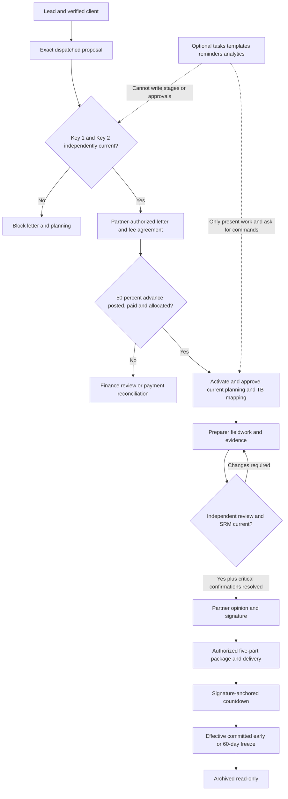

# AuditSphere — Cloud Practice Management Completion Program

**Technical user stories and acceptance contract | STE Audit Management Tool v2.2**

| Attribute | Value |
|---|---|
| Document status | **PROPOSED implementation plan** — not an approved architecture change or a claim that code is missing |
| Prepared | 2026-10-12 |
| Repository | `https://github.com/nirzaf/AuditSphere` |
| Source baseline | `master` at `733ab239171714f02f228ecd2e268f71617ed612` (baseline from prior gap review; refresh before coding) |
| Functional authority | User-provided `auditsphere-requirements-source-ste-audit-management-specification-v22.md`, Sections **1–7** |
| Implementation authority | Current repository `AGENTS.md`, `docs/architecture/auditsphere-architecture-current-architecture.md`, current ADRs, and `docs/requirements/auditsphere-accounting-module-requirements-current.md` |
| Primary personas | Preparer, Reviewer, Engagement Partner, Client; additional FinanceManager, FinanceReviewer, Administrator and other scoped staff as already modeled |
| Currency and locale | QAR; Qatar practice week Sunday–Thursday; financial precision and reporting per currently approved policies |
| Product target | **Complete the existing STE in-house accounting/audit practice platform first**; competitive Karbon/Uku-style conveniences require an explicit opt-in scope decision |
| Delivery | Small, independently testable vertical stories, implementation + tests + traceability; **do not modify `master` from this plan** |

## Executive feature story

> **As a professional accounting and audit practice**, we need an integrated cloud-based workspace for lead management, engagement delivery, recurring client services, audit/accounting work, collaboration, staff scheduling, time, billing, profitability and client interactions, **so that** our team can operate from one trustworthy platform without losing professional independence, client data boundaries, mandatory reviews, document integrity, or the complete original STE v2.2 workflow.

The product **shall retain exactly five authoritative functional modules** (Commercial/CRM; Governance/Planning; Audit Fieldwork; Reporting/Archive; Practice Analytics/Firm Books) and the existing accounting/consolidation extensions. The seven-phase design is an *operational view* of the eleven canonical lifecycle states, never a replacement state machine. The external tools **Karbon** (engagement workflow, team collaboration) and **Uku** (time, billing, profitability) are UX/product inspirations only: do not adopt them as new systems of record, replicate their internal architectures, or introduce mandatory vendor dependencies.

### Success definition and evidence levels

1. **STE-v2.2-complete (mandatory):** approved requirement rows have behaviorally proven code paths, role-specific UI and end-to-end tests, with valid `APPROVED` / `DEVIATION` / `BLOCKED_EXTERNAL` dispositions; no unresolved *mandatory* gap is silently labeled complete.
2. **Cloud-production-accepted (mandatory for go-live):** exact release build, database migration rehearsal, Microsoft/SharePoint/checkpoint acceptance, authorization, disaster recovery, capacity, independent professional review and controlled live pilot pass their separately owned gates.
3. **Competitive practice-management enhancements (optional, separate release train):** connected inbox, extensive billing models, outside accounting connectors, calendar and mobile conveniences, webhooks, AI suggestions and multi-practice SaaS only when the owner explicitly brings them into scope.

**Never conflate:** `PRESENT` source code, `PARTIAL` evidence, passing focused CI, a complete behavior-level acceptance test, and a production external approval. Reconcile every item at the *actual implementation commit*. Historical backlogs and task-card `NOT_AUDITED` statuses do not establish missing functionality.

---

## 1. Requirements and architectural precedence

For any discrepancy during implementation, apply in order:

1. Current `AGENTS.md` and architectural authority, including explicit product non-goals and finance/data boundaries.
2. Approved ADR decisions (especially ADR-0002/0003/0004/0006/0007/0009/0011/0012/0014/0015/0016/0017).
3. STE v2.2 **Section 5** canonical gates, **Section 6** operational display/automation rules, **Section 7** non-regression requirements, and the original Sections 1–4 requirements, interpreted according to the approved ADRs.
4. Current implementation and acceptance evidence in `docs/execution/status.json`, tracker and migration inventory.
5. This technical-story proposal and the prior gap analysis. **If this proposal conflicts with 1–4, do not implement the conflict; open a decision.**

**Known approved exceptions are to be preserved, not “fixed”:** Microsoft identity replaces emailed temporary client passwords; no WhatsApp sending merely because a lead's source is WhatsApp; lifecycle stages are derived, not writable; invoice automation creates **drafts only** (ADR-0007); certificate-capable final-report signing is available under ADR-0016 but production certificate requirement is an explicit deployment/owner decision; an archive's authoritative signed/released evidence is distinct from a SharePoint working copy (ADR-0009); no Purview or external eSignature provider integration; no autonomous professional conclusions. The owner's practice calendar now uses Sunday-start allocation weeks.

### 1.1 Non-goals and protected boundaries

- **No direct lifecycle state-write API, alternate lifecycle table, task-based “mark stage complete” override, or editable canonical stage badge.**
- **No bypass** of commercial consent, Partner AML/KYC, advance-payment allocation, planning/materiality, reviewer independence, open review notes, critical confirmations, release approvals, freeze controls or evidentiary currentness.
- **No automated human judgment** by task automation/AI: no acceptance approvals, materiality sign-off, journal or invoice posting, final report signature, opinion, release or discretionary freeze.
- **No new microservices, message broker, second ERP, wholesale framework/repository abstractions, MediatR refactor, new backend language or React rewrite.**
- **No unapproved operational payroll, inventory/procurement, payment initiation, automatic external tax filing, provider eSignature/Purview integration, or malware-scanning subsystem.** Existing **explicitly authorized** client-bookkeeping workflows remain in scope under current `AGENTS.md`.
- **No implicit multi-tenant commercial SaaS rollout:** this is currently an in-house practice product with firm IDs and client/engagement scope; marketing to other firms is a **separate decision**.
- No provider claim of SharePoint archive immutability without separate real-tenant read-only proof. Assigned staff's approved SharePoint Full Control does not equal immutable retention.
- No destruction of Blazor rollback/reference source until approved retirement criteria are met. No schema/data migrations against production without explicit authorized operational approval.

---

## 2. Non-negotiable authoritative workflow preservation

### 2.1 Exact eleven canonical stages and stage guards

**Implementation rule:** `EngagementLifecycleQuery` (or the repository's current authoritative equivalent) **computes** stage from source evidence. Never persist, edit, or “advance” a stage directly. For lead-level displays, preserve genuine lead scope rather than fabricating a draft engagement. Preserve all currently approved derived-projection ADR rules, and seek owner approval if a proposed fix would change authoritative stage semantics.

| # | Canonical stage | Existing human/financial evidence required before the **next** stage | How stories must behave |
|---:|---|---|---|
| 1 | `LEAD_INGESTION` | Minimum entity and primary-contact data validated | Pipeline task completion does not validate entity facts or create an engagement automatically |
| 2 | `PROPOSAL_GENERATION` | Exact approved/authorized proposal dispatched | Templates and reminders cannot declare that a quote was sent |
| 3 | `DUAL_KEY_PENDING` | **Key 1:** current client acceptance of precise commercial terms; **Key 2:** current, unconditional Partner risk/continuance clearance | Show two independent cards; neither authorizes the other; stale/conditional/rejected decisions block issuance |
| 4 | `ADVANCE_BILLING` | Authorized Engagement Letter + reviewed 50% advance workflow; full linked advance **paid and allocated** | Issuing or drafting an invoice never satisfies payment; only approved allocation does |
| 5 | `PORTAL_ACTIVE_PLANNING` | Authorized activation; actual staff/workspace/TB + approved current FSLI mapping; Partner materiality/planning approval | Operational tasks do not authorize fieldwork; changed underlying inputs invalidate affected approvals |
| 6 | `FIELDWORK_EXECUTION` | Relevant assigned FSLI procedures actually submitted with current evidence and versioned preparer authority | Task completion is not review acceptance; retain safe concurrent line-item work |
| 7 | `MANAGERIAL_REVIEW` | Independent review, no blocking notes, current SRM and evaluated critical confirmations | Review decisions require real reviewer, current revision and reasons; changes-required sends affected work back to fieldwork/rework |
| 8 | `PARTNER_APPROVAL` | Partner reviews current red risks/SRM, records audit opinion with basis if modified, signs as approved | No automation or “bulk complete” can perform Partner professional decision |
| 9 | `DELIVERABLE_RELEASE` | Complete **five-part bundle**, explicit approved delivery and finance controls | A render, email queue or task tick is not authorized issuance or delivery |
| 10 | `COMPLIANCE_COUNTDOWN` | 60 calendar days from Partner signature, or authorized Partner early lock; effective freeze is committed | Display timer separately from archive truth; countdown elapsed alone is not archived |
| 11 | `ARCHIVED_READ_ONLY` | Effective permanent local archive lock; independent provider protection shown separately | Terminal: no write, overwrite, delete or editing-through-task; preserve regulator/authorized read-only inspection |

**Important:** STE v2.2's source diagram, state table, and subsequent ADR clarifications may express slightly different timing for invoice drafts, signing and “delivered”. Do not silently change `EngagementLifecycleQuery` to mirror a drawing. Record exact source-commit behavior, resolve conflict in an ADR if necessary, then implement and test the approved rule.

### 2.2 Exact seven display phases

| UI phase (not stored) | Canonical state source(s) |
|---|---|
| 1. Client Onboarding | `LEAD_INGESTION`, `PROPOSAL_GENERATION`, `DUAL_KEY_PENDING`, `ADVANCE_BILLING` |
| 2. Audit Planning | `PORTAL_ACTIVE_PLANNING` |
| 3. Audit Fieldwork | `FIELDWORK_EXECUTION` |
| 4. Manager Review | `MANAGERIAL_REVIEW` (with procedure-level changes-required/rework loop to fieldwork) |
| 5. Partner Sign-off | `PARTNER_APPROVAL` |
| 6. Report & Delivery | `DELIVERABLE_RELEASE` |
| 7. Archive & Close | `COMPLIANCE_COUNTDOWN`, `ARCHIVED_READ_ONLY` |

Progress is always at least two independent values: **operational task progress** (completed eligible task instances / total eligible task instances) and **mandatory gate readiness** (derived from authoritative decision/evidence). A fully green task checklist with a blocked regulatory gate must render **BLOCKED**. No task can synthesize a review/signature/payment event.

### 2.3 Non-regression acceptance scenarios — universal for every feature

All user stories must preserve these Gherkin-style cases in their appropriate suites; do not duplicate hundreds of tests if shared approved fixtures already cover them.

**NR-01 — no commercial gate bypass:** Given only Key 1, only Key 2, conditional Key 2, a stale/changed offer, or a revoked Partner clearance, when any staff member or workflow automator requests letter issue or planning, then the original domain command denies and stores no accepted letter/activation.

**NR-02 — advance paid is distinct:** Given both valid keys but only a draft/approved/sent/part-paid 50% invoice, when a user completes onboarding tasks or accesses planning-only actions, activation remains blocked until the exact agreed advance is allocated under finance authority.

**NR-03 — effective fieldwork:** Given a current engagement but stale/missing materiality, TB mapping, planning sign-off or access grant, when a task is completed or a workprogram is opened, fieldwork eligibility continues to be enforced by its original authoritative service.

**NR-04 — reviewer independence:** Given a submitted audit procedure, when its preparer or an insufficiently authorized reviewer attempts approval, the review is denied. Any `CHANGES_REQUIRED` response needs comments, retains prior evidence, and permits a newly reviewed submission only through existing controls.

**NR-05 — confirmations and opinions:** Given an outstanding critical confirmation or unresolved review point, when an authorized Partner tries to issue the final opinion/release, the original controls refuse. A task marked “complete” does not change that decision.

**NR-06 — release bytes:** Given a stale document, unapproved financial package, missing signed LOR or mismatched release checkpoint, when a task is marked done or the client retries download, no incorrect new release is issued and only exactly authorized immutable bytes can be served.

**NR-07 — archive:** Given a committed permanent local freeze, when staff, client, automation, direct API, or retry requests to change/delete a protected artifact, the command refuses and records the refusal as specified. Provider-side protection must not be falsely represented as verified.

**NR-08 — tenant and sibling isolation:** Given different firms, clients, sibling engagements, revoked grants and stale sessions, all lists, counts, search, exports, tasks, attachments, notifications, REST commands and client portals return only authorized scoped information; no existence leaks.

**NR-09 — recurring year:** Given a completed prior-year engagement, when a new year is generated, no previous acceptance, planning, workpaper review, materiality, risk decision, opinion, signature, invoice settlement or compliance freeze is copied as currently approved.

**NR-10 — durable retries:** Given timed-out operations, duplicate requests, provider 429, unknown delivery, workers restarting or manual retry, the same idempotent intent never duplicates a financial posting, review event, sent document, provisioned site or notification side effect; unresolved unknown states remain explicitly unknown.

**NR-11 — three books:** Given a firm invoice, a client source invoice or a consolidated adjustment, no workflow or reporting aggregate silently posts values into another domain's ledger; consolidation never updates constituent client books.

**NR-12 — feature-off compatibility:** With each new feature flag off, current workflows, API contracts, approvals, existing historical records and UI routes behave as before; enabling a new feature requires only its documented additive schema/operational prerequisites.

---

## 3. Delivery strategy and minimum technical implementation contract

### 3.1 Source inspection precedes every story

For each story: (1) pin latest commit; (2) read current `AGENTS.md`, architecture and ADRs; (3) inspect relevant Domain/Application/API/Angular/persistence/worker/tests; (4) map exact existing behavior against specification; (5) label `ALREADY_COMPLETE`, `PARTIAL`, `MISSING`, `OWNER_DECISION`, `BLOCKED_EXTERNAL`, or `OPTIONAL`; (6) implement **only** a proven uncovered behavior; (7) run narrowly relevant tests; (8) update traceability and acceptance evidence. Older `v2.2` ledger rows are starting hypotheses, not verdicts on HEAD.

### 3.2 Technical boundaries

| Layer | Required engineering approach |
|---|---|
| Angular 22 | Add to existing routes/workbenches and Material/CDK components. Responsive, keyboard/assistive-tech safe; no business rules entrusted to buttons or CSS. |
| ASP.NET Core API | Use existing `/api/ui/*` contracts for first-party work, scoped session + XSRF, DTO validation and stable typed error codes. API cannot directly mutate domain state via raw DbContext paths. |
| Application | Static named capability services and queries; `CommandResult` contracts; current `ActorContext`/`RoleGrant` authorization, revision checks and existing durable behavior. |
| Domain | Preserve state machines, financial rules, authorization invariants, exact amounts, review and archive rules. No artificial “all checks passed” shortcut. |
| Persistence | One EF Core `AuditSphereDbContext` with existing capability partials; only strictly additive/reviewed migrations, unique constraints, immutable events and revision fences. Never use schema migration as a substitute for professional policy approval. |
| Worker/external | Use existing isolated worker/durable-operation/outbox boundaries. Graph and SharePoint only through explicitly consented, verified capability identities; dedupe and reconcile unknown effects. |
| Tests | Prefer existing PostgreSQL-backed Domain/API/Playwright/Angular suites. Add focused tests for changed behavior, plus the negative gate, scope and retry matrix. Do not claim full coverage from a filtered run. |
| Documentation | Update source-action parity, owner decisions, acceptance tracker and `status.json` through repository-prescribed process; do not hand-edit generated task board or copy volatile totals into prose. |

### 3.3 Recommended existing source entry points

- `src/AuditSphereOps.Application/Practice/PracticeCrmService*.cs`, `CommercialDocumentService*.cs`, `FeeAgreementService.cs`, `BillingService.cs` — proposals, commercial acceptance and firm billing.
- `src/AuditSphereOps.Application/Acceptance/EngagementLifecycleService*.cs`, `EngagementLifecycleQuery.cs`, `DualKeyEvidence.cs` — authorization and computed stage.
- `src/AuditSphereOps.Application/Practice/WorkflowTemplateService.cs`, `EngagementWorkflowPlanService.cs`, `EngagementWorkflowTaskService.cs`, `WorkflowTaskQueueQuery.cs` — operational work; reuse these, do not build another task engine.
- `src/AuditSphereOps.Application/Practice/PracticeTimeService.cs`, `ResourcePlanningService*.cs`, `PracticeInsights` queries — capacity, time and performance.
- `src/AuditSphereOps.Application/Documents/PbcService.cs`, Microsoft365, current SharePoint sink and worker groups — PBC requests, uploads and notifications.
- `src/AuditSphereOps.Application/Audit/AuditProgramService.cs`, `AuditFieldworkService*.cs`, confirmations/fieldwork/review services — professional testing and review.
- `src/AuditSphereOps.Application/Accounting/**`, `Consolidation/**`, `FinancialStatementService*` — financial preparation; no parallel accounting subsystem.
- `src/AuditSphereOps.Api/Ui/UiEndpoints.*.cs`, `src/AuditSphereOps.Ui/src/app/features/{engagements,practice,commercial,clients,audit,accounting,admin}/` — route-specific contracts and workbenches.
- `.github/workflows/ci.yml`, `docs/execution/status.json`, `docs/execution/auditsphere-execution-tracker-ste-v22-gap-verification-current.md`, `docs/migration/`, `docs/architecture/adr/` — acceptance and decisions.

These are **entry-point examples**, not guarantees that all referenced work is absent. The coding agent must locate the exact symbol at the current commit before editing.

---

## 4. Technical epics and independently shippable user stories

Each **story** is independently reviewable. Priority `P0` protects correctness or go-live; `P1` completes STE v2.2 daily usability; `P2` expands business capability; `P3` is deliberate optional productization. Every epic begins with **gap reconciliation** and ends with explicit negative authorization and domain-gate acceptance.

### PM-00 — Establish authoritative baseline and non-regression fixtures (`P0`)

**As** an engineering maintainer, **I want** one requirements-to-code and test-evidence baseline **so that** we can implement only true gaps without dismantling working modules.

**Technical work**

- Pin implementation SHA; inventory 11-state projection, 7-phase mapping, all current gate commands, HTTP owners, current source/action parity and flags. Reconcile the 88-row previous review appendix, current STE v2.2 tracker and remaining R2R/AUD story cards; do not assume old statuses remain correct.
- Record source links for every required operation with existing positive test, missing negative case, UI route and persistence event; classify code incomplete versus provider blocked versus approved deviation.
- Create/reuse a **lifecycle invariants regression set** covering NR-01–NR-12. Keep expected stage from existing authoritative projection rather than hardcoded stage fixtures that mask incorrect domain behavior.
- Establish `ALREADY_COMPLETE` closure path with no code change and evidence references; distinguish pending methodology approval from a development defect.

**Acceptance**

- **AC-PM00-1:** Every selected next story has source location, implementation gap, owner, linked requirements and verification plan.
- **AC-PM00-2:** Section 5/6 mappings and five-module boundaries unchanged in a before/after comparison.
- **AC-PM00-3:** Complete release/suite acceptance requirements recorded separately from latest focused CI success.

### PM-01 — Authoritative seven-phase engagement cockpit (`P1`; STE §§5–6.3)

**As** a Manager, **I want** one engagement cockpit with current seven-phase position, accountable staff, deadlines, exact blockers and next permitted actions **so that** daily work is clear without mistaking task progress for approval.

**Technical work**

- Extend existing `EngagementWorkflowWorkspaceQuery` and Angular engagement views, not the lifecycle domain model. Show phase, responsible **user and role**, due milestone, task count/percentage, evidence-based readiness and a single server-authorized permitted next action.
- Add expandable checklist sections backed by real operational tasks / current gate read projections, clear empty states and links to CRM, planning, FSLI, PBC, workpaper, review, completion, finance and records.
- Display `Waiting for Client`, `Under Review`, `Rework Required`, `Blocked`, provider `PENDING/UNKNOWN` separately. Do not derive an “approved” state from task completion.
- Retain `LEAD_INGESTION` as a genuine lead-level pipeline view if no engagement exists; never invent an engagement stage record merely to fill phase 1.
- Keep `WorkflowExperience:Enabled` opt-in until migrated, tested, and operationally accepted.

**Acceptance**

- **AC-PM01-1:** Every canonical stage projects to exactly one UI phase; rework maps to affected fieldwork without losing prior review events.
- **AC-PM01-2:** A 100%-done task list with unpaid advance, pending Partner clearance or critical confirmation still shows a blocked required gate.
- **AC-PM01-3:** Revoked users cannot see previously cached dashboard details after server reauthorization; counts and action links are scope-trimmed.
- **AC-PM01-4:** Keyboard/mobile/assistive-technology journey exercises all seven phase panels and error states.

### PM-02 — Reusable operational templates, task boards and dependencies (`P1`; STE §6.4)

**As** a Practice Manager, **I want** audited, reusable service templates and useful task views **so that** the firm repeats consistent processes without copying decisions or bypassing controls.

**Technical work**

- Complete existing reviewed/published template revisions with optional editable **operational** task groups, owners, offsets, effort estimates, PBC links and bounded dependencies. Pin exact published revision and immutable instantiation receipt to each engagement.
- Reuse `EngagementWorkflowTaskService`/existing work queue; implement My Tasks, Team Work, Waiting for Client, Under Review, Rework, Overdue and Completed filters plus Kanban/calendar views over the same paginated authoritative query; no second task database.
- Preserve current ad hoc task, assignment and due-date revision history; reject cyclic dependencies, cross-engagement/sibling-client links, illegal completion and stale revisions.
- A template update is never silently propagated to historical/current tasks. Offer explicit impact preview and deliberate authorized migration when policy permits, preserving prior template source.

**Acceptance**

- **AC-PM02-1:** Two users create/process template-derived tasks; wrong-firm templates and unauthorized clients/engagements are hidden and commands denied.
- **AC-PM02-2:** Re-applying the same template intent is idempotent; a revised template does not rewrite an earlier plan.
- **AC-PM02-3:** Calendar, Kanban and list show identical current task membership and fail safely on stale changes.
- **AC-PM02-4:** Task completion cannot write acceptance, materiality, opinion, review approval, posted invoice, release or freeze records.

### PM-03 — Annual recurrence and fresh authority (`P0 gate + P1 UX`; STE §§4.2.1, 6.5)

**As** a Relationship Manager, **I want** to prepare next-year recurring audit/accounting engagements from the prior-year client profile **so that** setup is fast while every new period undergoes fresh legally required approval.

**Technical work**

- Introduce an explicit **preview → approve → create** current-year workflow using existing engagement create/continuance services and scoped period controls. Suggest prior-year team, task template, mapping and contact data *as historical references*; initialize new engagement/tasks in non-approved draft state.
- Require current period-bound offer and correct service route, owner-approved fresh client acceptance definition, qualified Partner continuance decision, independently new finance agreement/advance handling and current-period TB/materiality before eligible fieldwork.
- No automatic resurrection of earlier approval, identity, signed documents, packages, posted invoices, receipt allocations or frozen archive; prior-year statements only serve comparative source evidence after explicit current approval.
- Resolve **owner decision** about expiry/scope of client-level acceptance and offer evidence before altering approval reuse semantics. Do not guess.

**Acceptance**

- **AC-PM03-1:** Starting 2027 after completing 2026 produces a unique new period/engagement, links historical provenance and creates zero approved Partner/reviewer decisions for the new year.
- **AC-PM03-2:** Even with all tasks complete, previous-year offer, prior AML approval where not current, materiality and advance payment cannot activate the successor.
- **AC-PM03-3:** Duplicate annual-create requests or a concurrent preparer retry yield one canonical successor/intent and a recoverable receipt.
- **AC-PM03-4:** Reject wrong client, overlapping period, service mismatch, archived write, superseded template and revoked actor.

### PM-04 — Safe workflow automation and staff notifications (`P1`; STE §6.6)

**As** a Manager, **I want** bounded reminders, task assignments, overdue escalations and notices **so that** work moves forward without a machine impersonating a Partner or accountant.

**Technical work**

- Build on existing workflow task events, due-date history, bounded worker, PBC reminders and durable notification receipts; add only a minimal set of *explicit permitted automation types* needed by the approved use cases.
- Automatically suggest/create **tasks/drafts/reminders**, not authoritative professional/financial decisions. Event source must include firm/client/engagement, actor authority, exact revision/generation and idempotency identity. Revalidate at worker execution.
- Implement owner-administered bounded reminder/escalation rules with schedule, quiet periods and retry cap; fail closed on missing consent/recipient or stale event. Separate `QUEUED`, `PROVIDER_ACCEPTED`, `DELIVERED_IF_PROVEN`, `FAILED`, `UNKNOWN`.
- No invented generic “AI automation” engine; no cross-client notification aggregation without explicit grant. Where §6.6's prohibition on “freeze” appears to conflict with existing mandatory scheduled freeze, keep approved scheduled compliance freeze and log an owner methodology clarification rather than disabling it.

**Acceptance**

- **AC-PM04-1:** One real event triggers at most one active reminder intent per rule version and target; lost responses/retries reconcile without duplicates.
- **AC-PM04-2:** An expired permission prevents delivery and leaks no private content; a disabled integration leaves the request visible as blocked.
- **AC-PM04-3:** Automation cannot invoke an API that records an acceptance decision, posts invoice/journal, approves sampling, signs a report, issues release, or changes archive lock.
- **AC-PM04-4:** Recipients and audit activity can be reconstructed by exact event/rule/recipient identity without exposing sensitive evidence in notifications.

### PM-05 — CRM, contact routing and commercial certainty (`P0–P1`; STE §4.1)

**As** a Relationship Manager, **I want** complete client organization, correct contacts, proposals and demonstrable current acceptance **so that** commercial operations do not misroute confidential documents or activate the wrong engagement.

**Technical work**

- Extend client hierarchy and versioned contact-role/purpose policies with explicit COMMERCIAL/FINANCE/AUDIT_FIELDWORK/REPORT_DELIVERY recipients, subject to owner approval of precedence, multi-recipient handling, and existing role boundaries.
- Validate minimum client identity, contact information, organization/affiliates and linked service period. Add appropriate quote timeline, firm-reviewed clause/engagement-type templates and approved staff CV snapshot selection; never generate unverified credentials.
- Preserve **exact** offer revision digest with client legal entity, service route, period, currency, fee, 50/50 terms, scope and recipient, including fallback path when no rendered quote exists. Client reply and its received channel/actor/timestamp must have revision-linked evidence; record declined/expired/revoked/rescinded and superseded states append-only.
- Continue using independent Key 1 client consent and Key 2 Partner AML/KYC/independence; never turn a contact response into Partner clearance or vice versa. Unresolved wording/response-authenticity policy remains blocked on owner/professional decision.
- Distinguish lead source labels (including WhatsApp) from authenticated outbound integrations; do not add unapproved social dispatch.

**Acceptance**

- **AC-PM05-1:** Commercial documents route only to currently approved recipient policy; wrong contact, revoked contact and cross-client mixups fail closed.
- **AC-PM05-2:** Changing any material offer term requires a new Key 1 acceptance; `DUAL_KEY_PENDING` cannot be bypassed by a prior `Accepted` flag.
- **AC-PM05-3:** Changing current risk assessment generation or conditional/rejected Partner review invalidates Key 2; exact missing/rejected gate is visible to staff but AML details never leak to portal users.
- **AC-PM05-4:** A fully paid advance, without both independent current keys, still does not activate planning.

### PM-06 — Client portal, PBC requests and collaboration (`P1 + external`; STE §§4.1.5, 4.3.2)

**As** a client liaison, **I want** to view my organization's document requests, respond, upload and replace rejected materials **so that** I can complete audit requests without seeing another client or editing released records.

**Technical work**

- Complete request-level detail conversations and mandatory rejection reasons; build on `PbcService`, existing upload receipt, request state and SharePoint selected-resource worker. Preserve request status authority: Pending, Uploaded, Under Review, Accepted/Approved, Rejected/Re-upload, Released/Frozen as currently approved.
- Show upload/readback/progress, current review owner, request due dates, client response and record of rework; never infer “approved” from a document's arrival or request polling status.
- Preserve Microsoft sign-in (no emailed passwords), delegation expiry/revocation, exact SharePoint site bindings and scope-denied bytes even when a client guesses an attachment ID.
- Reduce unnecessary refresh delay if demonstrably beneficial, but don't call 30-second polling “live push.” Real-time transport requires separately justified architecture and operational acceptance.

**Acceptance**

- **AC-PM06-1:** Client A may view/respond only to Client A requests, direct-by-ID/download/API included, and loses write privilege once the **actual** release/freeze rule takes effect.
- **AC-PM06-2:** Every rejected upload exposes the mandatory reason and new submit path while preserving immutable prior content hash/review evidence.
- **AC-PM06-3:** Provider `UNKNOWN` state is never shown as successful uploaded/delivered; retries use exact intent and readback.
- **AC-PM06-4:** Live Entra and SharePoint client test journeys are external gates and do not pass from a simulator.

### PM-07 — Communication hub (progressive, Microsoft first) (`P1 internal notices; P2 connected inbox`)

**As** an accountant, **I want** engagement-specific communication history and reliable notifications **so that** important emails, documents and client decisions do not disappear into private inboxes.

**Technical work**

- **Mandatory first slice:** unify existing attributable outbound communication and PBC/confirmation status history into an engagement timeline. Link mail *attempt*, provider acceptance, per-recipient identity and final resolution without assuming inbox delivery.
- **Optional later slice:** evaluate connected Outlook/Exchange shared inbox triage, calendar linkage and Teams notifications **only** with new explicit resource-scoped, consented provider permissions and legal retention review. No global mailbox access to unrelated staff or clients.
- Comments/mentions, when implemented, must be non-authoritative operational evidence and enforce author/edit history, client scope, safe attachments and redaction. A comment cannot approve a workpaper or accept an offer.

**Acceptance**

- **AC-PM07-1:** All communication cards show the authentic sender/recipient/status/time and link to underlying review or PBC source, without changing the underlying state.
- **AC-PM07-2:** A revoked staff member cannot retrieve cached threads or notifications; recipient privacy and sibling engagements enforced.
- **AC-PM07-3:** Provider uncertain, failed, accepted and delivered (only if independently established) remain distinguishable; duplicate retries don't resend silently.

### PM-08 — Staff time, utilization and capacity (`P1`; STE §§4.2.2, 4.5.1)

**As** a Practice Manager, **I want** trusted utilization, standard value, billable time and available capacity **so that** scheduling and budgets are internally consistent and fair.

**Technical work**

- Reconcile approved rate-card aliases (Senior/Supervisor, Junior/Associate) across budget, quotation and time classification; preserve reviewed rate revisions and existing QAR defaults.
- Obtain approved policy for non-billable and no-charge time: standard-value contribution, zero fee, internal cost, currency derivation, write-off and utilization denominators are distinct; do not silently count missing rate as zero.
- Reuse existing staff allocation and Sunday-start week logic. Reconcile weekly resource grid and department utilization with one documented basis; make leave/absence and holidays a *separate optional* source capability rather than inventing schedules.
- Add scoped staff/role budget-variance and realization dashboards only after personnel-privacy audience decision; no automated disciplinary scoring or unreviewed performance judgments.

**Acceptance**

- **AC-PM08-1:** Same time entries yield explainable totals in engagement budgets, department analytics and staff grid, with documented differences only where mathematically intentional.
- **AC-PM08-2:** Approved non-billable entries do not cause a spurious entire-engagement “Unavailable” when a valid approved treatment exists; truly missing data still fails closed.
- **AC-PM08-3:** Reversal/correction history retains original approved time, source assignment and rate version; no double billing.
- **AC-PM08-4:** Sunday–Thursday capacity and Sunday week start preserve historical allocation lineage and tested rounding.

### PM-09 — Firm billing lifecycle and 50/50 protection (`P0–P1`; STE §§4.1.5, 4.4.2, ADR-0007)

**As** a Finance Manager and independent reviewer, **I want** controlled fee invoices, payment recording, receipts and WIP traceability **so that** clients are billed accurately and no automation posts money or circumvents an engagement gate.

**Technical work**

- First prove existing 50/50 audit agreement, milestone and invoice/credit/receipt flows end-to-end through Angular/API/Domain. Make all invoice eligibility and post-/pre-release dependencies explicit, including approved revision, service period, fee, finance actor, and paid/allocated advance before activation.
- Keep `AutomaticFeeInvoices` **draft only and disabled by default** pending reviewed policy. FinanceReviewer and FinanceManager actions remain independent as per ADR-0007. Draft ≠ approved ≠ posted ≠ paid ≠ released ≠ delivered.
- Fix only verified gaps in partial payment voucher policy, scoped receivables aging (all eligible firm invoices), allocation reversal and WIP-to-source identity. Avoid leaking client bookkeeping sales invoices into firm AR.
- **Optional with new business decision:** add recurring fixed-fee/retainer/hourly/progress billing *beside*, not instead of, the mandatory statutory audit 50/50 fee workflow. No auto-posting, no automatic payment initiation or autopay without an explicit superseding approval.

**Acceptance**

- **AC-PM09-1:** Partner-approved letter generates both milestone obligations; optional worker prepares only a draft after required conditions; second finance actor reviews/posts via existing services.
- **AC-PM09-2:** Full approved advance with payment allocation — not a merely posted invoice — enables activation. Credit notes/refunds/reversals recalculate eligibility consistently under existing business rules.
- **AC-PM09-3:** Final balance document and released package use exact approved agreement/revision and comply with existing independent checkpoint/release gates; no unsanctioned email send.
- **AC-PM09-4:** Duplicate command/retry cannot create an extra posted invoice, receipt allocation or firm GL journal.

### PM-10 — Profitability, WIP and firm management reporting (`P1`; STE §4.5)

**As** a Partner, **I want** explainable profitability, utilization, receivables and monthly firm accounts **so that** I can manage engagement margins without a second accounting ledger.

**Technical work**

- Extend existing `PracticeInsights`/firm reports using only authoritative approved time, approved rate versions, firm-posted billing and immutable firm GL. Define planned hours vs actual hours, standard charge-out value, recognized/billed amount, billable WIP, collected amount, expense/staff-cost assumption and contribution explicitly.
- Support engagement/client/service/period splits under existing authorization; handle no-charge time and missing cost inputs via transparent coverage flags rather than fabricated amounts.
- Add chronological monthly P&L series and comparator using firm's existing double-entry ledger. Expand fee receivables aging to all eligible posted practice invoices (not operational client books) after acceptance of the report scope.
- Obtain owner decision for facilities/staff benefits taxonomy and HR-sensitive staff performance indicators before posting/reporting changes.

**Acceptance**

- **AC-PM10-1:** For a controlled small fixture, every margin/realization/KPI reconciles to time records, approved rates, fee agreement, invoice/receipt and firm GL.
- **AC-PM10-2:** Correct posted credit note and payment reversals adjust AR without changing historical reports' underlying immutable facts.
- **AC-PM10-3:** Multi-month P&L ties exactly to posted firm double entry; cannot be contaminated by a client's GL or consolidation adjustments.
- **AC-PM10-4:** No personnel/client financial aggregate leaks to a role without corresponding firm/client permission.

### PM-11 — End-to-end audit workpaper and review completion (`P1, with P0 professional guards`; STE §§4.2–4.4)

**As** a Preparer, Reviewer and Partner, **I want** a complete native fieldwork-submit-review-rework cycle **so that** every opinion is based on reviewable and version-current evidence.

**Technical work**

- Reuse existing audit program/fieldwork/reviewer services. Complete Angular/API gaps in FSLI → procedure navigation, explicit procedure assignee, digital/physical evidence, preparer versioned submission, independent Approve/Return with mandatory notes, precise rework ownership and current resubmission.
- Reconcile `AuditFieldworkService`/`AuditProgramService` with operational task rework: procedure approval authority remains independent; queue task is a projection and never equals the actual audit decision.
- Complete owner-approved confirmation differences ↔ client ledger reconciliation, source document hash/response aging and alternative-procedure links (T059). Critical unresolved confirmation blocks report; holding letter generation/delivery preserves reviewed mail authority.
- Consider sampling methodology, assertion-tagged standard procedures, ISA 570 line-item checklist and reviewer-approved significant accounting-estimate register; obtain qualified methodology decisions before implementing nontrivial professional calculations.
- Include current key audit variances, adjusted/unadjusted differences, significant estimates and review findings in a current SRM; maintain Partner control of red-risk sign-off and opinion.

**Acceptance**

- **AC-PM11-1:** Preparer→Reviewer→Changes Required→Preparer corrected revision→independent reviewer→Partner, exercised from Angular against persisted database and real role actors, including wrong actor/expired revision refusal.
- **AC-PM11-2:** The same audit case cannot count both rejected and approved; comments/resubmission retain append-only version and author evidence.
- **AC-PM11-3:** Critical confirmation unresolved, open review note, stale estimate evidence or red-risk lacking Partner clearance prevents report issue despite full task progress.
- **AC-PM11-4:** Sampling, materiality, accounting treatment and report conclusions are practitioner-authored or approved under qualified professional policies, never guessed by task automator.

### PM-12 — Accounting source intake, bookkeeping and R2R closure (`P1; approved R2R dependencies`)

**As** an accountant, **I want** repeatable intake, mapping, reconciliation, statement production and client accounting workflows **so that** prepared financial statements retain source lineage without turning AuditSphere into an unauthorized ERP.

**Technical work**

- First reconcile T003–T047 code vs task-card acceptance; complete approved framework, reporting context, FX/consolidation and golden-fixture decisions before dependent implementation. Never treat all `NOT_AUDITED` card statuses as missing code.
- Offer optional bounded vendor TB/GL import profiles (QuickBooks, Tally, Zoho, SAP) that transform source files to existing canonical import fields; show validated previews, full mapping confidence/exceptions, approved chart/current period and exact source hash. No unapproved automatic mapping or silent overwrite.
- Close proven context binding, journal/reconciliation, client operational bookkeeping, tax/credit/open-item rollforward and group package assembly gaps through existing commands; use current client-bookkeeping service eligibility/cutover gates.
- Keep firm/practice books, client source/native books and group consolidations physically/logically separate. No group elimination journal writes to client components; no external ERP operational order/payroll/payment modules.

**Acceptance**

- **AC-PM12-1:** One imported source file has deterministic preview, current approved mapping, controlled acceptance, GL/TB traceability, independent adjustments and verifiable package numbers.
- **AC-PM12-2:** Duplicate upload, malformed spreadsheet, bad FX policy, stale reporting context and unsupported taxonomy fail safely and preserve historical receipts.
- **AC-PM12-3:** Client A mapping/GL/AR/AP never appears in Client B, firm books or outside its separately approved consolidation perimeter.
- **AC-PM12-4:** No technical financial adjustment is automatically posted on behalf of the client or firm without role and accounting-policy review.

### PM-13 — Reports, release, correspondence and permanent archive (`P0; STE §4.4`)

**As** an Engagement Partner and records custodian, **I want** a current auditable five-part release and permanent archive controls **so that** issued reports have exact identity, justified clearance and read-only preservation.

**Technical work**

- Complete required Management Letter `Deficiency → Impact → Recommendation`, material representation-letter figures and human-readable correspondence digest, only where professionally approved by template owner. Reuse release candidate, signed report evidence and exact-five-part manifest services.
- Preserve modified-opinion FSLI basis, Partner review, signed PDF capability under approved ADR-0016, approved firm-seal version, signed LOR scan, final posted balance fee note and exact released financial statements.
- Distinguish `DRAFT`, `APPROVED`, `SEALED`, `CHECKPOINTED`, `ISSUED`, `DELIVERED` with existing authoritative events (do not invent a second release machine); preserve unknown external provider states and exact SHA-256 identities.
- Preserve effective scheduled freeze 60 calendar days after Partner report signature, authorized early lock, permanent refusal of protected writes, immutable local evidence and separate authoritative archive store; SharePoint working copy is not equivalent to immutable provider retention.

**Acceptance**

- **AC-PM13-1:** Full five-part ZIP exact manifest/content hashes survive download, retry and legal inspection; one missing required part blocks final issue.
- **AC-PM13-2:** Same client/engagement, current approved signature and signer identity required; browser buttons may only call original authorized sign/release methods.
- **AC-PM13-3:** An actual committed freeze, not time elapse or a queued worker job, yields `ARCHIVED_READ_ONLY` and prevents local writes on every path.
- **AC-PM13-4:** Production provider archive, checkpoint, certificate custody and legal wording are visibly gated until independent external/professional acceptance.

### PM-14 — Cloud identity, isolation, resilience and release gates (`P0`)

**As** the service operator, **I want** a securely accepted cloud deployment **so that** authorized firms and clients can rely on availability, recoverability, and non-leaking data.

**Technical work**

- Resolve remaining AS-PAR-002 permission matrix and Angular/Blazor source-action parity using role-grant, sibling-client, sibling-engagement, cross-firm, stale/disabled actor, export/search/aggregate count, direct ID and browser tests. Keep the Web host until independent retirement acceptance.
- Complete live Entra and isolated client SharePoint/Graph permission/identity tests, durable worker provider reconciliation, release checkpoint custody and archive protection; no simulator substituting for real-tenant test.
- Establish approved production secret store and rotation, scoped OTLP collector/alerts, sensitive-log inspection, approved capacity/p95/browser/accessibility targets, external backup custody and measured restore/RPO/RTO drills.
- Rehearse migrations/rollback separately for schema and release, fail-closed production flags, canary, operation reconciliation, branch protection and independent partner/pilot sign-off.

**Acceptance**

- **AC-PM14-1:** Exact tagged release SHA has full available Domain/API/E2E/Angular/contract/migration/doc checks and independent code review, not merely focused CI.
- **AC-PM14-2:** Client-to-client isolation proven with live provider resources and negative revocation/tenant controls; no confidential bytes or result counts leak.
- **AC-PM14-3:** Recovery objectives, deployment rollback, telemetry and alert drills have explicit measured/approved evidence; incomplete external items stay `BLOCKED_EXTERNAL`.
- **AC-PM14-4:** Production activation is refused until all required P1–P10 and M365-ADMIN/P2b gates meet current criteria, with documented permitted out-of-scope exceptions.

### PM-15 — External accounting imports, public API and webhooks (`P2 OPTIONAL; owner approval required`)

**As** an integration owner, **I want** carefully scoped third-party data exchanges **so that** time and financial facts can be reused without compromising their record authority.

**Technical work**

- Decide per connector whether the required behavior is **download/import** (preferred first) or bidirectional write-back; choose only approved vendors and review license/consent requirements. Preserve import receipts and mapping history, not silently overwrite signed/mapped source data.
- If exposing a public API, create an explicitly versioned integration access model distinct from user sessions, with firm/client scopes, quotas, pagination, audit logging, credential rotation and zero cross-client inference.
- Outbound webhooks may publish **observed** approved changes (e.g., task state, review decision metadata, invoice posting *already performed by finance*); signed secret verification, bounded retries and replay protection. The receiver cannot inject a protected professional decision.

**Acceptance**

- **AC-PM15-1:** Integration identifiers cannot access a broader firm/client audience than the grant; cross-tenant webhook subscriptions and callbacks are rejected.
- **AC-PM15-2:** Failed/missing integrations do not block the authorized manual canonical workflow or silently change ledger truth.
- **AC-PM15-3:** Webhook duplicates are observable and safe, and no external action can forge an authentic review/Partner/finance approval.

### PM-16 — Usability, accessibility and responsive operations (`P1 foundation + P2 conveniences`)

**As** a staff member using desktop/mobile browsers, **I want** consistent responsive tasks, accessible workflows, search and recovery **so that** the application is usable without hidden authorization shortcuts.

**Technical work**

- Standardize Angular route/field focus, keyboard shortcuts where safe, form validation, conflict/failure recovery, context breadcrumb and phase navigation; remove stale presentations only after new routes satisfy source/action parity.
- Verify RTL/locale, date/time/QAR display, timezone conversions, Sunday–Thursday calendars, long-form documents, file upload limits, assistive technology and browser behavior against owner-approved targets.
- Offline time drafts or installable PWA are **optional** and may never cache confidential cross-tenant data or queue protected sign/post/release decisions. Do not add offline write behavior before security approval.

**Acceptance**

- **AC-PM16-1:** Critical onboarding, planning, review, issue and client-upload journeys pass keyboard/navigation and screen-reader acceptance with accessible error messages.
- **AC-PM16-2:** Browser back/refresh, changed permissions, concurrent edits and lost response render server-current state, never an old approval.
- **AC-PM16-3:** Date/amount display cannot alter monetary precision, approved conversion source or regulatory countdown start.

### PM-17 — Optional AI and commercial SaaS research, explicitly deferred (`P3 OUTSIDE current completion scope`)

**As** the product owner, **I want** proposals for assistant tools and multi-practice commercialization **so that** optional value can be assessed without quietly expanding the core system.

**Technical work (design only unless newly approved):** assess explainable summaries of permitted case data, suggested non-authoritative task/email drafts, safe search, opt-in per-firm provisioning, separate firm administration, licensing and data export, and integration marketplace. Create a short threat/permission/cost review and an ADR **before** any implementation. AI may neither sign an audit opinion nor make professional or financial approvals; firm data cannot be used across customers. Do not install external AI, payment or SaaS infrastructure as a prerequisite for the STE launch.

**Acceptance:** outcome is an explicit `APPROVED_FOR_FUTURE` or `OUT_OF_SCOPE` decision with no implicit dependency added to the mandatory work program.

---

## 5. Dependency-ordered implementation waves

| Wave | Milestone | Stories | Entry prerequisite | Exit evidence |
|---|---|---|---|---|
| **0 — Truth and safety** | Reconcile current HEAD and preserve all Section 5 gates | PM-00; decisions in PM-03/05/08/11/12/13 | Current ADRs, owner policies, requirements v2.2 | One source/acceptance matrix and negative-test baseline |
| **1 — Existing core closure** | Repair proven functional blockers and client-critical journeys | PM-05, PM-09, PM-11, PM-12, PM-13 | Qualified professional decisions; reviewed gate semantics | Complete role-based E2E work cycles; finance/professional decisions remain independent |
| **2 — Practice workflow** | Enable seven-phase experience, work queues, reminders, recurring year | PM-01, PM-02, PM-03, PM-04, PM-06 | Proven lifecycle/portal invariants, schema flags and consent | Usable task/phase/annual journey with independent gate projections |
| **3 — Practice operations** | Time, billing, firm analytics and staff UX | PM-08, PM-10, PM-16, PM-07 mandatory communications | Approved rates, non-billable/utilization policy; prior waves | Reconciled dashboards/firm reporting, accessible client/staff UX |
| **4 — Cloud acceptance** | Complete outstanding production/release operations | PM-14 (in parallel where independent, final exit last) | Required cloud tenant and qualified reviewers | All in-scope P0 external gates/rollbacks/professional acceptance |
| **5 — Optional expansion** | Integrations, connected inbox, advanced billing, AI or multi-practice SaaS | PM-15, PM-07 optional, PM-09 optional, PM-17 | Separate approved ADR/business case | No regression of mandatory STE path |

**Work only one minimal vertical slice at a time.** Once a wave has sufficient verified evidence for a core user journey, stop and ship a small accepted release rather than expanding scope because it is “nice to have.” Do not treat Wave 4 as avoidable merely because a wave 1–3 UI demo works.

### Reference end-to-end journey for mandatory acceptance

`New inquiry → verified lead → exact quote → client consent (Key 1) → independent Partner risk clearance (Key 2) → reviewed engagement letter → finance-reviewed 50% advance invoice → full payment allocation → authorized engagement activation → current TB/mapping → Manager materiality/Partner planning → versioned preparer testing → independent review/rework/approval → critical confirmation evaluation → current SRM → Partner opinion and signing → exact five-part bundle and final 50% fee handling → approved issue and client delivery → signature-anchored 60-day countdown → effective permanent archive lock.`

At each arrow the system must produce an authentic authoritative receipt/evidence event; all operational templates, messages, calendars, dashboards and AI suggestions remain subordinate.

---

## 6. Cross-cutting acceptance and definition of done

### 6.1 Test fixtures (minimum)

| Fixture | Required proof |
|---|---|
| Two firms, each with at least two clients; one client with sibling engagements | Business/data isolation on read, commands, counts, exports, attachment bytes, notifications and provider bindings |
| Named current real staff roles: preparer, independent reviewer, Partner, FinanceManager, FinanceReviewer, client liaison | Positive authorized + negative incorrect-role tests, including actor revocation |
| Revised proposals, stale/conditional risk generation, partially settled invoice | Distinct Key 1/Key 2/paid-advance gates |
| Prior-year signed/archived engagement and next-year fresh period | No stale approvals/reports/finance receipts copied into new engagement |
| Current/changed TB, materiality, sample and procedure revision | Currentness, rework, independence, fieldwork parallelism and immutable evidence |
| One unresolved critical confirmation and one resolved valid response | Report blocked/unblocked only through domain review |
| One approved unmodified opinion, one modified opinion with basis | Partner clearance and final-document byte identity |
| Uploaded client file, auditor-owned workpaper, signed LOR, interrupted provider send and lost-response retry | SHA-256 provenance and explicit unknown/recovery states |
| Boundary at signature+59/60/61 days and early Partner lock | Countdown, effective freeze, permanent denies; separate provider archive status |
| Firm double-entry, client accounting, group perimeter | Financial domain isolation and repeatable monetary calculations |

### 6.2 Per-story implementation checklist

- [ ] Record exact HEAD/branch and `CURRENT`/`APPROVED` documents inspected; mention unresolved decision blockers.
- [ ] Validate this story is actually unimplemented, not present/flag-off/external-only.
- [ ] Specify intent, minimum acceptance criteria and exclusions; choose minimal matching existing capability and data ownership.
- [ ] Add/adjust Application authorization, revision/idempotency and immutable event constraints as needed; no UI-only security.
- [ ] Keep existing Angular `/ui/app` and `/ui/portal` route and API contract compatibility or version changes explicitly with tests.
- [ ] Add only required schema change with safe migration and backward/forward read behavior; no unauthorized prod data writes.
- [ ] Run the existing relevant Domain/API/PostgreSQL/Angular/Playwright tests and new focused negative/regression checks.
- [ ] Check four boundary classes: **professional gate**, **client/sibling scope**, **stale revision**, **duplicate/unknown external side effect**.
- [ ] Record only actually executed results with exact SHA; reconcile test/ADR/spec/backlog references without falsely closing provider gates.
- [ ] Review minimal diff, no unnecessary dependencies/abstractions/leftover branches, and preserved rollback.
- [ ] Seek the project-required explicit owner authorization **before** any destructive migration, irreversible production action or pull-request merge. Review/test/branch work is allowed without declaring approval.

### 6.3 Global release acceptance

1. All **mandatory** STE v2.2 Section 6.8 criteria and Section 7 non-regression conditions pass against the release candidate.
2. Original five modules' complete Section 3/4 journeys run from actual staff/client roles with PostgreSQL persisted evidence and checked finance/professional human decisions.
3. Full available .NET Domain/API/E2E, Angular tests, contract drift, migration drift and browser matrix run on **the same source tree**, not inferred from earlier focused runs or green CI subsets. Failed/unrun suites are reported accurately.
4. Independently reviewed accounting/methodology and template-wording issues are approved. No AI-generated assertion of ISA/IFRS professional compliance replaces a qualified practitioner.
5. Real Microsoft Entra, selected SharePoint sites, guarded mail and final checkpoint/archive dependencies are exercised only in authorized environments with observation, owner approvals, and negative access tests. `BLOCKED_EXTERNAL` stays blocked until that evidence exists.
6. Approved production p95/concurrent use targets, accessibility/browsers, secure secret custody, alerts, backup/restore and incident operations have measured evidence; “deployed” alone is not operational readiness.
7. An authorized business owner signs the release readiness outcome; merged PRs and production operations respect the repository's authorization workflow.
8. Product optionality is explicit: deferred Karbon/Uku competitive extras do not block the single-firm STE go-live unless separately accepted as contractual requirements.

---

## 7. Owner and professional decisions that must not be guessed

| Decision ID | Required human decision | Blocking scope |
|---|---|---|
| DEC-01 | What legally counts as current commercial consent when renewing annual periods, including fallback offer-hash and response authentication | PM-03, PM-05 |
| DEC-02 | Accepted profession-specific engagement letter clauses, submission deadline, template layout, representation-letter figures and management-letter narrative | PM-05, PM-13 |
| DEC-03 | Prior acceptance/continuance expiry, changed client circumstances and period-specific Partner risk decisions | PM-03, PM-05, PM-11 |
| DEC-04 | Qualified accounting framework/edition, FX/consolidation policy, reporting limits, exact gold-fixture outcomes (T003), G16 open-item methodology and end-of-service measurement | PM-08, PM-11, PM-12 |
| DEC-05 | Non-billable/no-charge cost/value basis, utilization definition, staff-performance audience, facilities/benefit expense taxonomy | PM-08, PM-10 |
| DEC-06 | Exact finance receipt policy for partial payments, default invoicing options, broader fee models and permitted client notifications | PM-07, PM-09 |
| DEC-07 | Procedure-level assignee/reassignment policies, confirmation release alternatives, significant estimate register and sampling method | PM-11 |
| DEC-08 | Report certificate requirement and firm legal acceptance; release/delivery countdown semantics if specification, projection and ADR differ | PM-13 |
| DEC-09 | Client contact-purpose routing precedence, cross-mailbox consent and deliverable recipient policy | PM-05, PM-07 |
| DEC-10 | External cloud RPO/RTO, data residency, concurrent-use/p95, accessibility/locale goals and protected production pilot acceptance | PM-14, PM-16 |
| DEC-11 | Whether multi-firm SaaS, payment initiation, public API, connected inbox/AI are allowed at all | PM-15, PM-17; **not a prerequisite** for core |

**Owner-delegated ADR-0017 choices are already decided; do not reopen them merely to match old text.** This list is a gate to *new* professional/business decisions, not a claim existing ADRs are void.

---

## 8. Requirement-to-story traceability

| STE v2.2 area | Coverage story IDs | Key regression |
|---|---|---|
| §1 Personas, objectives, unlimited client files | PM-00, PM-14, PM-16 | Firm/client role and bounded query without per-file subscription gate |
| §2 Five module boundaries | PM-00, PM-09, PM-10, PM-11, PM-12, PM-13 | Firm/client/group ledger and scope isolation |
| §3.1 / §4.1 Lead→dual-key→fee→portal | PM-03, PM-05, PM-06, PM-09 | NR-01, NR-02, NR-09 |
| §3.2 / §4.2 Resources→materiality→planning | PM-01, PM-08, PM-11, PM-12 | NR-03 |
| §3.3 / §4.3 FSLI→workpapers→review/SRM | PM-02, PM-04, PM-11 | NR-04, NR-05 |
| §3.4 / §4.4 Report→five-part bundle→freeze | PM-06, PM-09, PM-13, PM-14 | NR-05, NR-06, NR-07 |
| §3.5 / §4.5 Timesheets, utilization, firm books | PM-08, PM-09, PM-10 | NR-11 |
| §5 Canonical state machine | PM-00, PM-01, PM-03, PM-05, PM-09, PM-11, PM-13 | NR-01–NR-09 |
| §6.2/6.3 Dashboard and phase details | PM-01, PM-06, PM-11, PM-16 | NR-02, NR-04 |
| §6.4 Templates, queues, views | PM-02, PM-04 | NR-04, NR-12 |
| §6.5 Recurring audits | PM-03 | NR-09 |
| §6.6 Safe automation | PM-04, PM-07 | NR-10 |
| §6.7/6.8 Roles, isolation, 12 acceptance criteria | All stories + PM-14 | NR-01–NR-12 |
| §7 Architectural non-regression | All stories + PM-00/PM-14 | Exact unchanged gate outcomes with new operational features enabled |

---

## 9. Baseline documents and URLs for coding agents

- **User's attached controlling source:** `auditsphere-requirements-source-ste-audit-management-specification-v22.md` (677 lines; dated 2026-10-12 upload; §5 states and §6/7 constraints). In the repo it is also tracked under `docs/requirements/auditsphere-requirements-source-ste-audit-management-specification-v22.md`.
- Prior analysis: `AuditSphere_Practice_Management_Gap_Analysis_2026-10-12.md` (88 individually named review/backlog rows, **not** 88 missing features).
- `https://github.com/nirzaf/AuditSphere/blob/master/AGENTS.md`
- `https://github.com/nirzaf/AuditSphere/blob/master/docs/architecture/auditsphere-architecture-current-architecture.md`
- `https://github.com/nirzaf/AuditSphere/blob/master/docs/architecture/adr/auditsphere-architecture-adr-0004-engagement-lifecycle-derived-projection-approved.md`
- `https://github.com/nirzaf/AuditSphere/blob/master/docs/architecture/adr/auditsphere-architecture-adr-0007-fee-invoice-automation-drafts-only-approved.md`
- `https://github.com/nirzaf/AuditSphere/blob/master/docs/requirements/auditsphere-accounting-module-requirements-current.md`
- `https://github.com/nirzaf/AuditSphere/blob/master/docs/execution/auditsphere-execution-tracker-ste-v22-gap-verification-current.md`
- `https://github.com/nirzaf/AuditSphere/blob/master/docs/execution/auditsphere-execution-current-slice.md`
- `https://github.com/nirzaf/AuditSphere/blob/master/docs/execution/status.json`
- `https://github.com/nirzaf/AuditSphere/blob/master/docs/migration/auditsphere-migration-blazor-removal-readiness.md`
- `https://github.com/nirzaf/AuditSphere/blob/master/docs/architecture/auditsphere-architecture-policy-non-functional-requirements-current.md`

**Implementation agent instruction:** Follow the source/approval hierarchy, implement only code gaps verified at the pinned HEAD, and produce one scoped PR or commit per vertical story. Do not use synthetic acceptance, forced status changes, fake test claims, blind “complete all tasks” loops, or any implementation that invalidates the eleven-stage workflow.

---

## Appendix A — Prior review: 88-item inventory crosswalk (candidate work only)

The rows below preserve the earlier classification so an agent can verify them against the actual latest commit before work begins. `OPTIONAL` and `OUT_OF_SCOPE` are **not** implicit obligations; `EXTERNAL` needs live evidence; `PARTIAL` may refer only to a missing user journey or acceptance proof. Avoid duplicating an already implemented feature.

| Prior gap ID | Priority | Prior status | Candidate requirement / gap | Primary story area |
|---|---|---|---|---|
| CRM-01 | P1 | PARTIAL | Client organization hierarchy: parent/affiliate/subsidiary tree depth, validated displayed hierarchy, and change history | PM-05 (commercial); PM-03 (annual); PM-06 (portal) |
| CRM-02 | P1 | PARTIAL/DECISION | Structured contact roles and contact-purpose routing (commercial, finance, audit liaison, final reports) | PM-05 (commercial); PM-03 (annual); PM-06 (portal) |
| CRM-03 | P1 | PARTIAL | Dispatch approved invoices and other commercial documents to intended contacts with per-recipient delivery receipts | PM-05 (commercial); PM-03 (annual); PM-06 (portal) |
| CRM-04 | P1 | PARTIAL | Brief quotation includes timeline and approved one/two-page layout | PM-05 (commercial); PM-03 (annual); PM-06 (portal) |
| CRM-05 | P2 | PARTIAL/DECISION | Comprehensive proposal can auto-compose assigned team CVs and credentials, and format is owner-approved | PM-05 (commercial); PM-03 (annual); PM-06 (portal) |
| CRM-06 | P0 | PARTIAL/DECISION | Exact dispatched-offer/accepted-revision proof, especially when quotation document absent; immutable client response history | PM-05 (commercial); PM-03 (annual); PM-06 (portal) |
| CRM-07 | P1 | PARTIAL/DECISION | Service-specific engagement letters: approved legal/ISA clauses and service deadline data | PM-05 (commercial); PM-03 (annual); PM-06 (portal) |
| CRM-08 | P1 | PARTIAL | Commercial quote validity/review/revocation/dispatch lifecycle fully accepted through UI and live mail | PM-05 (commercial); PM-03 (annual); PM-06 (portal) |
| CRM-09 | P1 | PARTIAL | Lead-stage data validation and pipeline-to-engagement transition; lead ingestion not represented as engagement lifecycle state | PM-05 (commercial); PM-03 (annual); PM-06 (portal) |
| CRM-10 | P2 | OPTIONAL | Rich sales pipeline: configurable stages, saved filters, win/loss reasons, conversion funnel and follow-up reminders | PM-05 (commercial); PM-03 (annual); PM-06 (portal) |
| CRM-11 | P2 | OPTIONAL | Lead capture via website form/mailbox/third-party CRM, beyond storing source labels | PM-05 (commercial); PM-03 (annual); PM-06 (portal) |
| CRM-12 | P1 | PARTIAL/EXTERNAL | End-to-end client portal invitation, access revocation, selected-resource SharePoint provisioning | PM-05 (commercial); PM-03 (annual); PM-06 (portal) |
| WF-01 | P0 | PARTIAL | Enable and accept v2.2 workflow experience currently behind `WorkflowExperience:Enabled=false` | PM-01 / PM-02 / PM-03 / PM-04 (workflow) |
| WF-02 | P1 | PARTIAL | Seven-phase dashboard: named accountable user, milestones, countdown, truly permitted next action, actionable blockers | PM-01 / PM-02 / PM-03 / PM-04 (workflow) |
| WF-03 | P1 | MISSING | Expandable per-phase operational checklists | PM-01 / PM-02 / PM-03 / PM-04 (workflow) |
| WF-04 | P1 | PARTIAL | Rich task graph: editable task groups, ad hoc dependencies, client-request links and exception paths | PM-01 / PM-02 / PM-03 / PM-04 (workflow) |
| WF-05 | P1 | MISSING | Kanban and calendar work views | PM-01 / PM-02 / PM-03 / PM-04 (workflow) |
| WF-06 | P1 | PARTIAL | Review/rework queue and procedure-level assignment; assigned preparer resubmission controls | PM-01 / PM-02 / PM-03 / PM-04 (workflow) |
| WF-07 | P1 | MISSING | Annual recurring engagement creation from approved templates and prior-year records | PM-01 / PM-02 / PM-03 / PM-04 (workflow) |
| WF-08 | P0 | PARTIAL/DECISION | Annual reacceptance/continuance controls: stale prior-year client-level decisions cannot authorize a new period by accident | PM-01 / PM-02 / PM-03 / PM-04 (workflow) |
| WF-09 | P1 | PARTIAL | PBC reminder administration, overdue client escalation, internal notifications, rule history; current first-party reminder is default-off | PM-01 / PM-02 / PM-03 / PM-04 (workflow) |
| WF-10 | P1 | MISSING | General-purpose safe task automation (non-professional steps only) | PM-01 / PM-02 / PM-03 / PM-04 (workflow) |
| WF-11 | P2 | PARTIAL | Full activity stream across tasks, client requests, engagement, reviewer notes and communications | PM-01 / PM-02 / PM-03 / PM-04 (workflow) |
| WF-12 | P2 | OPTIONAL | Cross-engagement task dependency and bulk task operations | PM-01 / PM-02 / PM-03 / PM-04 (workflow) |
| WF-13 | P1 | PARTIAL | Canonical lifecycle stages, including lead/proposal, rework, Partner clearance, release delivery, align precisely to v2.2 rules | PM-01 / PM-02 / PM-03 / PM-04 (workflow) |
| COM-01 | P1 | MISSING/OPTIONAL | Shared email triage/inbox linking Outlook conversations to client, work and engagement | PM-06 / PM-07 / PM-13 (client communication, evidence and deliverables) |
| COM-02 | P1 | MISSING/OPTIONAL | Internal contextual comments, @mentions and configurable in-app notifications | PM-06 / PM-07 / PM-13 (client communication, evidence and deliverables) |
| COM-03 | P1 | PARTIAL | PBC request-specific comments/rejection reasons and file-by-file review statuses | PM-06 / PM-07 / PM-13 (client communication, evidence and deliverables) |
| COM-04 | P1 | EXTERNAL | Live verified client request, receipt, notification, invitation, holding letter and final delivery | PM-06 / PM-07 / PM-13 (client communication, evidence and deliverables) |
| COM-05 | P1 | PARTIAL | Client portal status updates currently poll; instant notifications and task timeline absent or limited | PM-06 / PM-07 / PM-13 (client communication, evidence and deliverables) |
| COM-06 | P2 | OPTIONAL | Portal invoice list, payments and online receipt download self-service | PM-06 / PM-07 / PM-13 (client communication, evidence and deliverables) |
| COM-07 | P2 | OPTIONAL | Branded mobile-friendly client dashboard/mobile app, personalized task list and self-service document requests | PM-06 / PM-07 / PM-13 (client communication, evidence and deliverables) |
| COM-08 | P1 | EXTERNAL | Document storage and provider isolation, client site provisioning, access revocation and exact hash receipt | PM-06 / PM-07 / PM-13 (client communication, evidence and deliverables) |
| COM-09 | P0 | EXTERNAL | Immutable authoritative release checkpoint and archived evidence protection, not just application-local freeze | PM-06 / PM-07 / PM-13 (client communication, evidence and deliverables) |
| COM-10 | P1 | PARTIAL | Unified activity/audit record across configuration, role changes, files, review, refusals and document events | PM-06 / PM-07 / PM-13 (client communication, evidence and deliverables) |
| COM-11 | P2 | OPTIONAL | Advanced document search, indexing and co-authoring status, where Microsoft access permits | PM-06 / PM-07 / PM-13 (client communication, evidence and deliverables) |
| COM-12 | P2 | OPTIONAL/OUT_OF_SCOPE | External e-signature provider integration | PM-06 / PM-07 / PM-13 (client communication, evidence and deliverables) |
| TIME-01 | P1 | PARTIAL | Rate-card role aliases apply consistently to budgets, quotations and approved time | PM-08 / PM-10 (capacity, time and metrics) |
| TIME-02 | P1 | PARTIAL/DECISION | Correct non-billable/no-charge time treatment in client contribution and realization calculations | PM-08 / PM-10 (capacity, time and metrics) |
| TIME-03 | P1 | PARTIAL | Consistent utilization denominators and filters across weekly resource grid and firm department analytics | PM-08 / PM-10 (capacity, time and metrics) |
| TIME-04 | P1 | MISSING | Per-person staff realization, budget variance and performance dashboard | PM-08 / PM-10 (capacity, time and metrics) |
| TIME-05 | P2 | OPTIONAL | Capacity planning that accounts for leave/public holidays, recurring obligations and planned vs actual utilization | PM-08 / PM-10 (capacity, time and metrics) |
| TIME-06 | P2 | OPTIONAL | Assisted time capture from task/email context, offline draft or timer and missing-time alerts | PM-08 / PM-10 (capacity, time and metrics) |
| TIME-07 | P1 | VERIFY | Timesheet-to-WIP-to-invoice exact source tracking and write-off/reallocation corrections across fee models | PM-08 / PM-10 (capacity, time and metrics) |
| FIN-01 | P1 | PARTIAL | Advance/balance invoice drafts generated only under opted-in policy, independent posting/approval, authorized release and delivery | PM-09 / PM-10 (billing and practice finance) |
| FIN-02 | P1 | PARTIAL/DECISION | Receipts for partial payments versus only fully settled milestones | PM-09 / PM-10 (billing and practice finance) |
| FIN-03 | P1 | PARTIAL | AR aging currently restricted to fee milestones; practice-wide receivables coverage | PM-09 / PM-10 (billing and practice finance) |
| FIN-04 | P1 | PARTIAL | Profitability for non-billable time, client/service/team realization, actual staff cost and contribution | PM-09 / PM-10 (billing and practice finance) |
| FIN-05 | P1 | PARTIAL | Monthly firm P&L time series and comparative column reporting | PM-09 / PM-10 (billing and practice finance) |
| FIN-06 | P2 | PARTIAL/DECISION | Expense categories for facilities and employee benefits (beyond end-of-service provision) | PM-09 / PM-10 (billing and practice finance) |
| FIN-07 | P2 | OPTIONAL | Recurring fixed fee, hourly, retainer, variable and progress invoice models beyond specific audit fee milestones | PM-09 / PM-10 (billing and practice finance) |
| FIN-08 | P2 | OPTIONAL/OUT_OF_SCOPE | Online card/bank payments, autopay and payment-provider reconciliation | PM-09 / PM-10 (billing and practice finance) |
| FIN-09 | P2 | OPTIONAL | Batch billing, reminders and collections worklists, payment term intelligence | PM-09 / PM-10 (billing and practice finance) |
| FIN-10 | P2 | OPTIONAL | Practice-level financial KPIs: write-offs, WIP aging, collection days, AR turnover, realization by service line | PM-09 / PM-10 (billing and practice finance) |
| FIN-11 | P0 | PARTIAL/DECISION | Qualified accountant + Partner approval for end-of-service provision and period-end monetary open-item measurement rules | PM-09 / PM-10 (billing and practice finance) |
| ACC-01 | P1 | PARTIAL | Vendor import profiles for QuickBooks, Tally, Zoho and SAP TB/GL files | PM-11 / PM-12 / PM-13 (audit, accounting and reporting) |
| ACC-02 | P1 | PARTIAL | Beyond historical-memory FSLI mapping: safe suggestion and exception review | PM-11 / PM-12 / PM-13 (audit, accounting and reporting) |
| ACC-03 | P0 | PARTIAL/DECISION | T003 approved framework editions, FX/consolidation policies, bounded resource rules and golden fixtures | PM-11 / PM-12 / PM-13 (audit, accounting and reporting) |
| ACC-04 | P1 | PARTIAL | T007/T013/T014 exact reporting context, client dimensions and active context selection | PM-11 / PM-12 / PM-13 (audit, accounting and reporting) |
| ACC-05 | P1 | PARTIAL | Confirmations: differences to ledger, contact-validation reviewer, document hash, aging, alternative-procedure links | PM-11 / PM-12 / PM-13 (audit, accounting and reporting) |
| ACC-06 | P1 | PARTIAL | FSLI-to-procedure direct navigation/assignment and complete Angular preparer/reviewer review controls | PM-11 / PM-12 / PM-13 (audit, accounting and reporting) |
| ACC-07 | P1 | PARTIAL | Sampling: full MUS design input/confidence/expected misstatement and assertion-tagged procedures | PM-11 / PM-12 / PM-13 (audit, accounting and reporting) |
| ACC-08 | P1 | PARTIAL | Auditor-created electronic workpaper attachment as first-class versioned evidence | PM-11 / PM-12 / PM-13 (audit, accounting and reporting) |
| ACC-09 | P1 | PARTIAL | ISA 570 going-concern checklist and assertion-aware procedure library | PM-11 / PM-12 / PM-13 (audit, accounting and reporting) |
| ACC-10 | P1 | MISSING | Significant accounting-estimates register and Summary Review Memorandum section | PM-11 / PM-12 / PM-13 (audit, accounting and reporting) |
| ACC-11 | P2 | PARTIAL | Management letter deficiency description, representation-letter financial figures, human-readable correspondence digest | PM-11 / PM-12 / PM-13 (audit, accounting and reporting) |
| ACC-12 | P1 | PARTIAL | Advanced reporting/package lifecycle, including T047 group package assembly and final source lineage | PM-11 / PM-12 / PM-13 (audit, accounting and reporting) |
| ACC-13 | P1 | PARTIAL | Current client operational bookkeeping: chart/opening balances/invoices/payables/open-item allocations and safe roll-forward | PM-11 / PM-12 / PM-13 (audit, accounting and reporting) |
| ACC-14 | P1 | PARTIAL | New-year acceptance, financial source currentness, and impact of stale documents on final opinion | PM-11 / PM-12 / PM-13 (audit, accounting and reporting) |
| INT-01 | P2 | MISSING/OPTIONAL | Native QuickBooks Online/Xero/Zoho Books/Tally accounting imports/exports and sync | PM-15 (optional integrations); PM-07/17 where approved |
| INT-02 | P2 | OPTIONAL | Developer-facing stable public API with client credentials, versioning, pagination and published contracts | PM-15 (optional integrations); PM-07/17 where approved |
| INT-03 | P2 | MISSING/OPTIONAL | Outbound webhook subscriptions for workflow events, task due dates and invoices | PM-15 (optional integrations); PM-07/17 where approved |
| INT-04 | P2 | OPTIONAL | Microsoft Outlook shared triage, Microsoft calendar visibility, Teams notifications | PM-15 (optional integrations); PM-07/17 where approved |
| INT-05 | P3 | OPTIONAL | AI-assisted task drafting, document classification, email summarization and safe search | PM-15 (optional integrations); PM-07/17 where approved |
| INT-06 | P3 | OPTIONAL | Integration marketplace / Zapier / Power Automate connectors | PM-15 (optional integrations); PM-07/17 where approved |
| CLOUD-01 | P0 | PARTIAL | Complete 76 source/action and 28 supporting-file parity reviews; safely retire Blazor only after acceptance | PM-14 / PM-16 (production and UX acceptance) |
| CLOUD-02 | P0 | EXTERNAL | Live Entra OIDC role, wrong-tenant, revoke, changed-UPN and real portal journeys | PM-14 / PM-16 (production and UX acceptance) |
| CLOUD-03 | P0 | EXTERNAL | Live selected SharePoint resource grants, site isolation, worker synchronization and production consent | PM-14 / PM-16 (production and UX acceptance) |
| CLOUD-04 | P0 | EXTERNAL | Independent release checkpoint, protected archive and custody | PM-14 / PM-16 (production and UX acceptance) |
| CLOUD-05 | P0 | EXTERNAL | Custodially separate backups, restore rehearsal, measurable RPO/RTO and disaster recovery runbook | PM-14 / PM-16 (production and UX acceptance) |
| CLOUD-06 | P0 | EXTERNAL | Production secrets custody, OTLP collector, alerts, audit log review and operations runbooks | PM-14 / PM-16 (production and UX acceptance) |
| CLOUD-07 | P0 | PARTIAL | Full suites run against exact release HEAD, schema migration dry run, deployment rehearsal, test manifest and independent sign-off | PM-14 / PM-16 (production and UX acceptance) |
| CLOUD-08 | P0 | EXTERNAL | Production load/accessibility/browser and localization support targets | PM-14 / PM-16 (production and UX acceptance) |
| CLOUD-09 | P0 | PARTIAL | Complete whole-application role grants, sibling-client and revoked-session/HTTP/export/response-isolation reviews | PM-14 / PM-16 (production and UX acceptance) |
| CLOUD-10 | P0 | EXTERNAL | Branch protection, independent approval, migration operator handover and live pilot | PM-14 / PM-16 (production and UX acceptance) |
| CLOUD-11 | P2 | OPTIONAL | Commercial multi-practice SaaS signup, subscription metering and firm-level provisioning | PM-14 / PM-16 (production and UX acceptance) |
| CLOUD-12 | P2 | OPTIONAL | Customer data exports, firm-level retention policies, admin controls, data residency and SaaS incident policies | PM-14 / PM-16 (production and UX acceptance) |
| CLOUD-13 | P2 | OPTIONAL | Explicit REST third-party integration credentials and customer-managed webhook/API policies | PM-14 / PM-16 (production and UX acceptance) |

The implementation should be **evidence-driven**, not a blanket attempt to close all 88 checkboxes. Mandatory work is governed by the actual STE v2.2 source, current ADRs and accepted business scope. Proposals beyond that baseline require an owner decision before code.
