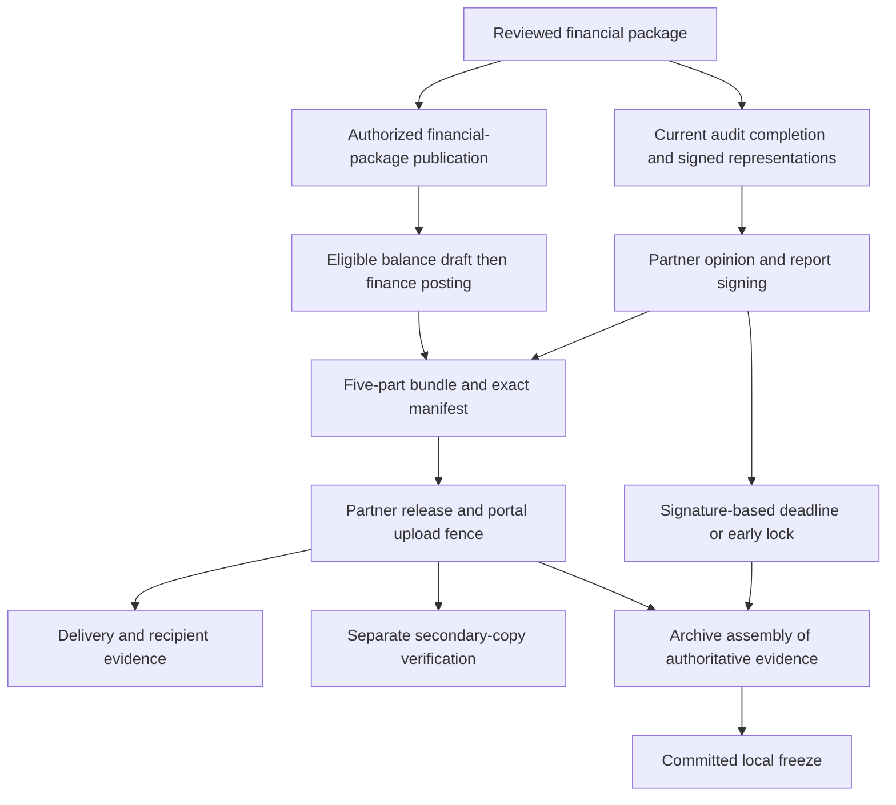

# AuditSphere — Five-Module Functional Requirements

| Attribute | Value |
| --- | --- |
| Revision | 2.3 — proposed for adoption |
| Prepared | 24 October 2026 |
| Scope | Five existing modules; seven display phases; eleven derived audit lifecycle states |
| Implementation status | Unverified in this document review |
| Purpose | Operational and accounting requirements across all five existing modules |

> **Authority:** This is a review-derived revision candidate. A filename ending in `current` is the requested naming convention; it does not establish approval or implementation. The six repository counterparts were not inspected. Source-reported approved ADRs and executed contracts remain controlling until an authorized change is adopted. Proposed changes and D01–D10 decisions do not silently override them.

The [complete proposed specification](auditsphere-requirements-specification-complete-practice-management-proposed.md) governs the proposed design across this package. The [preserved v2.2 source](auditsphere-requirements-source-ste-audit-management-specification-v22.md) supplies historical requirements and approved source overlays. Companion documents use the same control identifiers and do not add product modules.

## Filename and scope

The supplied material uses this filename for the broader STE requirements. This revision therefore retains all five modules. Client bookkeeping, audit execution, financial reporting, consolidation and the firm's internal books retain their existing owners; “accounting module” in the filename does not introduce a sixth module or narrow the product to bookkeeping.

Use this file for functional implementation planning. Use the complete proposed specification for the full architecture, security/operations, 165 procedures, 54 acceptance scenarios and owner decisions. Repeated control text is synchronized from that same reviewed source.

## Five modules with complete ownership

Existing accounting, consolidation, PBC, workflow, technical-library and platform capabilities remain inside the five-module product boundary. The source's R2R module numbers are retained as provenance; this revision does not add those as separate top-level modules.

| Existing module | Business responsibility | Owns | Boundary |
| --- | --- | --- | --- |
| **M1 Commercial & CRM Pipeline** | Lead through agreed terms | Client/contact profile, group relationships, proposals, dispatched revisions, commercial acceptance, Engagement Letter and commercial fee terms | Risk clearance comes from M2; invoices, cash and firm postings belong to M5. |
| **M2 Administration, Governance & Planning** | Eligibility, resources and plan | Acceptance/continuance, independence, assignments, calendar, service applicability, approved templates, directory provisioning requests, materiality and risk planning | Administrator access does not confer Partner authority. Planning consumes an accepted accounting dataset from M3. |
| **M3 Technical Execution & Audit Fieldwork** | Accounting preparation and audit evidence | TB/GL intake, native client accounting already in scope, mapping, adjustments, reconciliation, consolidation preparation, procedures, PBC, sampling, confirmations, reviews and SRM | Firm books and client books remain separate; consolidation never posts into component books. |
| **M4 Reporting & Final Deliverables** | Reviewed output through archive | Entity/group financial statements, notes, report composition, opinion, signed representations verification, signing, five-part bundle, release manifests, read-only freeze and inspection exports | Consumes M3 snapshots and M5 fee-note records. It cannot auto-approve financial or professional decisions. |
| **M5 Practice Analytics & Internal Bookkeeping** | Firm operations and financial control | Time, capacity analytics, rates, budgets, realization, fee milestones, firm invoices/credit notes/receipts/allocations, expenses, firm ledger, TB, P&L and AR ageing | Client sales/purchase invoices are never firm revenue. Charge-out value is not payroll cost. |

**Supporting capabilities are not new modules.** Identity, authorization, audit events, technical templates, document versioning, scheduled tasks, background operations, notifications and telemetry are shared implementation capabilities of the existing modules. Preserve their current ownership where the repository confirms it; this specification does not require renaming projects or moving every file.

### Source hierarchy and status

1. The user's scope constraint governs this review: improve the existing product without new modules.
2. Approved decisions reproduced in the attached v2.2 Markdown control interpretation where older source prose differs. They remain source-reported decisions; this review does not approve new ADRs.
3. Use v2.2 requirements and their operative overlays together. Keep executed contract terms and historical engagement evidence unchanged.
4. Use the HTML's existing accounting/consolidation extensions and the audit working process to fill detail inside current capabilities.
5. Apply this proposed revision after owner adoption. Entries in [the decision register](auditsphere-requirements-specification-complete-practice-management-proposed.md#rev-decisions) do not silently overrule existing policies.
6. Historical service names, code presence and earlier CI labels provide investigation leads, not proof of current implementation.

### Existing service routes

| Route already named in the sources | Required interpretation | Completion boundary |
| --- | --- | --- |
| External/statutory audit | Use all applicable audit gates and the existing eleven-state derived lifecycle. | Audited financial statements, audit report, required bundle, archive and professional review. |
| Imported accounting preparation | External books remain source of record. Reviewed adjustments and financial preparation do not imply external posting or an audit opinion. | Reconciled financial package under the selected service mandate and reporting framework. |
| Authorized native client bookkeeping | Activate only for an explicitly authorized book and period, after reviewed opening balances/cutover and applicable independence clearance. | Posted client ledger, reconciliations, period controls and statements. Optional ancillary capabilities do not block the core path. |
| Group consolidation | Group engagement consumes approved component snapshots and authorized external packs. | Group-only adjustments and reviewed consolidated financial output; component ledgers unchanged. |
| Agreed-upon procedures and internal audit | Separate the templates and mandates. ISRS 4400 relates to AUP; it is not a blanket standard for internal audit. Approve applicability before activation. | No automatic ISA opinion or assurance claim. D03 defines missing route details without adding product modules. |

The eleven canonical labels describe the supplied audit lifecycle. Do not rename them, add a parallel state machine or manufacture approvals to accommodate a non-audit service. Record the service mandate and applicability using existing engagement/task/report capabilities. A non-audit route whose contracts and deliverables are not specified remains explicitly unsupported for production until D03 is resolved.

### Retained scope limits

Inventory, payroll, tax and loan audit workprograms test client records; they do not authorize inventory operations, payroll processing, procurement, payment initiation or external tax filing. Purview and external eSignature providers remain outside the approved boundary. WhatsApp remains a lead-source label. There is no new CRM product, HR system, payment gateway, scanning service, analytics warehouse or separate quality-management product in this proposal.

## Derive progress from current evidence

Keep the eleven canonical audit states and seven display phases. Tasks support work; domain commands and valid evidence determine progression.

| Phase | Canonical state | Evidence required to leave the state |
| --- | --- | --- |
| 1 Onboarding | `LEAD_INGESTION` | Validated minimum entity/contact details and scoped proposed service. |
| 1 Onboarding | `PROPOSAL_GENERATION` | Approved exact proposal revision and evidenced email dispatch. |
| 1 Onboarding | `DUAL_KEY_PENDING` | Current commercial acceptance and current unconditional assigned-Partner risk clearance; no blocking hold. |
| 1 Onboarding | `ADVANCE_BILLING` | Authorized Engagement Letter/terms evidence, linked fee agreement, full 50% advance paid and allocated, activation command and required onboarding controls. |
| 2 Planning | `PORTAL_ACTIVE_PLANNING` | Required provisioning evidenced; staffing, accepted TB/mapping, materiality and risk routing current; assigned Partner planning approval. |
| 3 Fieldwork | `FIELDWORK_EXECUTION` | All applicable procedures assigned to fieldwork are submitted against current versions; exclusions/tailoring authorized. Later review/signing/release procedures are due at their own phase gates. |
| 4 Manager review | `MANAGERIAL_REVIEW` | Independent review complete; all blocking notes resolved with reviewer acceptance; current SRM; required confirmations cleared under current policy. |
| 5 Partner sign-off | `PARTNER_APPROVAL` | Partner review/clearance and opinion; required quality review; management-approved statements and verified signed representations; final report signed against the approved snapshot. |
| 6 Report and delivery | `DELIVERABLE_RELEASE` | Five required items pinned, final fee note valid under the agreed sequence, authorized immutable bundle release and evidenced delivery disposition; portal upload fence committed. |
| 7 Archive and close | `COMPLIANCE_COUNTDOWN` | Authorized early freeze or due freeze completes successfully. Secondary SharePoint observation is a separate condition, not inferred from the timer. |
| 7 Archive and close | `ARCHIVED_READ_ONLY` | Terminal for the frozen engagement version; authorized read/export remains. Corrections use explicit linked amendments/reissues, never overwrite the original. |

This is a proposed normalized gate reading, not a claim about current code. D01 covers package/billing semantics, D02 the archive clock and D03 non-audit routes. Gate changes require review rather than inferred implementation. Preserve ADR-0004's projection: no editable stage column and no task completion API that directly sets a lifecycle state.

### CTRL-01 Approval dependency and invalidation matrix

| Change | Pending decisions that become stale or need impact review | Must remain preserved |
| --- | --- | --- |
| Quote revision, fee, scope, service, entity or period | Affected commercial acceptance, letter eligibility and linked fee activation basis; reevaluate risk where its basis changed. | Dispatched offers, authentic responses, executed contracts and payment history. |
| Due-diligence facts, independence/conflict or ownership | Risk clearance and downstream eligibility affected by that clearance; open a hold where required. | Prior decisions and their actual generations/actors. |
| TB/GL source, mapping or approved adjustment set | Materiality, affected risk assessments/lead schedules, financial-package review, affected workpapers and SRM/sign/release eligibility. | Prior imported datasets, original evidence and previously issued report bytes. |
| Procedure result, population/sample or linked evidence | Affected procedure submission/review, dependent SRM and report readiness. Unrelated sections need not be discarded. | Old result, reviewer comments, sample definition and evidence versions. |
| Reporting policy/template, FX rates or comparative/restatement basis | Affected statement/consolidation outputs, reviews and release approvals. | Previously approved reporting contexts and group runs. |
| Representation letter, opinion text, statement approval or final document bytes | Report signature/package acceptance; require correct re-signing and re-release before a new issue. | Original signatures and issue manifest, with supersession relationship. |
| Payment reversal, unallocation or contract amendment | Current commercial eligibility and unexecuted dependent commands; require authorized finance resolution. | Historical activation/release facts; no automatic erasure or withdrawal of an issued audit report. |
| Identity disabled, staff reassigned or scope revoked | Future access, queued operations and new protected decisions. Historical approval validity follows professional impact assessment. | Authentic historical actor identity and completed evidence. |

Record dependency IDs/revisions and calculated digest where appropriate. A current approval proves review of those inputs, not all future revisions. Preserve the original decision, mark current eligibility stale, explain the affected dependency and route only necessary rework. After issuance, immutable release history wins: new evidence creates a correction workflow rather than a silent regression of the issued record.

### CTRL-02 Dashboard and task behavior

The engagement workspace always shows client, entity, period, service route, source mode, phase, responsible staffed person, due date, task progress, gate readiness and next permitted action. Display “Waiting for client”, “Under review”, “Rework required”, “Stale inputs”, “Blocked externally” and “Archive overdue” as explanatory conditions, not new lifecycle states. “100% tasks” never means “approved for release”.

Provide existing My Tasks, Team Work, waiting/review/rework/overdue/completed filters and list/Kanban/calendar views over the same records. Reject cyclic task dependencies, preserve completed task history, pin template versions and recalculate due dates with explicit change evidence. Autosave must expose unsaved/conflict/error status and preserve the user's draft when a revision conflict occurs. Links carry current client/engagement context and handle revoked, superseded or deleted targets safely.

Annual rollover copies approved templates, suitable client facts and mapping suggestions only. Require fresh commercial consent, continuance, staff assignments, TB/materiality, current evidence, reviews and opinion. Never copy prior-year approvals as current, reopen archived files as editable, or imply that imported historical balances have been newly audited.

## Commercial and CRM pipeline

Convert an evidenced client mandate into an engagement without conflating an accepted quotation, professional risk approval, agreed terms or received payment.

### M1-01 Client profiles and communication routing

Retain legal entities, registration/tax identifiers, parent/subsidiary/affiliate relationships and the multi-contact directory. Record contact authority, validity and purpose-specific routing for MD/GM commercial decisions, CFO/finance billing and liaison PBC work. Detect possible duplicate entities before conversion; an authorized merge preserves source IDs, engagements and history. Corporate relationship membership never grants access to another entity's files.

Phone, WhatsApp, email, web forms and in-person referrals remain lead-source classifications. No WhatsApp ingestion/dispatch is implied. Revalidate the actual recipient and allowed contact role immediately before outbound dispatch, not only when the document was drafted. Keep sensitive risk assessments out of customer-visible content.

### M1-02 Quotation and proposal versions

Provide the short quotation and comprehensive proposal with scope, service type, entity, period, currency, fee, 50/50 terms, milestones and approved firm/team content. Draft, review, dispatch and response are distinct facts. Freeze the exact dispatched version and its attachments, recipient, channel, timestamp and provider disposition. Track acceptance, decline, expiry and supersession. A changed fee, period, scope, currency or applicable terms requires a new client response.

### M1-03 Independent dual-key acceptance

Key 1 is acceptance of the exact dispatched offer by an authorized contact, with the approved response-channel label and supporting evidence. Key 2 is current unconditional clearance by the staffed Engagement Partner against the current due-diligence generation. Conditional, missing, rejected, stale or wrong-scope decisions do not satisfy a key. Both keys are required at letter generation and activation. Neither a task checkbox nor an administrator override can manufacture them.

Keep two approval cards with owner, status, version, date and evidence; show Engagement Letter eligibility separately from the advance-payment card. A declined proposal can be revised/re-dispatched or closed with a recorded reason. New facts after acceptance trigger targeted reassessment and an appropriate hold.

### M1-04 Engagement Letter and agreed terms

Generate only from the current dual-key clearance and appropriate versioned service template. Record legal entity, scope, period, responsibilities, reporting framework, fee schedule, deadlines and authorized signatories. Distinguish generated, Partner-authorized, dispatched and accepted/executed terms. Quote acceptance alone must not be presented as proof of the client's acceptance of a materially different Engagement Letter.

Retain existing signature/seal policy and the Microsoft identity route. Do not email temporary passwords. Capture evidence that engagement terms are agreed before professional work begins; if a specific mandate uses a different legally valid evidence form, pin that approved form. An amendment to an executed engagement is a new linked version, not an overwrite.

### M1-05 Advance and activation handoff

M1 supplies the accepted fee/letter basis to M5. Optional automation, disabled by default, may create an advance invoice draft. Separate authorized actions approve/post/send it and record cash. Activate only when the linked 50% ADVANCE milestone is fully paid and allocated, both acceptance keys remain current and all other applicable onboarding holds are clear. An issued invoice, receipt draft, promise to pay or partial payment does not unlock planning.

For a QAR 20,000 agreement the required advance is QAR 10,000. A QAR 6,000 receipt plus a QAR 4,000 receipt unlocks the payment gate only after both are validly recorded and allocated to that advance. Reversing an allocation opens a current finance exception; it never deletes the earlier activation evidence. Existing executed contract terms are preserved.

### M1-06 Onboarding outcomes and recovery

Expose exact blockers for absent client consent, stale risk approval, unsigned/unagreed terms, unallocated receipts, identity provisioning or provider failure. Keep business readiness separate from technical provisioning. Use one authorized activation receipt; retries reuse it. If provisioning partially succeeds, retain remote IDs and reconcile before another create. Client access remains limited until its full activation conditions are satisfied.

Traceability: v2.2 §§3.1, 4.1, 6.3; ADR-0003/0007/0012/0017; HTML M1 baseline (original HTML source) and commercial flow (original HTML source). Terms-evidence and recovery detail are proposed clarifications; executed contracts are not changed.

## Administration governance and planning

Make eligibility, review independence and the plan explicit before execution. Record professional judgment and its evidence; calculations support the decision.

### M2-01 Acceptance continuance and independence

Preserve separate new-client and annual-continuance questionnaires, including beneficial ownership, AML/KYC, integrity, conflicts, independence, litigation, fraud, finance changes and prior-year fees. Retain RV-031 and RV-032 and their approved adverse-answer meanings. Missing information, adverse answers and changes route to remediation or a recorded decision; they do not disappear through a score. Keep documents, answers, evidence and decisions versioned.

Where the firm also prepares books or financial statements, record the professional assessment of self-review and other independence threats for that engagement. Management must retain responsibility for client records, accounting judgments and statement approval. A product capability flag does not establish that the firm may legally/professionally provide the combined services. Define required safeguards and assignments within existing governance.

### M2-02 Roles assignment and independent review

Preserve PREPARER, REVIEWER, APPROVER and CLIENT as the business personas while using existing scoped capabilities for finance, administration and technical operations. Require a staffed Partner for acceptance, planning approval, high-risk/SRM clearance, opinion, report signing, signed-representation verification and bundle assembly. A technical administrator or firm-wide directory role is insufficient.

Prevent self-review of workpapers, adjustments and protected approvals where independence is required. Acting at two seniority levels does not make a person independent of their own preparation. Record reassignment, delegation limits, absence coverage and current professional eligibility. Amber work is performed by Senior Auditor or above and reviewed by an Audit Manager. Preserve mandatory Manager execution/Partner review for Red work unless an approved source decision states a narrower rule.

### M2-03 Quality-review applicability

Replace stale ISQC 1 references with the applicable ISQM 1, ISQM 2 and ISA 220 (Revised) context. Add an engagement-level decision recording whether an engagement quality review is required, why, the eligible independent reviewer and completion evidence. When required, incomplete review blocks report dating/signing. This is an applicability control in existing governance/review, not a new module. The application does not, by itself, constitute the firm's whole quality-management system. [R4](auditsphere-requirements-specification-complete-practice-management-proposed.md#ref-quality)

### M2-04 Capacity calendar and deadlines

Use the Sunday–Thursday firm workweek, Friday/Saturday weekend and Sunday–Saturday allocation week from ADR-0017. Track actual availability, leave and recorded public holidays without inventing a holiday table. Show over-allocation/conflicts before assigning work; retain authorized exceptions. Set milestones relative to the engagement's actual statutory/contract deadline rather than hard-coded example dates.

Store instants in UTC, display business times in Asia/Qatar by default and treat financial dates/date-only deadlines consistently. A change to year-end or deadline recalculates proposed dates for review and preserves prior commitments. Do not silently move completed tasks or statutory deadlines.

### M2-05 Workspace and reusable templates

Retain one SharePoint site per client and the five-folder taxonomy: Administration & Planning; Trial Balance & Schedules; Fieldwork & Testing; Drafts & Deliverables; Final Signed Archive. Verify the intended tenant, site marker, library and grants rather than trusting a URL or folder name. Distinguish reserved/requested/provisioned/observed facts; failed provider work remains visible.

Version technical-library content, task templates, workprograms and industry variations. Each engagement pins a published version. Changes to the library do not rewrite active or historical work. Require an authorized tailored-program review; record additions and exclusions with reasons and risk links. Maintain existing technical reference and knowledge content without adding a separate product module.

### M2-06 Materiality and risk policy

Retain the approved unnormalized PBT benchmark (mapped balances excluding tax), Revenue, Assets and Equity/Net Assets alternatives. Require an accepted dataset, reproducible benchmark account membership, rationale for the selected base/percentage and assigned-Partner approval. Zero, negative or inappropriate bases require selection of another professionally justified benchmark; do not silently take an absolute PBT or normalize it.

| Existing policy value | Proposed precise interpretation |
| --- | --- |
| PBT 5–10%; revenue 0.5–2%; assets 0.5–1%; equity/net assets 1–2% | Firm policy ranges requiring documented judgment; not percentages mandated by ISA. |
| PM | Use the source abbreviation for overall/planning materiality; label it clearly to avoid confusion with performance materiality. |
| TE / performance materiality 50–75% of PM | Preserve the configured source rule; distinguish engagement performance materiality from tolerable misstatement for a specific sample. |
| SAD threshold 3–5% of PM | Label “clearly trivial threshold”; the schedule of audit differences is the record, not the threshold itself. Qualitative concerns remain recordable. |
| Rounding within ±5% | Store raw value, proposed rounded value, difference and reviewer rationale; preserve the cap and approval. |
| Green / Amber / Red | Routing indicators using absolute FSLI exposure and qualitative overrides. Green is not automatic exclusion from work. |

Preserve the critical-estimate Red override and high inherent-risk definition of likelihood 3 with magnitude at least 2. D04 proposes equality handling as Red at or above PM and Amber at or above TE below PM, subject to professional approval and reconciliation with actual existing rules. Until resolved, equality must not fall through an unclassified branch. Sampling or full-population testing remains documented senior judgment, not a universal sample requirement.

### M2-07 Planning approval and applicability

Approve the current scope, service mandate, reporting framework/edition, applicable workprogram, risk/assertion responses, materiality, staffing, review routing and milestones as one versioned plan. Link each significant risk to its planned procedures and responsible reviewer. New source data, materiality, risks or tailored program changes trigger impact review and invalidate affected approval eligibility. Required procedures cannot be deleted by an ordinary task edit.

Traceability: v2.2 §§4.2, 6.3–6.5; ADR-0011/0017/0018; HTML planning/fieldwork (original HTML source); workflow area 1. Quality-review applicability and the clarified policy vocabulary are proposed completions within this module.

## Technical execution and audit fieldwork

Preserve the financial source, record every transformation and connect each conclusion to evidence. The same approved numbers feed the financial statements and audit working papers.

### M3-01 TB and GL intake with accountable mapping

Stage uploaded Excel/CSV data with file hash, uploader, source system, entity, period, currency, sheet/row lineage, row counts, source debit/credit totals and import-schema version. Preserve original bytes and accepted normalized records. Reject wrong-scope/period/currency data, duplicate keys that break the chosen grain, invalid precision and unbalanced accepted TBs. Quarantine errors and show an actionable row-level report. No hidden balancing plug or partial publication.

Specify the source grain: opening/movement/closing totals or a closing-balance TB, and do not sum cumulative snapshots as movements. Accept a distinct GL population with dates and journal/line identity; validate its relationship to the TB and any exclusions. A duplicate upload is a detected repeat or a deliberately superseding version. Large files use bounded background staging and cancel safely before publication.

Version the chart and FSLI taxonomy; reject parent cycles and invalid mappings. Historical mapping memory proposes matches, which an authorized reviewer confirms. Every posting account with relevant balance/movement must map or have a reviewed disposition. Mapping approval pins the dataset and chart; changing either makes the affected mapping/outputs stale. Comparative opening balances reconcile to the prior-year approved closing basis, with explicit differences/restatement evidence.

### M3-02 Adjustments and the financial close bridge

Maintain the bridge **original accepted TB + included approved adjustments/reclassifications = adjusted reporting TB**. Every entry has balanced debits/credits, scope/period/currency, explanation, category, supporting evidence, preparer and independent reviewer. Keep proposal, management response, audit approval, client-book posting and report inclusion as different facts. Record rejected/unadjusted differences in the misstatement schedule rather than losing them.

Link a posted native-book adjustment to its proposal. If an updated source TB already contains it, do not add the same adjustment again as a reporting overlay. Reversals reference the original and create new evidence. Compare aggregated and qualitative unadjusted differences with the approved materiality basis; record the Partner's conclusion and impact on the report. An automatic threshold does not select an opinion.

### M3-03 Authorized native client bookkeeping

Keep external-source mode for existing clients until an explicit approved cutover identifies book, period, opening TB, supporting receivable/payable balances, source freeze boundary and reconciliation. Activate native mode only after balanced opening data and authority checks. Subsequent TB/GL exports come from posted native records; a parallel external TB cannot become a second source of truth for the same period without a reviewed transition.

Complete the existing journal, sales/purchase invoice and credit-note paths: draft, review, posting, numbering, due date, currency, accounts, cancellation before posting, and credit/reversal after posting. Posting is atomic and balanced. Track receipts/payments as records and allocations; this does not initiate bank payments. Prevent over-allocation, double allocation, cross-client settlement and posting into closed periods. AR/AP controls reconcile to the GL.

Close a period only after required journals, reconciliations and checks pass. Reopening requires scoped authority, reason, impact assessment and preservation of the old closing snapshot; affected reports become stale. Tax/VAT and ancillary capabilities remain individually gated. Do not make them a prerequisite for the core non-tax bookkeeping path or imply universal tax readiness.

### M3-04 Reconciliations and movement schedules

Reconcile bank, AR, AP, inventory and fixed-asset schedules to the applicable GL/TB; retain source population, control total, difference, reconciling items, explanation, evidence and reviewer. Record unresolved differences even below materiality; a threshold changes attention or review policy, not arithmetic truth. Build lead schedules with opening balance, additions/movements, approved adjustments and closing balance. A signed schedule references the actual source and workpaper version.

### M3-05 Workprogram evidence and sampling

Implement all [20 source areas and 165 procedures](auditsphere-requirements-specification-complete-practice-management-proposed.md#rev-workprograms) as reusable workprogram content. Each procedure records applicability, assertion/risk, objective, method/population, selection method where applicable, work performed, evidence, exception, conclusion, preparer, reviewer and version. N/A requires authorized reasoning; “done” without evidence or a documented conclusion is insufficient. Preserve digital and physical-binder references, including location and custody where relevant.

MUS, systematic random and stratified methods retain population hash/version, units, parameters, seed or deterministic selection basis, selected IDs, exclusions and judgment. Validate zero/negative amounts and duplicated population items according to the method. Do not substitute an unsupported sample formula for professional assessment. Full-population testing is allowed with documented judgment. Altering a population or sample invalidates the affected testing conclusion.

Keep the split P&L/B/S workspace with current/prior balances, movements and links to analytical review/workprograms. Label unavailable/zero-baseline percentage comparisons instead of inventing infinite or zero percentages. Independent work on different rows proceeds concurrently; edits to the same reviewed result produce a revision conflict, not a silent overwrite.

### M3-06 PBC and controlled confirmations

Each PBC request identifies requested item, entity/period, owner, due date and acceptable evidence. Each upload is a new version linked to the request; show Pending Upload, Under Review, Approved or Rejected/Re-upload Required with the auditor's rejection reason. Requests for clarification preserve earlier files and comments. Freeze upload permissions on final release; retain authorized download access under the closure policy.

Track confirmation target, independent contact verification, dispatch evidence, response source, differences, reminders, alternative procedures and reviewer conclusion. Auditor-controlled routing and original evidence must not be replaced by an unchecked client-forwarded response. Preserve the approved Critical flag and its holding-letter/release block until the critical requirement is satisfied. Holding-letter generation does not mean it was sent or received.

ISA 505 distinguishes nonresponses requiring alternative work from cases where a necessary positive confirmation cannot be replaced by alternatives. The existing Critical rule is a stricter firm release policy; changing it needs D05. Do not silently downgrade a Critical item to bypass a block. [R5](auditsphere-requirements-specification-complete-practice-management-proposed.md#ref-handbook)

### M3-07 Review points and completion

Submit an immutable result version; independent reviewers accept it or return it with mandatory actionable comments. A preparer response does not close a review point until the authorized reviewer accepts it. Track open/resolved/reopened notes, linked procedure, accountable owner and history. No unresolved blocking note, stale approval or missing applicable procedure may disappear from the completion checklist.

Compile the SRM from the actual current risk, workpaper, confirmation, misstatement, estimate, going-concern and subsequent-event records. The Manager's recommendation and Partner's clearance are human decisions pinned to that SRM version. Complete required EQR before report dating. A change after completion creates explicit impact review/rework.

### M3-08 Group consolidation without component mutation

Retain group/perimeter, ownership, component reporting packs, currency translation, intercompany matching and group-only journals. Approve the control/consolidation assessment; ownership percentage alone does not prove control. Pin component entity/book/period, framework/policies, currency, source and mapping versions, authorization and reviewed external-pack provenance. Reject incompatible periods or provide the professionally approved alignment evidence. [R11](auditsphere-requirements-specification-complete-practice-management-proposed.md#ref-ifrs10)

Use reviewed purpose-specific FX rates and dates; closing, transaction, average and historical rates are not interchangeable. Any permitted average must be justified by the applicable policy. Reconcile CTA, equity and NCI from approved ownership/rate information; do not default every equity movement to a closing rate. [R12](auditsphere-requirements-specification-complete-practice-management-proposed.md#ref-ias21)

Intercompany matches consume identified source exposures once; partial matches track remaining quantities/amounts. Differences route for resolution rather than an unexplained plug. Balance elimination journals and record the approved run inputs. Changes create a new run; no elimination or consolidation workflow writes to a component client ledger. Preserve before/after component financial-data hashes and version counts as acceptance evidence.

Traceability: v2.2 §4.3 and client-accounting boundary; HTML EXT-ACC-01–06, EXT-CON-01–05, 07 (original HTML source), 08 (original HTML source), 09 (original HTML source); complete DOCX workflow. The detailed failure contracts are proposed clarifications of these existing capabilities.

## Reporting final deliverables and archive

A reproducible financial package, a signed audit report and an externally delivered bundle are distinct artifacts. Their approval and issuance must refer to the same versioned evidence.

### M4-01 Complete financial statement package

Generate entity/group statements only from the pinned approved reporting context and adjusted/consolidated dataset. Support the already-scoped statement of financial position, profit or loss and applicable comprehensive-income presentation, cash flows, changes in equity, comparative figures, accounting policies and notes. Each output line and numeric note can be traced to mapping, source rows, adjustments or an approved supporting schedule.

Validate assets = liabilities + equity; profit/OCI movements agree to equity; opening + movements = closing for each equity component; cash-flow closing cash agrees to the approved balance-sheet cash reconciliation; and note totals/cross-references agree to the primary statements. Capture non-cash movements, acquisitions/disposals, FX and other reconciling items explicitly. A cash-flow statement cannot be reliably inferred from two TB snapshots alone.

Use a versioned disclosure checklist with applicability, preparer, reviewer, linked evidence and rationale for N/A. Flag missing narrative, unresolved estimates, stale notes and comparative inconsistencies. No unreviewed “IFRS compliant” watermark or automatic compliance certification. Management authorization of the complete statements, including notes, is separate from the auditor's review.

### M4-02 Output formats and version identity

Produce genuine PDF, DOCX and XLSX outputs from one typed approved presentation dataset, retaining report ID, period, currency, status and template revision. Keep draft/approved/issued states visible; an export does not approve the data. Verify totals and content match across formats, fonts and pagination are readable, required notes are present and cross-references resolve. Editable exports are convenience copies; identify the exact issued signed artifact as authoritative.

Pin rendering inputs and preserve the exact issued bytes/hash. Re-rendering may change non-business metadata, so the issued artifact is retrieved from immutable storage rather than recreated and assumed byte-identical. Corrected financial figures or wording require a superseding reviewed version.

### M4-03 Prerequisites before report signing

Before the Partner dates/signs the final auditor's report, require current completed procedures/reviews, resolved Critical-confirmation blockers, final materiality/misstatement conclusions, current SRM and Partner clearance, completed required EQR, management authorization of the exact financial statements, verified signed management representations, and current going-concern/subsequent-event work. Check signatories, periods, financial figures and evidence versions.

Written representations must be dated close to, and no later than, the auditor's report date. A representation-letter template awaiting signature is not the required signed evidence. Generate templates early; include the completed representation evidence in the final package. This moves a critical check ahead of signing and repeats it at release. [R5](auditsphere-requirements-specification-complete-practice-management-proposed.md#ref-handbook)

### M4-04 Opinion and report construction

Keep the Partner-exclusive four-way selector, with “Unmodified” as the standard label and “Clean/Unqualified” as familiar explanatory terminology. Qualified, adverse and disclaimer reports require the professional basis, affected matters and quantitative/qualitative reasoning, with applicable FSLIs/disclosures. Support a pervasive or evidence-limitation matter without forcing a fictitious single FSLI. Validate that required sections match the selected template/framework.

The software can assemble approved text and show consistency checks; it cannot infer the opinion merely from materiality, a dropdown, a score or missing confirmation. Going-concern sections, emphasis/other-matter paragraphs and key audit matters where applicable need explicit applicability and professional review. They are not extra opinion categories or new modules.

### M4-05 Signature and seal contract

Preserve the visible PNG signature/seal and the optional/required firm-certificate policy from ADR-0005/0016. Record signing mode, approved signer/authority, exact document digest, certificate identity where used, signing result and validation evidence. Visual-only output is permitted only when certificate signing is optional and no certificate is configured. Required-but-missing material blocks signing. Any configured but invalid or unusable certificate blocks signing even when the required flag is false; there is no silent image-only fallback.

A PNG is visual appearance, not cryptographic protection. A CMS signature is not automatically a PDF-native PAdES signature, a trusted timestamp or long-term validation. Define the actual supported format, certificate-chain/expiry/revocation handling and verification method in D06. Do not claim a legal signature level the implementation and qualified review have not established. Keep private signing material outside browser/UI access and out of ordinary audit logs.

### M4-06 Financial package fee note and final bundle sequence

**Recommended D01 interpretation:** an authorized release/publication of the approved financial package is a separate event from releasing the final five-part client bundle. Only after the linked package is released and the full advance is paid may the existing automation create a balance-invoice draft. An authorized finance actor separately reviews/posts the final fee note. Bundle assembly then references that immutable fee-note version. This removes the circular prerequisite and preserves draft-only automation.

Confirm these event names and semantics against the existing commands before implementing; do not silently relabel client delivery as an internal release. If the current product has one conflated command, split the responsibilities within M4/M5 using the smallest change and an explicit adopted decision. Never reinterpret executed 50/50 contracts or introduce final-payment-before-report withholding through this document.

| Required final bundle item | Required readiness |
| --- | --- |
| 1 Auditor's report and audited financial statements | Same approved context; final report signed under policy; exact authoritative bytes retained. |
| 2 Management Letter | Reviewed deficiency, impact, recommendation and management response where relevant; explicit reviewed no-findings document if applicable. |
| 3 Letter of Representation | Completed signed version verified before report signing; template and prior versions retained separately. |
| 4 Management Correspondence audit trail | Reviewed client-appropriate correspondence/confirmation summary. Exclude internal AML, confidential reviewer notes and unauthorized third-party data. |
| 5 Final balance fee note | Correct contract/milestone, approved/posted invoice version, currency and remaining fee; not an unsent draft mislabelled as issued. |

### M4-07 Release delivery and client freeze

Reevaluate current authority, dependency pins and all bundle gates at release. Persist a manifest containing each item ID/version/hash, reporting context, signing evidence, Partner authorization, recipients and release time. Commit the authoritative issued record and upload fence atomically with the outbound intent. A changed file invalidates the prepared bundle; it cannot inherit the prior signature or approval.

Allow only authorized recipients/download grants; expire/revoke access under policy without deleting issued evidence. Track prepared, released and delivery disposition independently. Provider acceptance does not prove client receipt; retain proof of portal availability/download or other verified delivery where available. Failed transmission remains recoverable without issuing a different bundle or removing the upload fence. No new payment gate is imposed on report delivery.

### M4-08 Archive assembly retention and corrections

Retain ADR-0009: the authoritative append-only release/archive store holds issued evidence, and the SharePoint archive is a separate secondary copy. `OBSERVED` applies only after exact hashes and expected grants are read back; otherwise preserve its blocked/pending condition. Read-only grants are not a guarantee against a privileged administrator. Hashes detect changed content; they do not prevent all deletion or tampering.

Retain the approved signature-based 60-day timer pending D02. Record report date separately and flag any discrepancy affecting professional assembly timing. ISA 230 describes final-file assembly ordinarily within 60 days after the report date; this is distinct from retention. During assembly, do not treat new audit work or new conclusions as routine administrative cleanup. [R5](auditsphere-requirements-specification-complete-practice-management-proposed.md#ref-handbook)

Timer expiry requests a freeze; only a successful committed freeze produces `ARCHIVED_READ_ONLY`. A failed/overdue freeze is visible and escalated. Do not invent `ARCHIVED_LOCKED`. Retention duration, legal holds and disposal authorization need a qualified jurisdiction/firm policy; sixty days is not deletion eligibility. Preserve the original frozen version. Later permitted additions/corrections record why, who, when and review, with a linked supplementary record or superseding issue; ordinary users cannot edit the original.

Regulator/inspection exports include the permitted manifest, evidence index, provenance and decision history; verify hashes and scope before export. Restricted third-party/internal information follows explicit recipient authorization. Customer-master archival, engagement freeze and financial-period close remain different operations.

Traceability: v2.2 §4.4, ADR-0005/0007/0009/0016/0017, EXT-ACC-06, EXT-SEC-01–04, Diagram 12 (original HTML source); workflow areas 16–20. D01/D02/D06 preserve unresolved business/professional choices visibly.

## Practice analytics and internal bookkeeping

Separate work performed, standard charge-out value, actual costs, invoices, collected cash and recognized revenue. Each measure must explain its basis and source.

### M5-01 Time budget and rate history

Record time against authorized engagement, phase/task and valid applicable FSLI where supplied. Require date, duration, billable/no-charge classification and narrative proportionate to the work. Reject invalid/negative durations, incompatible scope and duplicate submissions; show overlaps or unreasonable daily totals for review. Time moves through draft/submitted/approved/rejected states with reason and edit history. Amend approved time through a reviewed correction.

Retain effective-dated rates and the Senior/Supervisor/Junior/Associate aliases. Snapshot the rate basis used for approved calculations; later rate edits do not silently reprice historic reports. The source's QAR 1,000/750/500/200 rates are policy inputs, not an assertion about real staff costs. Show missing rate/currency as unavailable. Track original budget, approved revisions, actual approved hours and remaining forecast separately.

### M5-02 Financial metric definitions

| Metric | Definition for adoption | Guard |
| --- | --- | --- |
| Approved actual hours | All approved billable and non-billable/no-charge time. | Exclude draft/rejected time; retain corrections. |
| Standard charge-out value | Sum of approved billable hours × applicable charge-out rate. | No-charge time has zero charge-out value; missing rate/currency makes the metric unavailable. |
| Contract realization | Agreed net contract fee ÷ standard charge-out value. | Label contract basis; zero/missing denominator is undefined, not 0% or 100%. |
| Standard-fee contribution | Agreed net contract fee minus standard charge-out value. | ADR-0018 billable-time basis; this is not accounting profit or actual staff-cost margin. |
| Actual engagement resource cost | All approved hours × approved internal cost rate, plus included approved direct costs. | Proposed cost view only where approved cost data/visibility exists; otherwise unavailable. Do not substitute charge-out rates. |
| Utilization | Approved billable minutes ÷ scheduled capacity net of recorded unavailability. | Same period/scope; show all approved hours separately; zero capacity is undefined. |
| Billing and collections | Posted net firm invoices/credits and allocated cash, shown independently. | Do not treat an invoice as received cash or presume billing equals revenue recognition. |
| Firm accounting profit | Posted recognized income less posted expense under the approved firm accounting policy. | Reconcile to the firm ledger and period; not the contract-contribution calculation. |

The source approves standard-value/realization/contribution and utilization bases; resolve any ambiguous numerator or additional staff-level measure in D07 before changing a live dashboard. Restrict salary/cost-rate and individual performance visibility to explicitly authorized users. Do not publish rankings or infer personnel decisions from these figures.

### M5-03 Fee agreements invoice lifecycle and allocations

Pin fee agreements and ADVANCE/BALANCE milestones to the accepted letter/terms. Preserve the unconditional fully paid advance gate. Default-off automation creates drafts only, after the correct eligibility event. Authorize invoice review/post/send and cash/credit actions separately. A posted invoice maps unambiguously to its approved fee basis/milestone; refuse ambiguous multiple-milestone reporting rather than double-counting it.

Capture payment date, currency, bank/cheque reference, amount, posting record and allocation. Allocation cannot exceed available receipt or open invoice amount; preserve unallocated credits and partial balances. Concurrent allocation is serialized or otherwise proven safe. A correction uses credit, reversal or unallocation history; it never edits posted facts in place. Receipt dispatch has its own evidentiary status.

A fully paid advance is a commercial activation condition, not an automatic revenue-recognition rule. The approved accounting policy determines advance/deferred-income or receivable postings and subsequent recognition. Prevent duplicate recognition when the final fee is billed. Refund, write-off, overpayment and contract-change handling must preserve approval, account impact and the original audit trail; D07 resolves policy choices.

### M5-04 Firm ledger and period control

Retain the firm's chart, balanced journal posting, rent/facilities, salaries/benefits, overhead, petty cash and Partner withdrawals. Classify withdrawals under the approved equity/current-account policy rather than automatically treating them as expenses. End-of-service benefits follow ADR-0010 as a person-entered provision/accrual with evidence and approval; no autonomous legal-benefit estimate is introduced.

Use the same reviewed posting, reversal, period-close and correction controls as appropriate to firm books. Link invoicing, receipts and expenses to resulting ledger entries and reconcile receivable controls. Native client invoices, audit proposed entries and group elimination journals never enter the firm's ledger. Preserve the financial domain in every posting/export endpoint.

### M5-05 Management reports and reconciliation

Produce a firm TB, one P&L row per accounting month with the same month one year earlier, approved budget/actual hours and contract-value analysis, and as-of-date AR ageing for all posted firm invoices (advance, final, time or other). Calculate outstanding amounts using transactions effective at the requested date; future receipts do not alter historical ageing. Reconcile the receivables report to the ledger control with explicit credits/adjustments.

Use agreed due-date ageing buckets, consistent timezone/date rules and a clear treatment of credits/overpayments. Never include client-bookkeeping receivables. Multi-currency reports show source currency and approved translation basis instead of adding unlike currencies. Users can drill from a total to the permitted underlying invoices/time/ledger records without bypassing scope.

Traceability: v2.2 §§3.5, 4.5; ADR-0007/0010/0012/0018; EXT-FIN-01–04; Diagram 10 (original HTML source). Cost visibility, recognition and broader fee exceptions remain professionally owned decisions rather than invented settled policy.

## Shared financial and transaction contracts

### ARCH-03 Financial ownership and reporting identity

**Three posting domains remain distinct:** firm practice books, each client legal entity's accounting books, and group consolidation journals. A shared database does not make their posting commands interchangeable. Treat `FirmId`, `ClientId`, `EngagementId`, legal entity/book, financial period and, where applicable, group/run identity as first-class ownership.

A reporting manifest pins the client/entity or group, engagement/service route, period, functional and presentation currencies, framework and edition, accounting-policy revision, source mode, accepted source version, mapping version, approved adjustment set, comparison/restatement basis, relevant rate set and output-template revision. Add workpaper/SRM/representation/opinion/signature references when producing audit deliverables. Use existing entities where possible; the required contract does not assert that a named implementation class already exists.

Use decimal amounts and the existing `numeric(19,6)` design; use decimal strings at money API boundaries and the recorded rounding policy. Validate range and scale before import/posting. Currency settlement/display precision is separate from calculation precision. Record any permitted rounding difference explicitly; never hide an unbalanced posting with a display-rounding adjustment.

### ARCH-04 Relationships and database invariants

- Scope-aware foreign keys/unique constraints and server checks prevent cross-client attachments, payments, mappings, review receipts and journals. Server-resolved identity controls scope; an identifier submitted by the browser grants no authority.
- Enforce one authoritative source mode per client book/period, immutable posted journal identity, unique posting/idempotency receipts and legal-entity invoice-number rules. Published versions are superseded, not overwritten.
- Validate whole-journal balance in the posting transaction and prohibit changes to posted lines except recorded reversal/replacement. Row-level checks alone cannot validate a sum across journal lines.
- Use optimistic revision tokens for forms and reviewed packages; use short locks or an equivalent proven transaction strategy for contended allocations, posting, publication and freeze. Reject stale writes with actionable current-version information.
- Keep business corrections, cancelled work and excluded imports discoverable in history. Hard deletion of issued or posted evidence is not a normal user action.

### ARCH-05 Protected command contract

Every protected command identifies its resource, expected revision, idempotency key when repeatable, requested action and required rationale/evidence. The server supplies the actor and authoritative scope. It authenticates, verifies active scoped grants and professional capacity, evaluates gate/input freshness, commits business change plus audit receipt plus durable intent atomically, and returns a stable result with correlation ID. Repeat the scope/freshness checks within the committing boundary where races matter.

Document error codes for `AUTHENTICATION_REQUIRED`, `FORBIDDEN`, `INPUT_INVALID`, `REVISION_CONFLICT`, `GATE_BLOCKED`, `DEPENDENCY_UNAVAILABLE` and `OUTCOME_UNCERTAIN`; align them to existing HTTP conventions after repository inspection. Do not claim a universal HTTP 423 rule or invent a new lifecycle status. Keep sensitive denial details out of client responses.

### ARCH-06 Transactions and recoverable external effects

Commit the local mutation, audit evidence and operation intent in one local transaction. Perform email, Graph, SharePoint and remote publication outside that transaction. Use scoped, payload-bound idempotency: the same key and same payload returns the prior operation; the same key with a different payload is rejected. Leases need fencing so an expired worker cannot publish after a successor takes ownership. These contracts refine the source's existing operation/outbox design. [R8](auditsphere-requirements-specification-complete-practice-management-proposed.md#ref-ef-transactions) [R9](auditsphere-requirements-specification-complete-practice-management-proposed.md#ref-ef-concurrency)

| Failure | Required result and recovery |
| --- | --- |
| Double click or lost local response | Return the original receipt/operation; no second financial posting, document or approval. |
| Provider throttling or known transient failure | Bounded retry with backoff and provider Retry-After; retain the original payload and actor. |
| Timeout after possible remote create/send | Mark the existing operation uncertain and reconcile its deterministic remote identity before retrying a create/send. |
| Worker crash after remote success | Recover and verify the existing remote effect, then complete the local receipt without duplicating the effect. |
| Authority revoked while job waits/runs | Stop future unauthorized effects. Preserve evidence of effects that already happened; require authorized reconciliation before publication. |
| Permanent failure or unexpected provider drift | Show the failed/blocked capability, exact operational reason, responsible owner and an authorized retry/reconcile action. |

Do not promise exactly-once delivery across remote services. Distinguish queued, provider-accepted, delivered where verifiable, and recipient-read where explicitly evidenced. A mail API accepting a message does not prove receipt or reading.

## Supporting controls and evidence

| Concern | Authoritative proposed controls |
| --- | --- |
| Runtime boundaries and compatible stack | [ARCH-01](auditsphere-requirements-specification-complete-practice-management-proposed.md#ARCH-01) · [ARCH-02](auditsphere-requirements-specification-complete-practice-management-proposed.md#ARCH-02) |
| Identity, scoped access and external access boundaries | [SEC-01](auditsphere-requirements-specification-complete-practice-management-proposed.md#SEC-01) · [SEC-02](auditsphere-requirements-specification-complete-practice-management-proposed.md#SEC-02) · [SEC-03](auditsphere-requirements-specification-complete-practice-management-proposed.md#SEC-03) |
| Deployment, operating targets, restore and monitoring | [OPS-01](auditsphere-requirements-specification-complete-practice-management-proposed.md#OPS-01) · [OPS-02](auditsphere-requirements-specification-complete-practice-management-proposed.md#OPS-02) · [OPS-03](auditsphere-requirements-specification-complete-practice-management-proposed.md#OPS-03) · [OPS-04](auditsphere-requirements-specification-complete-practice-management-proposed.md#OPS-04) |
| Accessible and recoverable user workflows | [UX-01](auditsphere-requirements-specification-complete-practice-management-proposed.md#UX-01) |
| All source procedures | [rev-workprograms](auditsphere-requirements-specification-complete-practice-management-proposed.md#rev-workprograms) |
| Acceptance evidence and delivery sequence | [rev-acceptance](auditsphere-requirements-specification-complete-practice-management-proposed.md#rev-acceptance) |
| Owner adoption decisions and checked primary references | [rev-decisions](auditsphere-requirements-specification-complete-practice-management-proposed.md#rev-decisions) |

Requirement ownership and acceptance mappings are indexed in the [domain and requirements catalogue](auditsphere-requirements-catalog-domain-glossary-current.md).
