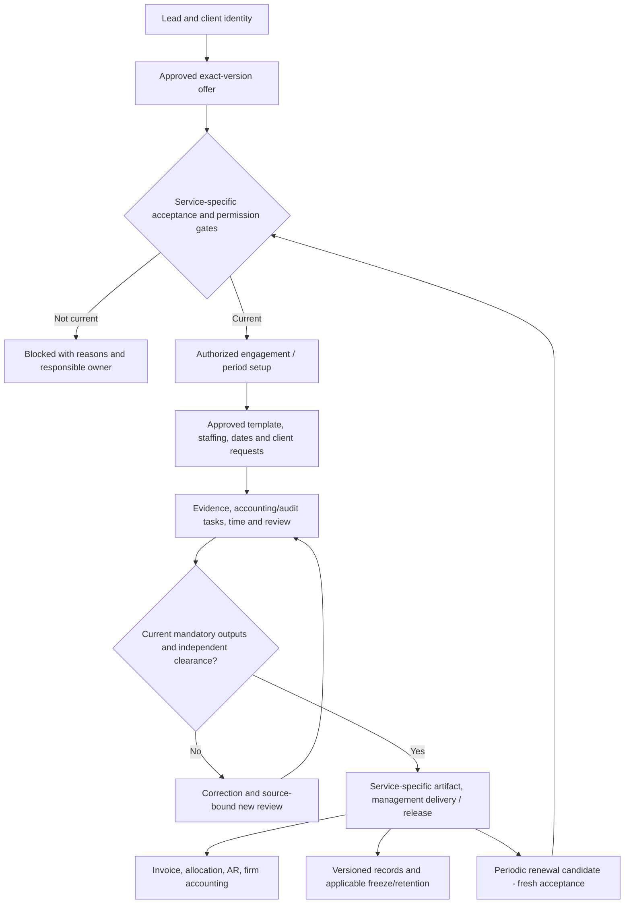

# AuditSphere — Complete Accounting-Firm Practice Management Product Specification

**Document ID:** AS-PM-COMPLETE-001  
**Status:** **PROPOSED — implementation and release acceptance plan, not evidence of completion**  
**Repository:** [`nirzaf/AuditSphere`](https://github.com/nirzaf/AuditSphere) · canonical branch `master`  
**Repository baseline inspected:** [`502ce6c81b05167f4a4e5bd44c7cb20cdc0a1ed2`](https://github.com/nirzaf/AuditSphere/commit/502ce6c81b05167f4a4e5bd44c7cb20cdc0a1ed2), authored 2026-10-17 20:23 UTC  
**Specification prepared:** 2026-10-18  
**Scope:** Firm-wide practice management; statutory audit, accounting preparation, and recurring external-source accounting/bookkeeping engagements; governed financial reporting, billing, documents, staff management, client collaboration, and operations.  
**Delivery model:** One modular monolith; the existing .NET API, Angular UI, PostgreSQL and Worker. No parallel platform.  
**Evidence type:** Repository read and requirements synthesis only. **No code changed; no tests, migrations, browser journeys, deployments or live Microsoft operations executed for this document.**

> **Executive decision.** AuditSphere has substantial implementation of all five STE modules, but it is not yet demonstrated as an end-to-end, production-accepted **complete practice management product**. Complete the existing workflows and service-specific handoffs. Avoid replacing the architecture, rebuilding implemented modules, or treating audit-methodology approval and external provider verification as routine code-review approvals.

## 1. How to interpret “complete product”

### 1.1 Release profiles

| Release profile | Definition | Required for which claim? |
|---|---|---|
| **PM-V1: Complete single-firm practice management** | STE or one independently administered accounting firm: CRM, engagements, reusable task plans, scheduling, PBC, time, finance, analytics, client communications, service-specific completion and reproducible records across the **enabled service profiles**. | **Mandatory** before calling the platform a complete practice-management tool for the adopting firm. |
| **PM-V1-AUD: Full statutory audit production** | PM-V1 plus the full 20-section/165-procedure methodology, independent Manager/Partner review, approved reporting, signed final documents and defensible archive. | **Mandatory** before offering final statutory audit issuance in production. |
| **PM-V1-ACC: Accounting preparation and recurring monthly practice** | PM-V1 plus approved accounting-only report/close rules and repeat-period work planning. May use client-supplied/external ledger data; native client posting is independently gated. | **Mandatory** before marketing monthly accounting services as fully supported. |
| **PM-NATIVE: Native client bookkeeping** | The optional in-system client-owned journals, invoices, open items, reconciliations, period maintenance and reporting are fully accepted for an authorized service and client. | **Mandatory only** when claiming native bookkeeping is complete; not required merely to manage external-source bookkeeping engagements. |
| **PM-SAAS: Multi-firm hosted commercial platform** | Firm provisioning, subscription/entitlement model if chosen, tenancy isolation, operational billing, residency decisions and customer support/onboarding between independent firms. | **Separate conditional product release**, **not** implied by the current STE internal scope. |

**Release vocabulary:** `IMPLEMENTED` means inspected working code; `FOCUSED_VERIFIED` means named tests ran against the exact revision; `FULL_CI_VERIFIED` means current-SHA unfiltered CI passed; `PROFESSIONALLY_APPROVED` and `LIVE_ACCEPTED` each require their own authentic evidence; `BLOCKED_DECISION`/`BLOCKED_EXTERNAL` cannot be relabeled merely to achieve a completion percentage. An entire release profile passes only when **every applicable mandatory criterion** passes and its separate human/external gates are closed.

### 1.2 Mandatory PM-V1 functional outcomes

A firm must be able to perform the following through supported staff/client UI and authorized APIs, starting with unseeded synthetic records:

1. Capture a lead; build the client/entity/contact relationship; qualify and convert the lead without granting hidden professional authority.
2. Issue an approved, exact-revision offer and create a client-engagement relationship with a clearly stated service, scope, period and fee model.
3. Establish the applicable independent acceptance/consent gates. **Statutory audits retain both Dual-Key approvals and the mandatory fully allocated 50% advance activation gate.**
4. Select the **approved service profile and published task template**, assign owners, set independently verified deadlines, and track next actions and blockers.
5. Prepare recurring annual, quarterly or monthly work **only where its service policy is approved**, with new-period data and separate human approvals, never copied sign-offs.
6. Exchange requests and files in the client portal, review exact document versions, maintain communication history and recover unknown provider results without duplication.
7. Schedule and reassign staff, capture/approve work time, manage budget/actuals, and preserve rate versions, confidentiality and independent review.
8. Generate, review, post and settle firm invoices under the approved service-specific fee model. Preserve immutable allocations, reversals, credits and firm-ledger provenance.
9. Produce service-specific, source-backed output: approved audit report, accounting-preparation pack, or agreed monthly close package. Do not force an audit opinion into an accounting-only engagement.
10. Close work with an appropriate independent decision and evidence manifest, preserve frozen/issued records, and clearly show later corrections or supplemental evidence.
11. Provide firm/client/service/staff reporting where authorized: open work, waiting-for-client, milestones, utilization, fees, cost, receivables, recovery and monthly firm financial statements.
12. Operate in a secure, measured, recoverable deployment with documented live identity, Microsoft 365, archive and professional acceptance.

### 1.3 Explicit exclusions and guardrails

Keep existing exclusions: inventory management, procurement operations, payroll execution, payment initiation, automatic tax filing, external eSignature providers, Purview provider integration, social-channel automation, a second ERP, multi-service microservices, broker/framework rewrites, malware/ClamAV scanning, and autonomous audit opinions. **Do not add these merely to satisfy the word “complete.”** Existing rate-limiting/security controls remain; no new rate-limit infrastructure is requested. Payment **recording after an external transfer** is allowed; initiating a transfer is not.

Only currently approved optional bookkeeping services may write client books; pre-existing external-source engagements remain external-source until a reviewed, explicit cutover. Firm ledger, individual client books and consolidation are three independent accounting domains.

## 2. Authority, codebase baseline and delta policy

### 2.1 Implementation authority, in order

1. [`AGENTS.md`](https://github.com/nirzaf/AuditSphere/blob/502ce6c81b05167f4a4e5bd44c7cb20cdc0a1ed2/AGENTS.md), [`CLAUDE.md`](https://github.com/nirzaf/AuditSphere/blob/502ce6c81b05167f4a4e5bd44c7cb20cdc0a1ed2/CLAUDE.md) and the [documentation index](https://github.com/nirzaf/AuditSphere/blob/502ce6c81b05167f4a4e5bd44c7cb20cdc0a1ed2/docs/auditsphere-docs-index.md).
2. [Current architecture](https://github.com/nirzaf/AuditSphere/blob/502ce6c81b05167f4a4e5bd44c7cb20cdc0a1ed2/docs/architecture/auditsphere-architecture-current-architecture.md), [code map](https://github.com/nirzaf/AuditSphere/blob/502ce6c81b05167f4a4e5bd44c7cb20cdc0a1ed2/docs/architecture/auditsphere-architecture-code-map.md), approved ADRs, and [STE v2.2 current requirements](https://github.com/nirzaf/AuditSphere/blob/502ce6c81b05167f4a4e5bd44c7cb20cdc0a1ed2/docs/requirements/auditsphere-accounting-module-requirements-current.md).
3. [Practice-management PM-00…PM-17 proposed stories](https://github.com/nirzaf/AuditSphere/blob/502ce6c81b05167f4a4e5bd44c7cb20cdc0a1ed2/docs/execution/auditsphere-execution-user-stories-cloud-practice-management-v22-proposed.md), [PM source/code crosswalk](https://github.com/nirzaf/AuditSphere/blob/502ce6c81b05167f4a4e5bd44c7cb20cdc0a1ed2/docs/execution/auditsphere-execution-tracker-practice-management-v22-crosswalk-current.md), [STE coverage](https://github.com/nirzaf/AuditSphere/blob/502ce6c81b05167f4a4e5bd44c7cb20cdc0a1ed2/docs/execution/auditsphere-ste-specification-coverage-current.md) and [production-readiness audit](https://github.com/nirzaf/AuditSphere/blob/502ce6c81b05167f4a4e5bd44c7cb20cdc0a1ed2/docs/execution/auditsphere-execution-audit-production-readiness-gap-closure-current.md).
4. Current `docs/execution/status.json`, exact source/task cards, test bodies, CI artifacts and authorized human acceptance. **A recorded old status is not current-SHA acceptance evidence.**

Prioritization and policy additions in **this document are PROPOSED**. They do not override `CURRENT` requirements or `APPROVED` ADRs. Record an owner decision where a new service fee/contract/professional rule is needed. Reuse approved decisions; never demand repeat approval merely because an old document disagrees.

### 2.2 Source-grounded implementation baseline (not final acceptance)

| Capability | Verified code entry points at inspected SHA | Present foundation / delta to finish |
|---|---|---|
| Commercial lifecycle | `Application/Practice/{QuotationService,QuotationCalculator,CommercialDocumentService,FeeAgreementService,BillingService}.cs`; Angular `features/commercial/*`; `Api/Ui/UiEndpoints.{Commercial,FeeAgreement}.cs` | Versioned offer, accepted fee, 50/50 and controlled billing exist. Finish contract, routing, exception and service-profile acceptance. |
| Client/contact records | `Application/Practice/{PracticeCrmService,ClientContactCreationWorkspace,WorkspaceQuery.Client}.cs`; Angular `features/clients/*` | Client/contact/relationship paths exist. Verify complex groups, contact responsibility/expiry and appropriate consent per service. |
| Annual engagement preparation | `Application/Acceptance/AnnualEngagementPreparationWorkspace.cs`; Angular `features/clients/engagement-create*` | Source-bound annual suggestion with fresh approvals exists; monthly/quarterly recurrence and interruption policy need separate coverage. |
| Workflow templates and task plans | `Application/Practice/{WorkflowTemplateService,EngagementWorkflowPlanService,EngagementWorkflowTaskService,WorkflowTaskDependencyQuery,WorkflowTaskEvidenceQuery}.cs`; Angular `features/practice/workflow-*`, `work-queue*` | Published immutable templates, task plans, dependencies, evidence rules, queues and receipt recovery exist. Complete service-specific plans, task editing/notifications and acceptance. |
| Scheduling and time | `Application/Practice/{ResourcePlanningService,ResourcePlanningWorkspaceQuery,PracticeTimeService,PracticeTimeWorkspaceQuery}.cs`; Angular `features/practice/{resources,time-tracker}.ts` | Current staffing, availability, rates and time approval. Complete workload handovers, confidentiality and measured reporting parity. |
| Deadlines/reminders | `Application/Practice/EngagementDeadlineReminderQuery.cs`, `Application/Documents/PbcReminderDiscovery.cs`; existing Worker mail-outbox | Read-only deadline projections and optional PBC email reminders already exist. Broader operator-configured escalation and missed-deadline closure need verification/delta. |
| Collaboration and client portal | `Application/Acceptance/EngagementCommunicationTimelineQuery.Activity.cs`; `Application/Documents/{PbcService,ClientPortalService}.cs`; Angular `features/portal/*` | Timelined activities/PBC uploads and status; distinguish internal vs client-visible events and prove live delivery/identity. |
| Firm finance and KPIs | `Application/Practice/{BillingService,FirmReceivablesAgingQuery,FirmUnbilledTimeQuery,FirmFinanceQuery,FirmOperationsServices}.cs`; Angular `features/{finance,practice}/*` | Invoice/receipt source state, AR, approved time classification, firm ledger and analytics exist. Close agreed fee variants and report consistency. `FirmUnbilledTimeQuery` explicitly says charge-out value is **not recognized accounting WIP/revenue**. |
| Client accounting and R2R | `Application/Accounting/{ClientOperationalLedgerWorkspace,FinancialStatementCalculator,TrialBalanceImportService}.cs`, `Application/Accounting/FinancialStatements/*`; Angular `features/accounting/*` | Substantial source-linked ledger and statement preparation; unresolved cash-flow policy, equity/note lineage, prior-year comparison and final composition remain. |
| Audit programme / completion | `Application/Audit/{AuditProgramCatalog,AuditProgramService}.cs`, `Application/Completion/AuditDeliverableService*.cs`; Angular `features/audit/*` | Full 20-section/165-source program, review and report controls; terminal ordering D1 and professional approval remain open. |
| Signature, archival, deployment | `Application/Completion/ReportCertificateSigning.cs`, `Application/Records/FileFreezeService.cs`; `Worker`; existing release and GitHub Actions workflows | Firm-certificate capability, local freeze and controlled release exist. Real certificate, approved archive/provider custody, recovery and operations acceptance remain separate gates. |

**Do not rebuild** the listed capabilities from scratch. For each proposed task, first inspect the exact head and tests and classify every requested criterion `EXISTS_AND_VERIFIED`, `EXISTS_NOT_VERIFIED`, `PARTIAL`, `MISSING`, `DECISION` or `EXTERNAL`. Only implement the smallest remaining delta.

### 2.3 Project ownership (unchanged)

| Assembly/directory | Sole responsibility |
|---|---|
| `src/AuditSphereOps.Domain` | Models, invariants, pure calculators |
| `src/AuditSphereOps.Application` | Static capability commands/queries, scoped authorization and business state transitions |
| `src/AuditSphereOps.Infrastructure` | Single EF Core DbContext split by capability; PostgreSQL schema/migrations; approved providers |
| `src/AuditSphereOps.Api` | Session/authentication, versioned HTTP contracts, OpenAPI, Angular asset serving |
| `src/AuditSphereOps.Ui` | Angular 22 views, validation presentation, same-origin transport, accessible behavior |
| `src/AuditSphereOps.Worker` | Existing durable discovery, execution, retry/reconciliation |

The Blazor host is **retired**; historical `.razor` references are not current implementation targets. No Angular business decision may bypass an Application command or the required human actor.

## 3. Service-profile and lifecycle contract

### 3.1 Service classification and scope

The product must not apply the audit workflow indiscriminately to every engagement. Each accepted service must have an **immutable, reviewed service-profile revision** (reuse `ServiceRoute`, `ServiceProfileId` and existing published workflow-template contracts; **do not introduce a new parallel engagement state machine**). The profile must define:

`service route; enabled/retired; internal display name; reporting cadence and supported periods; externally supplied vs native source mode; client/firm obligation owner; required acceptance and reacceptance; data/evidence requirements; linked published task-plan revision; schedule basis; permitted staff roles; independent review policy; required output artifact types; invoice/fee policy; period close/renewal rules; version/effective date; approval reference.`

Where existing service/template contracts cannot record a required field safely, add the **smallest additive, versioned service-policy extension** after verifying schema ownership. Old engagements must retain their pinned policy and current behavior; missing profile decisions block *that profile only*, not unrelated audit engagements.

**Explicit scope rule:** The audit activation hard-block is unconditional under ADR-0012. A non-audit service must have its own authorized commencement rules; do not use a fabricated audit `NA_APPROVED` row or an empty opinion to advance it. The eleven canonical derived audit states and seven-phase UI remain unchanged for audits. For other services, show a service-specific **readiness/workflow projection** over real tasks and approvals, without directly setting or forging the audit lifecycle state.

### 3.2 Minimum supported services for a general accounting firm

| Service profile | Inputs | Governing review/output | Cadence | Fee rule |
|---|---|---|---|---|
| **Statutory external audit** — mandatory PM-V1-AUD | Registration, prior FS, sealed current TB/GL, risk/methodology evidence, PBC | 165-procedure program as applicable, analytical/GC and confirmations, Manager→Partner decisions, signed audit report + exact bundle | Annual or approved period | Existing exact 50/50 advance/balance; **do not bypass paid advance or independent finance posting**. |
| **Financial-statement preparation / accounting** — mandatory PM-V1-ACC | Client-owned accepted TB/GL, adjustments, opening/comparatives, chart/taxonomy and disclosure evidence | Accounting preparer → independent accounting reviewer → authorized management/client acknowledgement of a source-pinned FS or agreed accounting package; **no auditor opinion** | Annual and supported interim | Authorized fixed or time-based billing under approved commercial terms. |
| **Recurring bookkeeping / monthly accounting operations** — mandatory PM-V1-ACC, initially `EXTERNAL_SOURCE` if that is the approved deployment profile | Monthly/quarterly external accounting extracts, supporting statements, reconciliations, client instructions | Source completeness + reviewed period pack and exceptions + client handover; next-period tasks created without copying prior-period approvals. Native postings only with independently approved `NATIVE_BOOKKEEPING` entitlement. | Monthly / quarterly | Approved monthly fee or T&M invoice; rule is **not assumed to be 50/50**. |
| **Advisory / agreed-upon work** — optional PM-V1 expansion | Specific mandate, negotiated scope and client inputs | Reviewer/authorized issuer and final deliverable defined by a separately approved profile; not an audit opinion | Milestone / ad hoc | Approved milestone/fixed/time policy. |
| **Tax filing, payroll execution, inventory operations, payment initiation** | — | — | — | **OUT OF SCOPE** unless future separately approved capability. |

The term *bookkeeping operations* in PM-V1-ACC means the **practice workflow for recurring services**. Do not market it as full native bookkeeping until PM-NATIVE’s operational journal, invoice, AP/AR, period maintenance and customer acceptance criteria pass.

### 3.3 Canonical engagement and recurring-period rules

1. Identify work by exact `(FirmId, ClientId, EngagementId, ServiceRoute, ServiceProfileRevision, PeriodStart, PeriodEnd)`; reuse current trusted actor, existing generation/version and scope identity contracts.
2. A proposal approval, service acceptance, payment, reviewer clearance or signed output is an independent recorded decision. A completed operational task grants **none** of those authorities.
3. Derive readiness from current authoritative records. Return `{eligible, blockers, requiredActor, nextAction, affectedSourceRevision}` or equivalent existing contract; never persist a second mutable overall progress truth.
4. A new recurring period copies only **reviewable references** (permitted client profile, current contacts, approved template IDs and historical mapping *references*). It copies no accepted offer, AML decision, current period ledger balances without approved carry-forward, materiality, samples, time, evidence decisions, reviews, final release or payment.
5. Preview the next period and show changed client circumstances, service scope, current contact authority, planned owners, fee basis and required fresh actions. The user authorizes creation through the existing preview/digest/receipt pattern.
6. Duplicate/replayed next-period creation is idempotent; different source, period or inputs with the same key conflicts. Same-client/service overlapping active periods are refused unless an existing approved policy explicitly permits them.
7. Cancellation, pause or closing a period does not delete prior decisions, postings, payment allocations or files. Historical data remains independently readable within current scope.
8. Deadline calculations must use the approved service and jurisdiction calendar. The existing Qatar Sunday–Thursday working-week policy and manually recorded public-holiday unavailability are authoritative. Never invent a statutory filing deadline from a previous year's date.

### 3.4 End-to-end business orchestration



For audits, the approved Dual-Key + 50%-advance gate, Manager/Partner clearance, signed report, exact bundle and frozen archive are still mandatory. For non-audit work, only its independently approved service requirements apply. Firm time, invoice and activity records feed portfolio analytics in parallel, but no downstream reporting action retroactively changes a signed audit source.

## 4. Detailed product requirements and acceptance criteria

IDs below are **new traceability aliases**, not claims that identical tasks are absent. Reconcile each to PM-00…PM-17, STE v2.2, CP-00…CP-25, AS-AWP-EXEC and existing task cards before implementation; do not create duplicate backlog work.

### 4.1 CRM, client hierarchy and contact authority — `ASPM-CRM`

| ID | Required behavior | Minimum independently observable acceptance |
|---|---|---|
| `CRM-01` | A lead retains source channel, owner, status, service interest, action history and conversion identity. WhatsApp is **a channel label only** (ADR-0017). | One converted lead creates/reuses the intended client exactly once; lost/invalid stage never grants engagement/portal access; source remains visible after conversion. |
| `CRM-02` | Clients maintain legal identity, registration/tax identifiers as applicable, group parents/subsidiaries/affiliates, contacts, effective dates and historical engagements. | A three-level entity relationship is displayed without cycles; client A cannot search/open its unrelated sibling-client metadata without the necessary grant; archived client history remains searchable to authorized staff. |
| `CRM-03` | Contact purposes distinguish commercial proposals/EL, finance invoices/receipts, audit liaison/PBC and report delivery. Resolve the effective authorized contact and record a snapshot on dispatch. | A missing/ambiguous/expired designated recipient produces a typed blocker; changing a contact cannot silently redirect an already-queued/sent document; client and firm scope are rechecked before sending. |
| `CRM-04` | Commercial acceptance pins rendered offer digest, recipient, legal entity, period, service, fees, response channel and authority. | Changing any material offer term invalidates Key 1; client acceptance is never inferred from email delivery or a text-only `Accepted` flag. |
| `CRM-05` | CRM is usable for accounting services without fabricating audit-risk clearance. | An accounting-preparation lead can create only a blocked/eligible service-shell according to its separately approved rules; it cannot create active audit permissions accidentally. |

**Required decisions:** `DEC-01` and `DEC-03` (consent/reacceptance), `DEC-09` (contact routing precedence), `DEC-02` (legal document wording). Reuse existing `PracticeCrmService`, `ClientContactCreationWorkspace`, `QuotationService` and applicable exact-offer response services; no parallel CRM.

### 4.2 Service agreements, accepted pricing and professional commencement — `ASPM-COM`

- `COM-01`: Retain source-pinned quotation calculation: approved rate × forecast hours, complexity/risk uplift, any approved discount, currency, expiry, review matrix and exact render. The client sees only permitted commercial data; staff cost rates remain private.
- `COM-02`: Approved templates have explicit version, jurisdiction/service applicability, effective date, immutable issued rendering, fee clauses, delivery obligation and signatory. A new material version demands review/acceptance; previous issued bytes remain retrievable.
- `COM-03`: Audit agreement preserves independently approved **Key 1** commercial response and **Key 2** unconditional staffed-Partner acceptance. QAR 20,000 accepted audit fee has QAR 10,000 advance and QAR 10,000 balance; QAR 4,000 allocated is **not** sufficient for activation. After a separate valid QAR 6,000 allocation, the advance gate may clear if no other hold remains. Later reversal does not erase past history and must affect future dependent operations under the existing policy.
- `COM-04`: The engagement’s billing plan is an authorized, **service-specific policy reference**. Audit defaults preserve existing approved 50/50. Accounting/monthly service pricing is not inferred from audit rules; an operator may select only an accepted fixed/time/milestone plan supported by current billing commands and authorized templates.
- `COM-05`: Automatically prepared invoices are **DRAFT** only (ADR-0007), never approved/posted/sent/paid by task automation. Review and posting use existing finance makers/checkers. Agreement amendment, partial receipts, credit and reversal preserve original document/ledger lineage.
- `COM-06`: The portal and staff workbench show actual issued, posted, paid, overdue and provider-delivery states separately. Draft or unknown-send results may never appear as paid/sent.

**Acceptance:** identical fees, currencies and document versions must reconcile across proposal → agreement → invoice → receipt → practice AR → ledger; no duplicate fee obligation after replay or reissue. No unsupported fee model is enabled by default.

### 4.3 Work planning, service tasks, recurring periods and deadlines — `ASPM-WF`

- `WF-01`: A service-selected engagement offers only compatible, independently published workflow templates; an authorized Manager/Partner previews exact template revision, mandatory owners, current schedule and prerequisites before creating tasks.
- `WF-02`: Queue/list/board/calendar show identical scoped task membership and truth. Authoring groups or ad hoc dependencies uses the existing versioned task-dependency graph and rejects cycles, cross-scope targets, stale revisions and graph-limit overflow without partial application.
- `WF-03`: Every required operational task exposes `{owner, source reference, due date, current state, unmet dependencies, evidence requirement, next action}`. Task completion cannot substitute for PBC acceptance, current audit review, payment posting, opinion signing or release.
- `WF-04`: Periodic work supports an **approved cadence** (monthly, quarterly, annual), preview of predecessor and fresh source/period identity, explicit human authorization and idempotent creation. Never automatically renew commercial/legal consent without the governing policy.
- `WF-05`: Scheduling shows a verified statutory deadline distinct from internal targets; a deadline change is versioned with actor, reason and effect on dependent tasks. Operating week uses approved Qatar Sunday–Thursday rules; no hardcoded new regulatory due dates.
- `WF-06`: As-of queries and review queues show `UPCOMING`, `DUE_TODAY`, `OVERDUE`, `WAITING_FOR_CLIENT`, `CHANGES_REQUIRED`, `UNDER_REVIEW`, `BLOCKED`, `COMPLETED` based on authoritative records. Do not infer delivery, approval or archive from elapsed time alone.
- `WF-07`: Rule-driven reminders/escalations **only** create attributable internal notifications or drafts in supported approved channels. They use versioned rules, quiet hours, eligible contacts, deduplication and an off-by-default external-send policy. No automatic posting, professional approval, permanent freeze or release.
- `WF-08`: Cancellation, reassignment, missed-period recovery, reopened draft and suspension preserve the exact activity/evidence lineage; prevent duplicate tasks and hidden stale predecessors.

**Acceptance:** creating a 2027 annual task plan from the 2026 audit must not copy 2026 sign-offs, TB approvals, evidence, fees or paid advance. Creating a second plan with the same idempotency intent recovers the original receipt. A disabled recurrence policy offers a manual future-period review path, not silent auto-creation.

### 4.4 Client portal, PBC and communication — `ASPM-CLIENT`

- `CLIENT-01`: Client users authenticate through the approved Microsoft identity path with current grants, explicit client/engagement scope and first-sign-in controls; no password is emailed/stored by AuditSphere.
- `CLIENT-02`: A PBC request records sender/recipient, due date, service and work area, instructions, exact submission versions, clarification/rejection reason and reviewer decisions. An accepted version cannot be replaced without new source/version review.
- `CLIENT-03`: Upload and download never leak cross-client bytes, file names, IDs, counts or dispositions. Exact SHA-256 read-back and selected-site grant proof are separate from local metadata state.
- `CLIENT-04`: One engagement activity projection links the existing PBC messages/uploads, task events, review-note events, correspondence and outgoing commercial notification references, with authentic actor/time/status. Internal auditor review notes and protected financial data are **not** exposed to clients merely because they are in the timeline.
- `CLIENT-05`: A client-visible document state distinguishes draft/internal, queued, accepted-by-provider, delivered-when-proven, withdrawn, superseded, client-acknowledged and released; service completion does not invent external delivery evidence.
- `CLIENT-06`: Loss of current access, first sign-in, active engagement or upload window blocks further writes at both UI and command boundary. A released audit bundle shares the existing portal freeze/write guard; a non-audit service has only the freeze/closure rule approved for that profile.

**Acceptance:** Client A and B, including same-firm sibling engagements, cannot use guessed object IDs or stale sessions to enumerate or download each other’s documents. A network failure after upload/save must resolve through the original idempotency intent and exact receipt, not a new duplicate.

### 4.5 Scheduling, timesheets and review — `ASPM-RES`

- `RES-01`: Workload/capacity grid covers Partner, Manager, Senior and Staff, current staffing and availability, phase/risk-area planned hours, leave/holidays and controlled approval status. Work may not be assigned to an inactive/out-of-scope individual.
- `RES-02`: Optional staff skill/certification metadata must be current, privacy-controlled and distinguish *staff-declared*, *administratively verified* and *expired*. Do not manufacture certifications to suggest staff eligibility; no new HR system is required.
- `RES-03`: Time entries bind actor, work date, client, engagement, approved task, activity/phase, duration, billability and captured role/rate where applicable. Exact pinned mapping/FSLI is required when the task has one; unrelated accounting client books cannot be modified by time capture.
- `RES-04`: Draft→submitted→independently reviewed/returned→approved time retains prior revisions, audit trail and rate snapshots. Any allowed correction is attributable and cannot make a billing source available twice.
- `RES-05`: Standard charge-out value, approved actual cost, billable/non-billable minutes and realized revenue are separate metrics. Approved non-billable work counts in actual effort/cost but not standard charge-out value (ADR-0018).
- `RES-06`: Resource and engagement dashboards reconcile the same approved time/capacity and use **approved billable minutes / capacity net of recorded unavailability** for utilization. Salary, private cost rates and personnel-level performance require an explicit audience decision; no staff information is inferred from shared dashboards.

**Acceptance:** an engagement-only user cannot view sibling-client staff private costs, edit other people's time or approve their own submitted time. Rate-card revisions never recalculate historical approved entries.

### 4.6 Finance, fee collection, WIP, analytics and the firm’s own books — `ASPM-FIN`

- `FIN-01`: Preserve invoice draft/submission/review/posting separation and item provenance; use existing fee-milestone, time-source and invoice-line identities. No duplicate billable source reservation/consumption.
- `FIN-02`: Record only genuine externally completed receipts; support approved partial allocations, reversals and credits. Prevent over-allocation, negative residual, mixed-currency application, wrong-client source and stale replay. Any refund/payment initiation is explicitly outside the module.
- `FIN-03`: Firm AR ageing includes **all posted firm invoices**, typed `ADVANCE`, `FINAL`, `TIME` or `OTHER` according to existing ADR-0018; as-of-date ageing uses effective allocations and corrections. Do not include **client bookkeeping invoices** in the audit firm’s receivables.
- `FIN-04`: Publish explainable client/engagement/service/team results: contracted fee, approved billable minutes, standard value, actual staff cost, invoice amount, collected amount, aged receivable, budget variance, realization, contribution/margin and missing-input explanation. Staff-level breakdown is visible only under an approved audience policy.
- `FIN-05`: **Do not call standard charge-out value revenue or recognized WIP.** WIP, if required for financial statements, needs its own approved accounting recognition policy and posted ledger reconciliation. If unavailable, label the projection **Unbilled approved time (standard value, not accounting WIP)**, as `FirmUnbilledTimeQuery` already does.
- `FIN-06`: Firm expense entry/source evidence → independent review → double-entry posting → TB/P&L/balance sheet must reconcile by period. Month-by-month P&L includes the same prior-year month comparator where present and reports missing comparative as unavailable, not zero.
- `FIN-07`: Report totals remain currency-separated unless a reviewed conversion policy and actual rate evidence permits translation. Detail and total exports must agree with the same scoped source snapshot; use paging/refusal rather than silently truncating.
- `FIN-08`: Budget changes, invoice terms, reversals and historical corrections retain their original approval, effective date and predecessor so a prior as-of report can be reproduced.

**Acceptance fixture:** one accepted QAR 20,000 audit engagement; QAR 10,000 fully allocated advance; one supported final balance posted only after exact release; one QAR 2,000 prior-period firm expense posted with balanced entries; one approved non-billable time row; one reversal. The firm’s AR, trial balance and period profit calculations agree after each event and never include an unrelated client operational sale.

### 4.7 Accounting preparation and optional native client bookkeeping — `ASPM-ACC`

- `ACC-01`: Accepted-source intake (CSV/XLSX), source revisions, mapped chart and FSLI, opening/current/prior comparative, controlled adjustment journals and typed schedules generate an independently reviewed **complete** accounting package or explicit blockers.
- `ACC-02`: Cash flow, equity changes and notes have identifiable, applicable source records, reviewed numerical tie-outs, versioned disclosures and professional policy for classification. Manual entry is attributed and **never** advertised as accepted-ledger-derived evidence.
- `ACC-03`: Where a package claims a complete IFRS financial report, required balance sheet, profit/loss, equity, cash flow, comparatives and disclosures must all meet the approved scope. Unsupported line classifications, missing comparatives, unknown FX and unchecked adjustments fail closed.
- `ACC-04`: A non-audit accounting-preparation service may produce reviewed draft statements and client acknowledgement without fabricating auditor opinion, an audit representation letter, or a 20-section audit completion state.
- `ACC-05`: Recurring external-source bookkeeping establishes a **current period** work pack with ledger-source completeness, bank/AR/AP schedules, supported reconciliations, exceptions, reviewed monthly handover and subsequent-period reference. It does not claim that AuditSphere itself posted the client's original transactions.
- `ACC-06`: Optional native bookkeeping requires a separately accepted client mandate/cutover; independently reviewed journals, sales/purchase documents, credit notes, settlements, role-controlled accounts, opening balances and period close. Review source-to-report and reversals across months; do not turn partially built tax/inventory/payroll capabilities on by default.
- `ACC-07`: Group consolidation uses approved component packs/perimeter/FX/eliminations, never changes component client books, and has its own separate release profile. It is not a prerequisite for a single-entity practice engagement.

**Critical dependencies:** `T003` framework/FX/golden-fixture approval; `G16` open-item monetary treatment; `CP-11` accepted source-kind completion; `CP-12` indirect cash flow methodology; `CP-13` equity lineage; `CP-14` disclosures and reporting composition; current exact commit accepted sources. These are not closed by statement renderer existence.

### 4.8 Audit execution, professional reporting and closure — `ASPM-AUD`

- `AUD-01`: Use the exact existing `AuditProgramCatalog` (**20 sections, 165 source procedures**); an engagement adopts an immutable published revision and retains all applicable procedure IDs. No second catalogue and no unique bespoke UI form for each procedure.
- `AUD-02`: Auditors can enter work performed, physical/digital evidence, test results and professional conclusion; current source evidence and reasoned N/A decisions are independently reviewed and versioned. Automatic materiality/sampling calculations supply results **for human evaluation**, never an audit opinion.
- `AUD-03`: Relevant risk owners and review hierarchy are enforced. Open review notes, stale evidence, critical confirmation outcomes, missing signed representation, and lack of Partner clearance are release blockers as applicable.
- `AUD-04`: Resolve the **D1 versioned acyclic terminal-prerequisite policy** before activating completion of `AWP-20-07`, `AWP-20-09`, `AWP-20-10`: distinguish facts that are prerequisites to report signing, later attestations consuming signed output, and the subsequent final overall completion. A procedure cannot depend on completion of itself through report generation. Do not auto-approve N/A to break a cycle.
- `AUD-05`: Generate exact source-bound approved reports, SRM, correspondence/holding letters and current modified opinion basis; require the currently staffed authorized Partner for report decisions. Only authenticated human decisions may sign/release.
- `AUD-06`: Firm-held X.509 certificate signing remains governed by ADR-0016: when required, no valid configured certificate means refusal. Visual PNG signature/seal are appearance assets, not proof of certificate trust or legal suitability; make this visible in UI/evidence.
- `AUD-07`: Five-part bundle and manifest retain every exact required artifact, human review, release checkpoint and SHA-256. Client receives the issued same-byte artifact only after actual release. Final invoice is not issued merely because a task list is marked complete.
- `AUD-08`: The authoritative release/archive store governs issued evidence; the SharePoint archive library is a verified secondary copy. Preserve local read-only/60-day/early Partner freeze and supplemental-record policy; provider read-only protection remains `BLOCKED_EXTERNAL` until observed. Do not claim SharePoint administrator-proof WORM storage.

**Acceptance:** run one clean opinion and one documented modified-opinion case; two-person rework/review; an unresolved critical confirmation; report reissue; lost-response retry; signing-required with a missing certificate; day-59/day-60 freeze; guessed-foreign-scope downloads. The final report cannot issue from a partial or circular programme.

### 4.9 Accessible, role-specific daily operations and administration — `ASPM-UX`

- `UX-01`: Home cockpit shows phase, owners, approved milestone, due date, blocker, permitted next action and work queue. The seven-phase display is **not** a mutable second lifecycle. A fully completed task checklist cannot conceal unpaid advance or missing professional clearance.
- `UX-02`: Every required operation is reachable in supported Angular routes with loading, empty, invalid, blocked, stale, unknown-response, unauthorized and archived states. Refresh/back/forward does not silently lose unsaved user entries or restore a revoked session.
- `UX-03`: Direct links from client→engagement→task/PBC/time/invoice/report/record preserve exact identities, not just route existence; API responses remain bounded, paginated and properly sanitized.
- `UX-04`: Keyboard, focus recovery, accessibility labels, error announcements, browser support and RTL/locale requirements must be expressly accepted for the first deployment. Show dates in the agreed local zone while retaining UTC/time-source provenance. Never change money calculations through UI formatting.
- `UX-05`: Roles expose only relevant navigation and information: Relationship Manager (client/commercial), Manager (staff/task/review), Senior/Staff (own work), Partner (final decisions), FinanceReviewer/FinanceManager (firm accounting), ClientUser (own portal), Administrator (controlled firm setup).
- `UX-06`: Integration and configuration panels show `NOT_CONFIGURED`, `DRAFT`, `VERIFIED_LOCAL`, `UNKNOWN`, `BLOCKED_EXTERNAL`, `READY` with honest evidence links. A provider configured but not independently accepted is not marked production-ready.

## 5. Cross-cutting technical contract

### 5.1 Immutable identity and state

Recheck actor, `FirmId`, `ClientId`, `EngagementId`, service and period at read and commit boundaries. A current grant (`FIRM_WIDE`, `CLIENT`, `ENGAGEMENT`, `GROUP`) never confers sibling-engagement rights, nor does an Angular `can*` button grant authorization. Any write affecting a reviewed/persisted aggregate must include the current expected revision/generation and its source manifest as existing contracts require. Reauthorize after lock waits and before returning sensitive data. Preserve old hashes, review decisions, issued artifacts and effective dates as append-only records.

### 5.2 Safe command convention

For a new or changed workflow, preserve the current pattern:

```text
trusted request + current role/scope + exact source identities
    → validate input and supported service profile
    → acquire established firm/client/engagement lock order
    → revalidate authorization, session epoch, state and expected revision
    → apply minimal local transaction and persist immutable receipt
    → commit
    → dispatch only permitted durable provider intent (if any)
    → reconcile provider result with exact idempotency key/read-back
    → return typed status, blockers and original receipt
```

Do **not** introduce a generic orchestration framework or a second Unit of Work. Use established static capability services returning `CommandResult`/`CommandResult<T>`, existing EF partial mappings and Worker durable operations.

### 5.3 Error, compatibility and privacy rules

- Reuse existing named error codes and HTTP mappings. Proposed error labels in this document are **acceptance semantics**, not authorization to hardcode new codes without checking the current API contract. Bad request, unauthorized, forbidden/scope denied, stale/conflicting state, duplicate mismatched intent, unsupported service and uncertain provider state must remain distinguishable under the existing `ApiError` contract.
- Additive migrations only when needed. Generate timestamps with EF tooling; never guess migration IDs, edit previous migrations or skip tested rollback/forward-compatibility analysis. Historical engagements retain their old effective policy and must not be silently migrated to another service or invoice rule.
- Finance and employee-cost details are internal by default. Client PBC, documents, contact metadata, reports and search results need explicit redacted projections. Do not export secrets or store Graph/browser bearer tokens.
- Use money as `decimal`/`numeric(19,6)` under ADR-0014 with deliberate rounding once at the approved boundary; mixed currencies and missing FX must not silently total or round to zero.
- Never infer a qualified audit opinion, IFRS accounting treatment, independence conclusion, actual document delivery or provider permission from a route, checkbox, sample output or synthetic fixture.

### 5.4 Integration boundaries

- **Identity:** Current Entra authentication and session-epoch checks. Live wrong-tenant, revoked identity, new-client guest and first-sign-in journeys require accepted tenant evidence.
- **SharePoint:** One site per approved new client; assigned staff Full Control according to ADR-0006; isolated selected-site workers, least-privilege capability grants and exact-object byte/grant reconciliation. Archive read-only copy is separate under ADR-0009. Never rely on general site Full Control to protect the final archive.
- **Mail:** Existing consented Graph mail worker and append-only delivery receipts; unknown sends are uncertain, not delivered. Do not create a second email sender or live WhatsApp path.
- **Files:** Authoritative issued bytes and manifests remain in the governed release/archive store. SharePoint files/links are secondary copies or client working documents as defined by the specific workflow.
- **Payments:** AuditSphere records approved external payment evidence; no bank gateway, refund initiation or transfer.


## 6. Dependency-ordered implementation backlog

### 6.1 Task execution conventions

All tasks use **the existing repository**, not a new project. Work in a dedicated branch/PR unless an explicit, authorized exception is granted. The task operator must first inspect the named anchors at the **then-current `master` SHA**; the anchors below are confirmed at the inspected baseline, but an intervening commit can change them. No task is automatically `COMPLETE` because a proposed story says so. Status transitions require committed code and recorded observed acceptance.

Each task is a **coherent outcome**, not permission for one enormous PR. If it crosses many owners, create dependency-ordered narrow atomic slices (e.g., policy model/transaction → authorized API → Angular → focused journey), preserving source compatibility at each boundary. Reuse existing tests; one high-signal assertion per new distinct behavior plus negative security/financial cases. Full suite only through the existing CI/CD release verification.

| Wave | Task | Priority | Deliverable | Dependencies | Original backlog aliases |
|---|---|---:|---|---|---|
| **A: Authority** | **PMCOMP-00** | P0 | Current-source evidence and deduplicated completion matrix | None | PM-00, AS-PAR-002, CP-00 |
| A | **PMCOMP-01** | P0 | Reviewed service-profile/decision contract | PMCOMP-00 | PM-03, PM-05, DEC-01…DEC-11 |
| A | **PMCOMP-02** | P0 | Service-specific commencement/closure/readiness projection | PMCOMP-01 | PM-01, PM-12, ADR-0004/0012 |
| **B: Firm operations** | **PMCOMP-03** | P1 | Complete contacts, roles and dispatch routing | PMCOMP-00, approved DEC-09 | PM-05, CRM-01…CRM-09 |
| B | **PMCOMP-04** | P1 | Approved commercial and fee policy per service | PMCOMP-01, relevant DEC-02/06 | PM-05, PM-09, FIN-02 |
| B | **PMCOMP-05** | P1 | Monthly/quarterly and annual period preparation | PMCOMP-01, approved DEC-01/03 | PM-03, WF-07/08 |
| B | **PMCOMP-06** | P1 | Service-published templates, task dependencies and work queue | PMCOMP-02 | PM-01/02, WF-01…06 |
| B | **PMCOMP-07** | P1 | Deadline risk, internal reminders and escalation | PMCOMP-06 | PM-04, WF-09/10 |
| B | **PMCOMP-08** | P1 | Scoped communication timeline, notes and handoff | PMCOMP-03, PMCOMP-06 | PM-07, COM-01/03/05 |
| B | **PMCOMP-09** | P1 | Client/PBC evidence and live-provider truth | PMCOMP-02, PMCOMP-08 | PM-06, COM-04/08 |
| B | **PMCOMP-10** | P1 | Resource planning, time approval and cost privacy | PMCOMP-06, DEC-05 audience | PM-08, TIME-01…07 |
| B | **PMCOMP-11** | P1 | Source-traced invoicing, partial payments, receipts and reversals | PMCOMP-04 | PM-09, FIN-01…03 |
| B | **PMCOMP-12** | P1 | Reconciled management analytics and firm books | PMCOMP-10/11 | PM-10, FIN-04…07 |
| **C: Professional outputs** | **PMCOMP-13** | P0/P1 | Accounting-preparation and periodic close package | PMCOMP-02, applicable T003/CP professional gates | PM-12, CP-11…14, ACC-01…14 |
| C | **PMCOMP-14** | P0 | Audit terminal dependency, procedure and final-review closure | D1 approved, PMCOMP-02 | PM-11, AS-AWP-EXEC-10/11, T055–T075 |
| C | **PMCOMP-15** | P0 | Exact report, signing, delivery, archive and supplemental-record acceptance | PMCOMP-11, PMCOMP-13 or 14 as applicable | PM-13, ADR-0009/0016, CP-13/14 |
| C | **PMCOMP-16** | Conditional | Native client-bookkeeping supported profile closure | PMCOMP-13, professional cutover approval | PM-12, CA-family stories, G16 |
| **D: Release** | **PMCOMP-17** | P1 | Accessible, responsive and understandable staff/client journeys | PMCOMP-06…15 | PM-16, AS-PAR-002 |
| D | **PMCOMP-18** | P0 | Operations, tenant, recovery, security and NFR acceptance | PMCOMP-09/15 | PM-14, P1…P10, DEC-10 |
| D | **PMCOMP-19** | P0 | Exact-revision V1 UAT, regression and independent sign-off | PMCOMP-03…18 applicable | PM-00/14/16, CP-00…25 |
| **E: Separate market** | **PMCOMP-20** | P2/conditional | Multi-firm SaaS release specification | DEC-11 explicit choice, PMCOMP-19 | PM-15/17 |

### 6.2 Task specifications

#### PMCOMP-00 — Establish current implementation/requirements truth

**Files/anchors:** `docs/execution/auditsphere-execution-tracker-practice-management-v22-crosswalk-current.md`; `docs/execution/auditsphere-execution-tracker-ste-v22-gap-verification-current.md`; `docs/execution/auditsphere-execution-tracker-api-angular-parity-current.md`; `docs/execution/auditsphere-execution-audit-production-readiness-gap-closure-current.md`; `docs/execution/status.json`; current code-map and specs. **Documentation/evidence task; no feature rewrite.**

**Execution:** (1) Resolve and record exact HEAD, branch, relevant CI artifacts and approved ADRs. (2) For each `ASPM-*` row, identify one existing code owner, one test/required new assertion and one original requirement ID. (3) Reconcile repeated PM/STE/R2R/CP task identities; do not claim a gap from a stale proposed crosswalk when current code exists. (4) Mark code-vs-verified-vs-professional-vs-external states independently. (5) Prioritize only residual mandatory work and record owner decisions.

**Pass:** Every mandatory criterion has an owner, observed state, exact code/test evidence or an explicit blocker. No percentage derived from component/file/test counts. Documentation validators and diff checks pass; application tests are not necessary for docs-only changes.

#### PMCOMP-01 — Approve service-profile and requirement-policy model

**Existing anchors:** `Domain/Practice/`, `Application/Acceptance/EngagementLifecycleService.Creation.cs`, `Application/Practice/WorkflowTemplateService.cs`, `Application/Acceptance/AnnualEngagementPreparationWorkspace.cs`, current `ServiceRoute`/`ServiceProfileId` contracts, ADR register. **Proposed artifacts:** reviewed profile/policy decision records only where current configuration cannot express approved choices.

**Execution:** Define each first-release service's enabled processing mode, cadence, legal acceptance, permitted template, owners, required outputs, fee policy, closure and escalation. Reuse the existing route/profile fields; prefer linking immutable published templates and effective contract versions over creating another status engine. Define applicability and fee gates per profile. Require a human owner for contractual/professional choices; classify unavailable ones as `BLOCKED_DECISION` for the affected profile only.

**Pass:** Audit always uses the protected Dual-Key + full advance; accounting preparation cannot trigger audit signing; a future monthly service can be described unambiguously but remains disabled until its commercial/professional policy is approved. Historical engagements preserve prior route/fee/approval records. This task must not auto-approve any professional engagement.

#### PMCOMP-02 — Render authorized service-specific next action and completion readiness

**Existing anchors:** `Application/Acceptance/EngagementLifecycleQuery.cs`, `EngagementDisplayPhaseMapper.cs`, `EngagementWorkflowWorkspaceQuery.cs`, `Application/Practice/EngagementWorkflowPlanService.cs`, `WorkflowTaskQueueQuery.cs`, `Api/Ui/UiEndpoints.Workflow.cs`, Angular engagement/work-queue views.

**Execution:** Derive one server-owned next-action/blocker view from current service profile and actual records; use the eleven-state projection only when the approved audit lifecycle applies. Keep seven user-facing audit phases as presentation, not persisted truth. For non-audit services, expose a compatible service-workflow status using existing tasks/review receipts, and refuse any audit-specific gate action not in its authorized profile.

**Pass:** An audit with all operational tasks done but unpaid advance still says `BLOCKED`. An accounting-only service can reach its own reviewed package without creating an audit opinion or suppressing a real accounting review. Revoked actor sees neither stale counts nor enabled commands.

#### PMCOMP-03 — Make CRM recipient-purpose and consent decisions enforceable

**Existing anchors:** `Application/Practice/PracticeCrmService*.cs`, `ClientContactCreationWorkspace.cs`, `CommercialDocumentService.cs`, `CommercialMailDeliveryHandler.cs`; `Api/Ui/UiEndpoints.Commercial.cs`; Angular client relationships and commercial offers.

**Execution:** Recheck existing per-purpose contact routing and role assignment at current HEAD. Implement **only missing** effective-date/ambiguity/withdrawal and exact immutable snapshot rules after DEC-09; use current lead/proposal/offer evidence, not a new CRM. Preserve dispatch intent, email/receipt status and already-issued recipient identity. Bind current contact authority at send/issue, not only in UI.

**Pass:** MD/CFO/liaison routing matches the approved purpose policy; ambiguous or withdrawn recipient blocks rather than falling back to any contact; no sibling-client delivery; offer amendment demands fresh client acceptance. No leaked AML/KYC detail in client projection.

#### PMCOMP-04 — Finish service-level pricing, agreements and permissible fee models

**Existing anchors:** `Application/Practice/{QuotationCalculator,QuotationService,FeeAgreementService,BillingService,CommercialApprovalMatrix,InvoicePaymentTermsService}.cs`, `Api/Ui/UiEndpoints.FeeAgreement.cs`, Angular commercial/finance workspaces.

**Execution:** Pin every enabled service to one current agreed fee model and human-approved document/terms. Preserve fixed 50/50 audit milestones and draft-only automation. For non-audit work, adapt existing general source-linked billing to a separately approved fixed monthly, time-based or milestone contract; never reclassify a native client sales invoice as a firm invoice. Deny unsupported fee models instead of silently converting them to audit terms.

**Pass:** Audit QAR 20,000 → QAR 10,000 advance; QAR 4,000 partial payment cannot activate; fresh accepted QAR 6,000 allocation may clear the advance gate. A QAR 2,400 **illustrative** monthly fixed-fee contract creates the correct authorized monthly **draft** and, after finance review/posting, one firm receivable. Reruns create no duplicate obligation. **QAR 2,400 is a test fixture, not a firm default or approved tariff.**

#### PMCOMP-05 — Complete safe monthly/quarterly recurrence and annual succession

**Existing anchors:** `Application/Acceptance/AnnualEngagementPreparationWorkspace.cs`, `EngagementCreationWorkspace.cs`, `EngagementPeriodConflictQuery.cs`; `Application/Practice/EngagementWorkflowPlanService.cs`; Angular `features/clients/engagement-create*`; existing annual tests.

**Execution:** Retain the existing annual 365/366-day helper unchanged for approved annual audit cases. Under an approved cadence policy add only supported monthly/quarterly preview and controlled create paths; reuse creation receipt/idempotency, overlap fencing, draft shell and source-reference patterns. Verify the next period's boundary, changed contacts, compatible template, fees and fresh acceptance. No background job activates a successor.

**Pass:** Jan → Feb monthly period is contiguous and uniquely created after authorization; leap-year Feb, quarter end, overlapping period, duplicate request, revoked actor, retired template and pause/cancel refuse or reconcile predictably. Prior-year professional approvals, source IDs, paid invoices and task completion are never copied.

#### PMCOMP-06 — Complete task-plan editing without a second task engine

**Existing anchors:** `Application/Practice/{WorkflowTemplateService,EngagementWorkflowPlanService,EngagementWorkflowTaskService,PracticeTimeService.WorkflowDependencies,WorkflowTaskDependencyQuery}.cs`; `Api/Ui/UiEndpoints.WorkflowTasks.cs`; Angular `features/practice/{workflow-templates,work-queue,workflow-task-dependencies}.ts` and `features/engagements/workflow-task-create.ts`.

**Execution:** First verify current authoring, task creation and dependency-amendment contracts (several earlier backlog rows are already `IMPLEMENTED_VERIFICATION_PENDING`). Provide service-template setup, scoped owner choices, task categories and deadline/evidence previews using those exact operations. Retain immutable published revisions and pinned plans; supported manual edits must create attributable revisions rather than rewrite a published template or completed task. Reuse existing DAG cycle/edge-limit guards.

**Pass:** A template preview shows its actual service and eligible users; a plan is committed once and reloaded exactly; list/board/calendar agree on membership; cycle insertion and stale task edits refuse atomically; completing a task cannot invoke Partner/finance/release commands.

#### PMCOMP-07 — Make practice deadlines and reminders actionable

**Existing anchors:** `Application/Practice/EngagementDeadlineReminderQuery.cs`, `WorkflowTaskQueueQuery.cs`, `Application/Documents/PbcReminderDiscovery.cs`, `Worker`, `Api/Ui/UiEndpoints.Workflow*.cs` and Angular practice/work-queue views.

**Execution:** Combine existing read-only deadline indicators and optional PBC reminders with a reviewed, effective rule catalogue only if the existing configuration lacks required staff escalation behavior. Support responsible-person alerts, due/overdue visibility, quiet hours, permission expiry, explicit suspension and acknowledged rescheduling. Never treat a queried reminder or calendar date as an automatic approval or verified external delivery. Reuse existing durable mail outbox for authorized external email; no new provider.

**Pass:** overdue responsibility visible with exact due date and last action; a repeated rule run results in one intent; unauthorized recipient, closed engagement, disabled policy and frozen upload suppress delivery; unconfigured or unknown send is displayed as blocked/uncertain.

#### PMCOMP-08 — Complete scoped activity and client communication handoff

**Existing anchors:** `Application/Acceptance/EngagementCommunicationTimelineQuery*.cs`, `Application/Practice/WorkflowTaskActivityQuery.cs`, existing PBC communication services, Angular engagement/portal views.

**Execution:** Reuse the existing seven-source activity projection rather than building a second inbox. Add only any missing internal comment/mention/owner-transition path that is part of the accepted product scope, with client-safe visibility and read receipts if explicitly required. Keep provider's accepted/sent/delivered statuses separate. Connected inbox search remains optional under DEC-11.

**Pass:** Partner/Manager can see attributable document/request/task/review/dispatch chronology; client sees only released/public events; a revoked actor's cached detail clears; original timestamps, source IDs and immutable correspondence survive corrections.

#### PMCOMP-09 — Finish controlled PBC and portal operational acceptance

**Existing anchors:** `Application/Documents/{PbcService,ClientPortalService}.cs`, `ClientSharePointSites.cs`/provider paths, `Api/Ui/UiEndpoints.{Pbc,Portal}.cs`, Angular `features/portal/*` and `features/engagements/pbc.ts`.

**Execution:** Check full request lifecycle and owned file bytes against live portal/API actions. Enforce recipient delegation within approved scopes, source-version picker, replacement/rejection and session-revocation rules. Preserve selected-site exact-grant and readback semantics and Worker intent recovery. Do not claim full provider readiness until an authorized tenant records wrong-client/tenant/refusal cases.

**Pass:** Client A and B negative matrix; historical file hashes preserved after reupload; one request can be accepted exactly once per reviewed version; PBC request after release cannot accept new bytes; provider UNKNOWN remains unresolved rather than fabricated delivered.

#### PMCOMP-10 — Close workload, timesheet review and rate privacy

**Existing anchors:** `Application/Practice/{ResourcePlanningService,ResourcePlanningWorkspaceQuery,PracticeTimeService,PracticeTimeWorkspaceQuery,ResourceGridCalculator}.cs`, `Api/Ui/UiEndpoints.Time.cs`, `Api/Ui/UiEndpoints.PracticeInsights.cs`, Angular `features/practice/{resources,time-tracker,analytics}.ts`.

**Execution:** Trace one staffed assignment across weekly capacity, phase budget, approved billable/non-billable time and actual cost. Add missing service-specific staffing constraints or skill/qualification fields only when the adopted service requires them; keep verified/unverified qualifications distinguishable. Approvals and corrections reuse existing immutable time/rate contracts. Enforce staff-cost privacy in server queries and exports, not only in navigation.

**Pass:** 2 Manager hours at QAR 750/h plus 3 Staff hours at QAR 200/h = **QAR 2,100 standard billable value** (if both entries are approved/billable under recorded current rate cards); this is **not firm revenue**. A separate approved cost-rate fixture, not the charge-out rates, establishes actual cost. Remove one person's grant and both queue and private analytics refuse disclosure. No historic approved valuation changes when the rate card changes.

#### PMCOMP-11 — Close firm billing, payment and AR exception journey

**Existing anchors:** `Application/Practice/{BillingService,BillingInvoiceWorkspaceQuery,FeeAgreementService,InvoicePaymentTermsService,FirmReceivablesAgingQuery}.cs`, receipt reversal service and finance UI/API.

**Execution:** Reconcile fee milestones, posted firm invoices, source-linked time, credits, offline receipts and allocations in one lifecycle. Implement only unresolved DEC-06 choices; retain maker/checker and source reservation. Define statements/as-of date and idempotent lost-response behavior. Keep direct bank/payment initiation absent.

**Pass:** Fee/receipt changes reconcile one-to-one from agreement through firm GL and AR. Wrong-client/over-amount/mixed currency, duplicate invoice intent, returned invoice, partial receipt, reversal and replay are covered. Balance invoice remains ineligible before audit's valid advance and final release, irrespective of completed operational tasks.

#### PMCOMP-12 — Complete reconciled firm profitability, WIP labels and management packs

**Existing anchors:** `Application/Practice/{FirmUnbilledTimeQuery,FirmOperationsServices,FirmFinanceQuery,PracticeAnalyticsQuery.Paging,PracticeClientWaitQuery}.cs`; Angular `features/practice/analytics.ts`, `features/finance/books.ts`, `receivables-aging.ts`.

**Execution:** Combine source-bound approved time, billed/collected amounts, actual cost, budgets, service category and monthly firm ledger under distinct definitions. Reuse ADR-0018's accepted non-billable, utilization, AR and monthly comparison policies. Add only source-backed client/service/team filters needed for V1; staff-level breakdown waits on audience decision. Prevent false WIP accounting characterization, multi-currency conflation and hidden truncation.

**Pass:** Every displayed subtotal equals its scoped export and recalculates from recorded source fixtures; unapproved time is excluded from actual billed standard value, fee-contract value is not recognized ledger revenue, missing staff cost is `UNAVAILABLE` rather than zero, and client bookkeeping postings do not affect firm P&L.

#### PMCOMP-13 — Finish accounting-only service outputs and source-to-report closure

**Existing anchors:** `Application/Accounting/FinancialStatements/FinancialStatementService.*.cs`, `FinancialStatementPresentation*`, `Application/Accounting/Intake/*`, applicable adjustment/reconciliation services, `Api/Ui/UiEndpoints.{Statements,Packages}.cs`; Angular `features/accounting/*`.

**Execution:** Reuse current source-revision/presentation/review services; complete only currently open CP-11/12/13/14 lineages and proper comparative/disclosure rejection rules. Require the approved professional accounting framework/method before enabling affected statement features. Expose a reviewed accounting-preparation handover with scoped management acknowledgement but **no independent auditor opinion** for non-audit work.

**Pass:** One actual balanced accepted CSV/XLSX TB, approved mapping, evidenced adjustments, current/prior statements, reconciled notes/equity/cash flow and signed-off complete package reproduce exactly on download. Replacing an accepted source stales downstream review. Unsupported indirect classification or unreviewed manual evidence blocks a compliant-complete claim. For monthly bookkeeping, output carries that period's source/exception/review status without inventing native postings.

#### PMCOMP-14 — Complete the controlled audit programme and terminal closure

**Existing anchors:** `Application/Audit/{AuditProgramCatalog,AuditProgramService}.cs`, `Application/Audit/Fieldwork/*`, `Application/Completion/AuditDeliverableService*.cs`; current Angular `features/audit/*`; [`AS-AWP-EXEC atomic tasks`](https://github.com/nirzaf/AuditSphere/blob/502ce6c81b05167f4a4e5bd44c7cb20cdc0a1ed2/docs/task_breakdown/source/auditsphere-audit-specification-working-process-atomic-proposed.md).

**Execution:** **Wait for actual qualified D1 approval** of acyclic terminal ordering before the final gate. Keep the existing 165-procedure catalogue and Tasks 01–09 intact. Implement only Task 10 terminal attestations and validate Task 11 acceptance against the current exact SHA; recheck current source/evidence and staffed reviewer hierarchy. Preserve continued access to historic reviewed results.

**Pass:** All 20 sections and every adopted applicable source ID have an approved result or independently accepted N/A; AWP-20-07/09/10 are attributable to actual signed representation/review/output evidence and cannot be self-satisfied; critical confirmation and stale review block final issue; no generated audit opinion without the Partner's documented decision.

#### PMCOMP-15 — Certify service-specific deliverables, release and archive evidence

**Existing anchors:** `Application/Completion/{AuditDeliverableService*,ReportCertificateSigning}.cs`, `Application/Records/FileFreezeService.cs`, `Api/Ui/UiEndpoints.Completion.cs` and `UiEndpoints.Portal.cs`, Angular `features/audit/{completion,records}.ts`, existing release/checkpoint providers.

**Execution:** For audits, require the existing exact five-part bundle and real human Partner signing; revalidate current report revisions, source manifests, certificate policy, issued copies and client-visible content. For accounting-only outputs, allow only a separately approved document/publish/handover authority and archive treatment. Implement bounded provider read-only library verification and distinguish local frozen vs SharePoint observed. Preserve supplemental evidence without reopening original frozen bytes.

**Pass:** No missing mandatory artifact or stale Partner approval is released. Certificate-required and key missing/invalid blocks signing. Day-59 read remains open per policy but day-60 committed freeze blocks writes (unless previously authorized early lock). A delivery or archive claim uses actual byte/hash and external receipt evidence, not a generated local draft.

#### PMCOMP-16 — Conditional native client bookkeeping V1 completion

**Existing anchors:** `Application/Accounting/ClientOperationalLedgerWorkspace*.cs`, client invoice/credit, open-item allocation, opening-balance and period services; existing Angular accounting workspaces and approved service/cutover controls.

**Execution:** Work only if the adopting firm chooses PM-NATIVE. Resolve posting/period/AR/AP/counterparty/credit-note, account-role, source intake, financial report and end-to-end settlement gaps from the existing CA/R2R trackers. Require qualified treatment/policy for G16 and T003. Existing external-source clients continue their current mode; never migrate without human consent and accepted cutover.

**Pass:** Two periods of balanced source-backed native posting, approved cutover/openings, sales/purchase invoices, credit notes, settlements, reversals, AR/AP tie-out and controlled close reconcile exactly and preserve history. A disabled profile cannot invoke native posting routes. This task is **not a prerequisite** for an externally sourced bookkeeping-coordination PM-V1 release.

#### PMCOMP-17 — Complete role-based Angular UX and accessible handoffs

**Existing anchors:** Angular `src/app/features/{clients,commercial,practice,finance,portal,audit,accounting}`, Angular route ownership and API `UiEndpoints.*`, current source-action parity tracker.

**Execution:** Select the mandatory UAT paths in section 8; verify every action via real Angular/API rather than counting routes. Close blocked/not-connected buttons, missing role-specific navigation, error states, responsive overflow and unsaved-form protection. Reuse current API contracts, native Material/CDK, existing DTO decoders and `can*` decisions. Do not bring back Blazor.

**Pass:** Keyboard and narrow/wide viewport paths work on the supported browser matrix; client sees no private firm report; a stale request is reloaded/reconciled; task→PBC→audit→finance links retain exact engagement/source identity, including back/refresh and session revocation. Accessibility standard and browser support need explicit owner acceptance rather than an invented rating.

#### PMCOMP-18 — Production environment, secure tenancy and disaster recovery

**Existing anchors:** `infra/`, `.github/workflows/{ci,release-verification,release}.yml`, `Api`, `Worker`, current `docs/operations/*`, `docs/architecture/auditsphere-architecture-policy-non-functional-requirements-current.md`.

**Execution:** Secure an owner-approved deployment topology and secrets source. Complete P1–P3/P2b/P7–P10 as applicable, live permission/tenant negative tests, certificate handling, release checkpoint, backup and recovery, alerting/observability and performance measurements. Observe application logs and real provider statuses without exposing client data. Never change broad Microsoft consent, expand staff site access beyond ADR or mark a mock as production acceptance.

**Pass:** Approved realistic concurrent workload meets recorded p95/throughput/size thresholds; signed release survives restore; cross-store recovery meets separately approved RPO/RTO; expired/revoked keys and users are refused; exact SHA deployment is health-checked with rollback rehearsal and independent operator approval. All live evidence references the permitted target environment and no secrets are included in reports.

#### PMCOMP-19 — Integrated production acceptance and sign-off

**Existing anchors:** Full CI `.github/workflows/release-verification.yml`, protected release `.github/workflows/release.yml`, `tests/AuditSphereOps.{Domain,Api,E2E}.Tests`, Angular specs, current execution/status authorities.

**Execution:** Run section 8's mandatory positive/adverse cross-module scenarios against a single immutable candidate, using appropriate actual roles and a fresh synthetic dataset. Require exact-code acceptance traceability and full unfiltered current-SHA CI. Obtain independent methodology, security and operator signatures on the release profile's applicable evidence. Keep unapproved service profiles disabled and continue to report every external gate honestly.

**Pass:** Every mandatory acceptance ID = `PASS` with named evidence or explicitly recorded owner-approved exclusion; no omitted mandatory blocker; no uncleared high-severity defect; no direct write to `master`, unreviewed release or synthetic sign-off. Release is blocked when required evidence fails or is missing.

#### PMCOMP-20 — Conditional commercial multi-firm SaaS productization

**Existing anchors:** Firm-scoped authorization, current `FirmId` schema, login/provider boundaries, `Api`, Worker and existing deployment IaC. **No assertion of ready-made SaaS control plane.**

**Execution:** Only after an explicit DEC-11 product decision, specify tenancy provisioning, separate identities/sites/archives/keys, hosted operating responsibilities, billing/entitlements (if offered), tenant-level support and data residency, per-firm recovery, privacy policies and firm-to-firm differential testing. Build a separate approved set of implementation tasks; do not smuggle SaaS support into PM-V1 acceptance.

**Pass:** Two independently configured firms have no shared data, users, docs, finance reports, job queues, exports, support snapshots, secrets or archive bytes; fail-safe suspension/recovery and contractual operations pass. The multi-firm release must have its own dedicated legal/operations acceptance.

## 7. Decision register — resolve once, never invent authorization

An explicit **product decision** is not necessarily an external-blocking issue. A repository-authorized owner may delegate ordinary, reversible, backward-compatible engineering choices to Codex under `AGENTS.md`. **This delegation does not authorize** professional audit/accounting methods, contractual terms, live tenant consent, a firm's certificate, immutable-record custody, issuance of an opinion, or a real person’s approval.

| Decision | Required resolution before affected profile/action is enabled | Responsible approver | If not approved |
|---|---|---|---|
| **D1 / AS-AWP-EXEC Task 10** | Exact acyclic terminal audit procedure mapping, including AWP-20-07/09/10 to required upstream evidence, signed output and final attestations. | Qualified audit methodology owner + independent reviewer | Final audit completion/release **BLOCKED_DECISION**; continue unrelated code and non-audit work. |
| **DEC-01** | Consent/evidence for renewal, reissued accepted quote, response authority and exact revision. | Legal/commercial owner | New-period offer/activation requires fresh explicit acceptance; no automatic renewal assent. |
| **DEC-02** | Approved letter clauses, brief/comprehensive layout, representation figures, management-letter wording and report applicability. | Legal/commercial + audit-methodology owners | Affected formal document template cannot be issued. Draft preview is not approval. |
| **DEC-03** | Acceptance/continuance expiry and changed-client-circumstance rules. | Audit methodology/engagement governance | Require explicit new-period professional clearance; no prior approval carry-forward. |
| **DEC-04 / T003 / G16 / CP-12** | Framework edition, FX/consolidation, effective dates, eight independently approved GOLD-R2R fixtures, monetary open-item and indirect cash-flow classification policy; end-of-service measurement where applicable. | Qualified accountant/methodology owner + independent reviewer | Unsupported accounting preparation, native posting/remeasurement or compliant FS outputs remain disabled/blocked; do not invent treatment. |
| **DEC-05 remaining** | Visibility of individual staff performance/cost and expense category taxonomy; ADR-0018 already resolved utilization and non-billable-time valuation. | Firm management, HR/privacy and finance | Restrict to existing permitted aggregated views; don't expose unapproved staff-level metrics. |
| **DEC-06** | Partial receipt/overpayment/credit policy and non-audit fixed, T&M or recurring fee models; eligible finance communications. | Finance + commercial owner | Existing approved audit 50/50 and general billing continue; unsupported new models disabled. |
| **DEC-07** | Workprogramme assignee/reassignment obligations, sufficient alternative confirmation evidence, estimate register and applicable sampling policies. | Qualified audit-methodology owner | Auditors use existing reviewed manual workflows; no automatic closure or new sampling claims. |
| **DEC-08 / ADR-0016** | Production certificate required/not required for the applicable report, accepted firm certificate/legal validity and precise freeze/date/reissue semantics. | Signing/records owner + legal/security review | `ReportSigning:Required` remains under the accepted deployment policy; no visual-only fallback if required. Live certificate acceptance stays open. |
| **DEC-09** | Purpose-specific recipient priority, delegations, contact expiry and ambiguity behavior. | Commercial owner + client-governance reviewer | Ambiguous/missing recipient fails closed; no arbitrary primary-contact fallback. |
| **DEC-10 / P7/P8** | Region/residency, concurrent-user and p95 targets, approved RPO/RTO, production monitoring/secrets custody, browser/accessibility/locale matrix. | Operations/security/data-governance owner | Development may proceed; release cannot assert performance/resilience/compliance. |
| **DEC-11** | Whether multi-firm SaaS, connected inbox, public API, payment initiation, AI or extra external channels belong to an authorized next release. | Product owner | Remain **OPTIONAL/OUT OF SCOPE**; no code expansion into these areas. |
| **COM-ORDER (new explicit review item)** | Verify current approved **financial-package release → fee-draft eligibility → finance review/post → audit deliverables bundle/release** ordering and clearly distinguish it from final auditor-report delivery. Preserve any approved existing source-specific sequencing. | Finance owner + reporting/release owner | No task may impose a circular rule where a bundle requires a balance invoice that cannot exist until that same bundle is released. Flag `BLOCKED_DECISION` if current contracts disagree. |
| **P1–P3/P2b/P7–P10** | Independent live Entra, SharePoint exact-grant, provider checkpoint, records custody, recovery, load/security and actual tenant acceptance (see current pending work). | Named environment/operations custodian and independent reviewer | `BLOCKED_EXTERNAL`; local/simulated tests cannot mark `PASS`. |

**Already approved and NOT to re-decide:** Angular canonical UI/Blazor retirement (ADR-0002); Microsoft sign-in (0003); derived lifecycle (0004); archive authority (0009); approved PBT basis (0011); mandatory audit advance (0012); monetary scale/rounding (0014); firm-held X.509 signing capability (0016); Qatar workweek/product choices (0017); and practice reporting bases (0018). A new conflicting policy needs a separately reviewed superseding ADR, not an undocumented agent override.

### 7.1 Required decision artifact template

Every new applicable policy record should contain:

```text
Decision ID / authority / status / effective date
Approved service profiles and excluded profiles
Exact rule, decision options and source-of-truth input
Named owner and independent reviewer (where required)
Professional/contractual references and approved method/edition
Accept/reject/exception behavior and user-facing explanation
Effect on prior engagements, documents, fees and immutable history
Expected numeric example/fixture with independently approved answer
Related ADR and acceptance criteria; evidence URL and signed/recorded date
```

A Codex code commit must not auto-populate `approvedBy`, create a synthetic reviewer consent, flip feature flags in production or change `BLOCKED_EXTERNAL` to `APPROVED` without genuine evidence.

## 8. Integrated UAT contract — acceptance journeys and negative cases

### 8.1 Synthetic fixture set and calculation discipline

Use a **new isolated test firm**, at least two unrelated clients plus a multi-entity example, and distinct natural-person roles: RelationshipManager, Partner A, Manager B, Senior C, Staff D, FinanceReviewer E, FinanceManager F, ClientContact G and ClientContact H. Include one revoked actor and a person with two permitted responsibilities; self-approval is still prohibited where independent decision is required.

Fixed **illustrative** test data (not approved firm tariffs):

| Fixture | Values and expected invariant |
|---|---|
| Audit agreement | Client A, service `statutory audit`, period 2026, QAR 20,000 agreed fee; QAR 10,000 advance and QAR 10,000 balance at existing fixed 50/50 policy. |
| Partial advance | Receipt/allocation QAR 4,000 → QAR 6,000 advance outstanding, activation refused. Additional valid QAR 6,000 → QAR 10,000 allocated, gate **eligible** only if both independent keys current. |
| Monthly service | Client B, external-source bookkeeping January–March 2027; **illustrative** QAR 2,400/month fee only if the test profile’s contract is approved. Three distinct monthly billable periods have QAR 7,200 total draft fee basis before posting/credits. |
| Standard time value | Approved billable Manager 2 h × QAR 750/h + Staff 3 h × QAR 200/h = QAR 2,100 **standard charge-out value**, not booked revenue or actual staff cost. |
| Non-billable time | One 60-minute approved non-billable entry increases actual hours and actual cost (when valid cost rate exists) but contributes **zero standard charge-out value**. |
| Firm books | One authorized, balanced QAR 2,000 rent journal; no change to any client TB; as-of monthly P&L and firm TB reconcile after posting. |
| Currency/isolation | Client B also has USD transactions or documents. Never add USD and QAR totals without a separately approved FX source/method. |
| Bad identities | Client A's user attempts direct Client B PBC ID, download, report and task; revoked/expired staff actor attempts a cached next action. Every attempt must refuse without revealing foreign counts/bytes. |

All money expectations derive from **approved policy and independent arithmetic**, never by calling the same calculator to generate its own expected answer. Date/time tests control the test clock and choose a known Qatar workweek, leap month and freeze boundary.

### 8.2 Mandatory functional journeys

| ID | Happy-path script | Mandatory adverse assertions and completion evidence | Profile |
|---|---|---|---|
| `UAT-01` | New lead → client/contacts → exact offer/approval → staffed Partner risk approval → EL → finance advance invoice/partial+final allocation → activation → saved task plan. | Wrong quote version, missing Key 2, conditional Partner acceptance and QAR 4k partial advance all block; QAR 6k second allocation permits only when other gates current. Prove by UI/API and immutable receipts. | PM-V1 + AUD |
| `UAT-02` | Existing accepted 2026 client → propose 2027 annual engagement → preview contact/template/mapping references → explicitly create next-period draft → fresh approvals. | Duplicate/retry, overlapping period, stale contact/offer and foreign source refuse; never carry prior TB sign-off, materiality, release, reviewer approval or paid fee forward. | PM-V1 |
| `UAT-03` | Accounting-only client → approved service → client TB/GL upload → mapped statements → independent accounting review → source-pinned package → client acknowledgement/delivery. | No audit risk/opinion gate is fabricated; wrong framework, stale source, unsupported disclosure or unreviewed adjustment prevents a “complete FS” output. | PM-V1-ACC |
| `UAT-04` | Authorized monthly bookkeeping-coordination profile → January/February/March unique periods, staffed tasks, PBC, reconciliations/exceptions, reviewed month pack, invoicing. | Unapproved cadence or fee blocks; February leap boundary correct; paused/cancelled periods cannot silently create duplicate commitments; native client books remain unchanged in external-source mode. | PM-V1-ACC |
| `UAT-05` | Staff create/select matching published work template, assign owner and schedule, submit work, Manager reviews/returns, staff rework and resolve. | Same intent idempotent; cyclic dependency/cross-scope task/revoked assignee rejected; task `COMPLETED` does not create professional acceptance or payment status. | PM-V1 |
| `UAT-06` | Client A receives PBC and a due reminder; uploads document; Manager rejects with reason; client submits new version; authorized reviewer accepts. | Client B direct URL/download denied; missing first-sign-in or expired grant blocked; stale file version cannot be silently accepted; actual provider receipt distinct from queued intent. | PM-V1 |
| `UAT-07` | Staff assignments → planned capacity → draft/submitted time → independent approval → Manager workload and budget reports. | Leave reduces available capacity, billable utilization basis matches all approved reports, self-approval and rate-version restatement denied, private staff cost hidden. | PM-V1 |
| `UAT-08` | Fixed-fee, time-based and (if approved) monthly fee source → draft → finance review → posting → receipt/AR report → controlled correction/reversal. | No double billing, no wrong-client/mixed currency application, no time source reused, no autonomous posting/sending. Reversal changes effective AR but retains prior decisions. | PM-V1 |
| `UAT-09` | Firm expense and time data → approved firm ledger posting → month P&L/TB → AR aging and profitability/realization dashboard. | Firm and client books separated; missing cost shown unavailable; standard time not reported as recognized WIP; as-of and source totals reconcile. | PM-V1 |
| `UAT-10` | 20-section audit programme → tailored applicable work → source-linked evidence → sampling/results → return/rework → independent Manager review → SRM → Partner clearance. | All 165 source IDs accounted for by version/applicability, D1 terminal ordering noncircular, critical confirmation blocks, red-risk/Partner sign-off cannot be forged. | AUD |
| `UAT-11` | Authorized Partner selects opinion, verifies signed representation, signs required documents, confirms current FS, assembles and releases exact audit bundle. | Missing part/signature certificate/reviewer/financial-package release or wrong version blocks; replay never issues a different hash under one intent; final invoice not created from task status. | AUD |
| `UAT-12` | Report signature on controlled date → archive due calculated → read-only freeze committed at deadline; archive export and supplement inspected. | At day 59 no false archived state; at day 60 no document edit or delete through any local path; direct SharePoint protection is **separate live evidence**. | AUD |
| `UAT-13` | Provider lost-response retry, permission revoke while operation waits, resumed durable job and client-side refresh. | Exactly one resulting authorized effect/receipt, no stale actor success, unknown external state never assumed delivered, previous version remains. | PM-V1 |
| `UAT-14` | Supported keyboard and mobile/narrow browser engagement creation, queue, PBC, review, finance and delivery; reload during unfinished edit. | Accessible errors, focus/scope clearing, protected-content redaction, no lost unsaved draft without notice. Must use accepted browser/AT matrix. | PM-V1 |
| `UAT-15` | Exact-SHA production-like restore/deploy rehearsal with authorized selected-site and controlled firm certificate/checkpoint where applicable. | Prove secure secrets, recovery objectives, provider readback, alerts, backup custody, rollback and independent operator sign-off; missing gates remain `BLOCKED_EXTERNAL`. | Production |

For statutory audit publication, **UAT-01, 05–15 as applicable** are mandatory. For accounting-only PM-V1, **UAT-01 (non-audit equivalent), 03–09, 13–15** apply; UAT-10–12 may not be required unless that service legitimately consumes those controls. All excluded journeys require a recorded scope rationale; exclusions cannot erase failures of applicable mandatory gates.

### 8.3 Required failure/denial matrix

At least one current-source scenario must demonstrate each distinct invariant:

- Unauthorized `FirmId`, client, sibling engagement and group scope; disabled/expired identity and session epoch; API, CSV, file bytes and search/count routes.
- Concurrent writes on same reviewed revision, conflicting idempotency key, lost commit response and changed source after independent approval.
- Same person attempting maker/checker/Partner decision where independence is required; required professional role absent from current staffing.
- A paid invoice incorrectly treated as payment allocation; partial/unallocated/reversed payment; duplicate invoice source; missing/mismatched fee/currency.
- Missing or uncertain Graph selected-site/grant/file read-back; provider timeout/throttling; independent revocation during long-running Worker operation.
- Missing FX source, period mismatch, unbalanced posting, unsupported statement treatment, stale source/adjustment/disclosure and attempted component-book mutation from consolidation.
- Incomplete workpaper/critical confirmation, missing representation, stale report signature/manifest, and final audit completion cycle.
- Archival clock boundary, failed external copy, release checkpoint mismatch and attempted frozen write.
- Missing cost/confidential metric input, mixed-currency report, truncated export and duplicate time-value accounting categorization.

Prefer a **small, adversarial integrated journey** over dozens of superficial UI-only tests that duplicate existing API security checks.

## 9. Performance, privacy, deployment and release NFR contract

The existing [NFR authority](https://github.com/nirzaf/AuditSphere/blob/502ce6c81b05167f4a4e5bd44c7cb20cdc0a1ed2/docs/architecture/auditsphere-architecture-policy-non-functional-requirements-current.md) already specifies enforced request/operation limits, security headers, six-decimal monetary storage, selected rate limits and upload bounds. **Do not replace those values through this document.** The topics below remain **release acceptance requirements**; where the project NFR says `Open`, no numeric value is approved yet.

| NFR ID | V1 non-functional requirement | Evidence and release disposition |
|---|---|---|
| `NFR-01` | Authentication/session expiry, disabled identity, anti-CSRF and scoped authorization for every protected API/file/queue/export. | API + live identity proof against current approved tenant, negative scope and revocation tests. |
| `NFR-02` | App must never expose secrets or customer confidential data in API errors, client logs, URL query parameters, screenshots, analytics or CI artifacts. | Secret/privacy review of critical logs, traces, retained artifacts and backups. |
| `NFR-03` | PostgreSQL durability, applied migrations, verified rollback/forward plan, append-only trigger controls and backup restore. | Current-SHA migration readiness and separate-custody restore evidence; no production data resets. |
| `NFR-04` | Release, archive, PBC and downloaded report bytes retain immutable identities and explicit provider status. | Exact SHA-256 digest/manifest match and provider-grant read-back; never claim provider admin-proof immutability. |
| `NFR-05` | **Interactive p95 target, concurrency level, latency mix and failure threshold** must be defined for real staff/client usage; respect existing request/operation size caps. | `DEC-10/P8`: approved measured workload and acceptance target. Until accepted `BLOCKED_EXTERNAL` for production-capacity claim. |
| `NFR-06` | Approved **RPO, RTO, backup interval, retention duration, recovery custodian** and realistic cross-store topology are required. | `DEC-10/P7`: restore drill including DB, authoritative archive, SharePoint copy and checkpoints; record measured RPO/RTO. |
| `NFR-07` | Observability covers health, failed background jobs, PBC delivery, signing, archive freeze, permission revocation, financial exceptions, restore and release rollback. | Operator accepts dashboards, alarm routes and runbooks with an observed incident/synthetic fault drill. |
| `NFR-08` | Explicit supported-browser/assistive-technology/accessibility and locale plan, including Arabic if required by deployment contract. | Owner-approved support matrix and actual keyboard/AT checks against supported browsers. No invented WCAG certification. |
| `NFR-09` | Production secrets use the separately approved store/mount, scoped least-privilege identities and rotation; signing keys never placed in a browser/build artifact. | Operator/security inspection and revocation/rotation rehearsal. |
| `NFR-10` | Tenant/provider configuration is environment-specific, off/fail-closed without verified grants, with no broad consent added from this specification. | Live consent and resource-boundary tests for P1/P2/P2b/P3. |
| `NFR-11` | Exact-SHA release, independent approval, migration/readiness guard, canary/rollback and preserved evidence. | `.github/workflows/release.yml` with protected environment and owner-confirmed deployment authorization. |
| `NFR-12` | Historical data remains accessible under current authority after schema or service-profile upgrades; migrations are reversible or explicitly and independently accepted as not safely reversible. | No destructive migration without separate authorization; additive historical migration tests and validation. |

**Recommended NFR decision format (not approved values):** `endpoint class; workload mix and data size; supported concurrent staff/client users; p95 and error target; measurement environment; success/failure thresholds; owner; evidence reference`. Similarly record recovery goals as `maximum acceptable data loss (RPO); maximum acceptable restoration time (RTO); restore scope; location/custodian; evidence run`. Codex should propose candidate values **for approval**, not pretend they are firm-approved targets.

No per-client-file **licensing penalty** does not imply unlimited per-request payload, storage, concurrent sessions or zero-cost infrastructure. Pagination and existing safety caps remain mandatory.

## 10. Developer testing and CI/CD acceptance contract

**Maintain the user's speed preference:** local work uses the smallest high-signal tests; complete unfiltered tests run only through CI/CD. No repeated full-suite local testing and no artificial test-count targets.

### 10.1 The existing workflows are authoritative

- **Fast push/PR CI:** `.github/workflows/ci.yml` compiles Release, builds and runs Angular specs, database-free guards, EF model/OpenAPI drift, standalone publish and documentation validators. It does **not** prove the full PostgreSQL/API/Playwright regression.
- **Full nightly/manual verification:** `.github/workflows/release-verification.yml` pins one immutable commit SHA, runs all Domain, API, E2E/Playwright and Angular suites with PostgreSQL and emits result artifacts. It is the **full regression** source, not `ci.yml`.
- **Protected deployment:** `.github/workflows/release.yml` is separately dispatched, requires accepted preconditions for the exact SHA and uses a protected environment. Its existence alone does not mean any target tenant or cloud prerequisites have been provisioned.

### 10.2 Smallest sufficient local checks

```bash
# From repository root. First use existing bounded task packets, where applicable.
./scripts/agent-check --list
./scripts/agent-check <verified-capability>
./scripts/agent-check <verified-capability> --run

# Otherwise filter existing xUnit test class/method; replace placeholder with a real name.
dotnet test tests/AuditSphereOps.Domain.Tests/AuditSphereOps.Domain.Tests.csproj \
  --no-restore -c Release --maxcpucount:1 --filter 'FullyQualifiedName~VerifiedAffectedTest'

# Run the one affected Angular spec; path must be verified against the current tree.
npm --prefix src/AuditSphereOps.Ui run test:ci -- --include 'src/app/features/<area>/<affected>.spec.ts'

git diff --check
```

Only after changed contracts/schema: applicable .NET/Angular build, `bash scripts/contracts/verify-openapi.sh` and EF `has-pending-model-changes`. Do not install/restore dependencies on every edit; restore once for fresh environments or changed lockfiles. Database tests use the isolated `auditsphere_tests`, never development/production. Keep tests that protect money, scope, immutable history, concurrency and required human decisions. Add a new test only for distinct uncovered behavior; reuse cases/fixtures rather than copy the same assertion across all layers.

### 10.3 Evidence levels required at different stages

| Stage | Required evidence | Status if absent |
|---|---|---|
| Task implementation | Minimal diff, focused relevant test and any touched contract/schema checks | `IMPLEMENTED_VERIFICATION_PENDING` or `BLOCKED_TEST_ENV` |
| PR ready for review | Code diff, passing **current commit** fast CI, impact matrix, reviewer disposition | `READY_FOR_REVIEW` only when proven |
| Integrated V1 candidate | Section 8 UAT assertions and exact-source current-SHA full CI run | `INTEGRATION_PENDING` / `FULL_CI_PENDING` |
| Professional audit/FS issuance | Qualified source policy, human professional approval and applicable signed legal templates | `BLOCKED_PROFESSIONAL` if missing |
| Production deployment | Live tenant/provider/checkpoint, operator RPO/RTO/secrets/security acceptance and protected release approval | `BLOCKED_EXTERNAL` if missing |

A successful build, source-code presence, positive unit test, screenshot or old CI run must never silently elevate the entire product or service profile to `COMPLETE`.

## 11. Product-wide Definition of Done and release gate

### 11.1 Per-task DoD

- [ ] Requirement ID(s) and original source/approved ADR identified; baseline/current HEAD captured.
- [ ] Existing command/type/route/service owner inspected; no duplicated workflow, source of truth, ledger or document store.
- [ ] Minimal coherent feature through Domain/Application/Infrastructure/API/Angular as needed; no unrelated changes/dependencies.
- [ ] Scoped and current-role authorization, independent decision, revision fence, exact source and idempotency preserved.
- [ ] Mandatory error/unknown/stale/retry/revocation/frozen behavior visibly defined and tested where impacted.
- [ ] Relevant focused checks executed and recorded with observed result; others marked NOT_RUN/deferred CI.
- [ ] Existing historical documents, source versions, signing credentials and financial journals are unchanged unless an approved versioned amendment is required.
- [ ] Documentation/status updates are factual, concise and compatible with current authoritative docs/ADRs.
- [ ] PR reviewed; merging and destructive/environment actions follow **explicit owner authorization**, not a passing CI result.

### 11.2 PM-V1 release acceptance checklist

- [ ] Approved first-release firm, jurisdiction, service profiles, enablement policy, supported data-source mode and affected staff/client populations.
- [ ] All applicable `ASPM-*` requirements and original STE/PM acceptance criteria traced to real code, current tests, verified UI/API paths, recorded decisions and observed evidence.
- [ ] UAT-01–UAT-15 applicability matrix reviewed and each required scenario passed, including adverse cases; excluded scenarios have **approved** reasons.
- [ ] Accounting/reporting/service-specific review rules fully authorized; all professional decisions represented by authentic human sign-offs.
- [ ] Fee rules and firm books reconcile through posting, corrections, as-of AR and report exports; no erroneous charge-out value→revenue/WIP claim.
- [ ] Three financial domains and client/engagement/firm access isolation proven on current SHA.
- [ ] Client documents, authentic mail/status, selected-site grants and retained issued evidence independently verified for the target environment.
- [ ] Audit report, five-part bundle, signing/representation/Partner review and D1 terminal ordering accepted **if statutory audit service enabled**.
- [ ] Current SHA fast CI **and** full unfiltered CI passed, with results and artifacts retained. Security, schema and source-revision regressions have no unresolved release blockers.
- [ ] Production security, residency, p95/capacity, RPO/RTO, secret custody, on-call/support, deployment and rollback plans are owner-approved and measured.
- [ ] P1–P10/M365 authority and explicitly applicable provider gates accepted with independent evidence; out-of-scope gates remain identified as such, not silently closed.
- [ ] Change approval, protected release and firm operator/professional acceptance are recorded. No direct unauthorized production actions.

### 11.3 Release decision and naming

- **`PM-V1 TECHNICALLY COMPLETE`** only when mandatory code and tested UAT pass. This is **not** live provider or professional acceptance.
- **`PM-V1 READY FOR PILOT`** only when approved realistic pilot environment, secure access, required service policy and live-provider prerequisites pass.
- **`PM-V1 PRODUCTION ACCEPTED`** only after accepted pilot, independent operational/security/professional sign-off, full exact-SHA CI and closure of all required live gates.
- **`PM-NATIVE COMPLETE`** only for clients/service profiles that pass the native operational accounting contract.
- **`PM-SAAS COMPLETE`** only after separate DEC-11, tenant provisioning/security and commercial operating criteria, if ever chosen.

**No fixed completion percentage is authorized** until the repository has a reviewed denominator of applicable mandatory criteria and exact acceptance evidence. Do not remove criteria merely because they are blocked.

## 12. Fastest safe delivery order for Codex and small coding agents

1. **Workstream A — Stabilize the target:** execute PMCOMP-00; capture latest HEAD, decide which service profiles truly belong to the first release, apply existing approved ADRs, and record only new owner/professional decisions. Do not edit feature code during this inventory.
2. **Workstream B — Complete shared practice operations:** PMCOMP-02/03/04/05/06 in dependency order. Reuse the current reviewed creation, template, time, billing and queue APIs. New periodic/fee options remain disabled until approved. Provide one connected accounting-only and one audit demo with actual captured actor/receipt evidence.
3. **Workstream C — Close daily operations:** PMCOMP-07…12: practical deadline escalation, communication/PBC, scoped staffing/time, credits/allocations and reconciled firm reports. Defer full CI to the existing workflow. Keep unrelated source modes working.
4. **Workstream D — Finish applicable professional services:** PMCOMP-13/14/15 in parallel where there are no shared migrations or policy dependencies. D1 and T003/CP professional decisions are genuine gates; do not invent them or prevent unrelated work. PMCOMP-16 is enabled only if native bookkeeping is a selected release claim.
5. **Workstream E — Launch:** PMCOMP-17/18/19; run full exact-SHA release verification, real user/browser/provider tests, signed source-policy acceptance and a guarded deployment/recovery pilot. PMCOMP-20 is a separately funded/approved roadmap.

### 12.1 Agent execution instruction

For each selected PMCOMP task, the implementation agent must create a repository-grounded **single-task micro-spec** before changing code, recording:

```text
Task ID, relevant requirement IDs, latest verified source commit
Existing implementation already present and exact missing behavior
Applicable approved ADR, service profile and authoritative decision
Small approved modification paths + read-only references
Exact existing class/command/route/DTO/EF partial/Angular decoder anchors
Actor/grant, source-generation, idempotency, consistency and provider rules
One coherent step-by-step implementation recipe and error/unknown states
Minimal affected tests, independently derived expected results
Explicit integration/external/professional gates and non-goals
Acceptance evidence, CI SHA, PR, reviewer and requested owner approvals
```

**If a listed task is already complete in current code:** produce evidence and close the duplicate backlog entry rather than implementing it a second time. **If the only blocker is a routine reversible engineering choice:** choose the minimal approved-architecture implementation within the existing owner delegation and record it. **If an action needs a qualified human decision or live resource:** keep it `BLOCKED_DECISION`, `BLOCKED_PROFESSIONAL` or `BLOCKED_EXTERNAL` and continue other eligible tasks. Do not silently lower security, balance, archive or signing gates to create a green dashboard.

## 13. Source register and validation boundaries

This document was synthesized from the **live GitHub connector** at `502ce6c8` and earlier user-supplied audit-working-process source. It is a proposed design and acceptance contract, not an exhaustive independent security audit, actual runtime verification or approved accounting methodology.

| Source | Role in this specification |
|---|---|
| [Root `AGENTS.md`](https://github.com/nirzaf/AuditSphere/blob/502ce6c81b05167f4a4e5bd44c7cb20cdc0a1ed2/AGENTS.md) | Scope, financial/accounting boundaries, fast local testing, CI and agent safety |
| [Documentation and authority index](https://github.com/nirzaf/AuditSphere/blob/502ce6c81b05167f4a4e5bd44c7cb20cdc0a1ed2/docs/auditsphere-docs-index.md) | Current vs proposed vs historical documents |
| [STE current requirements v2.2](https://github.com/nirzaf/AuditSphere/blob/502ce6c81b05167f4a4e5bd44c7cb20cdc0a1ed2/docs/requirements/auditsphere-accounting-module-requirements-current.md) | Five-module audit-management requirements and seven-phase workflow layer |
| [Product brief](https://github.com/nirzaf/AuditSphere/blob/502ce6c81b05167f4a4e5bd44c7cb20cdc0a1ed2/docs/requirements/auditsphere-requirements-specification-product-brief-current.md) | Current supported scope and explicit non-goals |
| [Approved ADR register](https://github.com/nirzaf/AuditSphere/blob/502ce6c81b05167f4a4e5bd44c7cb20cdc0a1ed2/docs/architecture/adr/auditsphere-architecture-index-adr-register-current.md) | Binding deviations and decisions; check the individual ADR before implementation |
| [Current code map](https://github.com/nirzaf/AuditSphere/blob/502ce6c81b05167f4a4e5bd44c7cb20cdc0a1ed2/docs/architecture/auditsphere-architecture-code-map.md) | Existing capability ownership/partial service and UI paths |
| [Cloud PM v2.2 stories (PROPOSED)](https://github.com/nirzaf/AuditSphere/blob/502ce6c81b05167f4a4e5bd44c7cb20cdc0a1ed2/docs/execution/auditsphere-execution-user-stories-cloud-practice-management-v22-proposed.md) | PM-00…PM-17, existing acceptance criteria, DEC-01…DEC-11 questions |
| [PM implementation crosswalk](https://github.com/nirzaf/AuditSphere/blob/502ce6c81b05167f4a4e5bd44c7cb20cdc0a1ed2/docs/execution/auditsphere-execution-tracker-practice-management-v22-crosswalk-current.md) | Earlier code-reviewed/pending candidate rows; explicitly **not** a current-SHA comprehensive pass |
| [STE v2.2 code/requirement tracker](https://github.com/nirzaf/AuditSphere/blob/502ce6c81b05167f4a4e5bd44c7cb20cdc0a1ed2/docs/execution/auditsphere-execution-tracker-ste-v22-gap-verification-current.md) | Current requirement vs source code mapping, owner decisions and historical findings |
| [Production readiness report](https://github.com/nirzaf/AuditSphere/blob/502ce6c81b05167f4a4e5bd44c7cb20cdc0a1ed2/docs/execution/auditsphere-execution-audit-production-readiness-gap-closure-current.md) | Open source-to-report, reporting, recovery and external acceptance profile |
| [Audit work-process atomic specification](https://github.com/nirzaf/AuditSphere/blob/502ce6c81b05167f4a4e5bd44c7cb20cdc0a1ed2/docs/task_breakdown/source/auditsphere-audit-specification-working-process-atomic-proposed.md) | Controlled Word document identity, 20 sections/165 procedures, terminal D1 gate |
| [Current NFR authority](https://github.com/nirzaf/AuditSphere/blob/502ce6c81b05167f4a4e5bd44c7cb20cdc0a1ed2/docs/architecture/auditsphere-architecture-policy-non-functional-requirements-current.md) | Enforced limits and still-unapproved production performance/recovery goals |
| [Pending work and production gates](https://github.com/nirzaf/AuditSphere/blob/502ce6c81b05167f4a4e5bd44c7cb20cdc0a1ed2/docs/execution/auditsphere-execution-pending-tasks.md) | Remaining capability/decision and P1–P10 gate inventory |
| [`ci.yml`](https://github.com/nirzaf/AuditSphere/blob/502ce6c81b05167f4a4e5bd44c7cb20cdc0a1ed2/.github/workflows/ci.yml) / [`release-verification.yml`](https://github.com/nirzaf/AuditSphere/blob/502ce6c81b05167f4a4e5bd44c7cb20cdc0a1ed2/.github/workflows/release-verification.yml) / [`release.yml`](https://github.com/nirzaf/AuditSphere/blob/502ce6c81b05167f4a4e5bd44c7cb20cdc0a1ed2/.github/workflows/release.yml) | Exact development/full-regression/protected-deployment separation |

**Verification caveats:** The inspected `status.json` contained a last-verified commit older than inspected GitHub HEAD; this document neither updates it nor claims its historical test results apply to current HEAD. The prior PM crosswalk and production-readiness audit identify themselves as snapshots. The audit-working-process catalog’s source count does not establish actual professional execution of every procedure. GitHub branch metadata exposed an unprotected `master` at inspection time; a release must separately establish the protected-review/merge gate without assuming repository-level enforcement.

---

**Product acceptance statement to use only after genuine completion:**  
“**AuditSphere PM-V1** supports the explicitly enabled and approved accounting-firm service profiles from client intake through reviewed work, billing, source-backed delivery and records, with reconciled firm reporting, independently verified security and production operations. Audit issuance, native client bookkeeping and multi-firm SaaS are claimed only for their separately accepted release profiles.”
