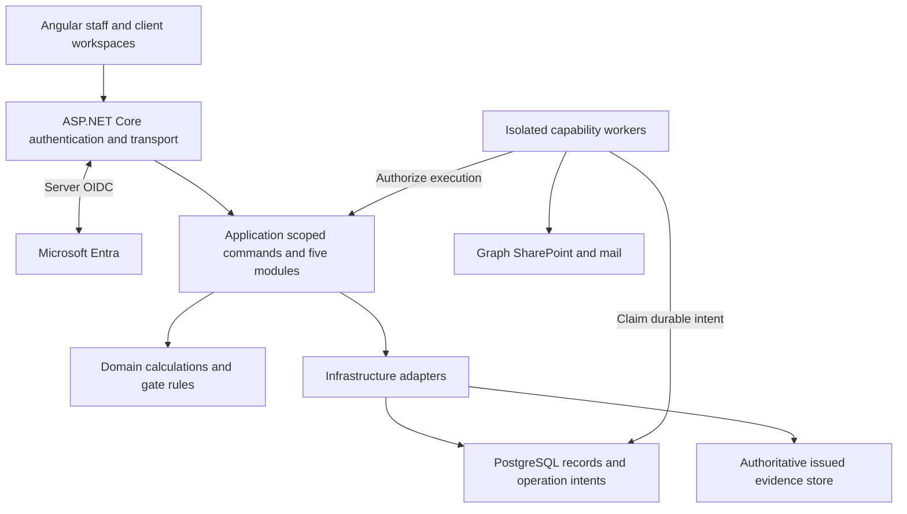
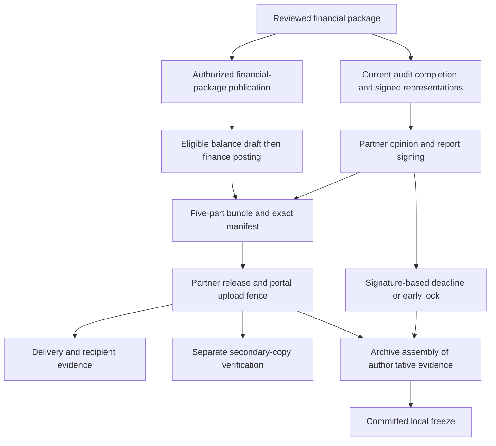

# AuditSphere — Complete Practice Management Requirements and Architecture

| Attribute | Value |
| --- | --- |
| Revision | 2.3 — proposed for adoption |
| Prepared | 24 October 2026 |
| Scope | Five existing modules; seven display phases; eleven derived audit lifecycle states |
| Implementation status | Unverified in this document review |
| Purpose | Canonical proposed specification for the six-file Markdown package |

> **Authority:** This is a review-derived revision candidate. A filename ending in `current` is the requested naming convention; it does not establish approval or implementation. The six repository counterparts were not inspected. Source-reported approved ADRs and executed contracts remain controlling until an authorized change is adopted. Proposed changes and D01–D10 decisions do not silently override them.

The [complete proposed specification](auditsphere-requirements-specification-complete-practice-management-proposed.md) governs the proposed design across this package. The [preserved v2.2 source](auditsphere-requirements-source-ste-audit-management-specification-v22.md) supplies historical requirements and approved source overlays. Companion documents use the same control identifiers and do not add product modules.

## Package and reading guide

| File | Purpose |
| --- | --- |
| [auditsphere-accounting-module-requirements-current.md](auditsphere-accounting-module-requirements-current.md) | All five modules: functional requirements, financial ownership, lifecycle and related controls. |
| [auditsphere-m365-onboarding-user-stories.md](auditsphere-m365-onboarding-user-stories.md) | Proposed Microsoft 365 onboarding and access/recovery stories within existing modules. |
| [auditsphere-requirements-catalog-domain-glossary-current.md](auditsphere-requirements-catalog-domain-glossary-current.md) | Domain definitions, canonical states, control catalogue, acceptance links and source-workflow index. |
| [auditsphere-requirements-source-ste-audit-management-specification-v22.md](auditsphere-requirements-source-ste-audit-management-specification-v22.md) | Complete supplied v2.2 source body preserved unchanged beneath an archival wrapper. |
| [auditsphere-requirements-specification-complete-practice-management-proposed.md](auditsphere-requirements-specification-complete-practice-management-proposed.md) | Full proposed v2.3 requirements and architecture, 165 procedures, 54 scenarios and decision register. |
| [auditsphere-requirements-specification-product-brief-current.md](auditsphere-requirements-specification-product-brief-current.md) | Product objectives, users, boundaries, priorities and package reading guide. |

Read the product brief for orientation, this complete specification for the full contract, the module requirements for functional work, and the focused onboarding/glossary files as needed. Keep the v2.2 source as provenance. These documents were generated from the reviewed HTML and supplied source files; they are not a fresh repository audit.

## Contents

- [Practice management requirements and architecture](#rev-summary)
- [Five modules with complete ownership](#rev-scope)
- [Keep the modular monolith and make authority explicit](#rev-architecture)
- [Derive progress from current evidence](#rev-lifecycle)
- [Commercial and CRM pipeline](#rev-m1)
- [Administration governance and planning](#rev-m2)
- [Technical execution and audit fieldwork](#rev-m3)
- [Reporting final deliverables and archive](#rev-m4)
- [Practice analytics and internal bookkeeping](#rev-m5)
- [Complete audit workprogram traceability](#rev-workprograms)
- [Security operations and release evidence](#rev-assurance)
- [Accept workflows through observed outcomes](#rev-acceptance)
- [Decisions standards and source evidence](#rev-decisions)

## Practice management requirements and architecture

Retain the existing architecture and complete the controls within its five modules. This proposed revision consolidates the attached requirements, resolves contradictory workflow descriptions, and defines evidence needed to accept the system.

**Recommendation.** Continue with ASP.NET Core, Angular, EF Core and PostgreSQL as a modular monolith. The attachments support this architecture. They do not establish a need for a framework migration, additional product modules, a second database, a generic workflow engine, or microservices. The most valuable improvements are precise business rules, versioned financial evidence, coherent approval gates and verifiable recovery.

**Review boundary.** This review inspected the supplied HTML, the v2.2 Markdown requirements and the 20-area audit working process. It did not inspect the current GitHub repository, execute the application, assess a live tenant or certify professional compliance. The original HTML's October 18–19 code and CI statements are preserved as source-reported history. No current implementation percentage is asserted.

### Material findings and recommended changes

| Priority | Finding in the supplied design | Correction in this revision | Evidence |
| --- | --- | --- | --- |
| High | Historical wording, current ADR overlays and previous code claims coexist. | One proposed operative reading, source hierarchy, dated historical pages and separate design versus implementation evidence. | HTML overview (original HTML source), extensions (original HTML source), code alignment (original HTML source) |
| High | Representation-letter verification appears as a bundle dependency after report signing. | Verify signed representations, management authorization of statements and completion evidence before final report dating/signing; recheck their exact revisions at release. | Diagram 12 (original HTML source); v2.2 §4.4.2; workflow area 20 |
| High | The five-part bundle includes a final invoice, while ADR-0007 makes its draft eligible after financial-package release. | Distinguish financial-package publication, balance-invoice approval/posting and final bundle release; keep automation draft-only. Confirm precise command semantics before implementation. | ADR-0007; Diagram 06 (original HTML source); §4.4.2; [D01](#decision-01) |
| High | Approval freshness is specified locally but not as one complete dependency contract. | Pin inputs and invalidate only affected pending approvals when source data, mappings, adjustments, evidence or policy changes. | Diagram 07 (original HTML source), 08 (original HTML source), 14 (original HTML source); [revised gate model](#rev-lifecycle) |
| High | Financial statements and consolidation depend on an incompletely specified reporting context. | Define scoped reporting identity, versions, comparatives, movement evidence, disclosure checks and reproducible output acceptance. | EXT-ACC-01–06; EXT-CON-01–05; [M3](#rev-m3); [M4](#rev-m4) |
| High | Broad SharePoint rights and application engagement permissions have different boundaries. | Retain ADR-0006 and explicitly describe its limitation; track external grants independently. Any narrowing requires an owner decision. | ADR-0006/0009; Diagram 11 (original HTML source); [security](#rev-assurance) |
| High | Timer expiry, local archive freeze, protected storage and observed secondary copy can be mistaken for one guarantee. | Separate these facts; require successful freeze commit, exact-byte verification and recovery evidence. An elapsed deadline means overdue until freezing succeeds. | ADR-0009; Diagram 12 (original HTML source); [M4](#rev-m4) |
| High | Ordinary managerial review is not a complete quality-management applicability model. | Record whether an engagement quality review is required and, when required, independent eligible reviewer completion before report dating. Keep this inside M2/M3/M4. | §1.1, §4.3.3; [IAASB quality management](#ref-quality) |
| Medium | ISQC 1 terminology, fixed materiality percentages and universal confirmation wording are mixed with standards claims. | Update standards references and version applicability; identify firm policy separately. Preserve the stricter Critical-confirmation gate until a separate approved policy changes it. | §1.1, §4.2.4, §4.3.4; [professional decisions](#rev-decisions) |
| Medium | Native bookkeeping, imported accounting and audit adjustments can be confused. | Set one source-of-record mode per client book and period; require reviewed cutover; distinguish proposed, accepted, posted and report-only adjustments. | v2.2 client-accounting boundary; Diagram 08 (original HTML source) |
| Medium | The original profitability formula subtracts charge-out value as if it were actual cost. | Separate standard value, realization, standard-fee contribution, actual cost and posted-ledger P&L. Missing approved cost data produces “unavailable”. | §3.5/§4.5; ADR-0018; [M5](#rev-m5) |
| Medium | Service templates combine internal audit and agreed-upon procedures, while the lifecycle is statutory-audit oriented. | Specify service applicability within existing modules. An AUP or bookkeeping engagement cannot receive a fabricated audit opinion or automatic audit-gate exemptions. | §4.1.4; [service routes](#rev-scope); [D03](#decision-03) |
| Medium | The 20-area audit process needs explicit product traceability. | Retain every source procedure in a versioned workprogram catalogue with applicability, evidence, preparer, reviewer and conclusion. | [Original workflow coverage](#rev-workprograms) |
| Medium | Operating scale, recovery and release acceptance are insufficiently measurable. | Set proposed load, latency, recovery and durability targets; accept them through pinned evidence, including real provider checks. | Diagram 15 (original HTML source); [operations](#rev-assurance); [acceptance](#rev-acceptance) |

### How to use this document

Read this complete proposed specification first, followed by the focused companion files. Retained means the supplied requirements already establish the rule; clarified makes it testable; proposed identifies a change awaiting adoption. The source v2.2 file preserves the original text. The decision register does not silently override approved source decisions.

## Five modules with complete ownership

Existing accounting, consolidation, PBC, workflow, technical-library and platform capabilities remain inside the five-module product boundary. The source's R2R module numbers are retained as provenance; this revision does not add those as separate top-level modules.

| Existing module | Business responsibility | Owns | Boundary |
| --- | --- | --- | --- |
| **M1 Commercial & CRM Pipeline** | Lead through agreed terms | Client/contact profile, group relationships, proposals, dispatched revisions, commercial acceptance, Engagement Letter and commercial fee terms | Risk clearance comes from M2; invoices, cash and firm postings belong to M5. |
| **M2 Administration, Governance & Planning** | Eligibility, resources and plan | Acceptance/continuance, independence, assignments, calendar, service applicability, approved templates, directory provisioning requests, materiality and risk planning | Administrator access does not confer Partner authority. Planning consumes an accepted accounting dataset from M3. |
| **M3 Technical Execution & Audit Fieldwork** | Accounting preparation and audit evidence | TB/GL intake, native client accounting already in scope, mapping, adjustments, reconciliation, consolidation preparation, procedures, PBC, sampling, confirmations, reviews and SRM | Firm books and client books remain separate; consolidation never posts into component books. |
| **M4 Reporting & Final Deliverables** | Reviewed output through archive | Entity/group financial statements, notes, report composition, opinion, signed representations verification, signing, five-part bundle, release manifests, read-only freeze and inspection exports | Consumes M3 snapshots and M5 fee-note records. It cannot auto-approve financial or professional decisions. |
| **M5 Practice Analytics & Internal Bookkeeping** | Firm operations and financial control | Time, capacity analytics, rates, budgets, realization, fee milestones, firm invoices/credit notes/receipts/allocations, expenses, firm ledger, TB, P&L and AR ageing | Client sales/purchase invoices are never firm revenue. Charge-out value is not payroll cost. |

**Supporting capabilities are not new modules.** Identity, authorization, audit events, technical templates, document versioning, scheduled tasks, background operations, notifications and telemetry are shared implementation capabilities of the existing modules. Preserve their current ownership where the repository confirms it; this specification does not require renaming projects or moving every file.

### Source hierarchy and status

1. The user's scope constraint governs this review: improve the existing product without new modules.
2. Approved decisions reproduced in the attached v2.2 Markdown control interpretation where older source prose differs. They remain source-reported decisions; this review does not approve new ADRs.
3. Use v2.2 requirements and their operative overlays together. Keep executed contract terms and historical engagement evidence unchanged.
4. Use the HTML's existing accounting/consolidation extensions and the audit working process to fill detail inside current capabilities.
5. Apply this proposed revision after owner adoption. Entries in [the decision register](#rev-decisions) do not silently overrule existing policies.
6. Historical service names, code presence and earlier CI labels provide investigation leads, not proof of current implementation.

### Existing service routes

| Route already named in the sources | Required interpretation | Completion boundary |
| --- | --- | --- |
| External/statutory audit | Use all applicable audit gates and the existing eleven-state derived lifecycle. | Audited financial statements, audit report, required bundle, archive and professional review. |
| Imported accounting preparation | External books remain source of record. Reviewed adjustments and financial preparation do not imply external posting or an audit opinion. | Reconciled financial package under the selected service mandate and reporting framework. |
| Authorized native client bookkeeping | Activate only for an explicitly authorized book and period, after reviewed opening balances/cutover and applicable independence clearance. | Posted client ledger, reconciliations, period controls and statements. Optional ancillary capabilities do not block the core path. |
| Group consolidation | Group engagement consumes approved component snapshots and authorized external packs. | Group-only adjustments and reviewed consolidated financial output; component ledgers unchanged. |
| Agreed-upon procedures and internal audit | Separate the templates and mandates. ISRS 4400 relates to AUP; it is not a blanket standard for internal audit. Approve applicability before activation. | No automatic ISA opinion or assurance claim. D03 defines missing route details without adding product modules. |

The eleven canonical labels describe the supplied audit lifecycle. Do not rename them, add a parallel state machine or manufacture approvals to accommodate a non-audit service. Record the service mandate and applicability using existing engagement/task/report capabilities. A non-audit route whose contracts and deliverables are not specified remains explicitly unsupported for production until D03 is resolved.

### Retained scope limits

Inventory, payroll, tax and loan audit workprograms test client records; they do not authorize inventory operations, payroll processing, procurement, payment initiation or external tax filing. Purview and external eSignature providers remain outside the approved boundary. WhatsApp remains a lead-source label. There is no new CRM product, HR system, payment gateway, scanning service, analytics warehouse or separate quality-management product in this proposal.

## Keep the modular monolith and make authority explicit

One deployable application boundary, one PostgreSQL database, existing domain ownership and separately credentialed workers provide an appropriate foundation. Enforce business decisions at the server and keep external effects recoverable.

### ARCH-01 Runtime and dependency boundaries

| Component | Responsibility | Must not become authoritative for |
| --- | --- | --- |
| Angular interface | Forms, work queues, seven-phase dashboard, contextual navigation, validation hints and conflict recovery. | Permissions, money calculations, approvals, stage changes or payment completion. |
| ASP.NET Core API | Server-owned sign-in/session, CSRF, request parsing, limits, trusted actor resolution and consistent transport results. | Business eligibility based solely on route attributes or client-supplied role/scope claims. |
| Application layer | Resource-scoped reads, command authorization, independent-review checks, input freshness, transactional workflow and audit receipts. | Pure calculation rules copied into controllers or workers. |
| Domain layer | Deterministic accounting, materiality, risk and lifecycle rules; explicit business invariants. | HTTP, Graph credentials, database querying or browser state. |
| Infrastructure | EF Core persistence, document bytes, Graph/mail adapters, signing implementation and operational stores. | New business approval pathways that bypass Application rules. |
| Worker groups | Lease durable operations; execute only the granted capability; reconcile provider outcomes; reauthorize publication. | Inventing an approving human, posting invoices automatically or declaring a timed-out operation successful. |

Preserve the repository's established project-reference pattern when implementing. The table states responsibilities, not a demand for a dependency-injection rewrite or a new interface for every class. Keep EF Core as the existing persistence mechanism; add only contracts necessary for the changed behavior.

### ARCH-02 Version baseline and compatibility

The supplied .NET 10 / C# 14, EF Core 10, Angular 22 / Material-CDK and PostgreSQL 18 stack is a viable retained baseline. Microsoft lists .NET 10 as LTS through 14 November 2028; the official PostgreSQL release notes confirm 18.6 is a released version. Pin exact compatible SDK, framework, Npgsql provider, Node, TypeScript and package-lock versions after inspecting the repository. Do not upgrade merely to make a document say “latest”. [R1](#ref-dotnet) [R2](#ref-angular) [R3](#ref-postgres)

At this review date the official Angular compatibility table lists Angular 22.0.x with Node `^22.22.3 || ^24.15.0 || ^26.0.0`, TypeScript `>=6.0.0 <6.1.0` and RxJS `^6.5.3 || ^7.4.0`. Use the row matching the exact installed Angular minor; these are compatibility ranges, not observed repository versions. Lock releases and prove the combination in CI.

### ARCH-03 Financial ownership and reporting identity

**Three posting domains remain distinct:** firm practice books, each client legal entity's accounting books, and group consolidation journals. A shared database does not make their posting commands interchangeable. Treat `FirmId`, `ClientId`, `EngagementId`, legal entity/book, financial period and, where applicable, group/run identity as first-class ownership.

A reporting manifest pins the client/entity or group, engagement/service route, period, functional and presentation currencies, framework and edition, accounting-policy revision, source mode, accepted source version, mapping version, approved adjustment set, comparison/restatement basis, relevant rate set and output-template revision. Add workpaper/SRM/representation/opinion/signature references when producing audit deliverables. Use existing entities where possible; the required contract does not assert that a named implementation class already exists.

Use decimal amounts and the existing `numeric(19,6)` design; use decimal strings at money API boundaries and the recorded rounding policy. Validate range and scale before import/posting. Currency settlement/display precision is separate from calculation precision. Record any permitted rounding difference explicitly; never hide an unbalanced posting with a display-rounding adjustment.

### ARCH-04 Relationships and database invariants

- Scope-aware foreign keys/unique constraints and server checks prevent cross-client attachments, payments, mappings, review receipts and journals. Server-resolved identity controls scope; an identifier submitted by the browser grants no authority.
- Enforce one authoritative source mode per client book/period, immutable posted journal identity, unique posting/idempotency receipts and legal-entity invoice-number rules. Published versions are superseded, not overwritten.
- Validate whole-journal balance in the posting transaction and prohibit changes to posted lines except recorded reversal/replacement. Row-level checks alone cannot validate a sum across journal lines.
- Use optimistic revision tokens for forms and reviewed packages; use short locks or an equivalent proven transaction strategy for contended allocations, posting, publication and freeze. Reject stale writes with actionable current-version information.
- Keep business corrections, cancelled work and excluded imports discoverable in history. Hard deletion of issued or posted evidence is not a normal user action.

### ARCH-05 Protected command contract

Every protected command identifies its resource, expected revision, idempotency key when repeatable, requested action and required rationale/evidence. The server supplies the actor and authoritative scope. It authenticates, verifies active scoped grants and professional capacity, evaluates gate/input freshness, commits business change plus audit receipt plus durable intent atomically, and returns a stable result with correlation ID. Repeat the scope/freshness checks within the committing boundary where races matter.

Document error codes for `AUTHENTICATION_REQUIRED`, `FORBIDDEN`, `INPUT_INVALID`, `REVISION_CONFLICT`, `GATE_BLOCKED`, `DEPENDENCY_UNAVAILABLE` and `OUTCOME_UNCERTAIN`; align them to existing HTTP conventions after repository inspection. Do not claim a universal HTTP 423 rule or invent a new lifecycle status. Keep sensitive denial details out of client responses.

### ARCH-06 Transactions and recoverable external effects

Commit the local mutation, audit evidence and operation intent in one local transaction. Perform email, Graph, SharePoint and remote publication outside that transaction. Use scoped, payload-bound idempotency: the same key and same payload returns the prior operation; the same key with a different payload is rejected. Leases need fencing so an expired worker cannot publish after a successor takes ownership. These contracts refine the source's existing operation/outbox design. [R8](#ref-ef-transactions) [R9](#ref-ef-concurrency)

| Failure | Required result and recovery |
| --- | --- |
| Double click or lost local response | Return the original receipt/operation; no second financial posting, document or approval. |
| Provider throttling or known transient failure | Bounded retry with backoff and provider Retry-After; retain the original payload and actor. |
| Timeout after possible remote create/send | Mark the existing operation uncertain and reconcile its deterministic remote identity before retrying a create/send. |
| Worker crash after remote success | Recover and verify the existing remote effect, then complete the local receipt without duplicating the effect. |
| Authority revoked while job waits/runs | Stop future unauthorized effects. Preserve evidence of effects that already happened; require authorized reconciliation before publication. |
| Permanent failure or unexpected provider drift | Show the failed/blocked capability, exact operational reason, responsible owner and an authorized retry/reconcile action. |

Do not promise exactly-once delivery across remote services. Distinguish queued, provider-accepted, delivered where verifiable, and recipient-read where explicitly evidenced. A mail API accepting a message does not prove receipt or reading.

## Derive progress from current evidence

Keep the eleven canonical audit states and seven display phases. Tasks support work; domain commands and valid evidence determine progression.

| Phase | Canonical state | Evidence required to leave the state |
| --- | --- | --- |
| 1 Onboarding | `LEAD_INGESTION` | Validated minimum entity/contact details and scoped proposed service. |
| 1 Onboarding | `PROPOSAL_GENERATION` | Approved exact proposal revision and evidenced email dispatch. |
| 1 Onboarding | `DUAL_KEY_PENDING` | Current commercial acceptance and current unconditional assigned-Partner risk clearance; no blocking hold. |
| 1 Onboarding | `ADVANCE_BILLING` | Authorized Engagement Letter/terms evidence, linked fee agreement, full 50% advance paid and allocated, activation command and required onboarding controls. |
| 2 Planning | `PORTAL_ACTIVE_PLANNING` | Required provisioning evidenced; staffing, accepted TB/mapping, materiality and risk routing current; assigned Partner planning approval. |
| 3 Fieldwork | `FIELDWORK_EXECUTION` | All applicable procedures assigned to fieldwork are submitted against current versions; exclusions/tailoring authorized. Later review/signing/release procedures are due at their own phase gates. |
| 4 Manager review | `MANAGERIAL_REVIEW` | Independent review complete; all blocking notes resolved with reviewer acceptance; current SRM; required confirmations cleared under current policy. |
| 5 Partner sign-off | `PARTNER_APPROVAL` | Partner review/clearance and opinion; required quality review; management-approved statements and verified signed representations; final report signed against the approved snapshot. |
| 6 Report and delivery | `DELIVERABLE_RELEASE` | Five required items pinned, final fee note valid under the agreed sequence, authorized immutable bundle release and evidenced delivery disposition; portal upload fence committed. |
| 7 Archive and close | `COMPLIANCE_COUNTDOWN` | Authorized early freeze or due freeze completes successfully. Secondary SharePoint observation is a separate condition, not inferred from the timer. |
| 7 Archive and close | `ARCHIVED_READ_ONLY` | Terminal for the frozen engagement version; authorized read/export remains. Corrections use explicit linked amendments/reissues, never overwrite the original. |

This is a proposed normalized gate reading, not a claim about current code. D01 covers package/billing semantics, D02 the archive clock and D03 non-audit routes. Gate changes require review rather than inferred implementation. Preserve ADR-0004's projection: no editable stage column and no task completion API that directly sets a lifecycle state.

### CTRL-01 Approval dependency and invalidation matrix

| Change | Pending decisions that become stale or need impact review | Must remain preserved |
| --- | --- | --- |
| Quote revision, fee, scope, service, entity or period | Affected commercial acceptance, letter eligibility and linked fee activation basis; reevaluate risk where its basis changed. | Dispatched offers, authentic responses, executed contracts and payment history. |
| Due-diligence facts, independence/conflict or ownership | Risk clearance and downstream eligibility affected by that clearance; open a hold where required. | Prior decisions and their actual generations/actors. |
| TB/GL source, mapping or approved adjustment set | Materiality, affected risk assessments/lead schedules, financial-package review, affected workpapers and SRM/sign/release eligibility. | Prior imported datasets, original evidence and previously issued report bytes. |
| Procedure result, population/sample or linked evidence | Affected procedure submission/review, dependent SRM and report readiness. Unrelated sections need not be discarded. | Old result, reviewer comments, sample definition and evidence versions. |
| Reporting policy/template, FX rates or comparative/restatement basis | Affected statement/consolidation outputs, reviews and release approvals. | Previously approved reporting contexts and group runs. |
| Representation letter, opinion text, statement approval or final document bytes | Report signature/package acceptance; require correct re-signing and re-release before a new issue. | Original signatures and issue manifest, with supersession relationship. |
| Payment reversal, unallocation or contract amendment | Current commercial eligibility and unexecuted dependent commands; require authorized finance resolution. | Historical activation/release facts; no automatic erasure or withdrawal of an issued audit report. |
| Identity disabled, staff reassigned or scope revoked | Future access, queued operations and new protected decisions. Historical approval validity follows professional impact assessment. | Authentic historical actor identity and completed evidence. |

Record dependency IDs/revisions and calculated digest where appropriate. A current approval proves review of those inputs, not all future revisions. Preserve the original decision, mark current eligibility stale, explain the affected dependency and route only necessary rework. After issuance, immutable release history wins: new evidence creates a correction workflow rather than a silent regression of the issued record.

### CTRL-02 Dashboard and task behavior

The engagement workspace always shows client, entity, period, service route, source mode, phase, responsible staffed person, due date, task progress, gate readiness and next permitted action. Display “Waiting for client”, “Under review”, “Rework required”, “Stale inputs”, “Blocked externally” and “Archive overdue” as explanatory conditions, not new lifecycle states. “100% tasks” never means “approved for release”.

Provide existing My Tasks, Team Work, waiting/review/rework/overdue/completed filters and list/Kanban/calendar views over the same records. Reject cyclic task dependencies, preserve completed task history, pin template versions and recalculate due dates with explicit change evidence. Autosave must expose unsaved/conflict/error status and preserve the user's draft when a revision conflict occurs. Links carry current client/engagement context and handle revoked, superseded or deleted targets safely.

Annual rollover copies approved templates, suitable client facts and mapping suggestions only. Require fresh commercial consent, continuance, staff assignments, TB/materiality, current evidence, reviews and opinion. Never copy prior-year approvals as current, reopen archived files as editable, or imply that imported historical balances have been newly audited.

## Commercial and CRM pipeline

Convert an evidenced client mandate into an engagement without conflating an accepted quotation, professional risk approval, agreed terms or received payment.

### M1-01 Client profiles and communication routing

Retain legal entities, registration/tax identifiers, parent/subsidiary/affiliate relationships and the multi-contact directory. Record contact authority, validity and purpose-specific routing for MD/GM commercial decisions, CFO/finance billing and liaison PBC work. Detect possible duplicate entities before conversion; an authorized merge preserves source IDs, engagements and history. Corporate relationship membership never grants access to another entity's files.

Phone, WhatsApp, email, web forms and in-person referrals remain lead-source classifications. No WhatsApp ingestion/dispatch is implied. Revalidate the actual recipient and allowed contact role immediately before outbound dispatch, not only when the document was drafted. Keep sensitive risk assessments out of customer-visible content.

### M1-02 Quotation and proposal versions

Provide the short quotation and comprehensive proposal with scope, service type, entity, period, currency, fee, 50/50 terms, milestones and approved firm/team content. Draft, review, dispatch and response are distinct facts. Freeze the exact dispatched version and its attachments, recipient, channel, timestamp and provider disposition. Track acceptance, decline, expiry and supersession. A changed fee, period, scope, currency or applicable terms requires a new client response.

### M1-03 Independent dual-key acceptance

Key 1 is acceptance of the exact dispatched offer by an authorized contact, with the approved response-channel label and supporting evidence. Key 2 is current unconditional clearance by the staffed Engagement Partner against the current due-diligence generation. Conditional, missing, rejected, stale or wrong-scope decisions do not satisfy a key. Both keys are required at letter generation and activation. Neither a task checkbox nor an administrator override can manufacture them.

Keep two approval cards with owner, status, version, date and evidence; show Engagement Letter eligibility separately from the advance-payment card. A declined proposal can be revised/re-dispatched or closed with a recorded reason. New facts after acceptance trigger targeted reassessment and an appropriate hold.

### M1-04 Engagement Letter and agreed terms

Generate only from the current dual-key clearance and appropriate versioned service template. Record legal entity, scope, period, responsibilities, reporting framework, fee schedule, deadlines and authorized signatories. Distinguish generated, Partner-authorized, dispatched and accepted/executed terms. Quote acceptance alone must not be presented as proof of the client's acceptance of a materially different Engagement Letter.

Retain existing signature/seal policy and the Microsoft identity route. Do not email temporary passwords. Capture evidence that engagement terms are agreed before professional work begins; if a specific mandate uses a different legally valid evidence form, pin that approved form. An amendment to an executed engagement is a new linked version, not an overwrite.

### M1-05 Advance and activation handoff

M1 supplies the accepted fee/letter basis to M5. Optional automation, disabled by default, may create an advance invoice draft. Separate authorized actions approve/post/send it and record cash. Activate only when the linked 50% ADVANCE milestone is fully paid and allocated, both acceptance keys remain current and all other applicable onboarding holds are clear. An issued invoice, receipt draft, promise to pay or partial payment does not unlock planning.

For a QAR 20,000 agreement the required advance is QAR 10,000. A QAR 6,000 receipt plus a QAR 4,000 receipt unlocks the payment gate only after both are validly recorded and allocated to that advance. Reversing an allocation opens a current finance exception; it never deletes the earlier activation evidence. Existing executed contract terms are preserved.

### M1-06 Onboarding outcomes and recovery

Expose exact blockers for absent client consent, stale risk approval, unsigned/unagreed terms, unallocated receipts, identity provisioning or provider failure. Keep business readiness separate from technical provisioning. Use one authorized activation receipt; retries reuse it. If provisioning partially succeeds, retain remote IDs and reconcile before another create. Client access remains limited until its full activation conditions are satisfied.

Traceability: v2.2 §§3.1, 4.1, 6.3; ADR-0003/0007/0012/0017; HTML M1 baseline (original HTML source) and commercial flow (original HTML source). Terms-evidence and recovery detail are proposed clarifications; executed contracts are not changed.

## Administration governance and planning

Make eligibility, review independence and the plan explicit before execution. Record professional judgment and its evidence; calculations support the decision.

### M2-01 Acceptance continuance and independence

Preserve separate new-client and annual-continuance questionnaires, including beneficial ownership, AML/KYC, integrity, conflicts, independence, litigation, fraud, finance changes and prior-year fees. Retain RV-031 and RV-032 and their approved adverse-answer meanings. Missing information, adverse answers and changes route to remediation or a recorded decision; they do not disappear through a score. Keep documents, answers, evidence and decisions versioned.

Where the firm also prepares books or financial statements, record the professional assessment of self-review and other independence threats for that engagement. Management must retain responsibility for client records, accounting judgments and statement approval. A product capability flag does not establish that the firm may legally/professionally provide the combined services. Define required safeguards and assignments within existing governance.

### M2-02 Roles assignment and independent review

Preserve PREPARER, REVIEWER, APPROVER and CLIENT as the business personas while using existing scoped capabilities for finance, administration and technical operations. Require a staffed Partner for acceptance, planning approval, high-risk/SRM clearance, opinion, report signing, signed-representation verification and bundle assembly. A technical administrator or firm-wide directory role is insufficient.

Prevent self-review of workpapers, adjustments and protected approvals where independence is required. Acting at two seniority levels does not make a person independent of their own preparation. Record reassignment, delegation limits, absence coverage and current professional eligibility. Amber work is performed by Senior Auditor or above and reviewed by an Audit Manager. Preserve mandatory Manager execution/Partner review for Red work unless an approved source decision states a narrower rule.

### M2-03 Quality-review applicability

Replace stale ISQC 1 references with the applicable ISQM 1, ISQM 2 and ISA 220 (Revised) context. Add an engagement-level decision recording whether an engagement quality review is required, why, the eligible independent reviewer and completion evidence. When required, incomplete review blocks report dating/signing. This is an applicability control in existing governance/review, not a new module. The application does not, by itself, constitute the firm's whole quality-management system. [R4](#ref-quality)

### M2-04 Capacity calendar and deadlines

Use the Sunday–Thursday firm workweek, Friday/Saturday weekend and Sunday–Saturday allocation week from ADR-0017. Track actual availability, leave and recorded public holidays without inventing a holiday table. Show over-allocation/conflicts before assigning work; retain authorized exceptions. Set milestones relative to the engagement's actual statutory/contract deadline rather than hard-coded example dates.

Store instants in UTC, display business times in Asia/Qatar by default and treat financial dates/date-only deadlines consistently. A change to year-end or deadline recalculates proposed dates for review and preserves prior commitments. Do not silently move completed tasks or statutory deadlines.

### M2-05 Workspace and reusable templates

Retain one SharePoint site per client and the five-folder taxonomy: Administration & Planning; Trial Balance & Schedules; Fieldwork & Testing; Drafts & Deliverables; Final Signed Archive. Verify the intended tenant, site marker, library and grants rather than trusting a URL or folder name. Distinguish reserved/requested/provisioned/observed facts; failed provider work remains visible.

Version technical-library content, task templates, workprograms and industry variations. Each engagement pins a published version. Changes to the library do not rewrite active or historical work. Require an authorized tailored-program review; record additions and exclusions with reasons and risk links. Maintain existing technical reference and knowledge content without adding a separate product module.

### M2-06 Materiality and risk policy

Retain the approved unnormalized PBT benchmark (mapped balances excluding tax), Revenue, Assets and Equity/Net Assets alternatives. Require an accepted dataset, reproducible benchmark account membership, rationale for the selected base/percentage and assigned-Partner approval. Zero, negative or inappropriate bases require selection of another professionally justified benchmark; do not silently take an absolute PBT or normalize it.

| Existing policy value | Proposed precise interpretation |
| --- | --- |
| PBT 5–10%; revenue 0.5–2%; assets 0.5–1%; equity/net assets 1–2% | Firm policy ranges requiring documented judgment; not percentages mandated by ISA. |
| PM | Use the source abbreviation for overall/planning materiality; label it clearly to avoid confusion with performance materiality. |
| TE / performance materiality 50–75% of PM | Preserve the configured source rule; distinguish engagement performance materiality from tolerable misstatement for a specific sample. |
| SAD threshold 3–5% of PM | Label “clearly trivial threshold”; the schedule of audit differences is the record, not the threshold itself. Qualitative concerns remain recordable. |
| Rounding within ±5% | Store raw value, proposed rounded value, difference and reviewer rationale; preserve the cap and approval. |
| Green / Amber / Red | Routing indicators using absolute FSLI exposure and qualitative overrides. Green is not automatic exclusion from work. |

Preserve the critical-estimate Red override and high inherent-risk definition of likelihood 3 with magnitude at least 2. D04 proposes equality handling as Red at or above PM and Amber at or above TE below PM, subject to professional approval and reconciliation with actual existing rules. Until resolved, equality must not fall through an unclassified branch. Sampling or full-population testing remains documented senior judgment, not a universal sample requirement.

### M2-07 Planning approval and applicability

Approve the current scope, service mandate, reporting framework/edition, applicable workprogram, risk/assertion responses, materiality, staffing, review routing and milestones as one versioned plan. Link each significant risk to its planned procedures and responsible reviewer. New source data, materiality, risks or tailored program changes trigger impact review and invalidate affected approval eligibility. Required procedures cannot be deleted by an ordinary task edit.

Traceability: v2.2 §§4.2, 6.3–6.5; ADR-0011/0017/0018; HTML planning/fieldwork (original HTML source); workflow area 1. Quality-review applicability and the clarified policy vocabulary are proposed completions within this module.

## Technical execution and audit fieldwork

Preserve the financial source, record every transformation and connect each conclusion to evidence. The same approved numbers feed the financial statements and audit working papers.

### M3-01 TB and GL intake with accountable mapping

Stage uploaded Excel/CSV data with file hash, uploader, source system, entity, period, currency, sheet/row lineage, row counts, source debit/credit totals and import-schema version. Preserve original bytes and accepted normalized records. Reject wrong-scope/period/currency data, duplicate keys that break the chosen grain, invalid precision and unbalanced accepted TBs. Quarantine errors and show an actionable row-level report. No hidden balancing plug or partial publication.

Specify the source grain: opening/movement/closing totals or a closing-balance TB, and do not sum cumulative snapshots as movements. Accept a distinct GL population with dates and journal/line identity; validate its relationship to the TB and any exclusions. A duplicate upload is a detected repeat or a deliberately superseding version. Large files use bounded background staging and cancel safely before publication.

Version the chart and FSLI taxonomy; reject parent cycles and invalid mappings. Historical mapping memory proposes matches, which an authorized reviewer confirms. Every posting account with relevant balance/movement must map or have a reviewed disposition. Mapping approval pins the dataset and chart; changing either makes the affected mapping/outputs stale. Comparative opening balances reconcile to the prior-year approved closing basis, with explicit differences/restatement evidence.

### M3-02 Adjustments and the financial close bridge

Maintain the bridge **original accepted TB + included approved adjustments/reclassifications = adjusted reporting TB**. Every entry has balanced debits/credits, scope/period/currency, explanation, category, supporting evidence, preparer and independent reviewer. Keep proposal, management response, audit approval, client-book posting and report inclusion as different facts. Record rejected/unadjusted differences in the misstatement schedule rather than losing them.

Link a posted native-book adjustment to its proposal. If an updated source TB already contains it, do not add the same adjustment again as a reporting overlay. Reversals reference the original and create new evidence. Compare aggregated and qualitative unadjusted differences with the approved materiality basis; record the Partner's conclusion and impact on the report. An automatic threshold does not select an opinion.

### M3-03 Authorized native client bookkeeping

Keep external-source mode for existing clients until an explicit approved cutover identifies book, period, opening TB, supporting receivable/payable balances, source freeze boundary and reconciliation. Activate native mode only after balanced opening data and authority checks. Subsequent TB/GL exports come from posted native records; a parallel external TB cannot become a second source of truth for the same period without a reviewed transition.

Complete the existing journal, sales/purchase invoice and credit-note paths: draft, review, posting, numbering, due date, currency, accounts, cancellation before posting, and credit/reversal after posting. Posting is atomic and balanced. Track receipts/payments as records and allocations; this does not initiate bank payments. Prevent over-allocation, double allocation, cross-client settlement and posting into closed periods. AR/AP controls reconcile to the GL.

Close a period only after required journals, reconciliations and checks pass. Reopening requires scoped authority, reason, impact assessment and preservation of the old closing snapshot; affected reports become stale. Tax/VAT and ancillary capabilities remain individually gated. Do not make them a prerequisite for the core non-tax bookkeeping path or imply universal tax readiness.

### M3-04 Reconciliations and movement schedules

Reconcile bank, AR, AP, inventory and fixed-asset schedules to the applicable GL/TB; retain source population, control total, difference, reconciling items, explanation, evidence and reviewer. Record unresolved differences even below materiality; a threshold changes attention or review policy, not arithmetic truth. Build lead schedules with opening balance, additions/movements, approved adjustments and closing balance. A signed schedule references the actual source and workpaper version.

### M3-05 Workprogram evidence and sampling

Implement all [20 source areas and 165 procedures](#rev-workprograms) as reusable workprogram content. Each procedure records applicability, assertion/risk, objective, method/population, selection method where applicable, work performed, evidence, exception, conclusion, preparer, reviewer and version. N/A requires authorized reasoning; “done” without evidence or a documented conclusion is insufficient. Preserve digital and physical-binder references, including location and custody where relevant.

MUS, systematic random and stratified methods retain population hash/version, units, parameters, seed or deterministic selection basis, selected IDs, exclusions and judgment. Validate zero/negative amounts and duplicated population items according to the method. Do not substitute an unsupported sample formula for professional assessment. Full-population testing is allowed with documented judgment. Altering a population or sample invalidates the affected testing conclusion.

Keep the split P&L/B/S workspace with current/prior balances, movements and links to analytical review/workprograms. Label unavailable/zero-baseline percentage comparisons instead of inventing infinite or zero percentages. Independent work on different rows proceeds concurrently; edits to the same reviewed result produce a revision conflict, not a silent overwrite.

### M3-06 PBC and controlled confirmations

Each PBC request identifies requested item, entity/period, owner, due date and acceptable evidence. Each upload is a new version linked to the request; show Pending Upload, Under Review, Approved or Rejected/Re-upload Required with the auditor's rejection reason. Requests for clarification preserve earlier files and comments. Freeze upload permissions on final release; retain authorized download access under the closure policy.

Track confirmation target, independent contact verification, dispatch evidence, response source, differences, reminders, alternative procedures and reviewer conclusion. Auditor-controlled routing and original evidence must not be replaced by an unchecked client-forwarded response. Preserve the approved Critical flag and its holding-letter/release block until the critical requirement is satisfied. Holding-letter generation does not mean it was sent or received.

ISA 505 distinguishes nonresponses requiring alternative work from cases where a necessary positive confirmation cannot be replaced by alternatives. The existing Critical rule is a stricter firm release policy; changing it needs D05. Do not silently downgrade a Critical item to bypass a block. [R5](#ref-handbook)

### M3-07 Review points and completion

Submit an immutable result version; independent reviewers accept it or return it with mandatory actionable comments. A preparer response does not close a review point until the authorized reviewer accepts it. Track open/resolved/reopened notes, linked procedure, accountable owner and history. No unresolved blocking note, stale approval or missing applicable procedure may disappear from the completion checklist.

Compile the SRM from the actual current risk, workpaper, confirmation, misstatement, estimate, going-concern and subsequent-event records. The Manager's recommendation and Partner's clearance are human decisions pinned to that SRM version. Complete required EQR before report dating. A change after completion creates explicit impact review/rework.

### M3-08 Group consolidation without component mutation

Retain group/perimeter, ownership, component reporting packs, currency translation, intercompany matching and group-only journals. Approve the control/consolidation assessment; ownership percentage alone does not prove control. Pin component entity/book/period, framework/policies, currency, source and mapping versions, authorization and reviewed external-pack provenance. Reject incompatible periods or provide the professionally approved alignment evidence. [R11](#ref-ifrs10)

Use reviewed purpose-specific FX rates and dates; closing, transaction, average and historical rates are not interchangeable. Any permitted average must be justified by the applicable policy. Reconcile CTA, equity and NCI from approved ownership/rate information; do not default every equity movement to a closing rate. [R12](#ref-ias21)

Intercompany matches consume identified source exposures once; partial matches track remaining quantities/amounts. Differences route for resolution rather than an unexplained plug. Balance elimination journals and record the approved run inputs. Changes create a new run; no elimination or consolidation workflow writes to a component client ledger. Preserve before/after component financial-data hashes and version counts as acceptance evidence.

Traceability: v2.2 §4.3 and client-accounting boundary; HTML EXT-ACC-01–06, EXT-CON-01–05, 07 (original HTML source), 08 (original HTML source), 09 (original HTML source); complete DOCX workflow. The detailed failure contracts are proposed clarifications of these existing capabilities.

## Reporting final deliverables and archive

A reproducible financial package, a signed audit report and an externally delivered bundle are distinct artifacts. Their approval and issuance must refer to the same versioned evidence.

### M4-01 Complete financial statement package

Generate entity/group statements only from the pinned approved reporting context and adjusted/consolidated dataset. Support the already-scoped statement of financial position, profit or loss and applicable comprehensive-income presentation, cash flows, changes in equity, comparative figures, accounting policies and notes. Each output line and numeric note can be traced to mapping, source rows, adjustments or an approved supporting schedule.

Validate assets = liabilities + equity; profit/OCI movements agree to equity; opening + movements = closing for each equity component; cash-flow closing cash agrees to the approved balance-sheet cash reconciliation; and note totals/cross-references agree to the primary statements. Capture non-cash movements, acquisitions/disposals, FX and other reconciling items explicitly. A cash-flow statement cannot be reliably inferred from two TB snapshots alone.

Use a versioned disclosure checklist with applicability, preparer, reviewer, linked evidence and rationale for N/A. Flag missing narrative, unresolved estimates, stale notes and comparative inconsistencies. No unreviewed “IFRS compliant” watermark or automatic compliance certification. Management authorization of the complete statements, including notes, is separate from the auditor's review.

### M4-02 Output formats and version identity

Produce genuine PDF, DOCX and XLSX outputs from one typed approved presentation dataset, retaining report ID, period, currency, status and template revision. Keep draft/approved/issued states visible; an export does not approve the data. Verify totals and content match across formats, fonts and pagination are readable, required notes are present and cross-references resolve. Editable exports are convenience copies; identify the exact issued signed artifact as authoritative.

Pin rendering inputs and preserve the exact issued bytes/hash. Re-rendering may change non-business metadata, so the issued artifact is retrieved from immutable storage rather than recreated and assumed byte-identical. Corrected financial figures or wording require a superseding reviewed version.

### M4-03 Prerequisites before report signing

Before the Partner dates/signs the final auditor's report, require current completed procedures/reviews, resolved Critical-confirmation blockers, final materiality/misstatement conclusions, current SRM and Partner clearance, completed required EQR, management authorization of the exact financial statements, verified signed management representations, and current going-concern/subsequent-event work. Check signatories, periods, financial figures and evidence versions.

Written representations must be dated close to, and no later than, the auditor's report date. A representation-letter template awaiting signature is not the required signed evidence. Generate templates early; include the completed representation evidence in the final package. This moves a critical check ahead of signing and repeats it at release. [R5](#ref-handbook)

### M4-04 Opinion and report construction

Keep the Partner-exclusive four-way selector, with “Unmodified” as the standard label and “Clean/Unqualified” as familiar explanatory terminology. Qualified, adverse and disclaimer reports require the professional basis, affected matters and quantitative/qualitative reasoning, with applicable FSLIs/disclosures. Support a pervasive or evidence-limitation matter without forcing a fictitious single FSLI. Validate that required sections match the selected template/framework.

The software can assemble approved text and show consistency checks; it cannot infer the opinion merely from materiality, a dropdown, a score or missing confirmation. Going-concern sections, emphasis/other-matter paragraphs and key audit matters where applicable need explicit applicability and professional review. They are not extra opinion categories or new modules.

### M4-05 Signature and seal contract

Preserve the visible PNG signature/seal and the optional/required firm-certificate policy from ADR-0005/0016. Record signing mode, approved signer/authority, exact document digest, certificate identity where used, signing result and validation evidence. Visual-only output is permitted only when certificate signing is optional and no certificate is configured. Required-but-missing material blocks signing. Any configured but invalid or unusable certificate blocks signing even when the required flag is false; there is no silent image-only fallback.

A PNG is visual appearance, not cryptographic protection. A CMS signature is not automatically a PDF-native PAdES signature, a trusted timestamp or long-term validation. Define the actual supported format, certificate-chain/expiry/revocation handling and verification method in D06. Do not claim a legal signature level the implementation and qualified review have not established. Keep private signing material outside browser/UI access and out of ordinary audit logs.

### M4-06 Financial package fee note and final bundle sequence

**Recommended D01 interpretation:** an authorized release/publication of the approved financial package is a separate event from releasing the final five-part client bundle. Only after the linked package is released and the full advance is paid may the existing automation create a balance-invoice draft. An authorized finance actor separately reviews/posts the final fee note. Bundle assembly then references that immutable fee-note version. This removes the circular prerequisite and preserves draft-only automation.

Confirm these event names and semantics against the existing commands before implementing; do not silently relabel client delivery as an internal release. If the current product has one conflated command, split the responsibilities within M4/M5 using the smallest change and an explicit adopted decision. Never reinterpret executed 50/50 contracts or introduce final-payment-before-report withholding through this document.

| Required final bundle item | Required readiness |
| --- | --- |
| 1 Auditor's report and audited financial statements | Same approved context; final report signed under policy; exact authoritative bytes retained. |
| 2 Management Letter | Reviewed deficiency, impact, recommendation and management response where relevant; explicit reviewed no-findings document if applicable. |
| 3 Letter of Representation | Completed signed version verified before report signing; template and prior versions retained separately. |
| 4 Management Correspondence audit trail | Reviewed client-appropriate correspondence/confirmation summary. Exclude internal AML, confidential reviewer notes and unauthorized third-party data. |
| 5 Final balance fee note | Correct contract/milestone, approved/posted invoice version, currency and remaining fee; not an unsent draft mislabelled as issued. |

### M4-07 Release delivery and client freeze

Reevaluate current authority, dependency pins and all bundle gates at release. Persist a manifest containing each item ID/version/hash, reporting context, signing evidence, Partner authorization, recipients and release time. Commit the authoritative issued record and upload fence atomically with the outbound intent. A changed file invalidates the prepared bundle; it cannot inherit the prior signature or approval.

Allow only authorized recipients/download grants; expire/revoke access under policy without deleting issued evidence. Track prepared, released and delivery disposition independently. Provider acceptance does not prove client receipt; retain proof of portal availability/download or other verified delivery where available. Failed transmission remains recoverable without issuing a different bundle or removing the upload fence. No new payment gate is imposed on report delivery.

### M4-08 Archive assembly retention and corrections

Retain ADR-0009: the authoritative append-only release/archive store holds issued evidence, and the SharePoint archive is a separate secondary copy. `OBSERVED` applies only after exact hashes and expected grants are read back; otherwise preserve its blocked/pending condition. Read-only grants are not a guarantee against a privileged administrator. Hashes detect changed content; they do not prevent all deletion or tampering.

Retain the approved signature-based 60-day timer pending D02. Record report date separately and flag any discrepancy affecting professional assembly timing. ISA 230 describes final-file assembly ordinarily within 60 days after the report date; this is distinct from retention. During assembly, do not treat new audit work or new conclusions as routine administrative cleanup. [R5](#ref-handbook)

Timer expiry requests a freeze; only a successful committed freeze produces `ARCHIVED_READ_ONLY`. A failed/overdue freeze is visible and escalated. Do not invent `ARCHIVED_LOCKED`. Retention duration, legal holds and disposal authorization need a qualified jurisdiction/firm policy; sixty days is not deletion eligibility. Preserve the original frozen version. Later permitted additions/corrections record why, who, when and review, with a linked supplementary record or superseding issue; ordinary users cannot edit the original.

Regulator/inspection exports include the permitted manifest, evidence index, provenance and decision history; verify hashes and scope before export. Restricted third-party/internal information follows explicit recipient authorization. Customer-master archival, engagement freeze and financial-period close remain different operations.

Traceability: v2.2 §4.4, ADR-0005/0007/0009/0016/0017, EXT-ACC-06, EXT-SEC-01–04, Diagram 12 (original HTML source); workflow areas 16–20. D01/D02/D06 preserve unresolved business/professional choices visibly.

## Practice analytics and internal bookkeeping

Separate work performed, standard charge-out value, actual costs, invoices, collected cash and recognized revenue. Each measure must explain its basis and source.

### M5-01 Time budget and rate history

Record time against authorized engagement, phase/task and valid applicable FSLI where supplied. Require date, duration, billable/no-charge classification and narrative proportionate to the work. Reject invalid/negative durations, incompatible scope and duplicate submissions; show overlaps or unreasonable daily totals for review. Time moves through draft/submitted/approved/rejected states with reason and edit history. Amend approved time through a reviewed correction.

Retain effective-dated rates and the Senior/Supervisor/Junior/Associate aliases. Snapshot the rate basis used for approved calculations; later rate edits do not silently reprice historic reports. The source's QAR 1,000/750/500/200 rates are policy inputs, not an assertion about real staff costs. Show missing rate/currency as unavailable. Track original budget, approved revisions, actual approved hours and remaining forecast separately.

### M5-02 Financial metric definitions

| Metric | Definition for adoption | Guard |
| --- | --- | --- |
| Approved actual hours | All approved billable and non-billable/no-charge time. | Exclude draft/rejected time; retain corrections. |
| Standard charge-out value | Sum of approved billable hours × applicable charge-out rate. | No-charge time has zero charge-out value; missing rate/currency makes the metric unavailable. |
| Contract realization | Agreed net contract fee ÷ standard charge-out value. | Label contract basis; zero/missing denominator is undefined, not 0% or 100%. |
| Standard-fee contribution | Agreed net contract fee minus standard charge-out value. | ADR-0018 billable-time basis; this is not accounting profit or actual staff-cost margin. |
| Actual engagement resource cost | All approved hours × approved internal cost rate, plus included approved direct costs. | Proposed cost view only where approved cost data/visibility exists; otherwise unavailable. Do not substitute charge-out rates. |
| Utilization | Approved billable minutes ÷ scheduled capacity net of recorded unavailability. | Same period/scope; show all approved hours separately; zero capacity is undefined. |
| Billing and collections | Posted net firm invoices/credits and allocated cash, shown independently. | Do not treat an invoice as received cash or presume billing equals revenue recognition. |
| Firm accounting profit | Posted recognized income less posted expense under the approved firm accounting policy. | Reconcile to the firm ledger and period; not the contract-contribution calculation. |

The source approves standard-value/realization/contribution and utilization bases; resolve any ambiguous numerator or additional staff-level measure in D07 before changing a live dashboard. Restrict salary/cost-rate and individual performance visibility to explicitly authorized users. Do not publish rankings or infer personnel decisions from these figures.

### M5-03 Fee agreements invoice lifecycle and allocations

Pin fee agreements and ADVANCE/BALANCE milestones to the accepted letter/terms. Preserve the unconditional fully paid advance gate. Default-off automation creates drafts only, after the correct eligibility event. Authorize invoice review/post/send and cash/credit actions separately. A posted invoice maps unambiguously to its approved fee basis/milestone; refuse ambiguous multiple-milestone reporting rather than double-counting it.

Capture payment date, currency, bank/cheque reference, amount, posting record and allocation. Allocation cannot exceed available receipt or open invoice amount; preserve unallocated credits and partial balances. Concurrent allocation is serialized or otherwise proven safe. A correction uses credit, reversal or unallocation history; it never edits posted facts in place. Receipt dispatch has its own evidentiary status.

A fully paid advance is a commercial activation condition, not an automatic revenue-recognition rule. The approved accounting policy determines advance/deferred-income or receivable postings and subsequent recognition. Prevent duplicate recognition when the final fee is billed. Refund, write-off, overpayment and contract-change handling must preserve approval, account impact and the original audit trail; D07 resolves policy choices.

### M5-04 Firm ledger and period control

Retain the firm's chart, balanced journal posting, rent/facilities, salaries/benefits, overhead, petty cash and Partner withdrawals. Classify withdrawals under the approved equity/current-account policy rather than automatically treating them as expenses. End-of-service benefits follow ADR-0010 as a person-entered provision/accrual with evidence and approval; no autonomous legal-benefit estimate is introduced.

Use the same reviewed posting, reversal, period-close and correction controls as appropriate to firm books. Link invoicing, receipts and expenses to resulting ledger entries and reconcile receivable controls. Native client invoices, audit proposed entries and group elimination journals never enter the firm's ledger. Preserve the financial domain in every posting/export endpoint.

### M5-05 Management reports and reconciliation

Produce a firm TB, one P&L row per accounting month with the same month one year earlier, approved budget/actual hours and contract-value analysis, and as-of-date AR ageing for all posted firm invoices (advance, final, time or other). Calculate outstanding amounts using transactions effective at the requested date; future receipts do not alter historical ageing. Reconcile the receivables report to the ledger control with explicit credits/adjustments.

Use agreed due-date ageing buckets, consistent timezone/date rules and a clear treatment of credits/overpayments. Never include client-bookkeeping receivables. Multi-currency reports show source currency and approved translation basis instead of adding unlike currencies. Users can drill from a total to the permitted underlying invoices/time/ledger records without bypassing scope.

Traceability: v2.2 §§3.5, 4.5; ADR-0007/0010/0012/0018; EXT-FIN-01–04; Diagram 10 (original HTML source). Cost visibility, recognition and broader fee exceptions remain professionally owned decisions rather than invented settled policy.

## Complete audit workprogram traceability

The uploaded working-process document contains 20 areas and 165 procedures. Every procedure is retained below in source order with a stable identifier assigned by this revision.

These are audit work areas, not additional product modules. Payroll, inventory, tax and loans are tested using supplied client records; this catalogue creates no payroll, stock, tax-filing or lending system. The source programme is a starting point for qualified engagement tailoring, not proof that all audit situations are covered.

Each adopted procedure needs an applicability decision, risk/assertion/FSLI link as relevant, owner, evidence, work performed, finding/conclusion, preparer submission, independent review and version. A procedure that does not apply needs a reviewed reason. Preserve originals when adding engagement-specific work. The identifier format `WF-01-01` means source area 1, procedure 1; these identifiers were not present in the original file.

| Source ID | Original audit area | Procedures | Owner | Required product evidence |
| --- | --- | --- | --- | --- |
| [WF-01](#WF-01) | Planning & Risk Assessment | 9 | M2, M3 | Accepted source, opening-balance tie-out, risk/assertion response and approved plan. |
| [WF-02](#WF-02) | Cash & Bank | 8 | M3 | Bank/ledger/statement/confirmation reconciliation with reviewed reconciling items. |
| [WF-03](#WF-03) | Trade Receivables | 9 | M3 | Ageing tie-out, responses/alternatives, subsequent receipts, cut-off and ECL evidence. |
| [WF-04](#WF-04) | Inventory | 8 | M3 | Count/valuation/NRV/cut-off workpaper; client inventory listing remains the source. |
| [WF-05](#WF-05) | Revenue / Sales | 8 | M3 | Revenue population, risk-based selections, source documents, credit notes and cut-off. |
| [WF-06](#WF-06) | Purchases & Trade Payables | 8 | M3 | Payables reconciliation, confirmations, subsequent payments and unrecorded-liability search. |
| [WF-07](#WF-07) | Fixed Assets | 9 | M3 | Asset roll-forward, additions/disposals, depreciation, capitalization and impairment review. |
| [WF-08](#WF-08) | Expenses | 9 | M3 | Expense reconciliation, analytics, approvals, classifications and cut-off tests. |
| [WF-09](#WF-09) | Payroll | 8 | M3 | Payroll testing on client records; contracts, recalculations and payments, without payroll execution. |
| [WF-10](#WF-10) | Loans & Borrowings | 9 | M3 | Loan roll-forward, confirmations, terms, interest, classification and covenant evidence. |
| [WF-11](#WF-11) | Equity / Share Capital | 7 | M3, M4 | Equity movements, authorized capital/dividends and retained-earnings reconciliation. |
| [WF-12](#WF-12) | Related Parties | 7 | M2, M3, M4 | Related-party completeness, balances/transactions and disclosure review. |
| [WF-13](#WF-13) | Tax & Statutory Liabilities | 7 | M3, M4 | Tax source computations, liabilities, payments and disclosures; no external tax filing. |
| [WF-14](#WF-14) | Journal Entries & Fraud | 8 | M3 | Complete journal population, unusual entries, authorization and fraud/override conclusions. |
| [WF-15](#WF-15) | Analytical Review | 8 | M3 | Comparative analytics and ratios with supported explanations and defined denominators. |
| [WF-16](#WF-16) | Going Concern | 9 | M3, M4 | Management assessment, forecast/assumption evidence and dated auditor conclusion. |
| [WF-17](#WF-17) | Subsequent Events | 8 | M3, M4 | Dated post-year-end coverage and adjustment/disclosure disposition before report. |
| [WF-18](#WF-18) | Financial Statements & Disclosures | 9 | M4 | All primary statements, comparatives, notes, policies and mathematical cross-checks. |
| [WF-19](#WF-19) | Audit Differences & Adjustments | 7 | M3, M4 | Adjustment disposition, management response, posting evidence and unadjusted differences. |
| [WF-20](#WF-20) | Final Completion & Audit Report | 10 | M3, M4 | Current completion evidence, cleared reviews, representations, approvals and signed output. |

### WF-01 · Planning & Risk Assessment (9 procedures · M2, M3)

**Completion evidence:** Accepted source, opening-balance tie-out, risk/assertion response and approved plan.

1. **WF-01-01** Obtain company registration documents and basic company information.
   Due at: Planning approval
2. **WF-01-02** Obtain prior-year audited financial statements and audit report.
   Due at: Planning approval
3. **WF-01-03** Obtain current-year Trial Balance and draft financial statements.
   Due at: Planning approval
4. **WF-01-04** Agree opening balances with prior-year audited balances.
   Due at: Planning approval
5. **WF-01-05** Understand the nature of business, major revenue streams and accounting system.
   Due at: Planning approval
6. **WF-01-06** Identify significant account balances and transaction classes.
   Due at: Planning approval
7. **WF-01-07** Identify significant audit risks, fraud risks and areas involving management judgement.
   Due at: Planning approval
8. **WF-01-08** Determine materiality and performance materiality.
   Due at: Planning approval
9. **WF-01-09** Prepare the audit strategy and audit program.
   Due at: Planning approval

### WF-02 · Cash & Bank (8 procedures · M3)

**Completion evidence:** Bank/ledger/statement/confirmation reconciliation with reviewed reconciling items.

1. **WF-02-01** Obtain bank reconciliation for all bank accounts at year-end.
   Due at: Fieldwork submission; review follows
2. **WF-02-02** Agree bank ledger balances with the Trial Balance.
   Due at: Fieldwork submission; review follows
3. **WF-02-03** Agree bank reconciliation balances with year-end bank statements.
   Due at: Fieldwork submission; review follows
4. **WF-02-04** Obtain direct bank confirmations and reconcile confirmed balances.
   Due at: Fieldwork submission; review follows
5. **WF-02-05** Check outstanding cheques, deposits and other reconciling items.
   Due at: Fieldwork submission; review follows
6. **WF-02-06** Investigate old or unusual outstanding items.
   Due at: Fieldwork submission; review follows
7. **WF-02-07** Test selected bank transactions to supporting documents.
   Due at: Fieldwork submission; review follows
8. **WF-02-08** Review subsequent bank statements for unusual transactions.
   Due at: Fieldwork submission; review follows

### WF-03 · Trade Receivables (9 procedures · M3)

**Completion evidence:** Ageing tie-out, responses/alternatives, subsequent receipts, cut-off and ECL evidence.

1. **WF-03-01** Obtain the year-end receivable ageing report.
   Due at: Fieldwork submission; review follows
2. **WF-03-02** Agree total receivables and ageing to the GL/TB.
   Due at: Fieldwork submission; review follows
3. **WF-03-03** Review significant and overdue customer balances.
   Due at: Fieldwork submission; review follows
4. **WF-03-04** Send customer balance confirmations and investigate differences.
   Due at: Fieldwork submission; review follows
5. **WF-03-05** Perform alternative procedures for non-confirmed balances.
   Due at: Fieldwork submission; review follows
6. **WF-03-06** Test selected sales invoices to delivery documents and ledger.
   Due at: Fieldwork submission; review follows
7. **WF-03-07** Check subsequent customer collections through bank statements.
   Due at: Fieldwork submission; review follows
8. **WF-03-08** Perform/recalculate ECL and assess adequacy of provision.
   Due at: Fieldwork submission; review follows
9. **WF-03-09** Test sales and receivable cut-off around year-end.
   Due at: Fieldwork submission; review follows

### WF-04 · Inventory (8 procedures · M3)

**Completion evidence:** Count/valuation/NRV/cut-off workpaper; client inventory listing remains the source.

1. **WF-04-01** Obtain the year-end inventory listing and agree it to the GL.
   Due at: Fieldwork submission; review follows
2. **WF-04-02** Attend/observe physical inventory count where applicable.
   Due at: Fieldwork submission; review follows
3. **WF-04-03** Perform auditor test counts and reconcile differences.
   Due at: Fieldwork submission; review follows
4. **WF-04-04** Check inventory quantities against count sheets/final listing.
   Due at: Fieldwork submission; review follows
5. **WF-04-05** Test inventory costs to purchase invoices or supporting records.
   Due at: Fieldwork submission; review follows
6. **WF-04-06** Review slow-moving, damaged and obsolete inventory.
   Due at: Fieldwork submission; review follows
7. **WF-04-07** Compare cost with NRV where applicable.
   Due at: Fieldwork submission; review follows
8. **WF-04-08** Test purchases and goods received around year-end for cut-off.
   Due at: Fieldwork submission; review follows

### WF-05 · Revenue / Sales (8 procedures · M3)

**Completion evidence:** Revenue population, risk-based selections, source documents, credit notes and cut-off.

1. **WF-05-01** Obtain sales listing and reconcile total revenue to GL/TB.
   Due at: Fieldwork submission; review follows
2. **WF-05-02** Perform analytical review of monthly and annual sales.
   Due at: Fieldwork submission; review follows
3. **WF-05-03** Select sales samples based on value and risk.
   Due at: Fieldwork submission; review follows
4. **WF-05-04** Check invoices to customer orders/delivery documents.
   Due at: Fieldwork submission; review follows
5. **WF-05-05** Verify quantity, price, calculation and accounting entry.
   Due at: Fieldwork submission; review follows
6. **WF-05-06** Check selected subsequent receipts where relevant.
   Due at: Fieldwork submission; review follows
7. **WF-05-07** Review significant credit notes after year-end.
   Due at: Fieldwork submission; review follows
8. **WF-05-08** Perform revenue cut-off testing before and after year-end.
   Due at: Fieldwork submission; review follows

### WF-06 · Purchases & Trade Payables (8 procedures · M3)

**Completion evidence:** Payables reconciliation, confirmations, subsequent payments and unrecorded-liability search.

1. **WF-06-01** Obtain supplier ageing and reconcile it to the GL/TB.
   Due at: Fieldwork submission; review follows
2. **WF-06-02** Review significant, old and unusual supplier balances.
   Due at: Fieldwork submission; review follows
3. **WF-06-03** Obtain supplier confirmations and investigate differences.
   Due at: Fieldwork submission; review follows
4. **WF-06-04** Compare supplier statements with the company's payable ledger.
   Due at: Fieldwork submission; review follows
5. **WF-06-05** Test selected purchases to invoices, GRNs and purchase orders.
   Due at: Fieldwork submission; review follows
6. **WF-06-06** Check subsequent payments to identify outstanding liabilities.
   Due at: Fieldwork submission; review follows
7. **WF-06-07** Perform search for unrecorded liabilities.
   Due at: Fieldwork submission; review follows
8. **WF-06-08** Test purchase and payable cut-off around year-end.
   Due at: Fieldwork submission; review follows

### WF-07 · Fixed Assets (9 procedures · M3)

**Completion evidence:** Asset roll-forward, additions/disposals, depreciation, capitalization and impairment review.

1. **WF-07-01** Obtain the fixed asset register and reconcile it to the GL.
   Due at: Fieldwork submission; review follows
2. **WF-07-02** Agree opening balances with prior-year audited balances.
   Due at: Fieldwork submission; review follows
3. **WF-07-03** Test additions to invoices, payment records and approvals.
   Due at: Fieldwork submission; review follows
4. **WF-07-04** Determine whether expenditure is correctly capitalized.
   Due at: Fieldwork submission; review follows
5. **WF-07-05** Physically verify significant additions/assets where appropriate.
   Due at: Fieldwork submission; review follows
6. **WF-07-06** Test disposals to disposal documents and sale proceeds.
   Due at: Fieldwork submission; review follows
7. **WF-07-07** Recalculate depreciation for selected assets.
   Due at: Fieldwork submission; review follows
8. **WF-07-08** Check useful lives and depreciation method.
   Due at: Fieldwork submission; review follows
9. **WF-07-09** Review assets for impairment, damage or obsolescence.
   Due at: Fieldwork submission; review follows

### WF-08 · Expenses (9 procedures · M3)

**Completion evidence:** Expense reconciliation, analytics, approvals, classifications and cut-off tests.

1. **WF-08-01** Obtain detailed expense listing and reconcile to GL/TB.
   Due at: Fieldwork submission; review follows
2. **WF-08-02** Perform analytical review against prior year and budget where available.
   Due at: Fieldwork submission; review follows
3. **WF-08-03** Identify significant and unusual expense movements.
   Due at: Fieldwork submission; review follows
4. **WF-08-04** Select samples based on value and risk.
   Due at: Fieldwork submission; review follows
5. **WF-08-05** Check invoices and supporting documentation.
   Due at: Fieldwork submission; review follows
6. **WF-08-06** Check management approval and payment evidence.
   Due at: Fieldwork submission; review follows
7. **WF-08-07** Verify correct accounting classification.
   Due at: Fieldwork submission; review follows
8. **WF-08-08** Check whether any capital expenditure has been incorrectly expensed.
   Due at: Fieldwork submission; review follows
9. **WF-08-09** Perform expense cut-off testing.
   Due at: Fieldwork submission; review follows

### WF-09 · Payroll (8 procedures · M3)

**Completion evidence:** Payroll testing on client records; contracts, recalculations and payments, without payroll execution.

1. **WF-09-01** Obtain annual/monthly payroll summary and reconcile to GL.
   Due at: Fieldwork submission; review follows
2. **WF-09-02** Select employees for detailed testing.
   Due at: Fieldwork submission; review follows
3. **WF-09-03** Check employment contracts and salary details.
   Due at: Fieldwork submission; review follows
4. **WF-09-04** Recalculate gross salary, allowances and deductions.
   Due at: Fieldwork submission; review follows
5. **WF-09-05** Agree selected salary payments to bank statements.
   Due at: Fieldwork submission; review follows
6. **WF-09-06** Test new employees and supporting employment documents.
   Due at: Fieldwork submission; review follows
7. **WF-09-07** Check terminated employees and final payments.
   Due at: Fieldwork submission; review follows
8. **WF-09-08** Review unusual changes in payroll or employee numbers.
   Due at: Fieldwork submission; review follows

### WF-10 · Loans & Borrowings (9 procedures · M3)

**Completion evidence:** Loan roll-forward, confirmations, terms, interest, classification and covenant evidence.

1. **WF-10-01** Obtain loan/borrowing schedule and agree it to GL.
   Due at: Fieldwork submission; review follows
2. **WF-10-02** Agree opening balances to prior-year financial statements.
   Due at: Fieldwork submission; review follows
3. **WF-10-03** Obtain bank/financier confirmation.
   Due at: Fieldwork submission; review follows
4. **WF-10-04** Check new loans against agreements and bank receipts.
   Due at: Fieldwork submission; review follows
5. **WF-10-05** Check repayments against bank statements.
   Due at: Fieldwork submission; review follows
6. **WF-10-06** Recalculate interest expense and accrued interest.
   Due at: Fieldwork submission; review follows
7. **WF-10-07** Check current and non-current classification.
   Due at: Fieldwork submission; review follows
8. **WF-10-08** Review loan terms, security and covenant requirements where applicable.
   Due at: Fieldwork submission; review follows
9. **WF-10-09** Check subsequent repayments.
   Due at: Fieldwork submission; review follows

### WF-11 · Equity / Share Capital (7 procedures · M3, M4)

**Completion evidence:** Equity movements, authorized capital/dividends and retained-earnings reconciliation.

1. **WF-11-01** Obtain share capital and equity movement schedule.
   Due at: Fieldwork submission; review follows
2. **WF-11-02** Agree opening balances with prior-year audited FS.
   Due at: Fieldwork submission; review follows
3. **WF-11-03** Agree share capital to company/CR records.
   Due at: Fieldwork submission; review follows
4. **WF-11-04** Check additions, transfers or changes in shareholding.
   Due at: Fieldwork submission; review follows
5. **WF-11-05** Check dividend declarations and payments.
   Due at: Fieldwork submission; review follows
6. **WF-11-06** Reconcile retained earnings movement with profit/loss.
   Due at: Fieldwork submission; review follows
7. **WF-11-07** Agree closing equity balances to financial statements.
   Due at: Fieldwork submission; review follows

### WF-12 · Related Parties (7 procedures · M2, M3, M4)

**Completion evidence:** Related-party completeness, balances/transactions and disclosure review.

1. **WF-12-01** Obtain management's related-party listing.
   Due at: Fieldwork submission; review follows
2. **WF-12-02** Check directors, shareholders and key management records.
   Due at: Fieldwork submission; review follows
3. **WF-12-03** Review related-party transactions during the year.
   Due at: Fieldwork submission; review follows
4. **WF-12-04** Review significant related-party balances.
   Due at: Fieldwork submission; review follows
5. **WF-12-05** Confirm significant balances where appropriate.
   Due at: Fieldwork submission; review follows
6. **WF-12-06** Check whether transactions are properly recorded.
   Due at: Fieldwork submission; review follows
7. **WF-12-07** Verify required related-party disclosures in the financial statements.
   Due at: Fieldwork submission; review follows

### WF-13 · Tax & Statutory Liabilities (7 procedures · M3, M4)

**Completion evidence:** Tax source computations, liabilities, payments and disclosures; no external tax filing.

1. **WF-13-01** Obtain tax returns and tax computations.
   Due at: Fieldwork submission; review follows
2. **WF-13-02** Reconcile tax balances with the GL/TB.
   Due at: Fieldwork submission; review follows
3. **WF-13-03** Check tax payments against bank statements.
   Due at: Fieldwork submission; review follows
4. **WF-13-04** Review outstanding tax liabilities and penalties.
   Due at: Fieldwork submission; review follows
5. **WF-13-05** Review correspondence with tax authorities.
   Due at: Fieldwork submission; review follows
6. **WF-13-06** Check tax provisions and current-year tax expense.
   Due at: Fieldwork submission; review follows
7. **WF-13-07** Check relevant tax disclosures in the financial statements.
   Due at: Fieldwork submission; review follows

### WF-14 · Journal Entries & Fraud (8 procedures · M3)

**Completion evidence:** Complete journal population, unusual entries, authorization and fraud/override conclusions.

1. **WF-14-01** Obtain journal entry listing for the audit period.
   Due at: Fieldwork submission; review follows
2. **WF-14-02** Identify unusual, manual and high-value journal entries.
   Due at: Fieldwork submission; review follows
3. **WF-14-03** Focus on journals posted close to year-end.
   Due at: Fieldwork submission; review follows
4. **WF-14-04** Select samples based on risk.
   Due at: Fieldwork submission; review follows
5. **WF-14-05** Check supporting documents and authorization.
   Due at: Fieldwork submission; review follows
6. **WF-14-06** Review unusual journals affecting revenue, expenses or reserves.
   Due at: Fieldwork submission; review follows
7. **WF-14-07** Check reversed or unusual post-year-end journals.
   Due at: Fieldwork submission; review follows
8. **WF-14-08** Document any fraud indicators or management override concerns.
   Due at: Fieldwork submission; review follows

### WF-15 · Analytical Review (8 procedures · M3)

**Completion evidence:** Comparative analytics and ratios with supported explanations and defined denominators.

1. **WF-15-01** Compare current-year results with prior year.
   Due at: Fieldwork submission; review follows
2. **WF-15-02** Analyse monthly revenue and expense trends.
   Due at: Fieldwork submission; review follows
3. **WF-15-03** Compare gross profit and net profit margins.
   Due at: Fieldwork submission; review follows
4. **WF-15-04** Analyse significant movements in major accounts.
   Due at: Fieldwork submission; review follows
5. **WF-15-05** Calculate relevant ratios and key performance indicators.
   Due at: Fieldwork submission; review follows
6. **WF-15-06** Review receivable, payable and inventory days where applicable.
   Due at: Fieldwork submission; review follows
7. **WF-15-07** Investigate significant or unexpected fluctuations.
   Due at: Fieldwork submission; review follows
8. **WF-15-08** Obtain management explanations and supporting evidence.
   Due at: Fieldwork submission; review follows

### WF-16 · Going Concern (9 procedures · M3, M4)

**Completion evidence:** Management assessment, forecast/assumption evidence and dated auditor conclusion.

1. **WF-16-01** Obtain management's going-concern assessment.
   Due at: Reviewed before report signing
2. **WF-16-02** Review current financial position and working capital.
   Due at: Reviewed before report signing
3. **WF-16-03** Review cash flow forecasts.
   Due at: Reviewed before report signing
4. **WF-16-04** Check expected cash inflows and major payments.
   Due at: Reviewed before report signing
5. **WF-16-05** Review loan repayments and financing facilities.
   Due at: Reviewed before report signing
6. **WF-16-06** Review losses, negative cash flows and overdue liabilities.
   Due at: Reviewed before report signing
7. **WF-16-07** Assess significant assumptions used in forecasts.
   Due at: Reviewed before report signing
8. **WF-16-08** Consider subsequent trading performance.
   Due at: Reviewed before report signing
9. **WF-16-09** Document the auditor's conclusion.
   Due at: Reviewed before report signing

### WF-17 · Subsequent Events (8 procedures · M3, M4)

**Completion evidence:** Dated post-year-end coverage and adjustment/disclosure disposition before report.

1. **WF-17-01** Review post-year-end bank statements and transactions.
   Due at: Reviewed before report signing
2. **WF-17-02** Review significant sales, purchases and payments after year-end.
   Due at: Reviewed before report signing
3. **WF-17-03** Review board/management meeting minutes.
   Due at: Reviewed before report signing
4. **WF-17-04** Check new loans, investments or major asset purchases.
   Due at: Reviewed before report signing
5. **WF-17-05** Review litigation and significant legal developments.
   Due at: Reviewed before report signing
6. **WF-17-06** Discuss significant events with management.
   Due at: Reviewed before report signing
7. **WF-17-07** Determine whether events require adjustment or disclosure.
   Due at: Reviewed before report signing
8. **WF-17-08** Ensure relevant events are reflected in the financial statements.
   Due at: Reviewed before report signing

### WF-18 · Financial Statements & Disclosures (9 procedures · M4)

**Completion evidence:** All primary statements, comparatives, notes, policies and mathematical cross-checks.

1. **WF-18-01** Agree final financial statements to the audited Trial Balance.
   Due at: Reviewed before report signing
2. **WF-18-02** Check statement of financial position and profit/loss.
   Due at: Reviewed before report signing
3. **WF-18-03** Check cash flow statement and statement of changes in equity.
   Due at: Reviewed before report signing
4. **WF-18-04** Review accounting policies and significant estimates.
   Due at: Reviewed before report signing
5. **WF-18-05** Check comparative figures with prior-year audited FS.
   Due at: Reviewed before report signing
6. **WF-18-06** Check note disclosures and supporting schedules.
   Due at: Reviewed before report signing
7. **WF-18-07** Check related-party, tax and going-concern disclosures.
   Due at: Reviewed before report signing
8. **WF-18-08** Check subsequent-event disclosures.
   Due at: Reviewed before report signing
9. **WF-18-09** Perform final financial statement consistency and mathematical review.
   Due at: Reviewed before report signing

### WF-19 · Audit Differences & Adjustments (7 procedures · M3, M4)

**Completion evidence:** Adjustment disposition, management response, posting evidence and unadjusted differences.

1. **WF-19-01** Record all identified audit differences.
   Due at: Reviewed before report signing
2. **WF-19-02** Obtain management's response to proposed adjustments.
   Due at: Reviewed before report signing
3. **WF-19-03** Recalculate the financial statement impact of each difference.
   Due at: Reviewed before report signing
4. **WF-19-04** Update the adjusted and unadjusted misstatement schedule.
   Due at: Reviewed before report signing
5. **WF-19-05** Compare total unadjusted differences with materiality.
   Due at: Reviewed before report signing
6. **WF-19-06** Assess whether remaining differences affect the audit conclusion.
   Due at: Reviewed before report signing
7. **WF-19-07** Ensure all agreed adjustments are posted and reflected in the final TB.
   Due at: Reviewed before report signing

### WF-20 · Final Completion & Audit Report (10 procedures · M3, M4)

**Completion evidence:** Current completion evidence, cleared reviews, representations, approvals and signed output.

1. **WF-20-01** Ensure all audit sections are completed and cross-referenced.
   Due at: Reviewed before report signing
2. **WF-20-02** Ensure all review points have been cleared.
   Due at: Reviewed before report signing
3. **WF-20-03** Confirm all significant risks have been addressed.
   Due at: Reviewed before report signing
4. **WF-20-04** Review audit differences and final materiality assessment.
   Due at: Reviewed before report signing
5. **WF-20-05** Complete going-concern and subsequent-event procedures.
   Due at: Reviewed before report signing
6. **WF-20-06** Complete financial statement disclosure checklist.
   Due at: Reviewed before report signing
7. **WF-20-07** Obtain signed management representation letter.
   Due at: Reviewed before report signing
8. **WF-20-08** Perform final analytical review.
   Due at: Reviewed before report signing
9. **WF-20-09** Complete senior/manager/partner review.
   Due at: Reviewed before report signing
10. **WF-20-10** Finalize the auditor's report and signed financial statements.
    Due at: After signing and before final release

### Completion rule

Assign each source procedure to its applicable phase, using each procedure’s due-at label as the proposed template baseline. Planning exit requires its applicable planning procedures. Fieldwork exit requires applicable fieldwork procedures to be submitted, with independent review following in the review phase. Pre-signing completion requires the applicable review/completion procedures, including signed representations, to be reviewed. The final signed-report procedure is satisfied after signing and before final release; it is never a prerequisite for entering the review/signing stages themselves.

By final release, account for all 165 source procedures through current completed/reviewed work or an authorized N/A decision, together with additional engagement-specific mandatory procedures. Missing applicable work, orphan evidence, unresolved significant risks and blocking notes prevent the relevant gate. Template publication and annual rollover never overwrite prior-year results.

## Security operations and release evidence

The system is acceptable only when scoped access, durable records, external boundaries and recovery work under realistic failure conditions. A successful build is one piece of that evidence.

### SEC-01 Session identity and authorization coverage

Keep Microsoft OIDC on the server, immutable tenant/object identity binding, secure HttpOnly cookies, CSRF protection and same-origin API behavior. Store no portal passwords or browser Graph tokens. Validate the allowed tenant, trusted identity and current local grants. Expired/disabled/revoked local authority denies future requests and queued protected work. Define and verify freshness for externally detected deprovisioning; do not promise instantaneous external revocation without evidence.

Apply firm/client/engagement/group checks to lists, counts, global search, attachments, previews, streaming downloads, exports, bulk operations, cached results and workers as well as individual record commands. Prevent object-identifier substitution and cross-scope parent/child links. Scope cache keys to the permitted identity/context and invalidate appropriately. Follow deny-by-default and permission checks on every request. [R13](#ref-owasp)

| Action | Required business authority | Additional condition |
| --- | --- | --- |
| Perform/submit fieldwork | Assigned Preparer at required risk seniority | Current program, evidence version and engagement access. |
| Review results/close review notes | Assigned eligible Reviewer | Independence from preparation and required risk-level review. |
| Risk/planning/SRM/opinion/sign/release | Staffed Engagement Partner with action permission | Current inputs; no technical-admin shortcut; signature/bundle policies satisfied. |
| Required engagement quality review | Eligible independent quality reviewer | Not the preparer/engagement-team member represented as independent; approved applicability. |
| Invoice/post/receipt/credit/allocate | Existing explicitly granted finance capability | Current agreement/period; required independent financial review and balanced transaction. |
| Provision identity/site/grants | Authorized tenant operator and isolated worker capability | Approved tenant, allowed operation and provider readback; no professional sign-off rights. |
| Client uploads/downloads | Active scoped Client identity/contact | Permitted request/artifact, current upload fence and recipient policy; no internal-risk access. |

### SEC-02 Microsoft 365 and SharePoint boundaries

Retain capability-separated credentials. The normal selected-site document worker gets only its approved sites; consent alone is not a resource grant. Verify the tenant, app identity, site grant and actual resource access. The explicitly approved privileged site-provisioning exception belongs only in its isolated client-sites worker, never the web API, client portal or ordinary document process. Do not replace that exception with the inaccurate blanket claim that all identities have only selected permissions. [R7](#ref-graph)

ADR-0006's assigned staff Full Control on a client site can allow direct access to sibling engagement folders outside AuditSphere. Application engagement permissions cannot reduce those separately granted external rights. Preserve that decision and record its residual boundary. If narrower external access is desired, D08 requires an explicit revised owner decision and provider verification. Reconcile changed assignments and drift, with separate requested and observed grant state.

### SEC-03 Document privacy and safe handling

Validate upload scope, extension/content type, byte/row limits and safe names. Store opaque identifiers rather than trusting a client path. Reject executable/unsupported formats according to the existing policy; isolate previews and use safe download headers. Never embed client financial documents in public URLs, analytics events or ordinary logs. Limit tokens, links and export access by policy and retain download/release audit evidence without logging secrets.

Separate confidential AML/KYC, internal review comments, staff cost data and client-visible PBC/reports. Final correspondence exports require explicit selection/redaction rules. Retain record-access history and approved retention/hold rules. Freeze only the released audit engagement's intake and evidence; do not inadvertently disable separately authorized future periods or client-bookkeeping services.

### OPS-01 Deployment and configuration

Use existing container/deployment patterns with separate runtime credentials, environment-specific settings and least-privilege database roles. Keep secrets out of source, artifacts and browser configuration. Validate required capabilities at startup/readiness and expose unavailable external features truthfully. Development fixtures can support local tests but cannot count as production-provider acceptance. Use a migration actor distinct from routine runtime access where supported.

Database changes need reviewed migration scripts and upgrade evidence on representative data. Prefer additive changes and backfills with checks before enforcing new constraints. Do not run destructive reset/migration commands against production. Release rollback must account for schema compatibility; record the backup/restore path for changes that cannot safely be rolled back by deploying an earlier binary.

### OPS-02 Proposed operating envelope

These are starting acceptance targets for owner agreement and measurement, not measured capacity or contractual promises. Preserve “no per-file licensing cap” while using practical storage, pagination and execution limits.

| Measure | Proposed target | Required evidence |
| --- | --- | --- |
| Interactive concurrency | 25 active staff and 20 active client users | Representative mixed reads, edits, reviews and uploads with declared hardware/data size. |
| Typical scoped reads/writes | p95 reads ≤2 seconds; writes ≤3 seconds, excluding long provider jobs | Server and browser timings, no hidden cross-scope caching. |
| Accounting intake | 100,000 TB rows and 250,000 GL rows per accepted import; target ≤5 minutes per staged file | Bounded memory, row errors, cancellation, retry and unchanged totals on declared reference hardware. |
| Heavy reports/exports | Queued with progress and cancellation before publication; explicit resource/size limits | Large genuine PDF/DOCX/XLSX generation without request timeout or duplicate publication. |
| Availability | 99.5% monthly within the agreed service window | Define measurement, maintenance and provider-dependent operations separately. |
| Recovery | RPO ≤15 minutes and RTO ≤4 hours for the accepted deployment | Coordinated database/document recovery, timed clean-environment restore and preserved release hashes. |

If these targets do not fit the firm's actual scale/cost, revise D08 before production acceptance. Do not introduce caching, a broker, another database or service decomposition merely to satisfy an unmeasured hypothetical load. Optimize scoped queries, indexes, paging, streaming and existing jobs first.

### OPS-03 Backup restore and durable evidence

Back up PostgreSQL, authoritative document/release bytes, manifests and required configuration together; keep necessary decryption/verification material and access to future signing capability under approved separate custody. Database recovery alone is insufficient if signed files are missing. Independent backups/checkpoints must survive the application host's failure/control boundary. Use consistent database backups and WAL archiving for the chosen PITR objective rather than treating a logical dump as PITR. [R10](#ref-pitr)

Restore a representative released/archived engagement and its financial ledgers into an isolated clean environment. Verify row/ledger totals, manifest/hash integrity, document readability, authorized access and safe resumption/reconciliation of queued operations. Record actual restore timing, recovery point, operator and failures. Historic signed evidence needs its verification material; this does not require unsafe retention of every old private signing key.

### OPS-04 Monitoring and support actions

Correlate request, operation, actor, scope, artifact version and receipt IDs. Monitor failed/old jobs, uncertain external outcomes, stale provider grants, upload failures, sign/verification failures, release/freeze errors, backup gaps, storage growth and authorization denials. Exclude secrets, access tokens and full financial payloads. Every blocking condition has an accountable owner, operational guidance and an authorized retry/reconcile action; support cannot bypass a professional gate.

### UX-01 Usability and accessibility

Maintain contextual client/entity/period breadcrumbs, searchable paginated lists, useful empty/error/loading states, accessible labels, keyboard navigation and visible focus. Risk/status cannot depend on color alone. Bulk actions preview scope and rejected items; destructive/irreversible actions identify the exact target and consequence. Preserve source instructions and the user's designated approval workflow for actual irreversible operations.

Use one task/evidence record across list, calendar, dashboard and detail views. Display amount/currency, dates, status and version consistently. Make upload/review rework simple for client users, with no exposure of internal professional discussions. Show safe conflict resolution and a recoverable local draft instead of losing edits when access, network or versions change.

## Accept workflows through observed outcomes

Requirements are complete for an agreed scope only when their applicable positive, denial and failure cases are verified on the same release candidate. Document counts and old passing CI runs cannot establish that result.

### Evidence classification

Track each requirement as Implemented and verified, Partial, Missing, Not applicable with approved reason, or Unverified. Record requirement ID, applicable profile, source, owner, repository commit, relevant code location, test/run, environment/provider, result and reviewer. “Designed”, “file present”, “unit-tested”, “UI verified” and “live provider accepted” are different claims. Do not assign a percentage until the denominator is an approved applicable inventory.

### Focused acceptance scenarios

The following are required outcomes to implement and verify; they have not been executed against AuditSphere in this review. Each should retain its input fixture, command/UI evidence, persisted result and relevant denial/failure output.

**54 acceptance scenarios.** All are specified, not application-tested in this review.

| ID | Revised controls | Scenario | Observable acceptance |
| --- | --- | --- | --- |
| AC-01 | [M1-02](#M1-02) · [M1-03](#M1-03) | Test no key, one key, two current keys and a conditional/stale risk decision. | Letter is eligible only with both current valid keys; payment remains a separate gate. |
| AC-02 | [M1-02](#M1-02) · [M1-03](#M1-03) · [CTRL-01](#CTRL-01) | Accept offer v1, then change fee/period/scope and dispatch v2. | v1 evidence remains; v1 acceptance cannot authorize v2 letter or activation. |
| AC-03 | [M1-04](#M1-04) | Generate a letter, then materially change its terms without renewed client agreement. | No claim of executed/current terms; protected commencement remains blocked. |
| AC-04 | [M1-05](#M1-05) · [M5-03](#M5-03) | QAR 20,000 fee: allocate QAR 9,999.99, then complete QAR 10,000 advance. | First attempt cannot activate; valid full allocation and other gates permit one activation receipt. |
| AC-05 | [M1-05](#M1-05) · [M5-03](#M5-03) · [ARCH-04](#ARCH-04) | Two actors allocate the same available receipt; later reverse an accepted allocation. | No over-allocation or duplicate posting; current eligibility is reevaluated and past facts retained. |
| AC-06 | [M1-06](#M1-06) · [SEC-01](#SEC-01) | Provisioning partly succeeds; retry after failure; sign in with an unactivated client. | Reuse/reconcile existing identity/site; no duplicate access and no premature portal activation. |
| AC-07 | [M2-01](#M2-01) · [M2-07](#M2-07) | Roll over a prior-year client with old approvals and a changed ownership/independence fact. | New consent/continuance/current plan required; prior-year sign-offs never become current. |
| AC-08 | [M2-06](#M2-06) | Use negative/zero PBT, out-of-range rounding, changed mapping and a qualitative risk below threshold. | No negative materiality/hidden normalization; cap enforced; approvals stale; qualitative risk remains visible. |
| AC-09 | [M2-02](#M2-02) · [M2-06](#M2-06) | Test TE/PM equality, Critical estimate, high inherent risk and wrong-seniority assignments. | Approved explicit boundaries classify every case; risk/seniority routing and independent review enforced. |
| AC-10 | [M2-03](#M2-03) · [SEC-01](#SEC-01) | Required EQR missing or assigned to an ineligible engagement-team member. | Report dating/signing blocked until eligible independent completion evidence exists. |
| AC-11 | [M2-04](#M2-04) · [M5-01](#M5-01) · [UX-01](#UX-01) | Schedule Sunday–Thursday, recorded holiday/leave, conflicting allocations and changed deadline. | Capacity/dates use agreed calendars; conflicts visible; changes preserve earlier decisions. |
| AC-12 | [M2-05](#M2-05) · [M3-05](#M3-05) · [CTRL-02](#CTRL-02) | Publish/adopt a template; update the library; inspect every source workflow ID. | All 165 original procedures retained; prior adoption unchanged; N/A decisions authorized and versioned. |
| AC-13 | [M3-01](#M3-01) · [ARCH-03](#ARCH-03) | Upload balanced-but-wrong-client/period/currency TB and an unbalanced TB. | All rejected from accepted reporting data with actionable errors and original-file lineage. |
| AC-14 | [M3-01](#M3-01) · [ARCH-06](#ARCH-06) | Repeat the same file/import command or crash before acceptance. | No duplicate financial population; prior source stays authoritative until an atomic acceptance. |
| AC-15 | [M3-01](#M3-01) | Publish cyclic chart, missing account mapping or conflicting mappings. | Invalid publication blocked; every relevant posting account has one valid reviewed disposition. |
| AC-16 | [M3-01](#M3-01) · [M4-01](#M4-01) | Opening balance differs from approved prior closing balance or comparative is restated. | Difference/restatement is explicit and reviewed; package cannot silently substitute figures. |
| AC-17 | [M3-02](#M3-02) | Accept/post an adjustment and then import a TB already containing it; refuse another proposal. | Included adjustment affects reports once; refused item remains in unadjusted differences with conclusion. |
| AC-18 | [M3-03](#M3-03) | Attempt native cutover with unbalanced openings or concurrent external-source activation. | Cutover fails safely; one source mode remains authoritative for the client book/period. |
| AC-19 | [M3-03](#M3-03) · [ARCH-04](#ARCH-04) | Post/credit/reverse client invoices, over-allocate credits and post into a closed period. | Balanced atomic postings; no cross-client/excess settlement; closed-period control and immutable reversal history. |
| AC-20 | [M3-04](#M3-04) | Load bank/AR/AP/asset/inventory schedules with unresolved differences. | Differences are preserved and reviewed; threshold/color never hides the reconciliation amount. |
| AC-21 | [M3-05](#M3-05) | Reproduce sample with same inputs/seed, then alter population or include duplicate/negative units. | Selection reproducible; invalid/unsupported input handled explicitly; stale test conclusion blocked. |
| AC-22 | [M3-07](#M3-07) · [M2-02](#M2-02) | Preparer submits, reviewer returns, preparer responds, and same preparer tries to approve. | Mandatory comments and versioned rework preserved; only eligible independent reviewer closes the point. |
| AC-23 | [M3-06](#M3-06) · [M4-03](#M4-03) | Critical nonresponse, unreliable returned response and non-critical alternative procedures. | Critical rule remains enforced; response reliability/differences reviewed; no automatic clearance. |
| AC-24 | [M3-07](#M3-07) · [CTRL-01](#CTRL-01) | Approve SRM, then alter a dependent procedure, mapping or source dataset. | Affected SRM/sign/release eligibility becomes stale; unrelated valid work and history remain. |
| AC-25 | [M4-03](#M4-03) | Missing, late-dated, wrong-period or replaced LOR; unapproved final statements. | Final report dating/signing blocked; exact management-approved statement/representation versions required. |
| AC-26 | [M4-01](#M4-01) · [M4-04](#M4-04) | Construct complete statements, modified opinion and relevant non-numeric notes. | Figures cross-cast; notes/applicability reviewed; wrong/pervasive opinion matter not forced into a fictitious FSLI. |
| AC-27 | [M4-01](#M4-01) | Insert non-cash/FX/acquisition movement and attempt unexplained cash-flow/equity plug. | Supported bridges reconcile; unsupported plug or incomplete schedule blocks approval. |
| AC-28 | [M4-02](#M4-02) | Export the same package to PDF/DOCX/XLSX and compare contents. | Genuine formats, matching numbers/notes/periods, visible status and correct layout; exact issued bytes retained. |
| AC-29 | [ARCH-03](#ARCH-03) · [M2-07](#M2-07) · [M4-01](#M4-01) | Use distinct approved 2026 and 2027 reporting profiles and upgrade a template. | Effective editions apply by period/adoption; historical packages unchanged; unsupported combination blocked. |
| AC-30 | [M4-05](#M4-05) | Test required missing certificate, optional unconfigured certificate and optional configured-but-unusable certificate. | Only optional unconfigured permits visual-only; all configured unusable material fails closed; altered digest fails validation. |
| AC-31 | [M4-06](#M4-06) · [M5-03](#M5-03) | Financial package released with paid advance; retry balance-draft automation; leave invoice unposted. | One draft only; finance approval/posting remains distinct; bundle missing valid fee note stays blocked. |
| AC-32 | [M4-07](#M4-07) · [ARCH-06](#ARCH-06) | Prepare bundle, alter an item, change recipient authority or timeout during send. | Changed bundle/recipient revalidated; released bytes immutable; uncertain send reconciled before retry. |
| AC-33 | [M4-07](#M4-07) · [SEC-03](#SEC-03) | Release one engagement while next year's bookkeeping/PBC remains separately authorized. | Released audit intake freezes; permitted downloads and unrelated authorized service periods behave correctly. |
| AC-34 | [M4-08](#M4-08) | Advance timer without successful freeze, then retry freeze; fail secondary SharePoint copy. | Overdue status until committed local freeze; canonical state correct; external copy does not falsely show OBSERVED. |
| AC-35 | [M4-08](#M4-08) | Alter stored bytes; attempt to edit archived evidence; issue authorized correction. | Hash failure visible; original cannot be overwritten; linked supplementary/reissue history preserves prior evidence. |
| AC-36 | [M3-08](#M3-08) | Consolidate stale perimeter, incompatible period/policy, missing FX or unsupported ownership case. | Run blocked with precise input reason; no default-rate or ownership-only assumption. |
| AC-37 | [M3-08](#M3-08) | Partially match intercompany exposures and try consuming the same source amount twice. | Remaining exposure tracked; duplicate/excess match rejected; approved eliminations balance. |
| AC-38 | [M3-08](#M3-08) · [M4-01](#M4-01) | Run group consolidation and compare component books before/after. | No component mutation; group-only journals, CTA/NCI and report totals reconcile to approved inputs. |
| AC-39 | [M5-01](#M5-01) · [M5-02](#M5-02) | 80 billable and 20 no-charge approved hours; 100 available hours; missing rate or zero denominator. | Utilization 80%, total hours 100; no-charge has no standard value; unavailable metrics never fabricated. |
| AC-40 | [M5-02](#M5-02) | QAR 20,000 fee and QAR 25,000 billable standard value; no internal cost-rate data. | Standard-fee contribution −QAR 5,000; not labeled accounting profit; actual cost unavailable. |
| AC-41 | [M5-03](#M5-03) · [M5-05](#M5-05) | Age invoices at prior date before later receipts/credits; include all firm invoice types. | As-of amounts and due-date buckets reconcile to firm AR; client-bookkeeping invoices excluded. |
| AC-42 | [M5-04](#M5-04) · [M5-05](#M5-05) | Post firm advance/expense/entered benefit provision/withdrawal under approved policy. | Balanced firm ledger and monthly comparators; no client/group postings or duplicate revenue recognition. |
| AC-43 | [SEC-01](#SEC-01) · [ARCH-04](#ARCH-04) | Swap firm/client/engagement IDs on list/count/search/preview/download/export/bulk paths. | All unauthorized access/relationships denied without data leakage; technical admin cannot act as Partner. |
| AC-44 | [SEC-01](#SEC-01) · [ARCH-06](#ARCH-06) | Revoke local role/identity after queueing; an old worker resumes after lease expiry. | Current authority and lease fencing prevent new unauthorized publication; prior remote effects retained for reconciliation. |
| AC-45 | [ARCH-05](#ARCH-05) · [ARCH-06](#ARCH-06) | Same key/same payload, same key/different payload, crash before/after provider effect. | Prior receipt reused or payload conflict returned; one accepted local outcome and truthful remote status. |
| AC-46 | [SEC-02](#SEC-02) · [M2-05](#M2-05) | Wrong-tenant/site grant, unassigned site and API access to provisioner credentials. | Selected resource access denied; privileged capability isolated; direct staff site-right limitation documented. |
| AC-47 | [SEC-03](#SEC-03) · [UX-01](#UX-01) | Upload unsupported/oversized file, navigate stale link and edit during network/revision failure. | Safe errors/limits; no untrusted preview execution or lost draft; keyboard/focus/status usable. |
| AC-48 | [OPS-02](#OPS-02) · [OPS-04](#OPS-04) | Run declared concurrent/import/report workload and cause sign, queue and backup failures. | Agreed measured targets met or honestly failed; progress/telemetry/alerts identify operational owner. |
| AC-49 | [OPS-01](#OPS-01) · [OPS-03](#OPS-03) | Upgrade representative data and restore DB/documents/manifests in an isolated environment. | Migration/rollback constraints documented; restore meets adopted RPO/RTO and validates hashes, totals and safe job recovery. |
| AC-50 | [M1-01](#M1-01) · [M1-02](#M1-02) | Duplicate client/profile merge proposal and revoked commercial recipient before dispatch. | Authorized merge preserves history; revised recipient authority checked at send; no group-membership access shortcut. |
| AC-51 | [CTRL-02](#CTRL-02) · [UX-01](#UX-01) | Complete all ordinary tasks while payment, risk, evidence or professional gate remains blocked. | Dashboard shows separate task progress/gate readiness and refuses direct lifecycle advancement. |
| AC-52 | [M1-04](#M1-04) · [M2-07](#M2-07) · [M4-04](#M4-04) | Choose bookkeeping/AUP/internal-audit service without an approved applicable profile. | Unsupported route clearly unavailable; never produce a fabricated statutory-audit opinion or gate bypass. |
| AC-53 | [OPS-01](#OPS-01) · [ARCH-02](#ARCH-02) | Inspect release evidence for commit, lockfiles, migrations, full suites and real external checks. | Same candidate traceable; fast CI/source presence do not substitute for release, provider or professional acceptance. |
| AC-54 | [ARCH-01](#ARCH-01) | Submit forged role/gate values from the interface, request the same protected operation through an API and a worker, and inspect project dependencies. | Server-owned authorization and invariants apply on every path; workers cannot invent human approval; domain calculation code has no HTTP, provider or database dependency. |

### Recommended delivery sequence

1. **Reconcile the contract.** Inspect current repository instructions and behavior, adopt the source hierarchy, resolve D01–D10 only where they block the intended slice, and map revised IDs to actual owners. Do not replace working components because a historical document named them differently.
2. **Close authority and accounting foundations.** Verify scope, source modes, reporting context, monetary invariants, transaction/idempotency rules and cross-artifact freshness. Add minimal schema constraints/migrations where evidence shows a gap.
3. **Complete one entity end to end.** Implement an accepted TB through mapping, adjustments, all statements/notes, workprogram results, reviews, representations, signed report, fee note and five-part bundle.
4. **Complete existing alternate paths.** Verify native bookkeeping cutover/close and group consolidation; keep unsupported profiles explicitly unavailable until accepted.
5. **Complete the operational handoffs.** Finish commercial/finance reversals, task/calendar behavior, practice metrics, portal freeze, archive/corrections, provider reconciliation and coordinated recovery.
6. **Accept the release candidate.** Run existing relevant tests first, add only targeted regression coverage for changed behavior, execute full required release gates on a pinned commit, then validate real external and professional acceptance separately.

### Change discipline

Use small, independently reviewable stories under the existing module owner. Each story states verified current behavior, revised requirement IDs, minimal changed code/data/UI, denial/failure cases, migration impact and focused acceptance evidence. Avoid new abstractions, dependencies and broad refactors unless a measured problem requires them. Preserve existing data and issued artifacts. Actual merges or irreversible production actions remain subject to the repository's and user's designated authorization.

### Overall completion criteria

- Every retained baseline/current requirement and applicable workflow procedure has a source, owner and acceptance disposition; no approved ADR conflict is hidden.
- Entity accounting, native-bookkeeping where enabled and group paths reconcile independently; firm and client financial domains remain separate.
- Professional approvals, evidence, representations, output bytes, billing and release refer to the same current scoped versions.
- Security covers all interactive, export, download and background surfaces; required external boundaries are observed rather than inferred.
- The release candidate passes required application checks, genuine output-format checks, workflow demonstration, provider acceptance and restore objectives.
- Remaining excluded/unsupported policies are visible to users and cannot silently produce a misleading approved report.

## Decisions standards and source evidence

The design work is complete for review. The following policy choices need their named owners before the affected production behavior can be accepted. They do not require pausing implementation of unrelated, already-defined work.

| Decision | Recommended resolution | Owner and safe rule until adopted |
| --- | --- | --- |
| D01 Package and balance-invoice sequence | Define financial-package publication separately from final client-bundle release; balance draft after published package and paid advance, finance approval/posting before bundle assembly. | Engagement Partner + finance owner + technical owner. Preserve ADR-0007 and existing executed contracts; block ambiguous final bundles. |
| D02 Assembly clock retention and amendments | Align report/signature dates and assembly deadline under the applicable rules; approve retention/holds and supplementary correction/reissue procedure. | Qualified audit/records owner. Keep the approved signature-based timer; flag earlier report-date deadline risk; no deletion or hidden reset. |
| D03 Service and reporting profiles | Approve supported service routes, framework/edition/adoption, templates, disclosures and non-audit completion semantics; separate AUP from internal audit. | Qualified audit/accounting owner. Unsupported combinations remain unavailable; never fake an audit approval/opinion. |
| D04 Materiality vocabulary and equality | Distinguish overall/performance/sample/trivial concepts. Recommend Red ≥PM, Amber ≥TE and <PM, with qualitative overrides; approve exact existing-compatible rule. | Engagement methodology owner. Preserve current approved percentages, ±5% rounding, unnormalized PBT and risk overrides. |
| D05 Critical confirmation policy | Keep the present stricter release gate. Only if the firm wants alternatives/opinion consequences to resolve a Critical case, adopt a precise reviewed policy. | Qualified audit owner. Critical nonresponse remains blocked; no generic override or silent downgrade. |
| D06 Production signing assurance | Decide when certificate signing is mandatory and specify supported signature format, chain, expiry/revocation, validation, custody and legal acceptance. | Firm signing authority + qualified legal/professional owner + security owner. Required missing or any configured unusable certificate blocks; optional unconfigured alone permits visual-only. No implied PAdES/LTV claim. |
| D07 Firm finance and metric policy | Confirm advance recognition, credits/refunds/write-offs, revenue basis, actual-cost visibility and exact realization numerators, without changing accepted contracts. | Finance owner. Preserve ADR-0018 and show missing rates/cost figures unavailable; no charge-out-as-profit display. |
| D08 External access and operating targets | Accept or explicitly narrow site-wide staff Full Control; agree production hosting/custody, provider permissions, load, RPO/RTO and acceptance owners. | Firm owner + tenant administrator + operations/security owner. Preserve ADR-0006; no unverified external immutability or capacity claim. |
| D09 Quality-review applicability | Approve required-engagement criteria, independent reviewer eligibility, evidence and sign-date gate inside existing governance/review. | Firm quality-management owner. A required review without an eligible independent reviewer blocks signing. |
| D10 Supported consolidation cases | Approve control/method, dates/policy alignment, acquisition/NCI/CTA treatment, FX rate bases and handling of complex ownership structures. | Qualified group-reporting owner. Unsupported complex cases are explicit; no ownership-only or default-rate approximation. |

### Standards applicability that changes the design

**Quality management:** the IAASB identifies ISQM 1, ISQM 2 and ISA 220 (Revised) as replacing the old ISQC 1/ISA 220 framework, effective from 15 December 2022. Update current terminology while retaining historical source text. [R4](#ref-quality)

**Going concern:** ISA 570 (Revised 2024) applies to audits of financial statements for periods beginning on or after 15 December 2026. Pin applicable editions rather than switching every 2026 engagement to the newest published text. [R6](#ref-going-concern)

**Financial statement presentation:** IFRS 18 is effective for annual periods beginning on or after 1 January 2027, with earlier application permitted, and replaces IAS 1. This is a reporting-template/policy version within M4. Applicability also depends on the engagement's adopted framework and jurisdiction; do not retrofit a prior issued package. [R14](#ref-ifrs18)

**Professional responsibility:** a configured checklist, percentage, balanced equation, digital image or automated document cannot establish compliance on its own. The product must preserve human decisions and the supporting evidence. The workprogram source remains subject to professional tailoring.

### Attached sources and provenance

| Attached source | Use in this review | SHA-256 of original bytes |
| --- | --- | --- |
| architecture_and_requirements.html | Original architecture/requirements atlas, overlays, extensions and historical code-review claims. | `25f496562ce81720aeb09ea7b47ed0181a2b4674247c07ff80c6824edb7c1904` |
| Pasted markdown(5).md | Full supplied v2.2 requirement text and operative ADR overlays. | `678d6edea7a82a390a1a6cd78c7961814682b1e52dedc1986fd1877459b1f48b` |
| Audit working process - Audit Tool New(1).docx | Twenty audit areas with 165 procedures, all retained in source order. | `034d3b5023f5b498f0953ef6fea2af8439d72cc107075bd3336e53405091d987` |

The reviewed HTML retains the 115 historical requirement statements, 23 extension entries, 138 source mapping rows, original diagrams and dated code-review pages. Those are source-content counts, not an accepted implementation denominator. This Markdown package preserves the supplied v2.2 text in its source file and includes the full 20-area, 165-procedure workprogram below.

### Primary references checked on 24 October 2026

1. **R1 Microsoft .NET support policy.** [Official lifecycle and servicing](https://dotnet.microsoft.com/en-us/platform/support/policy/dotnet-core).
2. **R2 Angular version compatibility.** [Official Node, TypeScript and RxJS ranges](https://angular.dev/reference/versions).
3. **R3 PostgreSQL 18.6 release notes.** [Official release evidence](https://www.postgresql.org/docs/release/18.6/).
4. **R4 IAASB Quality Management.** [ISQM 1, ISQM 2 and ISA 220 Revised](https://www.iaasb.org/focus-areas/quality-management).
5. **R5 IAASB 2026 Handbook Volume 1.** [Official handbook](https://ifacweb.blob.core.windows.net/publicfiles/2026-09/IAASB-Handbook-2026-Edition-Volume-1.pdf). Relevant locators: ISA 230 §§14–16/A21–A24; ISA 505 §§12–13; ISA 580 §14. Publication does not determine applicability to every historical engagement.
6. **R6 ISA 570 Revised 2024.** [Official effective-date notice](https://www.iaasb.org/publications/isa-570-revised-2024-going-concern).
7. **R7 Microsoft Graph selected permissions.** [Consent, resource grants and tokens](https://learn.microsoft.com/en-us/graph/permissions-selected-overview).
8. **R8 EF Core transactions.** [Official transaction behavior](https://learn.microsoft.com/en-us/ef/core/saving/transactions).
9. **R9 EF Core concurrency.** [Optimistic conflict handling](https://learn.microsoft.com/en-us/ef/core/saving/concurrency).
10. **R10 PostgreSQL 18 PITR.** [Base backups and continuous WAL archiving](https://www.postgresql.org/docs/18/continuous-archiving.html).
11. **R11 IFRS 10.** [Control as the basis for consolidation](https://www.ifrs.org/issued-standards/list-of-standards/ifrs-10-consolidated-financial-statements/).
12. **R12 IAS 21.** [Official currency-translation overview](https://www.ifrs.org/issued-standards/list-of-standards/ias-21-the-effects-of-changes-in-foreign-exchange-rates/). Detailed application needs the engagement's licensed adopted text, including §§39–41; the issued-text URL redirected to subscriber access during this review. Rate selection remains a qualified policy decision.
13. **R13 OWASP Authorization Cheat Sheet.** [Deny by default and request-level permissions](https://cheatsheetseries.owasp.org/cheatsheets/Authorization_Cheat_Sheet.html).
14. **R14 IFRS 18.** [Presentation changes and effective date](https://www.ifrs.org/issued-standards/list-of-standards/ifrs-18-presentation-and-disclosure-in-financial-statements/).
15. **R15 ISRS 4400 Revised.** [Agreed-upon procedures standard](https://www.iaasb.org/publications/international-standard-related-services-isrs-4400-revised).

## Markdown-package verification

- All 13 revised specification sections are included.
- All 50 revised control groups and 54 acceptance scenarios are included and cross-linked.
- All 20 source audit areas and 165 source procedures are included in source order.
- The two revised architecture/release diagrams are included as editable Mermaid source.
- Companion references and package-relative links were checked; the preserved source retains its original historical references and formatting.
- The v2.2 source body was checked against the complete supplied attachment; the wrapper is new and is not part of those original bytes.
- The reviewed HTML's two SVG diagrams were visually inspected in the preceding review. Markdown renderers vary; this package does not claim a browser execution or Mermaid rendering test.
- No application tests, current code audit, live-provider acceptance or professional compliance certification were performed. Acceptance scenarios specify required future evidence.

## Source-provenance note

The source register above identifies the three substantive inputs. The screenshot supplied with the Markdown request establishes the six requested filenames, not the contents or current implementation of repository files. Source locators such as "Diagram 12 (original HTML source)" refer to the original/retained HTML, not to an additional Markdown file.

The reviewed HTML is also available in the preceding response. Its historical code claims remain dated and are not promoted to current implementation facts by this conversion. This Markdown synchronization restores the precise retained lead-source label “in-person referrals” from v2.2; the HTML review had shortened it to “in-person”.
